<div align="center">

# PINNeAPPle 🍍

### Physics AI that tells you when to trust it

**Solve, simulate, forecast and design with physics-informed AI — and know, for every prediction, whether it still holds.**

[](https://github.com/PINNeAPPle-Labs/PINNeAPPle/actions/workflows/tests.yml)
[](docs/guides/physics_checks_in_ci.md)
[](https://pypi.org/project/pinneapple/)
[](https://doi.org/10.5281/zenodo.23343062)
[](LICENSE)

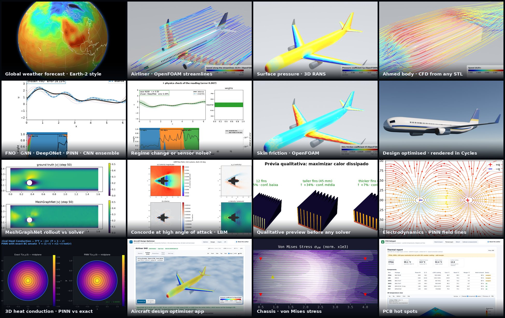
</div>

---

## Statement of need

Physics-informed neural networks, neural operators (DeepONet, FNO), graph networks on meshes and classical solvers each
live in their own library, with their own problem description, and they are usually judged by their error against a
reference solution that does not exist once a model is used on new cases. PINNeAPPle is for researchers and engineers
in computational science who train or compare physics-based surrogate models and need to know when those models stop
being valid. It gives every method one problem description, a comparison interface and a record of each run, and it
checks each prediction against the physics (equation residuals, conservation, bounds and each model's declared
assumptions) without needing a reference. It bridges to DeepXDE and PhysicsNeMo instead of replacing them. See
[`paper/paper.md`](paper/paper.md) for how it relates to other libraries.

## The whole Physics-AI workflow, not only PINNs

Physics-informed neural networks are one tool among several. PINNeAPPle covers the workflow industrial Physics-AI runs on:

| Step | In the library |
|---|---|
| Geometry | CAD and parametric shapes, fit-for-purpose meshes and their quality report (`pinneapple_design`, `pinneapple_data.cae`) |
| Simulation campaigns | OpenFOAM, CalculiX, lattice Boltzmann and spectral solvers, run many times over a design space (`pp.cfd`, the OpenFOAM campaign runner) |
| Surrogates | neural operators (FNO, DeepONet), graph networks (MeshGraphNet), MLPs and reduced-order models trained on those campaigns |
| Physics-informed models | PINNs from symbolic equations (`PINNFactory`), inverse problems, hard constraints |
| Optimisation | design search on top of a surrogate, verified back in the solver |
| Verification | grid convergence, physics audit, applicability domains, evidence records, equal-budget benchmarks (`pp.benchmark`, `pinneapple benchmark run`) |

Which learned method fits which problem is a question of evidence, not of taste: see
[Choosing a method](docs/guides/choosing_a_method.md) and the equal-budget benchmark behind it.

## What makes it different

Most Physics AI libraries stop at the prediction. PINNeAPPle adds a **trust layer**, so a model can say how good it is right now:

- **"This model just left its domain."** Every model's PDE residual on the current case, compared with its level in its own domain, switches the ensemble on the **first** case of a new regime instead of after errors pile up.
- **"Why did it fail?"** Each model declares its physical assumptions (laminar, incompressible, smooth wall...); the physics audit checks them on every case, routes to a model whose physics fits, and attributes failures to a regime change, extrapolation, a numerical problem or missing physics, even when the residual looks fine. See [docs/core_concepts/physics_audit.md](docs/core_concepts/physics_audit.md).
- **"That was the sensor, not the process."** A physics check of the reading itself keeps sensor noise from switching models or teaching them anything.
- **"Trust this forecast for 3.8 days."** Skill by lead time and a useful horizon for every forecast, next to the operational models.
- **"Here is the evidence."** Conservation and boundary-condition checks, uncertainty, provenance and a decision layer that only learns from verified results.

<div align="center">

| | |
|:---:|:---:|
| 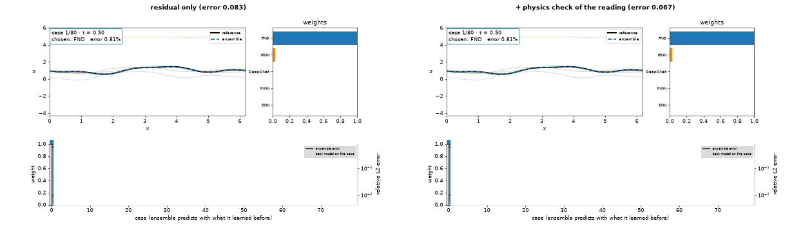 | 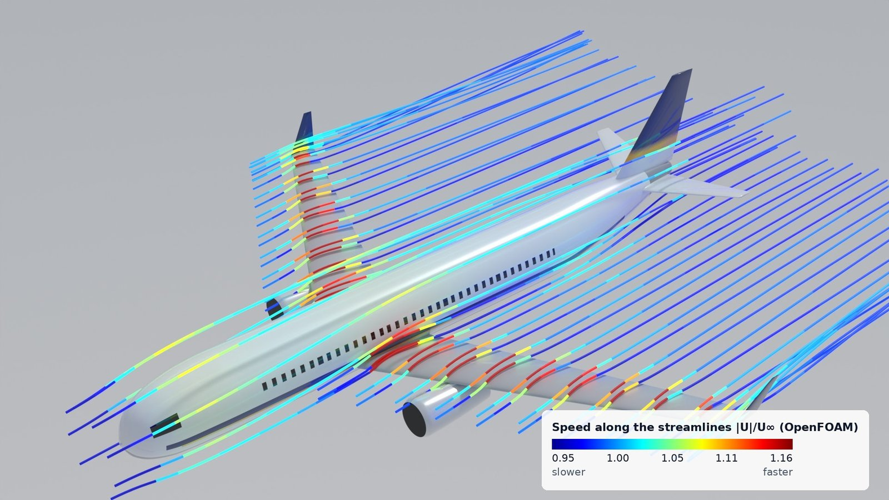 |
| **Regime change or sensor noise?** Five model families (FNO, GNN, DeepONet, PINN, CNN); with the physics check of the reading (right), noisy readings never switch the model. | **OpenFOAM in the loop.** An airliner designed and optimised in the library, verified with 3D RANS; streamlines coloured by speed. |
| 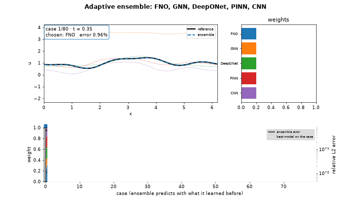 | 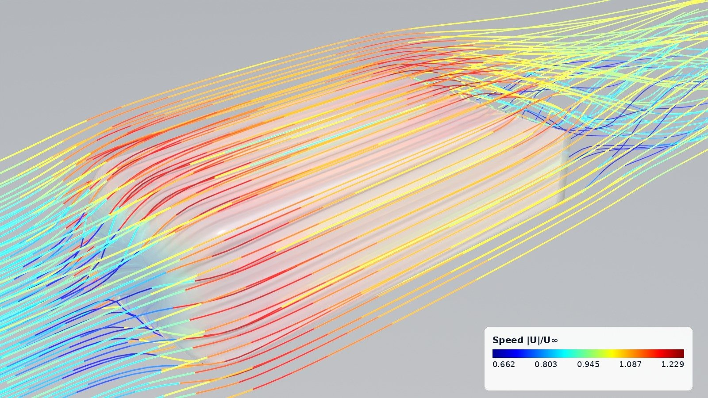 |
| **Adaptive physics ensembles.** The model chosen on each case against the exact field, as the regime drifts. | **External aerodynamics from any STL.** The Ahmed body, meshed and solved automatically. |
| 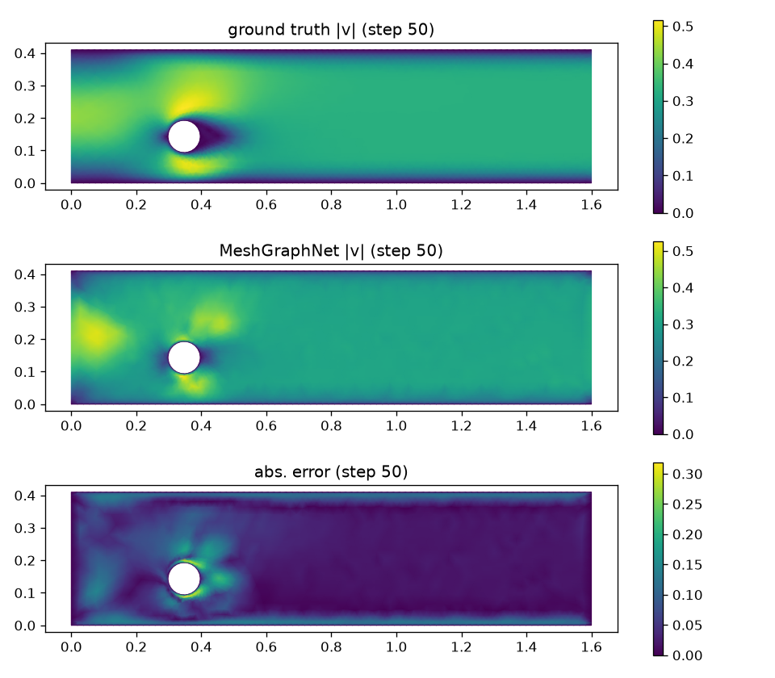 | 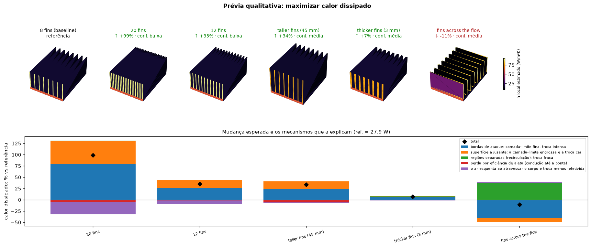 |
| **Neural operators and graph networks.** A MeshGraphNet rollout of the flow past a cylinder against the solver. | **Qualitative preview before any solver.** Which design change should help, by which mechanism, and how sure it is. |
|  |  |
| **A Formula car in OpenFOAM.** A parametric open-wheel car with wings, floor and diffuser, solved at 70 m/s with a moving road; skin pressure coefficient. | **Forces by component.** Opening the DRS flap cuts the rear-wing drag by 56 %; the wheels give part of it back. A pipeline demonstration, not a validated F1 model. |

</div>

## Physics checks in CI

`pinneapple check` is a linter for physics: it fails a pull request when a simulation result or a Physics-AI model
breaks conservation, its PDE, its boundary or initial conditions, bounds, units, its training range, a stored
reference or the integrity of its files. Zero configuration to start, rule ids with fixes (`PC101`...), exit
codes, SARIF and JUnit; the GitHub Action annotates the line that caused the violation.

```yaml
# .github/workflows/physics-check.yml, in a job with `permissions: security-events: write`
- uses: actions/checkout@v4
- uses: PINNeAPPle-Labs/PINNeAPPle@main    # pin a tag or a commit SHA
```

```bash
pinneapple check cases/ models/            # locally: same rules, readable output, exit code 1 on a violation
```

<div align="center"></div>

Rules, configuration and the Action: [docs/guides/physics_checks_in_ci.md](docs/guides/physics_checks_in_ci.md).

## Discovering physical laws from data

The same library that solves equations also finds them. Each discovery is an experiment in the [PINNeAPPle Lab](docs/core_concepts/lab.md), with its data, code, checks and figures in the database:

<div align="center">

| | |
|:---:|:---:|
|  |  |
| **Law from video, video from the law.** The angle is measured from the frames (left). Weak-form sparse regression finds θ'' = −0.152 θ' − 12.23 sin θ, so g = 9.787 m/s² (0.24 % off). The discovered law is re-rendered (right) and keeps predicting after the camera stops. | **Kepler's third law from real orbits.** Nineteen bodies around the Sun, Jupiter and Saturn (NASA fact sheets) give P ∝ a^1.4999 and the masses of the three centres within 0.1 %. All of them collapse onto P = 2π√(a³/GM). |
|  | 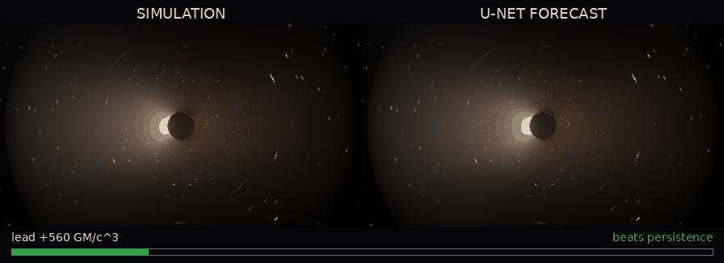 |
| **Chaos, AI-Lorenz style.** From noisy, subsampled data, extreme-learning-machine smoothing (the free function of X-TFC) plus sparse selection recovers σ, ρ, β within 2 %. | **Black-hole weather.** A U-Net forecast of the gas around a black hole (Duarte, Nemmen & Navarro 2022), ray-traced through curved spacetime, with the mass check that flags drift without the truth. |

</div>

```bash
python -m pinneapple_lab run pendulum_video          # or kepler_law, lorenz_discovery, ...
python -m pinneapple_lab report --html               # lab/index.html: every run, its checks, its code, its data
python -m pinneapple_lab examples --run              # every example and use case, into the same database
python -m pinneapple_lab serve                       # the catalogue as a web app: files, JSON API, dataset downloads
```

---

## Experiment gallery

Every picture below is a lab run with its checks against a reference. The whole set, with tiers and trust cards, is
in the **[experiment catalogue](https://pinneapple-labs.github.io/PINNeAPPle/lab/)** (`python -m pinneapple_lab site`).

| | |
|---|---|
| 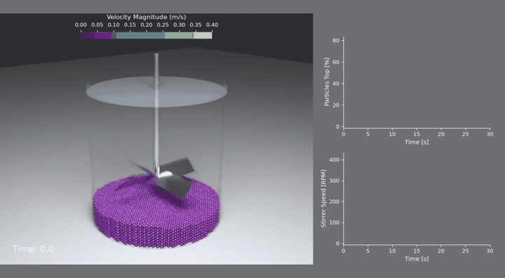 | 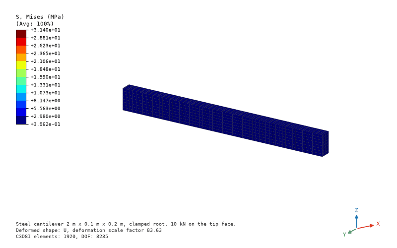 |
| **Solids suspension in a stirred tank** ([MP4](docs/assets/lab/stirred_tank.mp4)): 90 % off the bottom at 288 rpm, inside Zwietering's 237-474 rpm (`particle_suspension`) | **3-D FEA, C3D8I hexahedra**: tip deflection within 0.6 % of Timoshenko, CalculiX on the same mesh within 3e-6 (`solid_fem`) |
| 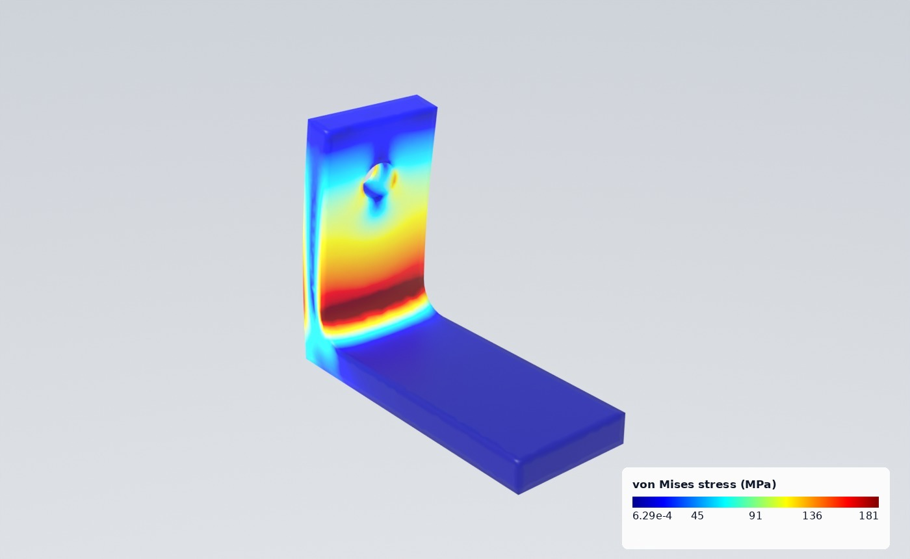 | 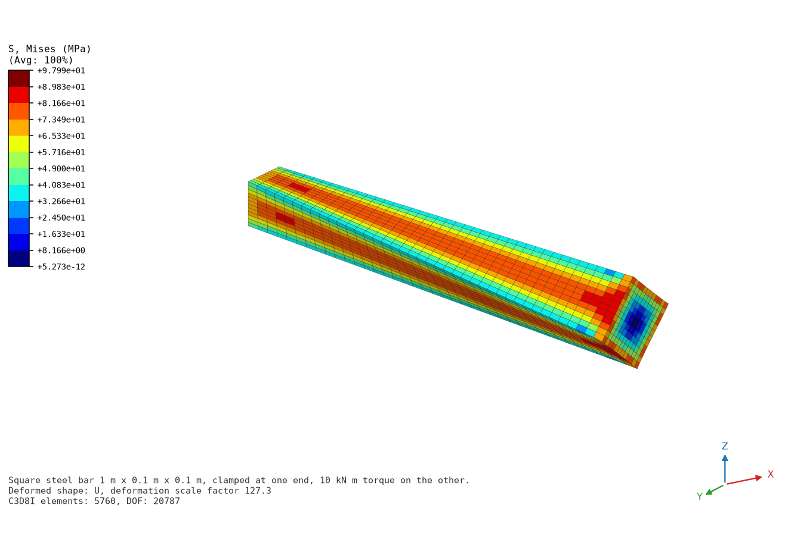 |
| **CalculiX from Python** (`pp.fea`): gmsh C3D10 bracket, bending stress vs M c / I, fillet peak converged (`calculix_case`) | **Square bar in torsion**: twist rate and shear within 1 % of Saint-Venant |
| 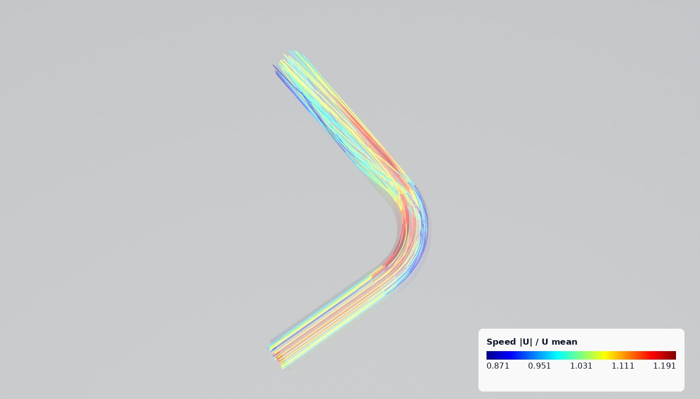 | 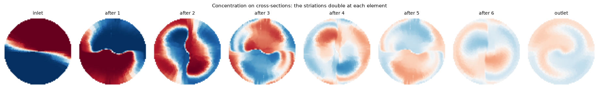 |
| **90° pipe bend, k-omega SST**: friction within 3.6 % of Colebrook, Dean vortices (`pipe_flow`) | **Kenics static mixer**: striations double at each element, 6x better mixing than the empty pipe |
| 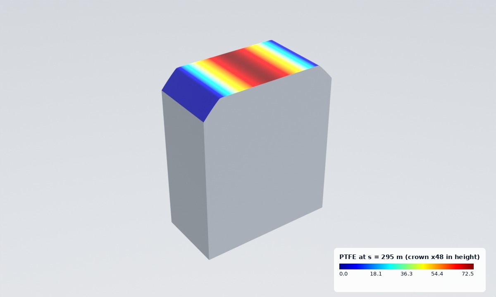 | 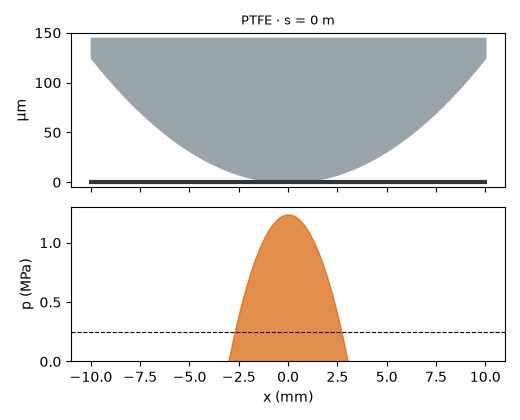 |
| **Sliding wear of eight materials**: worn volume = K F s exactly, steady rate vs flat punch (`bar_wear`) | **Running-in**: contact pressure from a Hertz-like peak to a flat punch |
| 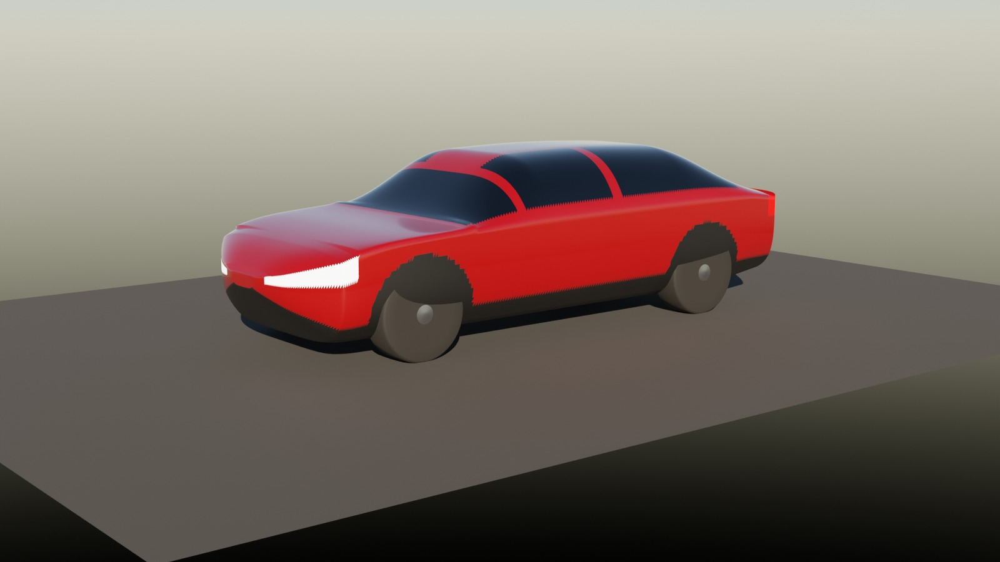 | 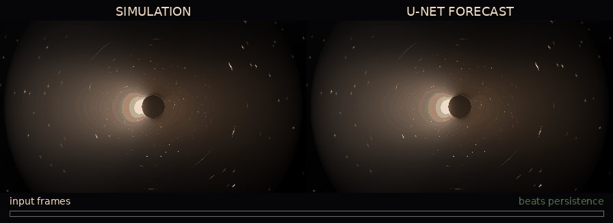 |
| **Road car, OpenFOAM 3-D**: CD 0.288 (`vehicle_cfd`) | **Black-hole weather**: forecast vs simulation (`repo_results`) |
| 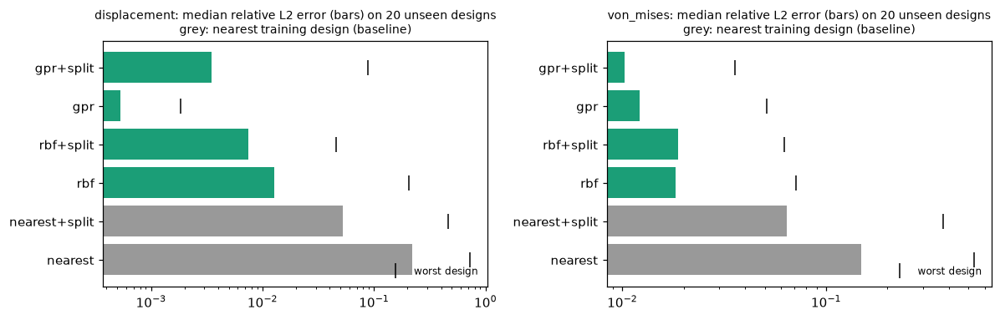 | 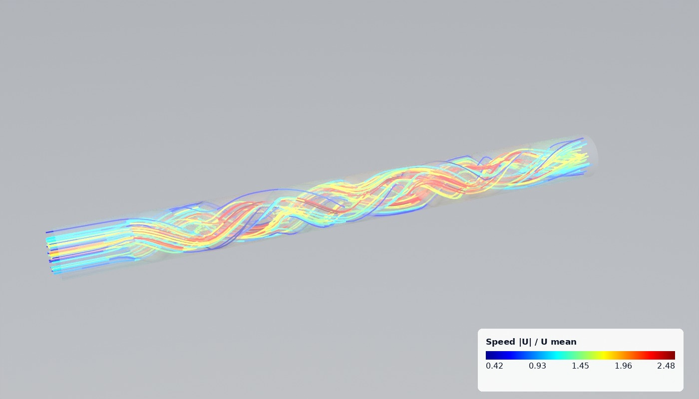 |
| **Reduced-order models**: POD-GPR of a 3-D FEM beam, 0.4 % median error on unseen designs, 16 000x faster (`rom_study`) | **Static mixer streamlines** through six Kenics elements |

## Install

```bash
pip install pinneapple
pip install "pinneapple[all]"     # every optional backend (solvers, geometry, FEniCS, ONNX, ...)
```

Or start in the browser, on a free Colab GPU (each notebook installs PINNeAPPle in its first cell):

| Notebook | |
|---|---|
| First PINN: heat in a plate, with its physics checks | [](https://colab.research.google.com/github/PINNeAPPle-Labs/PINNeAPPle/blob/main/notebooks/colab/01_first_pinn_heat.ipynb) |
| Airfoil: geometry, surrogate prediction, validation against stored CFD | [](https://colab.research.google.com/github/PINNeAPPle-Labs/PINNeAPPle/blob/main/notebooks/colab/02_airfoil_surrogate.ipynb) |
| Equal-budget benchmark of methods | [](https://colab.research.google.com/github/PINNeAPPle-Labs/PINNeAPPle/blob/main/notebooks/colab/03_equal_budget_benchmark.ipynb) |
| Lunar rover terramechanics and its animated dashboard | [](https://colab.research.google.com/github/PINNeAPPle-Labs/PINNeAPPle/blob/main/notebooks/colab/04_lunar_rover_dashboard.ipynb) |
| Verify a model: the trust card catching bad predictions | [](https://colab.research.google.com/github/PINNeAPPle-Labs/PINNeAPPle/blob/main/notebooks/colab/05_verify_a_model.ipynb) |

Working with a coding agent (Gemini CLI, Antigravity, Claude Code, Codex, Cursor)? [`AGENTS.md`](AGENTS.md) is the
guide it should read, and `pip install "pinneapple[mcp]"` adds an MCP server, `pinneapple-mcp`, with tools to solve,
benchmark and validate ([how to plug it in](docs/guides/mcp_server.md)).

## Five things to try

<details open>
<summary><b>1. Solve a PDE and compare against the exact solution</b></summary>

```python
import pinneapple as pp

prob = pp.PhysicalProblem.from_preset("burgers_1d", nu=0.01 / 3.141592653589793)
exact = pp.solve(prob, "analytic")                      # Cole-Hopf closed form
pinn = pp.solve(prob, "pinn", epochs=4000)            # physics-informed network
print(pp.compare(prob, ["pinn"], reference="analytic", options={"pinn": {"epochs": 4000}}))
```
`pp.Experiment(...).run()` records the result with the problem's fingerprint; add your own method with `@pp.register_method("name")`.
</details>

<details>
<summary><b>2. An ensemble that notices a regime change on its first case</b></summary>

```python
import numpy as np
from pinneapple_physics.advection_diffusion_1d import AdvectionDiffusion1D
from pinneapple_physics.ensemble import PhysicsEnsemble, from_callable

ad = AdvectionDiffusion1D()                             # u_t + c u_x = nu u_xx, exact solutions
experts = [from_callable("surrogate A (built for nu=0.01)", lambda q: ad.exact({**q, "nu": 0.01})),
           from_callable("surrogate B (built for nu=0.2)", lambda q: ad.exact({**q, "nu": 0.2})),
           from_callable("upwind scheme", lambda q: ad.finite_difference(q, "upwind"))]

rng = np.random.default_rng(0)                          # the diffusivity jumps half way: a regime change
cases = [ad.random_case(rng, nu) for nu in [0.01] * 30 + [0.2] * 30]

def implausible(q):                                     # physics on the reading itself: energy a real state lacks
    e = np.abs(np.fft.rfft(q["u0"])) ** 2
    return e[8:].sum() / e.sum() > 1e-4

ens = PhysicsEnsemble(experts, mode="select",
                      residual_fn=ad.residual, residual_lookahead=2.0,   # switch on the first new case
                      measurement_check=implausible)                     # sensor noise never switches it
run = ens.run(cases, [ad.exact(q) for q in cases])
print(run.switches(), run.summary()["ensemble"])
```
Output: `[(0, 'surrogate A (built for nu=0.01)'), (30, 'surrogate B (built for nu=0.2)')] 0.0`. The switch is at case 30, the first case of the new regime. Without `residual_lookahead` it takes five cases, and the error is 0.0103. See [docs/core_concepts/physics_ensembles.md](docs/core_concepts/physics_ensembles.md).
</details>

<details>
<summary><b>3. Know which design change should help, before simulating</b></summary>

```python
from pinneapple_design.geometry.bodies import box
from pinneapple_design.qualitative import Assembly, preview

def heat_sink(n_fins):                                  # base + fins along the flow (x), metres
    parts = {"base": box((0.08, 0.06, 0.004), (0.04, 0, 0.002))}
    for i in range(n_fins):
        y = -0.03 + 0.00075 + i * (0.06 - 0.0015) / (n_fins - 1)
        parts[f"fin{i}"] = box((0.08, 0.0015, 0.03), (0.04, y, 0.019))
    return Assembly(parts)

p = preview({"8 fins": heat_sink(8), "20 fins": heat_sink(20)}, "maximize heat rejection",
            conditions={"U": 2.0, "dT": 40.0, "base_part": "base"}, lang="en")
print(p.text())                                         # direction, mechanisms, confidence, before any solver
```
Then `p.quantify(...)` runs the accurate physics on the variants worth it and reports where the qualitative reading was right ([examples/qualitative](examples/qualitative)).
</details>

<details>
<summary><b>4. A 3D digital twin in the browser</b></summary>

```python
import numpy as np, trimesh
from pinneapple_twin3d import Scene

pipe = trimesh.creation.cylinder(radius=0.05, height=1.0, sections=48)
wear = np.linspace(0, 1, 3)[:, None] * np.abs(pipe.vertices[:, 2])[None, :]     # (time, vertex)
sc = Scene("Pipe wear", times=[0, 1, 2], time_unit="year")
sc.add_trimesh("pipe", pipe, group="line A")
sc.add_field("pipe", "wear_depth", wear, unit="mm")
sc.add_sensor("PT-101", (0.0, 0.06, 0.3), unit="bar", series=[4.1, 4.0, 3.8], envelope=(3.5, 5.0))
sc.export("out/pipe_twin")                                          # scene.json + geometry.glb + fields.bin + web viewer
```
Open `out/pipe_twin/index.html`: geometry, the field over time, sensors with their operating envelopes. USD export for Omniverse with `usd=True`.
</details>

<details>
<summary><b>5. A global weather forecast, Earth-2 style</b></summary>

```python
from pinneapple_physics.weather.data import download, Era5Store
from pinneapple_physics.weather.train import Forecaster
from pinneapple_physics.weather.viz import earth2_gif

ck = "examples/weather_forecasting/checkpoints/"
store = Era5Store(download("wx/era5", (2021, 2021), normalization=ck + "era5_64x32_normalization.json"))  # public ERA5
fc = Forecaster.load(ck + "phase1_step15000_fp16.pt", store)

i = store.index("2021-06-23T00")                        # five days before the 2021 heat dome
x = store.state[i - 1:i + 1]
f = store.denorm(fc.rollout(x[1], x[0], store.times[i], steps=24)[0])           # 6 days, every 6 h
t = store.denorm(store.state[i:i + 25])
c = store.channels.index("t2m")
earth2_gif("heat_dome.gif", "t2m", t[:, c], f[:, c], store.lat, store.lon, store.times[i:i + 25],
           lead_hours=range(0, 145, 6), horizon={"useful_hours": 91, "no_skill_hours": 96},
           title="Heat dome, June 2021", center=(42, -128))
```
ERA5 comes from the public WeatherBench2 bucket, no account needed. To finish training and score against IFS HRES, Pangu-Weather and NeuralGCM, see [examples/weather_forecasting](examples/weather_forecasting).
</details>

---

## Module map

```
PINNeAPPle
│
├── Problems and physics
│   ├── pinneapple_core           Field, Mesh, Domain, Geometry: shared primitives
│   ├── pinneapple_physics        PDE specs and presets, PINN compiler, SymPy → autograd, closed forms,
│   │                             adaptive physics ensembles, physics audit (assumptions, routing,
│   │                             failure attribution), global weather forecasting (ERA5),
│   │                             black-hole accretion and its forecasting, GR ray tracing (blackhole)
│   └── pinneapple_problemdesign  plain-language problem → PDE spec (elicitation, knowledge base, codegen)
│
├── Models and training
│   ├── pinneapple_neural         SIREN, FNO, DeepONet, AFNO, MeshGraphNet, transformers, recurrent, reservoir,
│   │                             ROMs, ...; trainers (DDP, causal, two-phase); predictors; PhysicsNeMo bridge
│   ├── pinneapple_adaptation     transfer learning and meta-learning (MAML, Reptile) across PDE families
│   ├── pinneapple_quantum        variational quantum circuits with PDE losses (VQ-PINN), simulators and hardware
│   └── pinneapple_worldmodel     a physics foundation model trained across domains, synthetic data factory
│
├── Simulation
│   ├── pinneapple_simulation     FEM, FDM, FVM, spectral, SPH, LBM, MPM; OpenFOAM, FEniCS, CalculiX, FMU bridges;
│   │                             geophysics
│   └── pinneapple_systems        time series, co-simulation graphs, digital twins (EKF/EnKF), process components
│
├── Trust, verification and decisions
│   ├── pinneapple_analysis       uncertainty, validation, verification, inverse problems, data assimilation,
│   │                             state estimation, trust and cost
│   ├── pinneapple_decision       probabilistic decision layer: which experiment next, under hard constraints,
│   │                             learning only from verified results
│   └── pinneapple_security       manifests, signatures, provenance (in-toto/SLSA), SBOM, audit trail, privacy,
│   └── pinneapple_veriphysics    Decision Record, evidence report, applicability map, robustness, recommendation
│                                 physics-residual detection of manipulated sensor data
│
├── Data and perception
│   ├── pinneapple_data           datasets, CAE mesh and field I/O, simulation metadata, preflight, lineage, synthesis
│   ├── pinneapple_perception     physics from images, video and audio (PIV, geometry, modal frequencies)
│   ├── pinneapple_pdb            physics database: templates, shards, derived quantities, benchmarks
│   └── pinneapple_catalog        what the library knows about, with sources
│
├── Design
│   └── pinneapple_design         SDF/CSG geometry, aero (VLM, airliner), thermal (heat sinks), qualitative preview,
│                                 adjoint, Bayesian and evolutionary optimisation
│
├── Visualisation and experience
│   ├── pinneapple_twin3d         3D digital twins in the browser (glTF/USD), OpenFOAM scenes, scans, Blender renders
│   ├── pinneapple_blender        fields and trajectories to Blender, Cycles renders
│   ├── pinneapple_tools          plots, model export (ONNX, TorchScript), HPO, benchmark suite, sandboxes
│   └── pinneapple_app            web app for benchmarking models on physics problems
│
└── Operations
    ├── pinneapple_lab            experiment runner and database: runs, checks, code, datasets, HTML catalogue,
    │                             law-discovery experiments
    ├── pinneapple_arena          YAML-driven multi-model benchmarks (80+ architectures)
    ├── pinneapple_registry       self-hosted model and dataset registry, experiment tracking
    ├── pinneapple_hub            push_to_hub / from_pretrained with model cards
    ├── pinneapple_orchestration  Prefect pipelines
    └── pinneapple_llm            LLM-drafted pipelines gated by a physics guardrail
```

`pinneapple_models`, `pinneapple_solvers` and `pinneapple_train` are compatibility aliases of the modules above.

---

## Use cases you can run

| Area | Example | What it shows |
|---|---|---|
| Weather | [`examples/weather_forecasting`](examples/weather_forecasting) | Global ERA5 model, skill by lead against IFS/Pangu/NeuralGCM, seven extreme events |
| Ensembles | [`examples/physics_ensemble`](examples/physics_ensemble) | Five model families, regime detection, sensor noise against regime change |
| Aerodynamics | [`apps/aero_optimizer`](apps/aero_optimizer), [`examples/use_cases/concorde_high_aoa`](examples/use_cases/concorde_high_aoa), [`examples/use_cases/missile_aero`](examples/use_cases/missile_aero) | Design optimisation with OpenFOAM verification, high angle of attack |
| Thermal | [`apps/heatsink_sizer`](apps/heatsink_sizer), [`apps/pcb_hotspot`](apps/pcb_hotspot), [`examples/use_cases/fin_convection_inverse`](examples/use_cases/fin_convection_inverse) | Sizing, hot spots, inverse convection |
| Structures | [`examples/use_cases/solid_mechanics`](examples/use_cases/solid_mechanics), [`examples/use_cases/crash_surrogate`](examples/use_cases/crash_surrogate), [`examples/calculix_cantilever`](examples/calculix_cantilever) | FEM surrogates, crash, CalculiX bridge |
| Digital twins | [`examples/use_cases/heated_channel_twin`](examples/use_cases/heated_channel_twin), [`examples/use_cases/drill_pipe_surrogate`](examples/use_cases/drill_pipe_surrogate) | Live twins, surrogates in the loop |
| Field robotics | [`examples/use_cases/terramechanics`](examples/use_cases/terramechanics) | Wheel-soil physics |
| Synthetic data | [`examples/use_cases/physics_data_factory`](examples/use_cases/physics_data_factory) | Simulation → rendered images for training |
| Design | [`examples/qualitative`](examples/qualitative) | Qualitative preview, then the quantitative check |

The Engineering Apps in [`apps/`](apps) (heat-sink sizer, PCB hot spots, mesh quality, simulation preflight and comparator, model lineage, interoperability hub, ...) are FastAPI services with a web front end, built on the library.

**Flow Studio** ([`apps/flow_studio`](apps/flow_studio/README.md)): describe a problem in words, get proposed node graphs (domain, editable equations, classical solvers, PINNs, neural operators, inverse problems, validation with the Lab seal, digital twin, ...), edit and run them on a canvas, or headless with `python -m pinneapple_flow run flow.json`. `pip install -e ".[flow]"` then `python -m pinneapple_flow studio`.

<div align="center">

| | | |
|:---:|:---:|:---:|
| 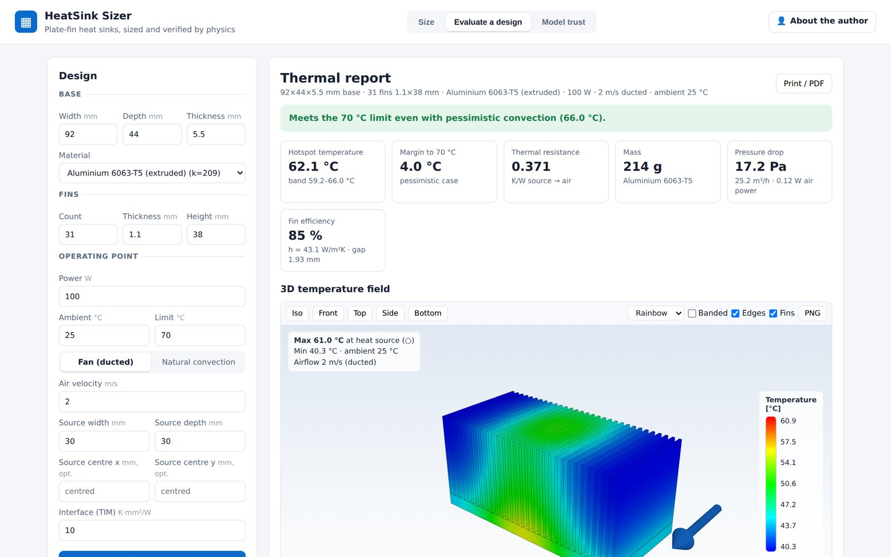 | 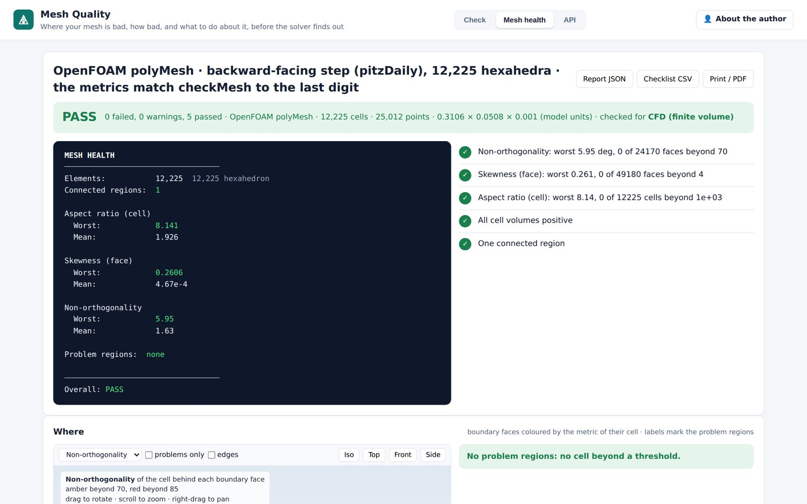 | 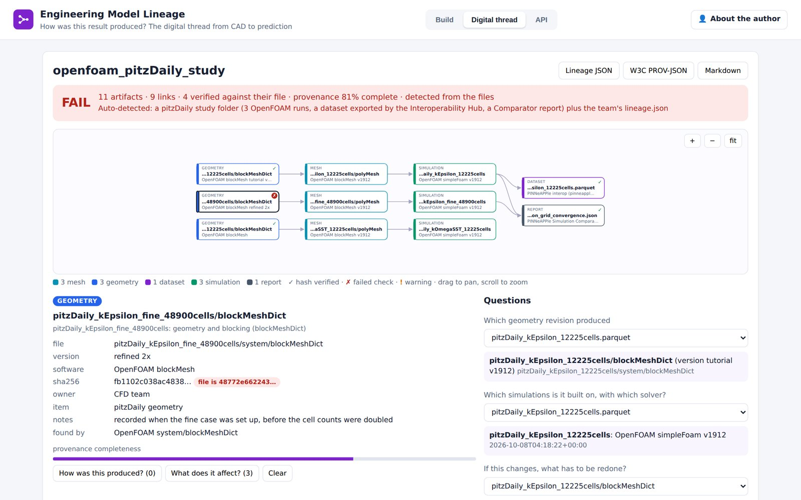 |
| Heat-sink sizer | Mesh quality | Model lineage |

</div>

---

## Releases

| release | theme | tracking issue |
|---|---|---|
| **v0.7.0** | Foundations you can trust: one front door, the Experiment record with provenance (PINNeAPPle Lab), benchmark protocol, units, plugins, CI tiers | [#420](https://github.com/PINNeAPPle-Labs/PINNeAPPle/issues/420) |
| **v0.8.0** | Surrogates with evidence: validation cards, V&V reports, FMU export, measured cost, active learning, multi-fidelity, law discovery, vision | [#421](https://github.com/PINNeAPPle-Labs/PINNeAPPle/issues/421) |
| **v0.9.0** | Twins and discovery at scale: digital twins with real sensors and OpenUSD, equation discovery in the Experiment flow, reproducibility, weather horizons | [#422](https://github.com/PINNeAPPle-Labs/PINNeAPPle/issues/422) |
| **v1.0.0** | Stable API: freeze, governance, security and supply chain, agent tool registry | [#423](https://github.com/PINNeAPPle-Labs/PINNeAPPle/issues/423) |

## Roadmap

- **Core** ([#343](https://github.com/PINNeAPPle-Labs/PINNeAPPle/issues/343)):
  - a trust object attached to every prediction (`pp.trust`);
  - data assimilation with neural models;
  - adaptive fidelity driven by the trust horizon;
  - "bring your foundation model, PINNeAPPle verifies it";
  - a trust benchmark with a public leaderboard;
  - embedded execution for drones and robots;
  - generic event scoring;
  - sensor placement;
  - evolutionary methods where gradients cannot help (symbolic regression for closures, quality-diversity search for designs and for the cases where models fail).
- **New areas** ([#327](https://github.com/PINNeAPPle-Labs/PINNeAPPle/issues/327)):
  - satellite nowcasting;
  - robotics and drones;
  - river discharge from video;
  - floods, fire, landslides and tailings dams;
  - methane from space and air quality;
  - batteries;
  - manufacturing drift;
  - structural health;
  - agriculture;
  - oil, gas and CO2 storage;
  - power grids;
  - maritime;
  - additive manufacturing.
- **Law discovery** ([#428](https://github.com/PINNeAPPle-Labs/PINNeAPPle/issues/428)):
  - from real data: Hubble-Lemaître, gyrochronology, galaxy rotation, exoplanet relations, tides, drag laws;
  - from images and video: smartphone mechanics, vortex streets, jet breakup, crack growth, droplets;
  - the inverse: law to labelled video at scale, and video to parameters with a trust flag.
- **Showcases** ([#344](https://github.com/PINNeAPPle-Labs/PINNeAPPle/issues/344)):
  - flagships: a hurricane from satellite to street, the drone that knows it is broken, a phone video to river discharge, an aircraft designed in an afternoon, a battle of the models;
  - moonshots from first principles ([#427](https://github.com/PINNeAPPle-Labs/PINNeAPPle/issues/427)): a Starship-style heat shield, full-flow engines, Mars propellant plants, battery runaway, humanoids, low-pressure tubes, rapid hardware iteration;
  - science fiction with real physics: terraforming Mars, a tidally locked exoplanet, a warp bubble that shows where it breaks physics, a space elevator, a fusion tokamak, weather inside an O'Neill cylinder, flying on Mars and Titan, planetary defence, listening to black holes.

---

## Philosophy

> *If you can't validate it, you shouldn't deploy it.*

Correct formulations, reliable validation, understanding failure modes, and decisions made on evidence.

## Citation

If you use PINNeAPPle in your research, please cite it. [`CITATION.cff`](CITATION.cff) holds the citation metadata
(GitHub shows it under "Cite this repository"):

```bibtex
@software{pinneapple2026,
  title        = {PINNeAPPle: An Open-Source Physics AI Research and Experimentation Platform},
  author       = {Barros, Yan and Schiassi, Enrico},
  year         = {2026},
  url          = {https://github.com/PINNeAPPle-Labs/PINNeAPPle},
  version      = {0.7.0},
  doi          = {10.5281/zenodo.23343062}
}
```

## Contributing and support

Contributions are welcome: see [CONTRIBUTING.md](CONTRIBUTING.md) for the development setup, tests and pull request
rules, and [CODE_OF_CONDUCT.md](CODE_OF_CONDUCT.md). Report bugs and request features in the
[issue tracker](https://github.com/PINNeAPPle-Labs/PINNeAPPle/issues); report security problems privately as described
in [SECURITY.md](SECURITY.md).

If this project makes sense to you, **give it a star** ⭐: it helps grow the ecosystem and attract contributors.

<div align="center"><sub>Built for researchers and engineers who take physics seriously.</sub></div>
