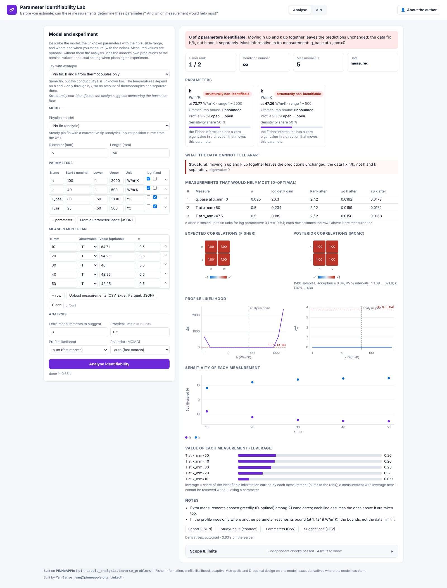

# Parameter Identifiability Lab (day 25)

**Before estimating parameters, check that the measurements can determine them.** Live at
<https://identifiability.pinneapple.org> (port 8108).



## Pain

Several parameter sets often explain the same experiment equally well. A fin's thermocouples fit any pair (h, k)
with the same h/k. A cooling curve fits any pair (h, C) with the same h/C. Kinetics measured at one temperature fit
a whole line of (A, Ea). A calibration still returns numbers in these cases, and nobody can tell that they are
arbitrary. This lab answers the question first, before the experiment is run or before the calibration is trusted,
and says what to measure instead.

## Input

- **A model.**
  - Built in: pin fin (analytic), fin with zone-wise h(x) (finite volumes), 2D heat-spreader plate, lumped-capacitance
    cooling, Arrhenius kinetics.
  - Your own formula, for example `T_air + (T0 - T_air)*exp(-h*A*t/C)`. It is parsed safely, never evaluated as code.
  - A table of your simulated runs, interpolated over the parameters.
- **The unknown parameters**: a nominal value, a plausible range, units and log scale. They can also be loaded from a
  `ParameterSpace` contract.
- **The measurement plan**: where and when you measure (positions, times, temperatures), which observable each
  measurement is, and its noise σ. You can type the rows or upload a table (CSV, Excel, Parquet or JSON; sensor exports
  with decimal commas work). Measured values are optional. Without them, the analysis uses the model's own predictions
  at the nominal values, the usual setting when planning an experiment. With them, the model is fitted first.

## Output

- **A verdict for each parameter**: identifiable, practically non-identifiable (these data cannot determine it), or
  structurally non-identifiable (no data of this kind could). It comes with the Cramér-Rao bound, the profile-likelihood
  95 % interval and the sensitivity share.
- **Ambiguities**: the parameter combinations the data cannot tell apart, and the combination they do fix
  (for example "the data fix h/k").
- **Correlations**: the expected ones from the Fisher information, and the posterior ones from MCMC.
- **The value of each measurement**: its leverage, meaning its share of the identifiable information.
- **The extra measurements that would help most** (greedy D-optimal design among candidate positions, times,
  temperatures or other observables), with the rank and the bounds each one would give.
- **Downloads**: the full report (JSON); a `StudyResult` contract (`study_type="identifiability"`) that the
  calibration, inverse and uncertainty apps read; and CSV tables.

## Integrations

- **REST API** at `/docs`. `POST /api/analyze` queues an analysis, and `GET /api/jobs/{id}` returns its status, progress
  and result (shared job queue).
- **API keys** (`X-API-Key`) for scripts, and **usage per caller** at `GET /api/usage`.
- **Tables** in CSV, Excel, Parquet or JSON.
- **Contracts**: `ParameterSpace` in, `StudyResult` out (`pinneapple_data.contracts`).
- **The same analysis in Python**: `pinneapple_analysis.inverse_problems.analyze_identifiability`.

## Methods

All of them come from `pinneapple_analysis.inverse_problems` (guide:
[docs/guides/identifiability_calibration_inversion.md](../../docs/guides/identifiability_calibration_inversion.md)):

- **Fisher information** `F = J^T Σ^-1 J`, with J computed in scaled parameters (ln for positive constants). Its rank
  gives local structural identifiability; its eigen-directions give the ambiguities; its inverse gives the Cramér-Rao
  bounds and the expected correlations. The derivatives are exact where the model has them (the finite-volume fin's
  sensitivities, PyTorch autograd); otherwise they are central differences.
- **Local sensitivity and leverage** of every measurement.
- **Profile likelihood** (Raue et al., Bioinformatics 25, 2009). Each re-fit starts on the ridge the Fisher information
  predicts. A profile that rises only because another parameter hits its bound is reported as such, not as a closed
  interval.
- **Bayesian posterior** by adaptive Metropolis (Haario et al., 2001), with flat priors inside the bounds.
- **D-optimal design**: greedy maximisation of log det F (determinant lemma), with distinct picks.

## What the examples show

Measured on this server's examples (synthetic measurements from a known truth plus Gaussian noise, fixed seeds):

| Example | Verdict | Suggested measurement |
|---|---|---|
| Pin fin, h and k from 5 thermocouples | rank 1 of 2: only h/k is determined | base heat flow (raises the rank to 2) |
| Same fin plus a ±2 % heat-flux meter | both identifiable; profile 95 % intervals h 24.1–26.2 W/m²K, k 15.4–16.8 W/m·K (truth 25 and 16) | — |
| Cooling curve, h and C unknown | T0 and T_air identifiable; h and C only as h/C | — |
| Arrhenius at 360 K only | rank 1 of 2: A and Ea not separable | a run at another temperature (400 K) |
| Arrhenius at 360 K and 390 K | both identifiable; profile 95 % interval Ea 72.2–76.5 kJ/mol (truth 75) | — |

Every example runs in under 3 s.

## Limits

- The Fisher rank and the Cramér-Rao bounds are local: they hold at the analysis point (the nominal values, or the
  best fit). This is a numerical test, not a symbolic proof of global identifiability. Check the profile likelihood.
- The model form is assumed right. A missing physical effect is not detected here; calibrate and validate on held-out
  data for that (Model Calibration Lab).
- Noise is independent and Gaussian with the σ you give. A shared sensor offset makes parameters less identifiable
  than reported unless you add it as a parameter.
- The profile likelihood and the posterior run only for fast models with at most 6 parameters; the posterior also
  needs finite bounds. The report says when they were skipped.
- At most 12 free parameters and 2000 measurements per analysis.

## Monetization

Paid per analysis, by model, number of parameters and experimental scenarios (the candidate measurements the design
evaluates). The units are metered per caller and month: `analyses`, `parameters`, `scenarios`, with free limits set
by `IDENT_FREE_*`. A team plan raises the limits and adds API keys for CI and design-of-experiments scripts.

## Run it

```bash
pip install -e . -r apps/identifiability_lab/requirements.txt
cd apps/identifiability_lab && uvicorn identifiability_lab.api:app --port 8108
# or: docker build -f apps/identifiability_lab/Dockerfile -t identifiability-lab . && docker run -p 8108:8108 identifiability-lab
```

| Variable | Default | Meaning |
|---|---|---|
| `IDENT_USER` / `IDENT_PASSWORD` | unset | HTTP Basic login on everything but `/health` |
| `IDENT_MAX_JOBS` | 2 | analyses running at once over all workers; the rest wait in the queue |
| `IDENT_FREE_ANALYSES`, `IDENT_FREE_PARAMETERS`, `IDENT_FREE_SCENARIOS` | 100, 600, 5000 | free use per caller and month (`unlimited` lifts it) |
| `IDENT_ADMIN_TOKEN` | unset | `X-Admin-Token` to manage API keys without the login |
| `IDENT_DATA_DIR` | `/data/identifiability` | SQLite with jobs, keys and usage; uploads |

Tests: `pytest tests/test_app_identifiability_lab.py`.
