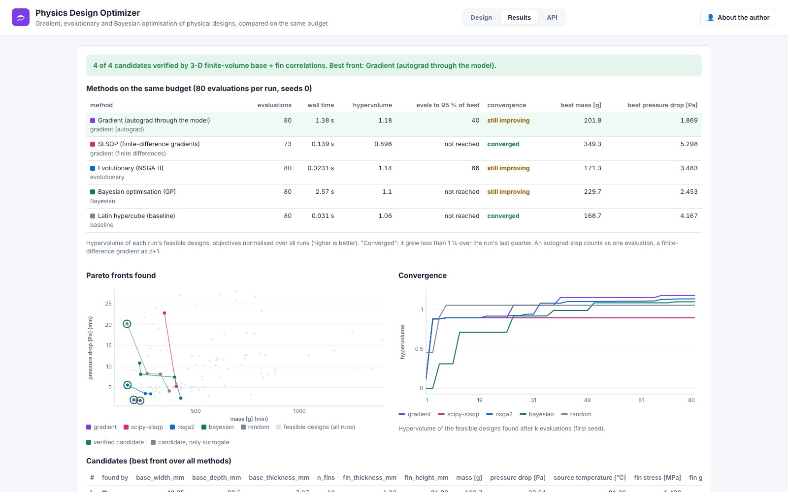

# Physics Design Optimizer

**Optimise parametric physical designs with explicit objectives, constraints and physics models, gradient-aware:
compare gradient, evolutionary and Bayesian methods on the same problem and budget, and see which candidates the
high-fidelity model confirms.** Day 23 of the PINNeAPPle app series; live at `https://design.pinneapple.org`.



## The pain

Physics AI promises gradients through the model: a differentiable surrogate, a PINN or a neural operator lets an
optimiser follow derivatives instead of sampling blindly. Whether that beats NSGA-II or Bayesian optimisation on a
given problem is rarely measured. Where it is measured, the methods usually got different budgets, and the "optimal"
design is a surrogate prediction nobody re-ran in the solver.

## Input

- **Design parameters and geometry** (parametric):
  - a **plate-fin heat sink**: base width, depth and thickness, fin count, fin thickness and height;
  - a **CST airfoil**: six Kulfan shape weights plus the angle of attack.
- **Objectives**:
  - heat sink: mass, pressure drop, cost, temperature or resistance;
  - airfoil: drag and spar depth.
- **Constraints**:
  - heat sink: source temperature, pressure drop, fin stress under a shock load, extrusion gap and height-to-gap;
  - airfoil: lift, pitching moment, trailing-edge thickness.
- **Evaluator**:
  - heat sink: the `pp.zoo` MLP of the heat-sink FVM engine and the closed-form geometry, differentiable end to end; the FVM engine is the high-fidelity reference;
  - airfoil: the `pp.zoo` ensemble trained on OpenFOAM runs (differentiable).
- **Methods** to compare, the **budget** per run and the **seeds**.

## Output

- **Method comparison on equal budget**: evaluations, wall time, hypervolume (mean and range over seeds),
  evaluations needed to reach 95 % of the best front, and whether each run converged or is still improving.
- **Pareto fronts** of every method on one chart, and hypervolume against evaluations.
- **Candidates** from the best front over all methods, labelled with the method that found them.
  - Physical metrics and constraint margins (active ones flagged), and a to-scale geometry preview.
  - A **verification status**: *verified by high fidelity*, *rejected by reference*, or *only surrogate*.
- **Design files**: each candidate as **STL** or **STEP** (AP214 faceted solids, one per body), and the parameters
  as **CSV** (`candidates.csv`).
- **Other files**: `comparison.csv`, `evaluations.csv`, `candidates_to_run.csv` (the candidates' parameters only, to
  run in your solver), `study.json` (StudyResult, study type "design") and `parameter_space.json` (ParameterSpace).

## Methods

All in `pinneapple_design.design_optimizer` (guide: [docs/guides/design_studies.md](../../docs/guides/design_studies.md)):

- `gradient`: Adam through autograd, with weighted sums and a growing constraint penalty. The integer fin count is relaxed and rounded at the end.
- `scipy-slsqp`: finite-difference gradients, with the constraints as inequalities.
- `nsga2`, `scipy-de`, `bayesian` (GP, ParEGO) and a `random` Latin hypercube.
- `compare_methods` gives each method the same evaluator, budget and seeds.
- `verify_candidates` re-runs the chosen designs in the reference.

Budget accounting:

- one evaluation is one design passed to the model;
- an autograd step (forward and backward) counts as one;
- a finite-difference gradient counts as `d + 1`.

## Measured

The runs behind the screenshots: one seed, 80 evaluations per method.

- **Heat sink**, mass vs pressure drop:
  - gradient through the surrogate had the best front: hypervolume 1.18, versus NSGA-II 1.14, Bayesian 1.10, Latin hypercube 1.06 and SLSQP 0.90;
  - gradient reached 95 % of the best front after 40 evaluations and was still improving at 80;
  - all 4 candidates were verified by the FVM engine;
  - surrogate errors at the candidates were 0.24–0.91 % for temperature and pressure drop.
- **Airfoil**:
  - Bayesian optimisation (1.00) and SLSQP (0.997) had the best fronts, against NSGA-II 0.98, Latin hypercube 0.97 and gradient 0.95;
  - the candidates are surrogate predictions only.

One seed does not rank methods in general. Run several seeds (the table then shows the range) before drawing a
conclusion.

## Integrations

- **PINNs, neural operators and classical models**: any torch module plugs in as a differentiable evaluator (`TorchModuleEvaluator`); closed-form physics as a `FunctionEvaluator` with a torch path.
- **High-fidelity solvers**: the reference evaluator (the FVM engine here) or a `CommandEvaluator`.
- **The other apps**: the shared contracts.
  - The Benchmark Arena picks the model, and its `ModelRef` (`zoo:<name>`) is what this app optimises on.
  - The Engineering Design Optimizer runs the black-box side of the same core.

## Run

```bash
pip install -e . -r apps/physics_design/requirements.txt              # from the repository root
cd apps/physics_design && PYTHONPATH=../_shared uvicorn physics_design.api:app --port 8106
```

Docker: `docker build -f apps/physics_design/Dockerfile -t physics-design .` from the repository root. Deployment
is with the other apps in [`apps/deploy`](../deploy) (service `design`, port 8106).

| Variable | Default | Meaning |
|---|---|---|
| `PDO_USER`, `PDO_PASSWORD` | unset | HTTP Basic login (`/health` stays open); an `X-API-Key` also passes |
| `PDO_MAX_JOBS` | 2 | studies running at once; more wait in the queue |
| `PDO_FREE_EVALUATIONS`, `PDO_FREE_CAMPAIGNS`, `PDO_FREE_SOLVER_RUNS` | 200000, 100, 500 | free use per caller and month |
| `PDO_ADMIN_TOKEN`, `PDO_REQUIRE_API_KEY`, `PDO_DATA_DIR` | | API keys and state (see `apps/_shared/README.md`) |

## API

- `POST /api/studies` (`spec`, `methods`, `budget`, `seeds`, `n_verify`) queues a study.
- `GET /api/jobs/{id}` returns progress and the result.
- `GET /api/studies/{id}/files/{name}` returns the CSV and JSON files.
- `GET /api/studies/{id}/design/{k}.stl|.step` returns candidate `k` as a design file.
- `GET /api/presets/{preset}/baseline.stl|.step` returns the baseline design.
- Interactive docs at `/docs`.

## Monetization

Usage is metered per caller, with free monthly limits and API keys for automation:

- optimisation campaigns (studies);
- model evaluations;
- high-fidelity solver runs.

Hosted solver runs (CFD, FEA) on the Workflow Runner are the paid tier.

## Limits

- Gradients are those of the surrogate, not of the solver. A gradient-found optimum is verified like any other.
- Airfoil candidates stay "only surrogate": no CFD runs here. Verify with OpenFOAM (`apps/aero_optimizer`).
- The heat-sink model is ducted laminar/developing flow with no radiation. Fin stress is root bending under a uniform lateral load.
- Bayesian optimisation is limited to 150 evaluations per run, and a study to 40000 evaluations.
- STEP files are faceted (triangulated) solids, not NURBS surfaces.
