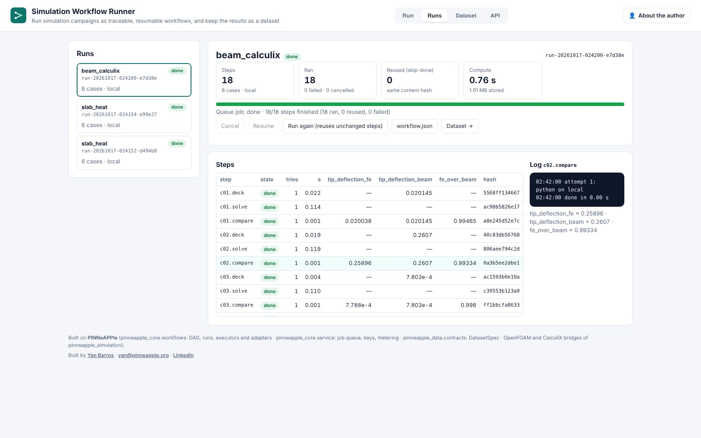
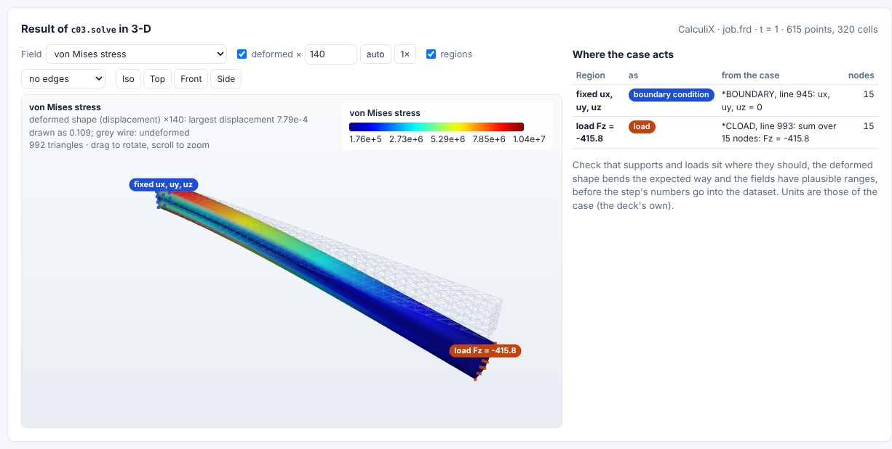
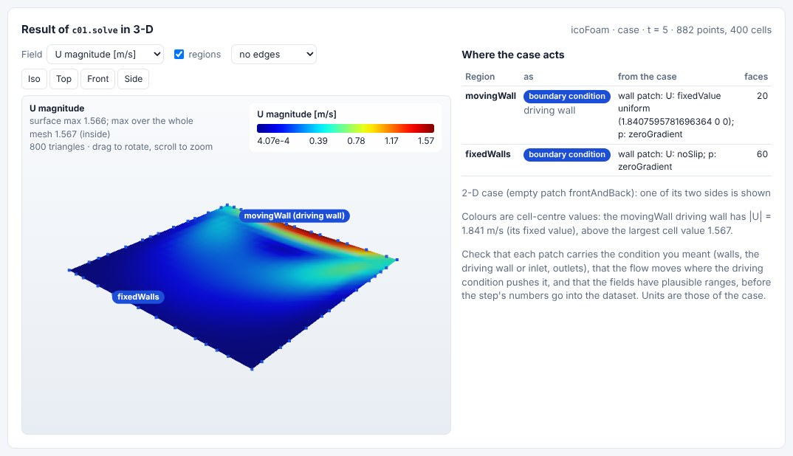

# Simulation Workflow Runner (day 27)

**runner.pinneapple.org** · port 8110 · `RUNNER_*` environment



## The pain

A simulation campaign is rarely one command. Each case is a chain: write the input, mesh, solve, post-process, check.
Teams rebuild that chain in shell scripts for every study. Then a node crashes at case 37 of 60, and nobody knows which
cases finished. Finished cases get rerun because nothing records what was already done. And the results end up in
folders that someone has to turn into a training table by hand.

## What it does

- **Input:** a table of cases (CSV, Parquet, HDF5 or JSON). A Campaign Planner export works directly, including its
  `.contract.json` sidecar. You also choose a workflow template (the steps per case and their dependencies), where the
  steps run, and how many run in parallel.
- **Output:**
  - **A traceable run.** Every step has a state (pending, running, done, failed, reused, cancelled), its attempts, its
    wall time, its outputs and its log.
  - **The files each step wrote**, downloadable.
  - **`workflow.json`**, the exact DAG that ran.
  - **A dataset** of the cases' parameters and outputs, as CSV, Parquet, HDF5 or JSON, with a `DatasetSpec`
    (`pinneapple_data.contracts`). The spec records units, input/output roles, file SHA-256 and the run step behind
    each row. It is ready for the Surrogate Studio.
- **Failure handling:**
  - **Retries:** each step can retry.
  - **Limited impact:** a failure cancels only the steps that need its result; independent cases go on (or set
    `fail_fast`).
  - **Resume:** resuming continues an interrupted or failed run without redoing finished steps.
  - **Skip-done:** a step whose content hash is unchanged is reused instead of recomputed. The hash covers the step
    definition, its parameters, its declared input files and the hashes of the steps it needs.

## View result: the solver's output in 3-D

A finished CalculiX or OpenFOAM step (also one reused by skip-done) has a **View result in 3-D** button. It opens the
step's result on its mesh as a sanity check before its numbers go into the dataset:

- **The mesh and a field.** Switch between the fields: CalculiX DISP, STRESS as von Mises, strain, forces and the
  error estimate; OpenFOAM's volume fields at the latest time, vectors as magnitude.
- **The deformed shape (CalculiX).** The displacement is drawn with a scale factor: automatic (the largest
  displacement shown as 10 % of the body), typed, or `1×`. The undeformed shape stays as a grey wire.
- **Where the case acts.** The regions where the case defines its boundary conditions and loads are marked and
  listed with the line they come from:
  - CalculiX: `*BOUNDARY` supports and `*CLOAD` / `*DLOAD` loads, from the `.inp` next to the `.frd`; point loads
    are summed per direction.
  - OpenFOAM: every non-empty patch, with its conditions from the first time directory. A patch with a non-zero
    fixed vector, such as the cavity's moving lid, is a boundary condition with the role "driving wall". A note
    gives its value: the colours are cell-centre values, so the lid's 1.84 m/s sits above the largest cell value.
- **Light.** Above `RUNNER_VIEW_MAX_FACES` triangles (250,000, from the size guide in `docs/core_concepts/studio.md`)
  the surface is decimated, and the panel says so. The glTF is built once per step and cached.

It reads the step's files only: `pinneapple_tools.visualization.studio.solver_view`, with
`pinneapple_data.cae.inp.deck_conditions` and `pinneapple_data.cae.foam.boundary_conditions`, shown by the shared
viewer `apps/_shared/static/shared/fieldview3d.js`. `GET /api/runs/{run}/steps/{step}/view3d` returns the description
and `/view3d.glb` the glTF.





## Integrations

| Piece | What it is | How |
|---|---|---|
| OpenFOAM | adapter `openfoam` | copies a case, edits dictionaries (`openfoam.campaign.edit_file`), runs blockMesh + solver, reads the log health (`parse_solver_log`) |
| CalculiX | adapter `calculix` | runs `ccx -i job` on a deck (e.g. from `calculix.study.FEModel`), reads the `.frd` (`read_frd`) |
| Python | adapter `python` | a library function in-process, or a script run by any executor |
| Commands | adapter `command` | any argv; a step may write `outputs.json` |
| Local | executor `local` | subprocess with timeout, environment and log capture |
| Docker | executor `docker` | `docker run --rm --network none` with the step directory at `/work`, memory and CPU limits |
| Slurm / HPC | executor `slurm` | one sbatch script per step (partition, time, tasks, memory, modules); `dry_run` (default) writes the script, otherwise `sbatch --wait` |
| Campaign Planner (day 13) | input | its case table and `DatasetSpec` skeleton are read as they are |
| Surrogate Studio (day 14) | output | the run's `DatasetSpec` + table |
| Engineering GUI Agent (guiagent, 8115) | plugin | `register_adapter` / `register_executor` (below) |

## Plugging in executors and step kinds

The engine is `pinneapple_core.workflows` in the library. An executor runs an argv list for a step. An adapter is what
a step of a given `kind` does. Both are registries:

```python
from pinneapple_core.workflows import Adapter, Executor, ExecResult, register_adapter, register_executor

class GuiStep(Adapter):                       # e.g. the GUI agent drives a CAE GUI as one step of a workflow
    kind = "gui"
    def available(self, step=None):
        return True, ""                       # (usable here, reason if not): shown as "needs ..." in the UI
    def run(self, ctx):                       # ctx.workdir, ctx.params, ctx.upstream[step]["outputs"/"workdir"],
        ctx.log("exporting the mesh")         # ctx.execute(argv) through the step's executor, ctx.should_stop()
        return {"exported": "mesh.inp"}       # JSON-able outputs: stored, shown, part of downstream hashes

class MyCluster(Executor):
    name = "mycluster"
    def run(self, argv, *, cwd, env=None, timeout=None, log=print, should_stop=lambda: False) -> ExecResult:
        ...

register_adapter(GuiStep())
register_executor("mycluster", MyCluster)
```

## Methods

- **DAG:** topological order (Kahn) with cycle and unknown-dependency checks; steps are expanded per case from a
  template (`workflow_from_cases`); a thread pool runs ready steps up to the parallel limit.
- **State:** SQLite (`runner.sqlite`: runs, steps, the content-hash cache) plus one directory and `log.txt` per step.
  Runs execute in the shared job queue (`pinneapple_core.service.JobQueue`). It limits concurrent runs across
  server workers and resumes after a restart.
- **Public templates.** All three below are cases of the PINNeAPPle library.
  - **Slab heating:** the exact Fourier-series solution of transient conduction
    (`pinneapple_physics.closed_form.heat.slab_transient`). Runs in seconds.
  - **Cantilever beam:** a deck from `calculix.study.FEModel` (C3D8I), `ccx`, then the tip deflection against
    Euler-Bernoulli `F L³ / 3EI`. Measured with CalculiX 2.21: FE / beam = 0.993 to 1.007 over the
    6 example cases; `tests/pinneapple_core/test_workflows.py` asserts within 2 % when `ccx` is installed.
  - **Lid-driven cavity:** the OpenFOAM tutorial case with lid speed and viscosity edited per run.

## Monetization

Jobs run, compute time, storage. `/api/usage` reports `jobs_run`, `compute_seconds` (the seconds steps actually ran;
reused steps count zero) and `storage_mb` per principal and month. Free limits come from
`RUNNER_FREE_JOBS_RUN`, `RUNNER_FREE_COMPUTE_SECONDS` and `RUNNER_FREE_STORAGE_MB`.

## Limits

- **It orchestrates, it does not replace.** It does not install solvers, queue jobs on a cluster or balance load
  across machines. The Slurm executor hands steps to Slurm.
- **Public server: whitelisted templates only.** Case values are checked against each template's parameter ranges
  (numbers only) before anything runs, so request text never reaches a shell or a solver dictionary. The container
  runs as an unprivileged user. The public image has neither OpenFOAM nor CalculiX, so those two templates show
  "needs solver" there; their Slurm scripts can still be generated (dry run). The CalculiX screenshot comes from a
  runner with `ccx` installed, and the 3-D screenshots from one with CalculiX 2.21 and OpenFOAM v1912.
- **The 3-D view is a sanity check, not a post-processor.** It shows the last increment (CalculiX) or the latest time
  (OpenFOAM), one side of a 2-D OpenFOAM case, cell values averaged to the surface vertices, and markers where the
  deck or the case files place conditions (node sets, patches); conditions defined in other ways (equations,
  `*INCLUDE` files not in the step folder, coded boundary conditions) are not marked.
- **Self-hosted mode runs what the caller sends.** Set `RUNNER_SELF_HOSTED=1` only behind your own login, on your own
  machine or cluster. It enables custom workflows (commands, scripts, Docker steps, Slurm submission).
- **Skip-done sees only what is declared.** Files a step reads without listing them in `inputs` are not in its hash,
  and a solver upgrade with the same command is not noticed. Put versions in the step parameters.
- **Thread-level cancel.** Commands are killed on cancel. An in-process Python function stops only after it returns.
- Up to `RUNNER_MAX_CASES` (60) cases per run and 4 parallel steps on the public server.

## Run it

```bash
pip install -e . -r apps/simulation_runner/requirements.txt
cd apps/simulation_runner && uvicorn simulation_runner.api:app --port 8110
docker build -f apps/simulation_runner/Dockerfile -t simulation-runner . && docker run -p 8110:8110 -v runner_data:/data simulation-runner
```

Environment: `RUNNER_USER` / `RUNNER_PASSWORD` (login), `RUNNER_SELF_HOSTED`, `RUNNER_MAX_CASES`, `RUNNER_MAX_JOBS`,
`RUNNER_FREE_*`, `RUNNER_ADMIN_TOKEN`, `RUNNER_DATA_DIR`, `RUNNER_VIEW_MAX_FACES` (triangles of a 3-D result view
before it is decimated, 250,000). The shared runtime variables (API keys, uploads) are listed
in [apps/_shared/README.md](../_shared/README.md).
