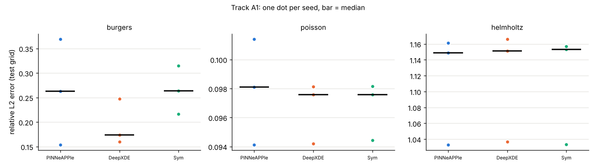
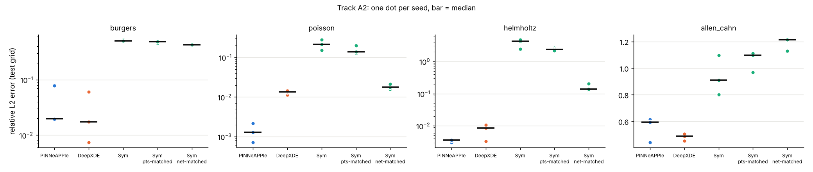

# Cross-framework benchmark: PINNeAPPle vs PhysicsNeMo / PhysicsNeMo-Sym, DeepXDE, neuraloperator

Generated by `python -m benchmarks.vs_frameworks.make_report`. Goal: understand the current state, not make
PINNeAPPle win. Protocol: [PROTOCOL.md](PROTOCOL.md), committed before any result. Every number below is from
`results/*.json`; the complete tables (median [min, max] over seeds for every metric, all variants, failures) are in
[results/TABLES.md](results/TABLES.md).

**Read this first.**
* CPU only: Intel Xeon @ 2.10 GHz, 4 cores, one thread per run. PhysicsNeMo and PhysicsNeMo-Sym are built for GPUs
  (CUDA graphs, AMP, multi-GPU). None of that is exercised here.
* PhysicsNeMo-Sym's official 6 x 512 network is CPU-hostile here. On a GPU this network would cost very differently,
  and that was not measured.
* 3 seeds (A1, A2, B) or 5 (C). By a sign test no difference here is statistically significant (the smallest
  attainable p is 0.25 with 3 paired seeds and 0.0625 with 5), so differences are given with their spread.

## Environment

| | |
|---|---|
| CPU | Intel(R) Xeon(R) Processor @ 2.10GHz, 4 logical CPUs, shared with unrelated jobs |
| Threads | 1 per run (`torch.set_num_threads(1)`, OMP / MKL / OpenBLAS = 1; checked inside the runs) |
| Software | Python 3.13.17, torch 2.14.1+cu130 on CPU, numpy 2.5.4; PINNeAPPle 0.7.0 at this branch; nvidia-physicsnemo 2.2.2; nvidia-physicsnemo.sym 2.4.0; deepxde 1.15.0 (PyTorch backend); neuraloperator 2.0.0 |
| Load | quiet-machine timing runs: one at a time, load average 1.0-2.1 before each (about 1 of it an unrelated pytest job). A1 / A2 runs: 2 at a time, up to 3 while the C reruns overlapped A2. B: 1 at a time, with one Sym A2 variant running alongside. Every run records wall time, CPU time, iterations and the load before / after |
| Budget | about 10.2 process-hours of single-threaded benchmark runs in total, including probes, setup and superseded runs (above the ~8 h target, because of the requested C rerun, the PINNeAPPle A2 reruns and the two Sym A2 variants) |

## A1, identical configuration (3 seeds, 2000 Adam iterations, the same weights, points and loss)

**A1 is an under-trained, identical-configuration regime.** It measures whether the libraries behave the same and
how fast they are under the same budget. It does not measure the accuracy each library can reach; that is A2. At
2000 iterations every framework fails Helmholtz (relative L2 about 1.15, worse than predicting zero) and is poor on
Burgers (0.17-0.26).

| problem | PINNeAPPle | DeepXDE | PhysicsNeMo-Sym |
|---|---|---|---|
| Burgers, rel. L2 | 0.263 [0.154, 0.369] | 0.174 [0.160, 0.247] | 0.264 [0.217, 0.315] |
| Poisson, rel. L2 | 0.0981 [0.0941, 0.101] | 0.0976 [0.0942, 0.0981] | 0.0976 [0.0944, 0.0982] |
| Helmholtz, rel. L2 | 1.15 [1.03, 1.16] | 1.15 [1.04, 1.17] | 1.15 [1.03, 1.16] |
| ms / iteration, quiet machine: Burgers / Poisson / Helmholtz | 97.7 / 122 / 120 | 93.4 / 135 / 129 | 189 / 176 / 187 |

* **The three libraries behave the same.**
  * They start from the same loss: 98.0739 on Poisson at step 0, identical to 6 digits. A direct check also found
    PhysicsNeMo-Sym and plain PyTorch within 3.6e-7 in the weights after 3 steps.
  * After 200 iterations their errors agree to 4 significant digits.
  * After 2000 iterations, the paired per-seed ratio of the error to PINNeAPPle's is 1.00 [0.96, 1.00] on Poisson
    and 1.00 [1.00, 1.00] on Helmholtz.
  * Burgers spreads more: DeepXDE / PINNeAPPle 0.94 [0.47, 1.04], Sym / PINNeAPPle 1.00 [0.85, 1.41]. Float32
    round-off differences are amplified through Adam's loss spikes on this problem. The spread between frameworks
    at one seed is as large as the spread between seeds.
* **Speed per iteration.**
  * PINNeAPPle and DeepXDE are within 4-11 % of each other: PINNeAPPle is 4 % slower on Burgers and 8-10 % faster on
    Poisson and Helmholtz.
  * PhysicsNeMo-Sym costs 1.4-1.9x more per iteration.
  * PINNeAPPle's numbers include the fix of a wasted forward pass (below). Without the fix, each PINNeAPPle iteration
    costs about 6.5 ms more (5-7 %). That would make it 5-11 % slower than DeepXDE on Burgers and about level on the
    other two problems.



## A2, each framework's own recipe (3 seeds, 240 s of CPU time per run)

| problem | PINNeAPPle (`pp.solve` defaults) | DeepXDE (official example) | PhysicsNeMo-Sym (official example) | Sym recipe, network matched to PINNeAPPle A2 | Sym recipe, points per step matched to pp.solve |
|---|---|---|---|---|---|
| Burgers | 0.0199 [0.0197, 0.0788] | 0.0174 [0.00739, 0.0605] | 0.502 [0.498, 0.523] | 0.427 [0.425, 0.432] | 0.486 [0.457, 0.489] |
| Poisson | 0.00129 [0.000714, 0.00215] | 0.0134 [0.0112, 0.0145] | 0.213 [0.150, 0.277] | 0.0176 [0.0157, 0.0211] | 0.139 [0.126, 0.197] |
| Helmholtz | 0.00362 [0.00306, 0.00383] | 0.00851 [0.00331, 0.0107] | 4.19 [2.45, 4.69] | 0.139 [0.126, 0.202] | 2.37 [2.19, 2.68] |
| Allen-Cahn | 0.592 [0.441, 0.613] | 0.490 [0.452, 0.506] | 0.909 [0.802, 1.10] | 1.21 [1.13, 1.21] | 1.10 [0.967, 1.11] |
| steps in 240 s (Burgers / Poisson / Helmholtz / Allen-Cahn) | 3369 / 2830 / 2862 / 3708 | 24080 / 16080 / 2747 / 9406 | 89 / 70 / 75 / 94 | 1890 / 1555 / 1558 / 1903 | 146 / 150 / 147 / 147 |

The table gives relative L2 on the test grid. The two right-hand Sym columns are labelled variants requested after the
first A2 results; they are not Sym's official recipe.

* **Burgers.** PINNeAPPle and DeepXDE are level within the seed spread (0.0199 vs 0.0174). DeepXDE's best seed
  (0.0074) beats every PINNeAPPle seed, and its worst seed (0.0605) is better than PINNeAPPle's worst (0.0788).
  DeepXDE gets there in 86-167 s: its recipe ends when L-BFGS stops (in one seed after 2 L-BFGS iterations), so it
  does not use the whole cap.
* **Poisson.** PINNeAPPle's error is 10x lower (0.0013 vs 0.0134), and so is its max abs error (0.004 vs 0.029). Its
  finite-difference residual is higher (0.19 vs 0.012). The modified MLP with Fourier features fits the values
  better but leaves small high-frequency ripples, which the second-difference residual picks up.
* **Helmholtz.** PINNeAPPle 0.0036 vs DeepXDE 0.0085. DeepXDE uses its hard boundary constraint and a sine
  activation; its best seed (0.0033) is level with PINNeAPPle. Residual: 0.23 vs 0.70.
* **Allen-Cahn.** Every recipe fails (0.49-1.21). DeepXDE's hard initial and boundary constraint gives the lowest
  error.
* **PhysicsNeMo-Sym, official recipe.** It fails every problem because it runs only 70-94 steps in the cap; its
  example runs 20000.
  * The cost per step is genuine, not a harness artefact (`results/sym_a2_profile.json`, Helmholtz, one thread).
  * The official network is a 6 x 512 SiLU network with weight norm: 1.32M parameters, 168x A1's 7,851.
  * On the official 4000 + 800 points it costs 3.37 s per step in Sym, against 3.03 s for the same math in plain
    PyTorch, so Sym's own overhead is about 11 %.
  * With the A1 4 x 50 network and the same points: 0.070 s per step.
  * With 2048 + 512 points (half): 1.71 s per step.
  * Weight norm off or jit off: about 3 % each.
  * No validators or monitors, recording and checkpoints off, 1 thread, no L-BFGS.
* **Sym recipe with the network matched to PINNeAPPle's A2 width x depth** (fully connected 64 x 4, SiLU, weight
  norm, Sym's optimiser, scheduler and batch sizes; 12,993 parameters against 20,865 in PINNeAPPle's modified MLP).
  * It runs 1555-1903 steps (0.12-0.15 s per step).
  * Poisson improves to 0.0176, close to DeepXDE's 0.0134; Helmholtz to 0.139.
  * Burgers (0.43) and Allen-Cahn (1.21) still fail.
  * Its errors stay 2.5-40x above PINNeAPPle and DeepXDE on all four problems. This variant was not tuned.
* **Sym recipe with only the points per step matched:** about 147 steps, and it still fails (Poisson 0.139,
  Helmholtz 2.37).



## B, FNO on Darcy 64 x 64 (3 seeds, 12 epochs, the same training loop and data for the three models)

| | PINNeAPPle `FNO2d` | PhysicsNeMo `FNO` | neuraloperator `FNO` |
|---|---|---|---|
| test rel. L2 (mean of per-sample) | 0.0366 [0.0362, 0.0447] | 0.0520 [0.0486, 0.0541] | 0.0700 [0.0695, 0.0769] |
| test rel. L2 (worst sample) | 0.119 [0.114, 0.156] | 0.168 [0.158, 0.173] | 0.234 [0.220, 0.246] |
| parameters (real-valued) | 2,363,681 | 2,365,217 | 2,372,449 |
| s / epoch (CPU, one thread) | 13.9 [13.8, 15.1] | 44.4 [42.6, 44.6] | 27.3 [27.2, 31.8] |
| inference, batch 1 / batch 20 [ms] | 10.0 / 84.9 | 23.8 / 380 | 13.8 / 165 |

* All three models have the same retained 24 x 12 Fourier block, width 32, 4 layers and about 2.36M real
  parameters. Each library counts modes differently; neuraloperator needs `n_modes=(24, 22)` to keep the same
  block.
* The structures differ:
  * PINNeAPPle `FNO2d`: 1x1 lifting, no padding, GELU after every Fourier layer, a 1x1 projection.
  * PhysicsNeMo `FNO`: a lifting network, zero padding by 9 cells (82 x 82 FFTs), an MLP decoder.
  * neuraloperator `FNO`: channel-MLP lifting and projection, a channel MLP in each block, soft-gating skips.
* At 12 epochs PINNeAPPle's simpler FNO has the lowest error and costs the least. PhysicsNeMo's error is 1.4x
  higher and its cost per epoch 3.2x; neuraloperator's error is 1.9x higher and its cost per epoch 2.0x.
* 12 epochs is far below Li et al.'s 500. These are early-training errors, and the ranking at convergence was not
  measured. GPU speed was not measured either.

## C, inverse Burgers: ν from 2000 samples with 1 % noise (5 seeds, 3000 iterations)

| framework | ν estimate (true 0.003183) | ν relative error | field rel. L2 | iterations |
|---|---|---|---|---|
| PINNeAPPle `InversePINN`, its defaults (**unequal budget**: stopped by its own early stopping) | 0.0428 [0.0381, 0.0466] | 12.5 [11.0, 13.6] | 0.374 [0.362, 0.414] | 540 [492, 564] |
| PINNeAPPle `InversePINN`, early stopping off (`patience` > iterations), **equal budget** | 0.0437 [0.0342, 0.0448] | 12.7 [9.75, 13.1] | 0.379 [0.370, 0.399] | 3000 |
| DeepXDE (`dde.Variable`) | 0.0101 [0.00924, 0.0119] | 2.16 [1.90, 2.74] | 0.0786 [0.0679, 0.0938] | 3000 |
| PhysicsNeMo-Sym (invert network, mean over the data points) | -0.00102 [-0.00266, 0.00243] | 1.32 [0.237, 1.83] | 0.0199 [0.0191, 0.0416] | 3000 |

* **Why PINNeAPPle stopped early.** `InversePINN` has built-in early stopping (`patience=300`) on its total loss. That
  total is re-weighted every step by its EMA loss balancing, on fresh random collocation points. The stopping rule
  therefore compares losses taken under different weights. After the first fast drop it sees no "improvement" for
  300 steps and stops, at 492-564 of 3000 iterations. It is not a crash and not a convergence test.
* **Early stopping is not what causes the error.** With early stopping off and the full 3000 iterations, the result
  is unchanged: the paired ratio of ν error (equal budget over default) is 0.95 [0.89, 1.09]. ν stays near 0.04,
  12x too large, and the field error near 0.38. In this budget the `InversePINN` recipe (10000 fresh points per step,
  EMA balancing, ν in log space with lr 1e-2) does not fit the data well enough to pin ν. The cause beyond early
  stopping was not isolated.
* **No framework identifies ν well in 3000 iterations.**
  * DeepXDE's estimate is positive and still approaching the true value (0.0101, 3x too large).
  * PhysicsNeMo-Sym fits the field best (rel. L2 0.020), but its ν is the mean of a learned field ν(x, t). That mean
    is negative in 4 of 5 seeds (-0.0027 to 0.0024), and within one run the field spans -0.019 to 0.026. The values
    are reported as computed, not clipped.
  * Sym's relative error (1.32) is below DeepXDE's only because an estimate near zero is closer to 0.0032 than one
    at 0.010.

## D, measured ergonomics (facts only)

| framework | runner lines A / B / C | install size of the package itself [MB] | `import` time [s] |
|---|---|---|---|
| PINNeAPPle | 126 / 12 / 67 | 25.7 (source tree; editable install) | 4.21 |
| DeepXDE | 161 / - / 53 | 1.62 | 3.15 |
| PhysicsNeMo-Sym | 243 / - / 93 | 4.27 | 3.03 |
| PhysicsNeMo | - / 14 / - | 20.3 | 6.70 (`physicsnemo.models.fno`) |
| neuraloperator | - / 13 / - | 1.90 | 2.21 |

* Runner lines are non-blank, non-comment lines without the docstring. They include this benchmark's plumbing (A1
  and A2 modes, export), so they are a rough measure.
* Install sizes exclude dependencies. PhysicsNeMo-Sym additionally needed VTK and a CUDA compiler to install (below).
* Import times were measured with two benchmark runs going.

## What each framework does better or worse

* **PINNeAPPle.**
  * Identical configuration (A1): the same numerics as DeepXDE and Sym, a cost per iteration within -4 % to +10 % of
    DeepXDE's, and 1.4-1.9x cheaper than Sym.
  * Its own defaults (`pp.solve`, A2): the lowest error on Poisson (10x lower than DeepXDE's recipe) and Helmholtz
    (2.4x lower), level with DeepXDE on Burgers, worse on Allen-Cahn (0.59 vs 0.49; both are failures). Its Poisson
    residual is 16x DeepXDE's despite the lower error.
  * FNO (B): the lowest early-training error and the cheapest per epoch (13.9 s vs 27.3 and 44.4).
  * Inverse problem (C): clearly worse. `InversePINN` misses ν by 12x, against 3x for DeepXDE, and its field error is
    4.8x DeepXDE's and 19x Sym's. Its early stopping cuts the budget to about 540 of 3000 iterations, although that
    does not change the outcome.
* **DeepXDE.**
  * Recipes: the best or level result on Burgers and Allen-Cahn, the most plausible ν, and the lowest residuals on
    Poisson and Helmholtz.
  * Its Adam + L-BFGS examples can finish before the cap.
  * Its Poisson and Helmholtz errors are 2.4-10x PINNeAPPle's.
* **PhysicsNeMo-Sym.**
  * The same numerics in A1, at 1.4-1.9x the cost per iteration on CPU. Sym's own overhead over plain PyTorch is about
    11 %.
  * Its official configurations are unusable within 240 CPU-seconds: 70-94 steps, because of the 6 x 512 network.
  * With a 64 x 4 network it trains (Poisson 0.018), but stays behind PINNeAPPle and DeepXDE on all four problems.
  * Best field fit on the inverse problem, but a ν estimate that is not usable as a coefficient.
  * Installing it on a CPU machine needed a CUDA compiler (below).
* **PhysicsNeMo FNO:** 1.4x PINNeAPPle's error at 12 epochs, 3.2x the CPU time per epoch, 2.4-4.5x the inference
  latency. Its padding makes every FFT 82 x 82 instead of 64 x 64.
* **neuraloperator FNO:** 1.9x PINNeAPPle's error at 12 epochs, 2.0x the time per epoch, 1.4-1.9x the latency.

## Deviations from the protocol

1. **A1 seeds: 3, not 5** (cut 3 of the protocol's cut order, for the CPU budget).
   * Allen-Cahn is not in A1 (cut 1, decided in advance).
   * Track D was kept; it costs seconds.
2. **B: 12 epochs.** The protocol fixed "the same epochs" without a number; 12 keeps B near the budget. The FNOs are
   under-trained (Li et al. train for 500 epochs).
3. **A2 cap = 240 s of CPU time**, fixed in the protocol commit before any result.
4. **PINNeAPPle A2 runs were redone** because of a harness bias against PINNeAPPle, found while A2 ran.
   * `pp.solve` cannot stop at a time budget, so the runner sets the number of epochs from a probe.
   * The first probe counted setup time as per-epoch cost, so those runs used only 77-88 % of the cap.
   * The runner now probes twice (the slope gives the cost per epoch). If a run misses the cap by more than 10 %, it
     repeats the run once with scaled epochs.
   * All 12 reported PINNeAPPle A2 runs used 231-258 s. DeepXDE and Sym stop at 240-243 s through a callback or
     handler.
   * The superseded runs are not in the tables.
5. **Added after the coordinator's review:**
   * C: an equal-budget PINNeAPPle row (early stopping off). This is a diagnostic, not tuning.
   * A2: two labelled Sym variants (network matched, points matched).
   * The official-recipe rows are kept unchanged.
6. **C collocation differs by framework**, following each one's documented pattern:
   * PINNeAPPle: 10000 fresh points per step (its only mode).
   * DeepXDE: the 10000 shared A1 points plus the 2000 data points (its example anchors the data).
   * Sym: the 2000 data points plus the 10000 shared points.
   * ν parameterisation: PINNeAPPle in log space (its documented option for a positive parameter), DeepXDE linear,
     Sym as a network output.
7. **Runs were not always alone on the machine** (see Environment). Accuracy is unaffected. Speed per iteration is
   quoted from the separate quiet-machine timing runs, and the A2 caps are CPU time.
8. **Darcy data regenerated** with the library recipe because the download is blocked. Both files match the zoo
   manifest's SHA-256.
9. **PhysicsNeMo-Sym on CPU:** `cuda_graphs=false`, because its default (`true`) crashes without a GPU driver.
   Recording and checkpoint frequencies were set above the run length, so no framework does I/O during training.
10. **Residual metric:**
    * It uses second-order central differences on exported values.
    * On Burgers the stencil (h = 1e-3) does not resolve the front: the exact solution itself has an FD residual RMS
      of 0.027. Burgers residuals below about 0.03 carry no information.
    * The Allen-Cahn reference has a max-abs uncertainty of 1.7e-4 (2048 vs 4096 modes).

## Installation and run failures (results in themselves)

* **PhysicsNeMo-Sym 2.4.0 does not install as documented on a CPU-only machine.**
  * It ships only an sdist, and its `setup.py` builds a CUDA extension (`physicsnemo_ext`, AMP kernels only).
  * `pip install nvidia-physicsnemo.sym --no-build-isolation` fails with "CUDA_HOME environment variable is not set".
    Without `--no-build-isolation` it first fails with "No module named torch", and without the README's `pip install
    Cython` with "No module named Cython".
  * Fix used: the CUDA 13.0 compiler from PyPI wheels (`nvidia-cuda-nvcc`, `nvidia-nvvm`, `nvidia-cuda-crt`,
    `nvidia-cuda-runtime`, `nvidia-cuda-cccl`, 13.0.x, kept outside the venv), with `CUDA_HOME` pointing at them and a
    `libcudart.so` symlink for the linker.
  * Then `pip install --no-deps --no-build-isolation` (the README's no-deps route), followed by the listed
    dependencies. The package itself was not modified.
* PhysicsNeMo-Sym imports `vtk` unconditionally (through `utils.io.vtk`), so the 140 MB VTK wheel is needed even
  without VTK output.
* PhysicsNeMo-Sym requires `typing>=3.7,<3.8`, a Python 2 era backport; it was not installed.
* PhysicsNeMo-Sym's default `cuda_graphs: true` crashes in the first training step without a GPU driver.
* PhysicsNeMo-Sym defaults that differ from the other libraries: gradient-norm clipping at 0.5, weight norm on, and a
  loss that sums (not averages) over points. All are switched off or normalised in A1.
* Installing the frameworks downgraded `python-dateutil` from 3.0.0 to 2.9.0.post0 in the shared venv.
* The zoo download of `darcy_2d_li2021` (Hugging Face) is blocked here (403).

## Existing repository claims the data contradicts or does not support

The first three claims are from the feature table in `examples/vs_physicsnemo/README.md`. They were checked against
the installed packages and measured where a track applies. The README was not rewritten.

* **"Arquiteturas PINN: 8 variantes | FullyConnected (via Sym)".** PhysicsNeMo-Sym 2.4.0 also ships Fourier-feature,
  modified-Fourier, multiscale-Fourier, highway-Fourier, SiReN, DGM, multiplicative-filter, hash-encoding,
  radial-basis and fused-MLP architectures (`physicsnemo/sym/models/`).
* **"Ajuste de pesos (SA-PINN, GradNorm, NTK, LossRatio) | ❌ | PINNeAPPle exclusivo".** PhysicsNeMo-Sym ships the loss
  aggregators `grad_norm`, `res_norm`, `homoscedastic`, `lr_annealing`, `soft_adapt` and `relobralo`, plus an NTK
  option (`physicsnemo/sym/hydra/loss.py`, `training.ntk`).
* **"Active Learning (RAR, RAD, ...) | ❌ | PINNeAPPle exclusivo".** PhysicsNeMo-Sym's continuous constraints support
  importance sampling (`domain/constraint/continuous.py`), and DeepXDE ships residual-based adaptive refinement
  (its `Burgers_RAR.py` example).
* **"Operadores neurais ... | PhysicsNeMo mais otimizado".** On this CPU, PhysicsNeMo's FNO took 3.2x the time per
  epoch and 2.4-4.5x the inference latency of PINNeAPPle's FNO2d with the same spectral parameters (track B). GPU
  speed was not measured.
* **PINN capability.** The README's PINN rows present PINNeAPPle as the more capable PINN library. The measurements
  show:
  * the same numerics as DeepXDE and Sym when configured identically (A1);
  * lower errors on Poisson and Helmholtz with its defaults, level on Burgers, worse on Allen-Cahn (A2);
  * clearly worse results on the inverse problem (C).
* **README.md: "It bridges to DeepXDE and PhysicsNeMo".**
  * `pinneapple_tools.benchmark_suite.backends.physicsnemo_sym` does not import with PhysicsNeMo-Sym 2.4.0 (bug 5
    below).
  * The DeepXDE backend only fits sensor data, with no PDE.
  * `pinneapple_physics.deepxde_bridge` was not tested here.

## PINNeAPPle changes made, and bugs found

1. **Fixed (small, with a test).** `pinneapple_physics.solve_pde` computed `y_hat = model(x_col)` every step and
   passed it to the compiled loss, which never reads it: one wasted forward pass per step.
   * Cost: 6.5 ms of about 100-120 ms per iteration in A1, and 4.9 ms of about 77 ms in `pp.solve`'s default.
   * Losses are unchanged.
   * Test: `test_solve_pde_evaluates_the_collocation_points_once_per_step`.
2. **Added (opt-in, default unchanged, with a test).** `solve_pde(x_col=...)` takes fixed collocation points. Without
   it, PINNeAPPle could not be trained on the same points as the other libraries.
   * Test: `test_solve_pde_fixed_collocation_points` (it checks the first loss against a hand-written mean squared
     residual).
3. **Not fixed: `InversePINN`.**
   * Its early stopping compares totals taken under changing loss weights on fresh random points, so it stops after
     about 500 iterations whatever the budget (track C).
   * Exceptions from `residual_fn` are caught and logged, and training continues with a zero PDE loss. A broken
     residual therefore trains a data-only model silently.
4. **Not fixed: silently dropped options.**
   * `ModelRegistry.build("vanilla_pinn" or "bench_mlp", hidden_dim=..., n_layers=...)` drops both arguments (these
     classes take `hidden=`). So `pp.solve(problem, "pinn", architecture="vanilla_pinn", hidden_dim=16, n_layers=2)`
     trains a 4 x 128 network.
   * `pp.solve`'s `_pinn(**_)` swallows every unknown option without a warning.
5. **Not fixed: `pinneapple_tools.benchmark_suite.backends.physicsnemo_sym`.**
   * It imports `ModulusConfig` from `physicsnemo.sym.hydra`, which does not exist in PhysicsNeMo-Sym 2.4.0.
   * It then reports "physicsnemo.sym is not available" even when the package is installed.
   * It never returns a predictor, so its runs cannot be evaluated.
6. **Defaults noted, not changed.**
   * The `burgers_1d` preset defaults to `nu=0.01`; the benchmark value is 0.01/π.
   * Preset condition weight 10 times `LossWeights(w_bc=10, w_ic=10)` gives an effective boundary and initial weight
     of 100.
   * `FNO2d` has no projection MLP and applies GELU after the last Fourier layer. Li et al. use a 128-wide projection
     MLP and no activation there.
   * The existing `Burgers1DTask` reference in `benchmark_suite/tasks` is a 512-point finite-difference solve, not
     the exact Cole-Hopf solution.

## Tests

`tests/test_crossframework_benchmark.py`: 30 tests.
* Always run: references against independent computations, the evaluator and statistics against hand-computed
  values, point sets, shared weights, the two `solve_pde` changes, and A1 / C runner smoke tests for every framework.
* Behind `PINNEAPPLE_SLOW=1`: the Allen-Cahn resolution study, A2 and B runner smoke tests.
* Results: 23 passed, 7 skipped by default; 30 passed with `PINNEAPPLE_SLOW=1`.
* Regression check of the `solve_pde` change: `test_public_api`, `test_manufactured_solutions`, `test_compile_api`,
  `test_compare_precomputed_solution`, `test_cartesian_breadth`, `test_solve_compare_experiment`, `test_agents_md` and
  `test_app_helpers` gave 125 passed, 21 skipped, 0 failed.

## Reproduce

```bash
python -m benchmarks.vs_frameworks.driver env
python -m benchmarks.vs_frameworks.driver run --track A1 --iters 2000 --seeds 0 1 2 --jobs 2
python -m benchmarks.vs_frameworks.driver run --track A2 --cap-s 240 --seeds 0 1 2 --jobs 2 \
    --frameworks pinneapple deepxde physicsnemo_sym physicsnemo_sym_netmatched physicsnemo_sym_matched
python -m benchmarks.vs_frameworks.driver run --track B --epochs 12 --seeds 0 1 2
python -m benchmarks.vs_frameworks.driver run --track C --iters 3000 --seeds 0 1 2 3 4 \
    --frameworks pinneapple pinneapple_nostop deepxde physicsnemo_sym
python -m benchmarks.vs_frameworks.driver run --work _timing --track A1 --iters 200 --seeds 0
python -m benchmarks.vs_frameworks.driver timing --work _timing
python -m benchmarks.vs_frameworks.driver collect
python -m benchmarks.vs_frameworks.measure_ergonomics
python -m benchmarks.vs_frameworks.make_report
```

Every runner takes `--device cuda` for a later GPU run.
