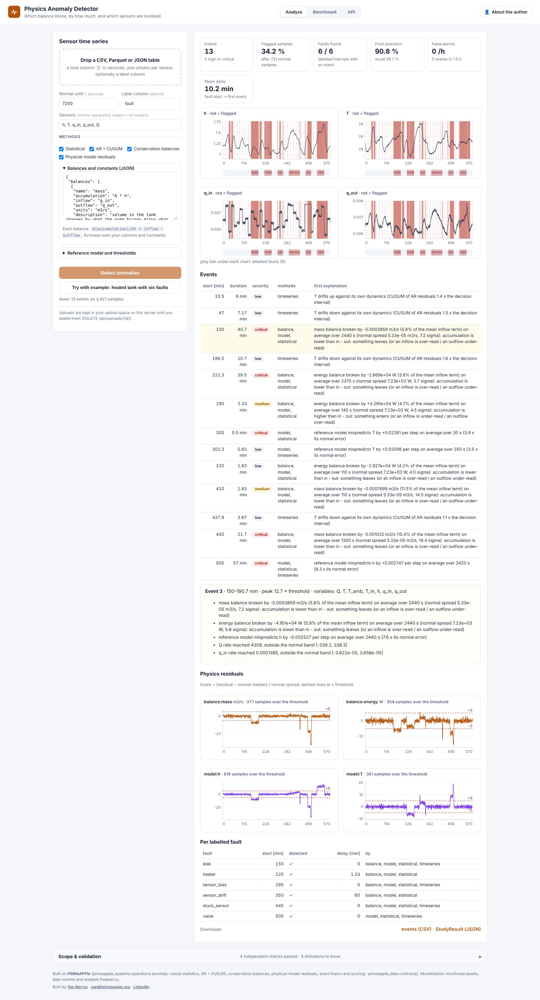
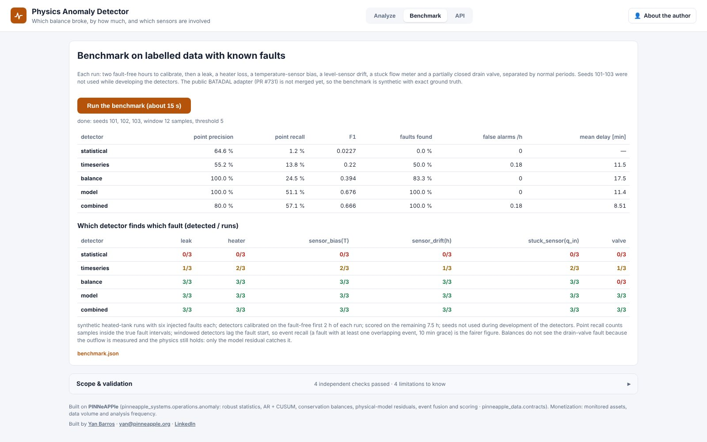

# Physics Anomaly Detector (day 28)

**Which balance broke, by how much, and which sensors are involved.** Live at <https://anomaly.pinneapple.org>.
Source: [`apps/anomaly_detector`](https://github.com/PINNeAPPle-Labs/PINNeAPPle/tree/main/apps/anomaly_detector).

Upload sensor time series and the end of a window you know is normal. Add conservation balances written as formulas
over your columns, and optionally a physical reference model. Four detector families run, each calibrated only on
the normal window:

| Family | What it sees |
|---|---|
| Statistical | values and rates outside their normal band (robust z-score) |
| AR + CUSUM | slow drifts against a signal's own dynamics |
| Conservation balances | `d(accumulation)/dt = inflow − outflow` broken, with the size and direction in the law's units |
| Model residuals | a reference model that mispredicts a state from the measured inputs |

Flags become events with a severity, the variables involved and explanations. With a label column, the app computes
precision, recall, false alarms per hour and detection delays.

## Benchmark

The benchmark uses labelled synthetic runs of the heated tank: a leak, a heater loss, a sensor bias, a sensor drift,
a stuck meter and a valve fault, on seeds not used during development. The combined detector finds every fault with
80 % point precision and 0.18 false alarms per hour. The balances alone never false-alarm but miss the valve fault,
because the outflow is measured and the physics holds. The public BATADAL adapter (PR #731) is not merged yet.

## Automate it

`POST /api/analyze` with an `upload_id`, `normal_until`, `balances` and `constants` returns a job. The events and
scores are in `GET /api/jobs/{id}`; the downloads are `events.csv` and `anomaly.study.json`. In Python, call
`pinneapple_systems.operations.anomaly.detect`.

## Limits

- "Normal" is whatever the declared window contains.
- A broken balance does not say whether the plant or a meter is at fault.
- The benchmark is synthetic until a public labelled set lands.

Monetization: monitored assets, data volume and analysis frequency.
