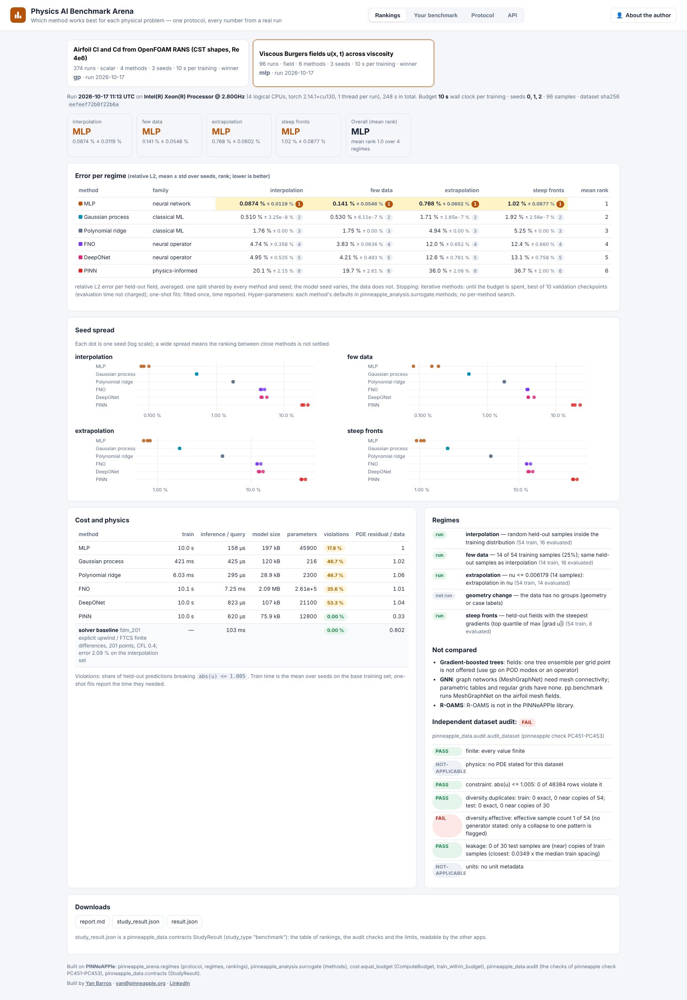
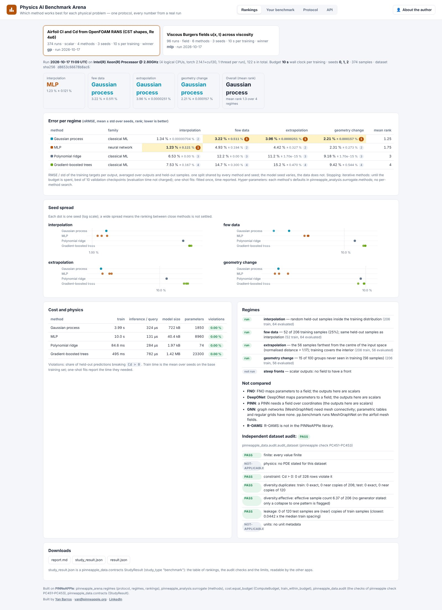
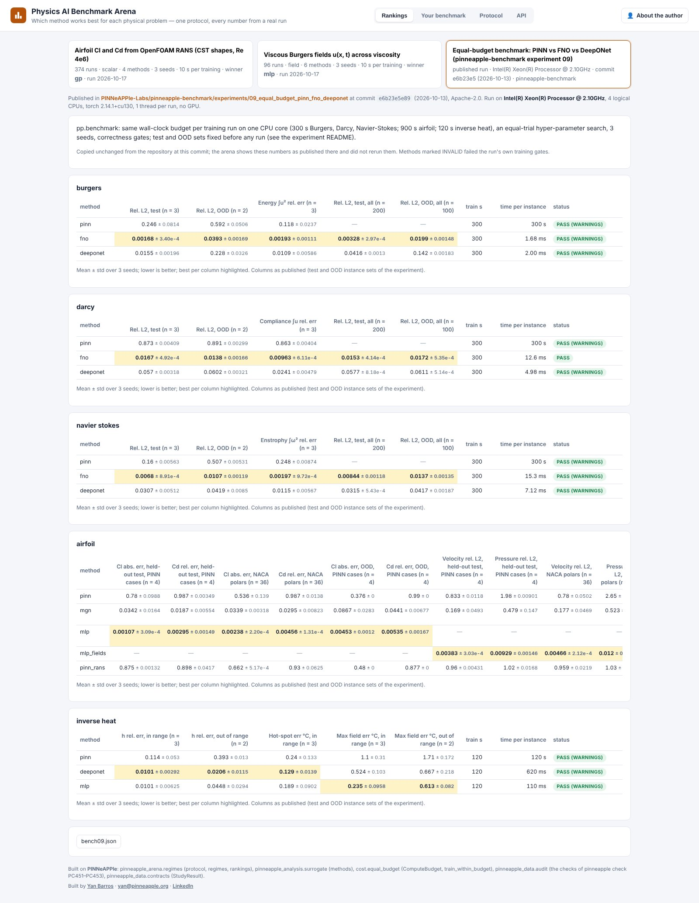

# Physics AI Benchmark Arena

[arena.pinneapple.org](https://arena.pinneapple.org) · source `apps/benchmark_arena`

Which method works best for each physical problem, ranked under one protocol, with only numbers from runs that were
actually executed.

**Protocol.** `pinneapple_arena.regimes.run_regime_arena` applies the same rules to every method:

- equal data: one split for every method and seed;
- equal compute: the same `ComputeBudget`, enforced by `train_within_budget`;
- the same stopping rule;
- several seeds, with their spread shown;
- errors measured only on samples that no method trained on or was chosen with.

**Regimes.** Interpolation, few data, extrapolation, geometry change (held-out groups), and steep fronts (fields
only).

**Also measured.** Training and inference cost, model size, violations of declared constraints, the PDE residual, and
numerical-solver baselines. The splits are audited independently by `pinneapple_data.audit`, which runs the dataset
checks of `pinneapple check`.

**Results.** Public results are files in `apps/benchmark_arena/results/`, written by `run_public_benchmarks.py` with
their date, hardware and dataset hash. The published results of pinneapple-benchmark experiment 09 (five problems, `pp.benchmark`
protocol) are shown unchanged with their source commit and hardware. Private benchmarks run the same protocol on an uploaded table as a job.

**Library.** `pinneapple_arena.regimes`, `pinneapple_analysis.surrogate.methods`,
`pinneapple_analysis.cost.equal_budget`, `pinneapple_data.audit`; guide:
[Surrogates from simulation results](../guides/surrogates_arena_gateway.md).

**Limits.**

- Hyper-parameters are the library defaults; there is no per-method search.
- Wall-clock budgets depend on the hardware.
- "Steep fronts" is only a proxy for discontinuities.
- Graph networks and R-OAMS are not compared; the app states why.
