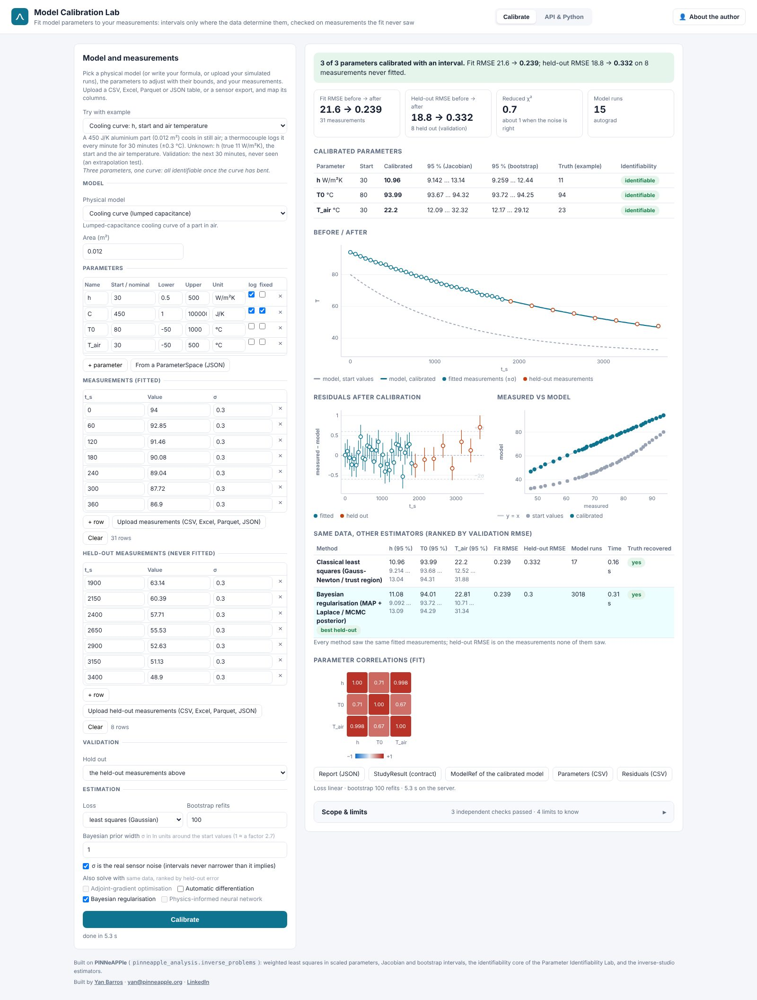
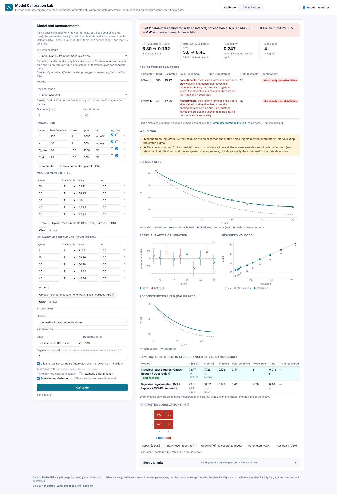
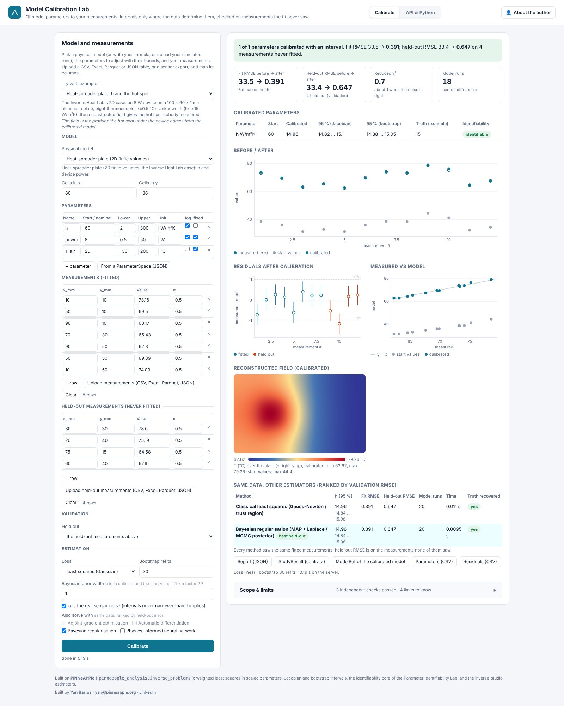

# Model Calibration Lab (day 18)

**Fit model parameters to your measurements, with intervals only where the data determine them, checked on
measurements the fit never saw.** Live at <https://calibration.pinneapple.org>.
Source: [`apps/calibration_lab`](https://github.com/PINNeAPPle-Labs/PINNeAPPle/tree/main/apps/calibration_lab).



Upload measurements: CSV, Excel, Parquet, JSON or a sensor export. Pick a model: built in, your formula, or a table of
your solver runs. Set the parameters to adjust and their bounds. The lab returns:

- **calibrated values**, with Jacobian and bootstrap 95 % intervals;
- **"not estimable"** instead of a number for any parameter the measurements cannot determine, with the combination
  they do fix (the identifiability core of the Parameter Identifiability Lab, day 25);
- **before / after** curves, residuals, and the error on held-out measurements (a separate table, a random fraction,
  or the last rows as an extrapolation test);
- **the same data solved by other estimators** (Bayesian, autodiff, adjoint, a physics-informed network), ranked by
  held-out error;
- a `StudyResult` and a `ModelRef` of the calibrated model with its held-out metrics, for the other apps.





## Automate it

```bash
curl -X POST https://calibration.pinneapple.org/api/calibrate -H 'Content-Type: application/json' -d @calibration.json
curl https://calibration.pinneapple.org/api/jobs/<id>
```

On your own machine, with your own solver: `pinneapple_analysis.inverse_problems.calibrate(CallableModel(solver), ...)`.
See the guide [Identifiability, calibration and inverse problems](../guides/identifiability_calibration_inversion.md).

## Limits

The intervals assume the model form is right; read the reduced χ² and the held-out error. A table of solver runs adds
an interpolation error the intervals do not include. Uploaded code is not run on the server. The app README lists
every limit, with the measured results of each example.
