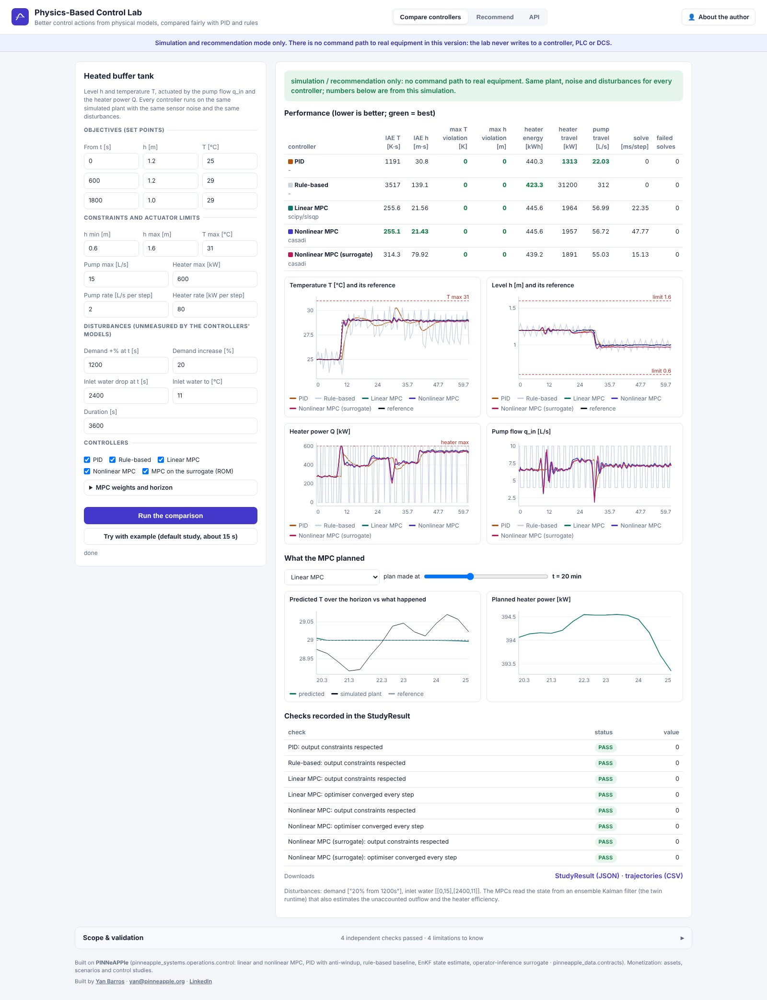
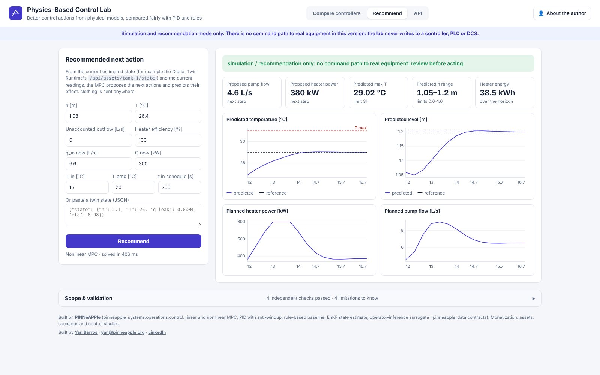

# Physics-Based Control Lab (day 29)

**Better control actions from physical models, compared fairly with PID and rules.** Live at
<https://control.pinneapple.org>. Source: [`apps/control_lab`](https://github.com/PINNeAPPle-Labs/PINNeAPPle/tree/main/apps/control_lab).

> **Simulation and recommendation only.** This version has no command path to real equipment: it never writes to a
> controller, PLC or DCS.

Give the lab a dynamic model, the estimated state, objectives, constraints and actuator limits. The model is the
heated tank's balances, or a reduced-order surrogate as a `ModelRef`. It runs each controller in closed loop on the
same simulated plant, with the same noise and disturbances:

- linear MPC: successive linearisation and a QP;
- nonlinear MPC: CasADi + IPOPT, with a SciPy fallback;
- nonlinear MPC with the surrogate as its model;
- a two-loop PID with anti-windup;
- hysteresis rules.

It reports tracking error, constraint violations, energy, actuator travel and solve time, plus what the MPC planned
at any moment against what then happened.

In the default study, the MPCs reduce the temperature tracking error 4.7x compared with PID, with no constraint
violation. They move the heater more, a trade-off set by the move weight. The surrogate MPC tracks the level worse
because the ROM cannot see the unmeasured demand change.

## Automate it

- `POST /api/compare` with `spec`, `scenario` and `controllers` returns a job. Downloads: `control.study.json`,
  `trajectories.csv`.
- `POST /api/recommend` with the Digital Twin Runtime's state and the current readings returns the proposed actions
  and their predicted effect.
- In Python, call `pinneapple_systems.operations.control.compare_controllers` and `recommend`.

## Limits

- The plant is simulated, so model mismatch is smaller than on a real plant.
- The baselines are hand-tuned, not optimal.
- Output constraints are soft; actuator and rate limits are hard.
- There is no command path to equipment, by design.

Monetization: assets, scenarios and control studies.
