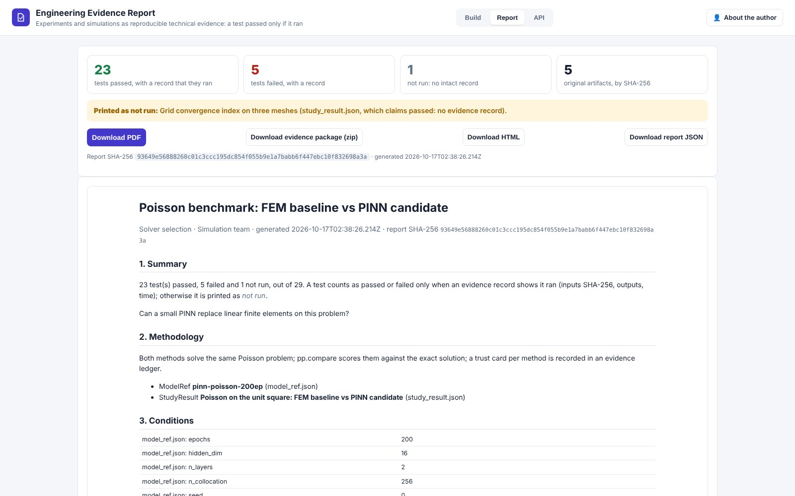
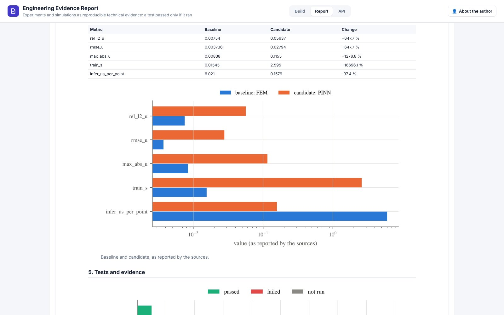
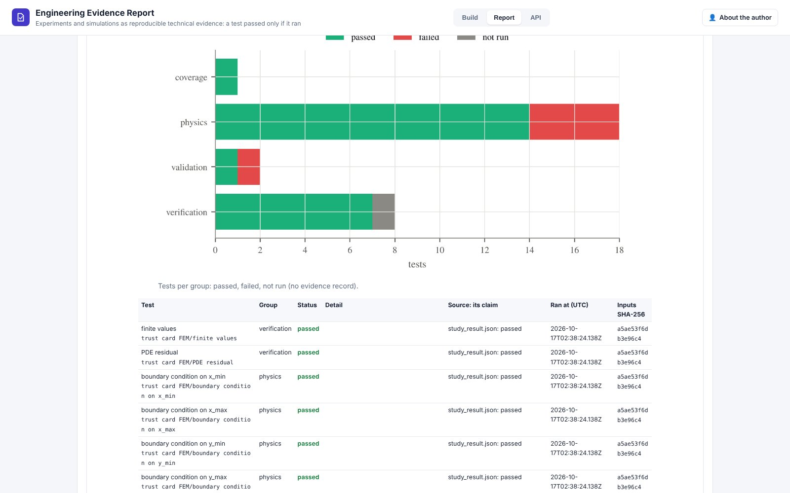

# Engineering Evidence Report (day 30)

**Experiments and simulations as reproducible technical evidence.** Live at <https://evidence.pinneapple.org>.
Source: [`apps/evidence_report`](https://github.com/PINNeAPPle-Labs/PINNeAPPle/tree/main/apps/evidence_report).

Upload what a study produced, from any app of the series or from your own tools:

- Validation Lab reports;
- evidence ledgers;
- `pinneapple check` JSON;
- Simulation Comparator results;
- StudyResult / ModelRef / DatasetSpec JSON;
- metrics tables;
- any other file.

Add the methodology, the conditions and the names of the baseline and candidate runs. The app builds a report
(HTML, PDF) with methodology, conditions, baseline comparison, tests, limitations and references, where every
original artifact is referenced by SHA-256 and URL. It also builds an evidence package: a zip with the report, the
ledger, the figures, the original files and a SHA-256 manifest.

**A test is reported as passed only when there is a recorded evidence entry that it ran** (inputs SHA-256, outputs,
time). Otherwise the report prints "not run", with the source's claim next to it. See the
[evidence ledger](../guides/evidence_ledger.md) for how records are made and checked.

## Automate it

`POST /api/report` returns JSON and HTML, `/api/report.pdf` the PDF and `/api/package` the zip. Each takes files
plus `meta` (JSON) and `urls` (JSON: file name → URL). The interactive docs are at `/docs`. API keys and usage
metering (reports and downloads per caller and month) come from the shared app runtime.

## Limits

- The report checks that records exist and are intact; it does not re-run tests.
- Baseline and candidate are matched by run name, and units are not converted.
- Contracts are validated against `pinneapple_data.contracts`; each report is also exported as a StudyResult.
- Nothing is stored: keep the package.

Monetization: reports, campaigns and private projects.
