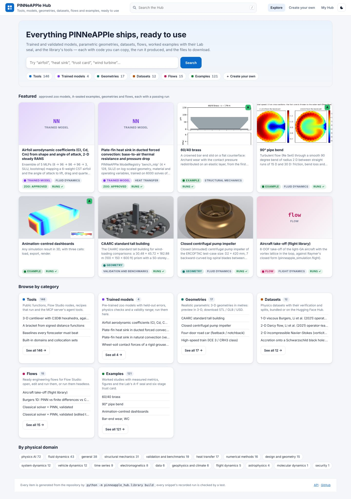
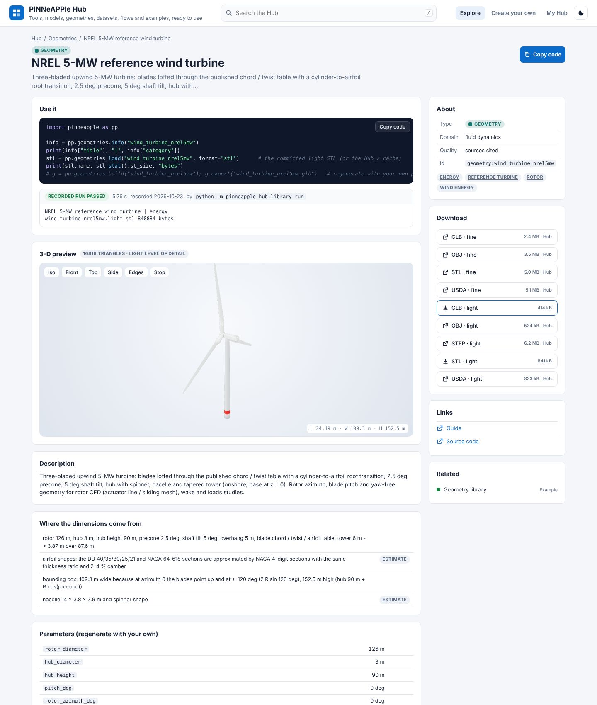
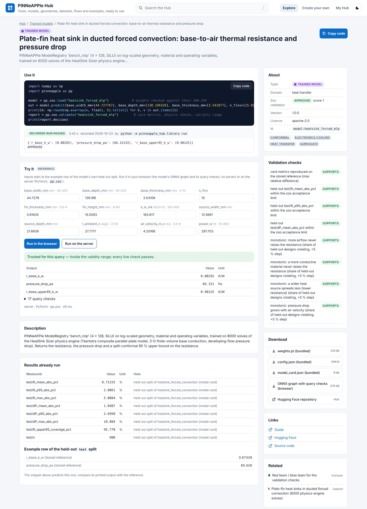
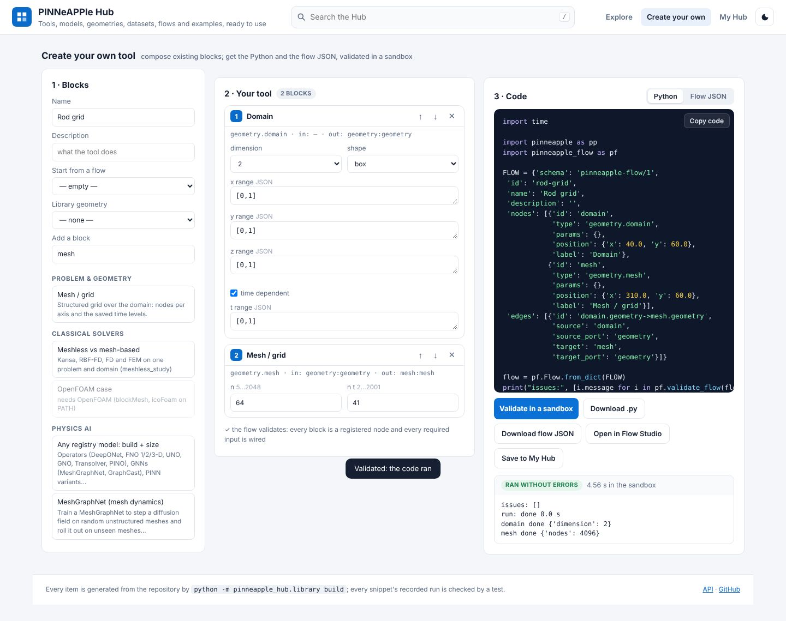
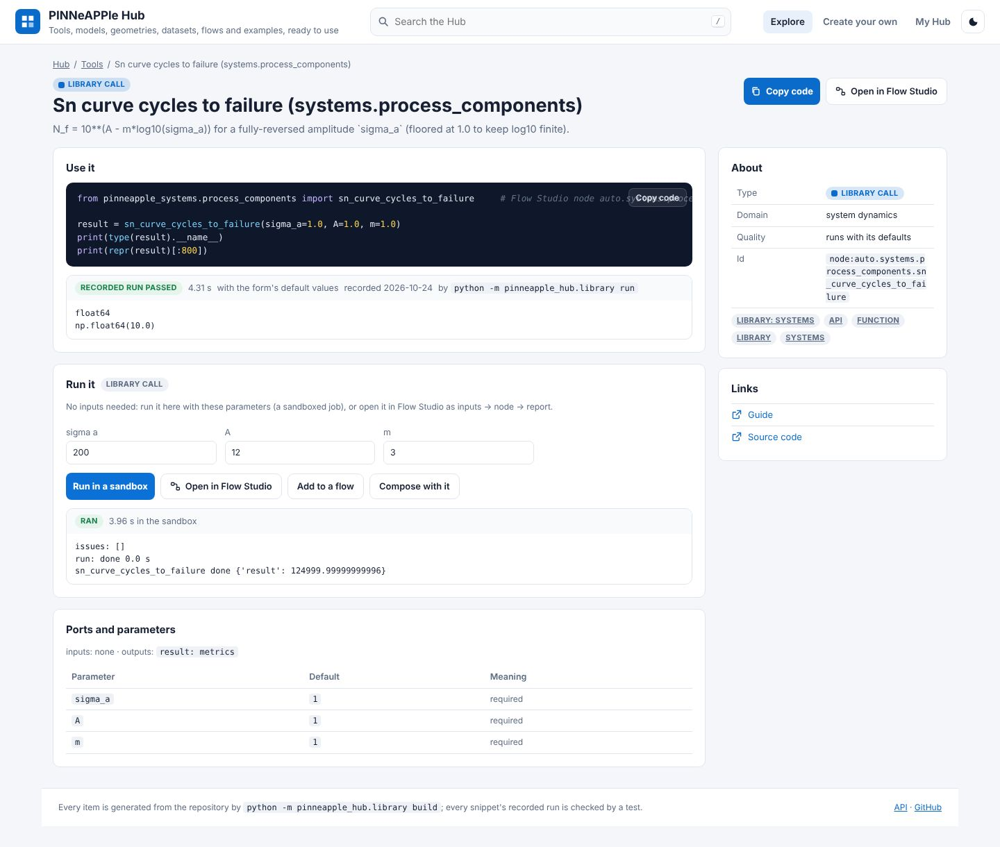
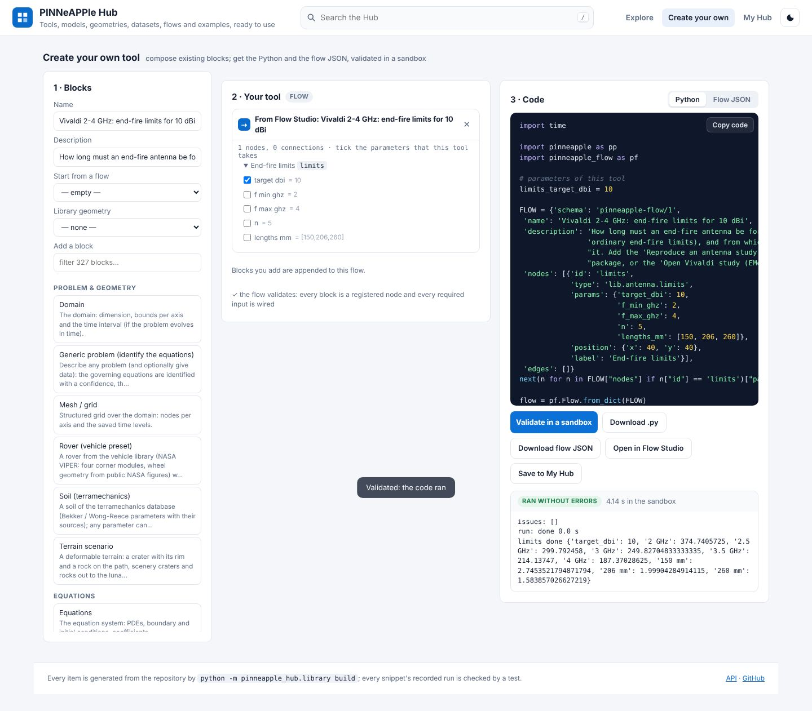
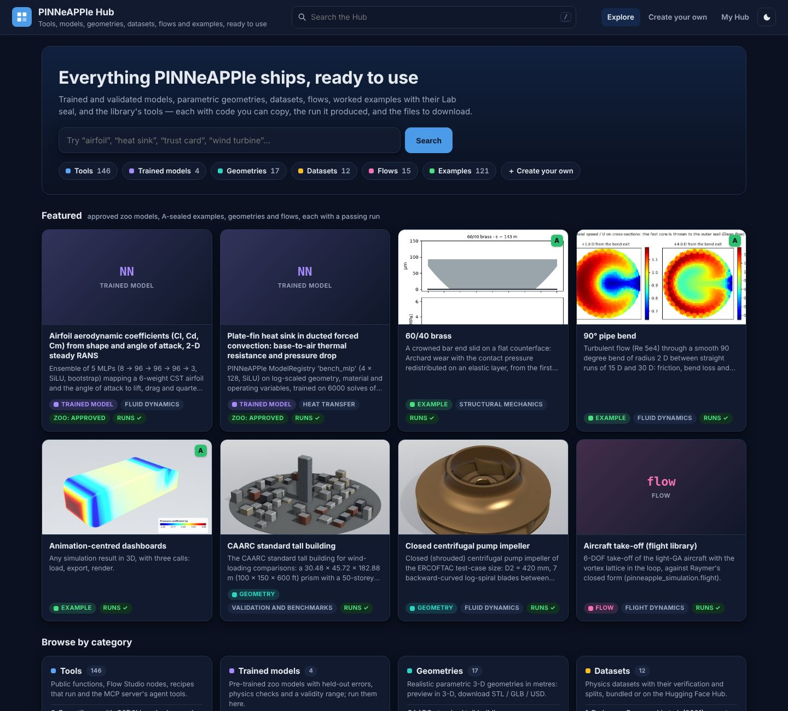
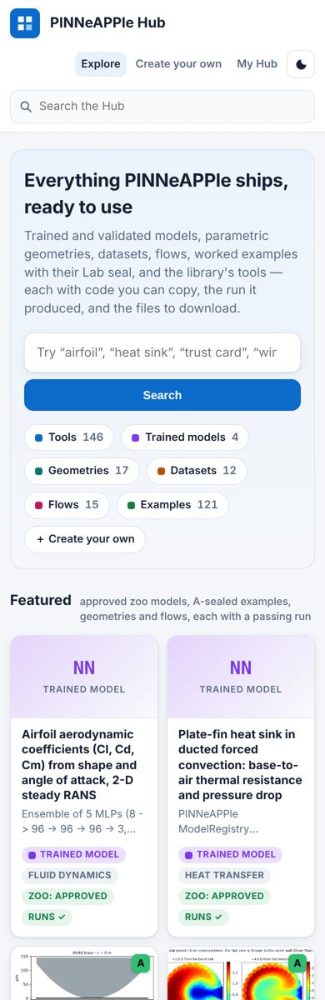
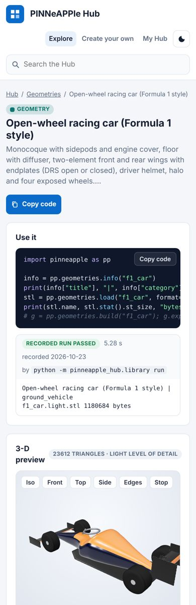

# PINNeAPPle Hub

[hub.pinneapple.org](https://hub.pinneapple.org) · source `apps/hub` · library `pinneapple_hub.library`

One searchable catalogue of everything ready-made in PINNeAPPle: **tools** (the public functions of AGENTS.md,
Flow Studio nodes, recipes from AGENTS.md and the module reference, the MCP server's tools), **trained models**
(the zoo), **geometries** (the geometry library), **datasets**, **flows** (Flow Studio) and **examples** (every
`examples/*` manifest and Lab item, with its A–F seal and six-stage trust card). Click an item to see what it is,
copy its code in one click, read the output its code printed when it was run, and download its files.



## An item

- **Use it**: a minimal snippet (`import pinneapple as pp ...`) and the **recorded run** of exactly that code
  (printed output, seconds, figures). The run is matched to the snippet by its hash, so a snippet that changed
  shows "not run" until it is run again.
- **Results already run**: the measured numbers and figures of the source: a model card's held-out metrics and an
  example row of the model's own test split (inputs and the stored reference), a Lab run's metrics and figures, the
  module reference's figures.
- **3-D preview** of a geometry (its committed light glTF, with the three.js copy the library vendors) and
  **downloads**: STL / GLB from the repository, fine levels of detail, OBJ, USD and STEP from the Hugging Face Hub;
  model weights, configuration, card and ONNX graph; dataset files.
- **Try it** (models): inputs start at the held-out example row; run the model's ONNX graph and its query checks in
  the browser (`pinneapple_hub/zoo/web/zoo.js`, no server) or `pp.zoo` on the server, with the verdict of the
  per-query trust checks.
- **Trust card / validation checks**: the Lab's six questions for examples, the zoo's validation checks for models.
- **Open in Flow Studio** for flows (`?example=<name>`), **Compose** for Flow Studio nodes.




## Create your own

Pick blocks (every curated Flow Studio node type), optionally start from a bundled flow and add a library
geometry. Each new block's inputs are wired from the blocks before it by port type
(`pinneapple_flow.lab_status.insert_nodes`) and every parameter is checked against the node's schema. You get the
flow JSON and Python that builds, validates and runs it, to copy or download. **Validate in a sandbox** runs that
Python -- regenerated on the server from the blocks, never code a visitor typed -- in a separate interpreter with a
time and memory limit, as a job, and shows what it printed. **Save to My Hub** keeps it (with the validation run
when it ran that exact code) in the app's data volume, per login, API key or address. **Open in Flow Studio**
passes the flow in the link (`?flow=<base64url JSON>`).



## With Flow Studio

The Hub and Flow Studio read one registry, `pinneapple_flow.REGISTRY`: every node type of the palette (the curated
nodes and the 249 generated library calls of `pinneapple_flow/autocalls.json`) is a Hub tool with the palette's
title, category and parameter schema, and `tests/test_hub_flow_link.py` fails when the two lists differ.

- **Run it** (a node page): a form generated from the node's parameter schema; a node without required inputs
  runs in the sandbox with those values and shows what it measured. A library call the generator checked ("runs
  with its defaults") also has a snippet that calls the function with the form's defaults, recorded like every
  other snippet (those defaults are placeholders, not a physical case).
- **Open in Flow Studio**: `pinneapple_hub.library.flowlink.flow_for_node` builds *inputs -> the node with your
  values -> report*: the upstream wiring of a bundled flow that uses the node when there is one, otherwise a
  producer for each required input, then `export.report`. Every node type gets a valid flow (tested for all 327).
- **Add to a flow**: Flow Studio opens with `?add=<type>&params=<base64url JSON>` and asks which flow (an example,
  a saved flow, the canvas or a new one); the node is wired in by port type (`/api/flows/insert-nodes`).
- **Publish to Hub** (Flow Studio's toolbar): the flow on the canvas opens in "Create your own"
  (`/create?flow=<base64url JSON>`); tick the parameters the tool takes and they become variables at the top of the
  generated Python; validate in the sandbox and save to My Hub.
- **Already run**: `python -m pinneapple_hub.library flowruns` runs each bundled flow headless and records what
  every node measured (`data/web/hub/flow_runs.json`, keyed by the flow file's SHA-256); a flow page shows its
  run, and a node page shows its results in every bundled flow that uses it. A flow that fails is shown as failed,
  with its error.
- A public function of the AGENTS.md table links to the node that wraps it.

Flow Studio's "🍍 Hub" button and links go to `FLOW_HUB_URL` (default `http://127.0.0.1:8116`); the Hub's go to
`HUB_FLOW_STUDIO_URL` (default `http://127.0.0.1:8765`).




## Using it

`/` focuses the search, **Ctrl+K** (⌘K) opens quick search with arrow keys and Enter; filters by type, physical
domain (`pinneapple_lab.manifest.domain_of`) and quality (Lab letter A–F, zoo decision). Light and dark themes
follow the system, the moon button switches and remembers. Works from 340 px wide.

| Dark | Phone |
|---|---|
|  |   |

## The index

`data/web/hub/index.json` is generated, never written by hand:

```bash
python -m pinneapple_hub.library build              # collect every item from the sources
python -m pinneapple_hub.library run --stale        # run new or changed snippets, record output and figures
python -m pinneapple_hub.library check              # current, every run passing, every file and link present
python -m pinneapple_hub.library flowruns           # run the bundled flows headless, record each node's metrics
```

```python
from pinneapple_hub import library as hub

index = hub.load_index()
item = hub.search(index, "wind turbine", kind="geometry")[0]
print(item["id"], item["run"]["status"], [f["label"] for f in item["files"]][:3])
```

| Kind | Source |
|---|---|
| model | `pinneapple_hub/zoo/manifest.json`, the bundled model cards, the first row of each model's held-out split, `data/web/zoo` |
| dataset | the zoo manifest's datasets |
| geometry | `pinneapple_design.geometry_library.web.index()` and its manifest |
| flow | `pinneapple_flow/flows/*.json`, with their recorded headless runs (`data/web/hub/flow_runs.json`) |
| tool | AGENTS.md (its API table and Python blocks), `scripts/reference/content.py` (recorded by `run_examples.py`), `pinneapple_flow.REGISTRY` (every node type: curated nodes and generated library calls), `pinneapple_mcp.server` |
| example | `pinneapple_lab.explorer.collect`: `examples/*/experiment.json` and `lab/curation.json` |

Related items link both ways: an example whose scripts name a model, dataset, geometry, flow or node is related to
it, and a node to every bundled flow that uses it.

**Tests.** `tests/test_hub_library.py` (index current, every recorded run passing for its current code, a sample
per kind run again, `PINNEAPPLE_HUB_RUN_SNIPPETS=1` runs all of them; quality equal to the Lab's and the zoo's;
files and links exist; search, composer, My Hub, sandbox), `tests/test_hub_app.py` (API, file serving limited to
the index's folders, server inference equal to the library's fixed-input answers, validation job, downloads),
`tests/test_hub_e2e.py` (Playwright: search, shortcuts, filters, copy code, 3-D preview, browser vs server
inference, composing and validating, My Hub, dark theme, phone layout; `HUB_SCREENSHOTS=<dir>` saves the pictures
above).

## Deploy

A service `hub` in `apps/deploy` (port 8116, Caddy block `{$HUB_DOMAIN}`, volume `hub_data`); see
[the deploy README](https://github.com/PINNeAPPle-Labs/PINNeAPPle/blob/main/apps/deploy/README.md#pinneapple-hub-hub).

**Limits.**

- The sandbox limits time, memory, CPU and file size, not the network; keep the container without outbound access
  on a public server if validation runs must be offline.
- Only the light geometries, small datasets and zoo weights are in the repository; fine levels of detail and large
  datasets download from the Hugging Face Hub.
- A recorded run is from the machine that ran `python -m pinneapple_hub.library run`; timings are that machine's.
- The interface is in English, like the other apps.
