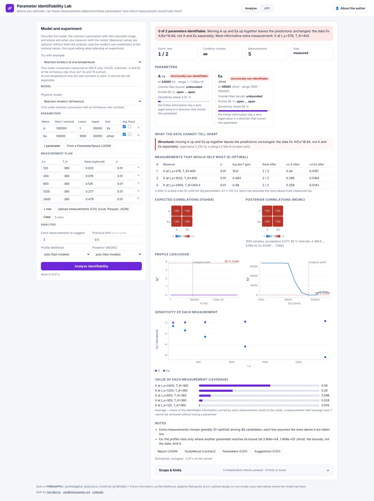

# Parameter Identifiability Lab (day 25)

**Before estimating parameters, check that the measurements can determine them.** Live at
<https://identifiability.pinneapple.org>.
Source: [`apps/identifiability_lab`](https://github.com/PINNeAPPle-Labs/PINNeAPPle/tree/main/apps/identifiability_lab).


Describe a model, the unknown parameters with their plausible range, and the measurement plan (where, when, which
observable, with what noise). The lab answers four questions on the same problem:

| Question | Method |
|---|---|
| Can any data of this kind determine each parameter? | Rank of the Fisher information; its null directions are the **ambiguities**, reported with the combination the data do fix (for example h/k) |
| Can *these* data determine it, and how precisely? | Cramér-Rao bounds and the **profile likelihood** (95 % interval, open or closed) |
| How are the estimates coupled? | Expected correlations (Fisher) and posterior correlations (adaptive Metropolis) |
| What should I measure next? | Leverage of each measurement, and the greedy **D-optimal** extra measurements, with the rank and bounds each would give |



The result downloads as a report (JSON), as CSV tables, and as a `StudyResult` contract
(`study_type="identifiability"`). The Model Calibration Lab and the Inverse Model Studio read that contract, and
call the same core to decide which parameters get a confidence interval.

## Automate it

```bash
curl -X POST https://identifiability.pinneapple.org/api/analyze -H 'Content-Type: application/json' -d @problem.json
curl https://identifiability.pinneapple.org/api/jobs/<id>           # status, progress, the report
```

The same analysis in Python: `pinneapple_analysis.inverse_problems.analyze_identifiability`. See the guide
[Identifiability, calibration and inverse problems](../guides/identifiability_calibration_inversion.md).

## Limits

The verdict is local: it holds at the analysis point and within the bounds given. It assumes the model form is right
and the noise is independent and Gaussian. The profile and the posterior run only for fast models with at most 6
parameters. The app README lists every limit.
