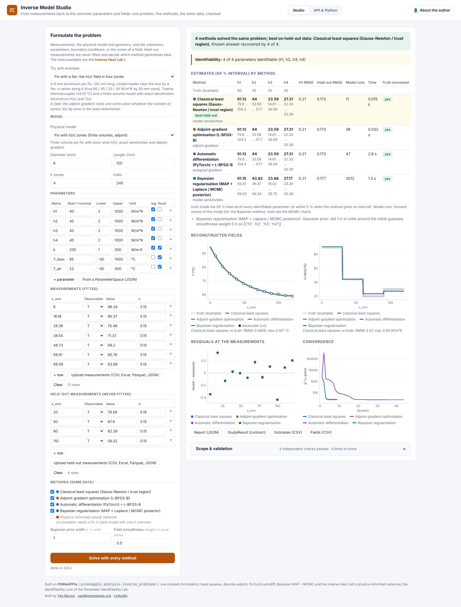
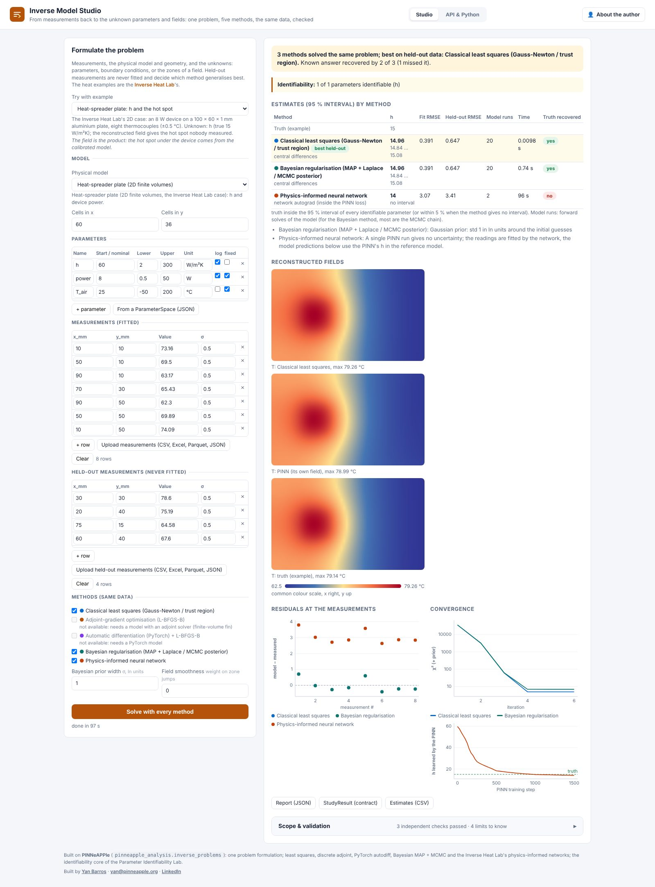
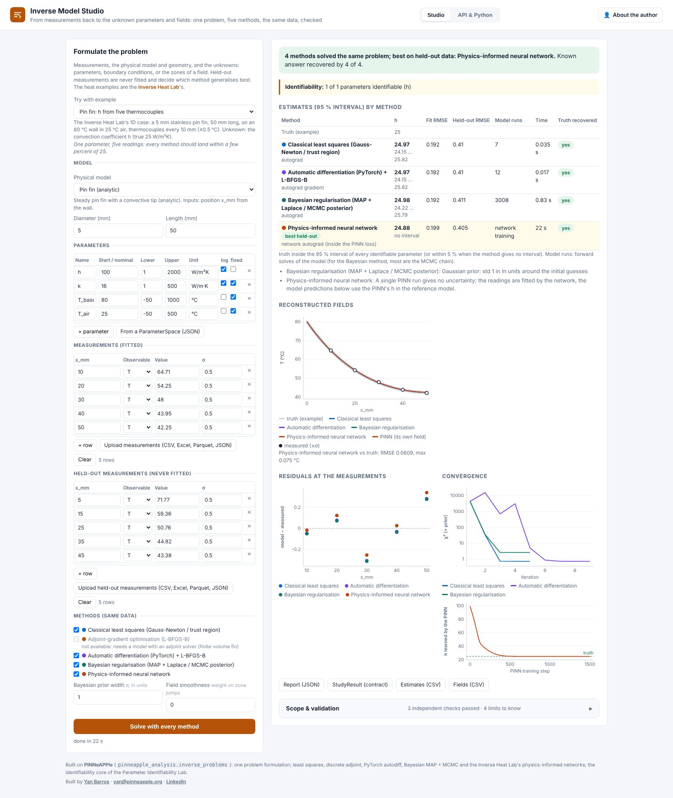

# Inverse Model Studio (day 21)

**From measurements back to the unknown parameters and fields: one problem, five methods, the same data, checked.**
Live at <https://inverse-studio.pinneapple.org>.
Source: [`apps/inverse_studio`](https://github.com/PINNeAPPle-Labs/PINNeAPPle/tree/main/apps/inverse_studio).



Formulate the problem once: measurements, a physical model and its geometry, and the unknowns (parameters,
boundary conditions or the zones of a field). The studio solves it with every method that applies, on the same data:

| Method | Uncertainty |
|---|---|
| Classical least squares (exact sensitivities, autograd or finite differences) | Gauss-Newton 95 % |
| Adjoint gradient (one adjoint solve per gradient, whatever the number of unknowns) | Gauss-Newton 95 % |
| Automatic differentiation (PyTorch) | Gauss-Newton 95 % |
| Bayesian regularisation (Gaussian and smoothness priors, MCMC) | posterior 95 % |
| Physics-informed network (the Inverse Heat Lab's fin and plate) | none from one run |

It then validates the answers:

- held-out measurements that no method saw, which rank the methods;
- the identifiability diagnosis (the [Parameter Identifiability Lab](identifiability_lab.md)'s core);
- on the examples, recovery of the known truth for the parameters and the reconstructed fields.



The heat examples are the [Inverse Heat Lab](https://inverse.pinneapple.org)'s, which stays a separate app. On its
plate, least squares on the finite-volume model gives h = 14.96 W/m²K for a true 15. The PINN gives 14.0 in 1500 steps,
although its own temperature field reproduces the hot spot. The studio shows both.



## Automate it

```bash
curl https://inverse-studio.pinneapple.org/api/presets/rod_h_field > problem.json   # a complete request
curl -X POST https://inverse-studio.pinneapple.org/api/solve -H 'Content-Type: application/json' -d @request.json
curl https://inverse-studio.pinneapple.org/api/jobs/<id>
```

In Python: `pinneapple_analysis.inverse_problems.compare_methods(InverseProblem(...), methods)`. See the guide
[Identifiability, calibration and inverse problems](../guides/identifiability_calibration_inversion.md).

## Limits

All methods fit the same model, so a missing physical effect can fool them all; read the held-out error. The adjoint
needs a discretised model with an adjoint solver (the finite-volume fin, today), and the PINN needs one of the
Inverse Heat Lab formulations. The 3D block is not run here. The app README lists every limit with the measured
results.
