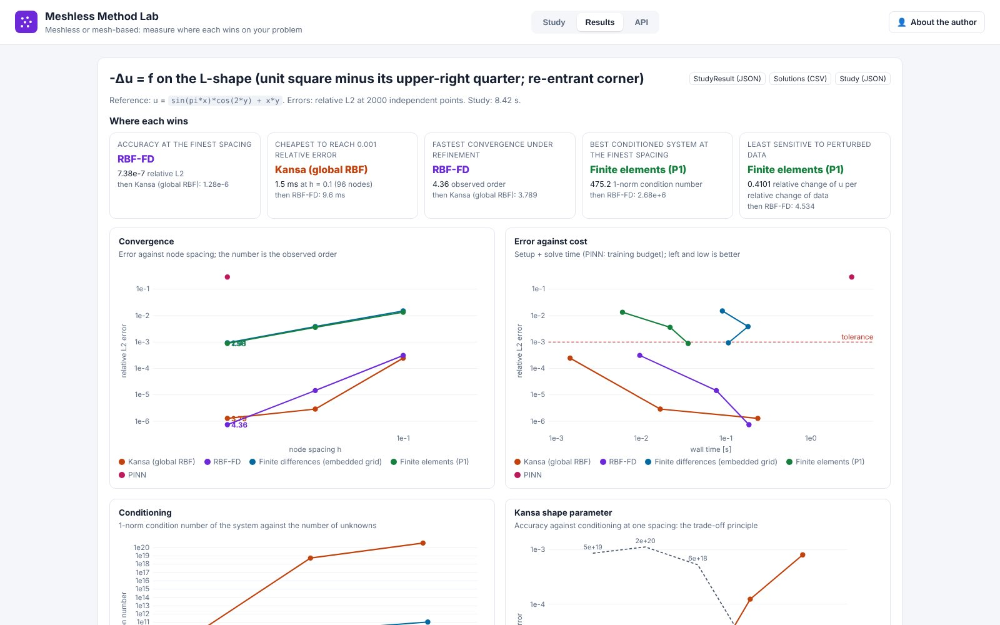
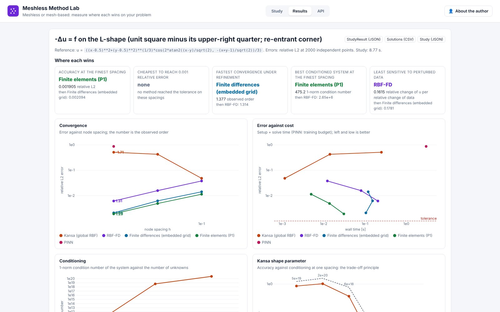
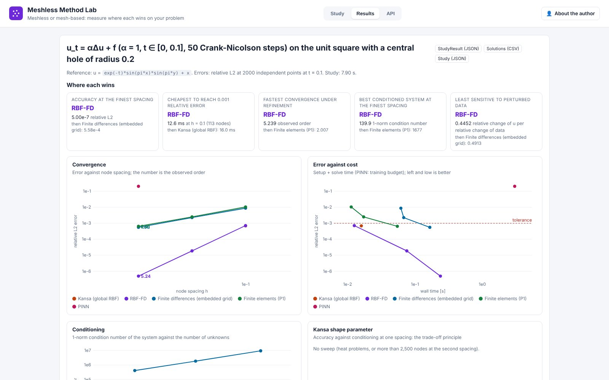

# Meshless Method Lab (day 26)

**Meshless or mesh-based: measure where each wins on your problem.** Live at <https://meshless.pinneapple.org>.
Source: [`apps/meshless_lab`](https://github.com/PINNeAPPle-Labs/PINNeAPPle/tree/main/apps/meshless_lab).

Describe a Poisson, Helmholtz or heat problem with a manufactured solution (or a source and boundary value), pick a
domain (preset, polygon with holes, uploaded point cloud) and node spacings. Kansa, RBF-FD, finite differences on an
embedded grid, linear finite elements and a PINN solve it on the same nodes; the lab reports error, cost, condition
number, noise amplification and observed order, and names the winner of each criterion from the numbers.

## Limits

2-D scalar linear problems with Dirichlet conditions; no linear elasticity or Neumann conditions yet; R-OAMS is not
in the library. See the app README.

Monetization: runs, problem size and reports.
