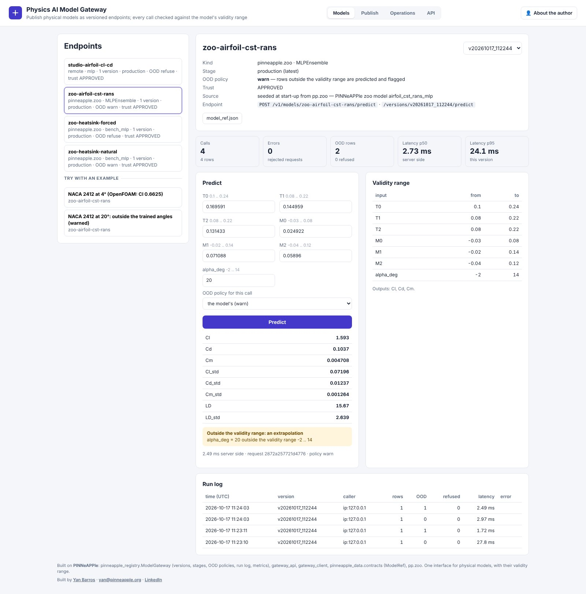
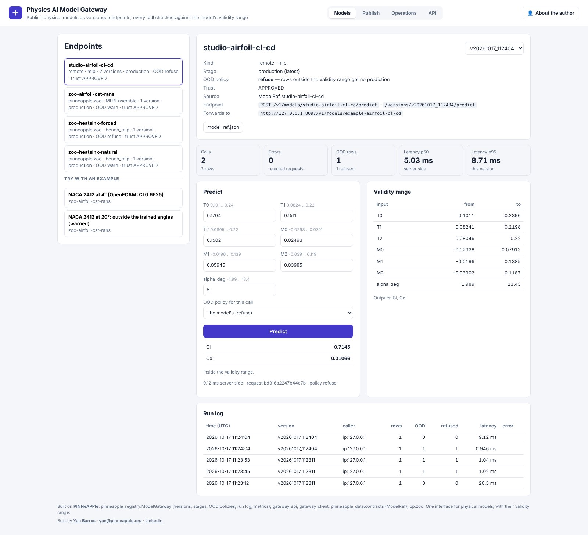

# Physics AI Model Gateway

[models.pinneapple.org](https://models.pinneapple.org) · source `apps/model_gateway`

Physical models published as versioned endpoints behind one API. Every query is checked against the model's
validity range, logged and metered.

**Models served** (`pinneapple_registry.ModelGateway`):

- zoo models;
- ONNX graphs with declared inputs, outputs and validity bounds;
- Surrogate Studio models, as a `model.zip`, or by their `ModelRef`, in which case the gateway forwards to the studio
  and enforces the bounds itself;
- any model behind the same `/v1` API.

**Per version.** Each version has a stage and an OOD policy: `warn` predicts and flags, `refuse` gives no prediction.
A caller can tighten the policy, never relax it.

**Operations.** Every call goes to the run log. Metrics per version: calls, rows, errors, OOD rows, refusals, latency
p50 / p95. Each version can be downloaded as a contracts `ModelRef`.

**Python:** `pinneapple_registry.gateway_client.GatewayClient(base_url, api_key=...)` works against this gateway and
the Surrogate Studio alike.

**Library.** `pinneapple_registry.gateway`, `gateway_api`, `gateway_client`; guide:
[Surrogates from simulation results](../guides/surrogates_arena_gateway.md).

**Limits.**

- Publishing by URL and `model.zip` uploads are admin-only.
- The OOD gate sees inputs only, and is a box for zoo, ONNX and remote models.
- JAX models must be exported to ONNX.
