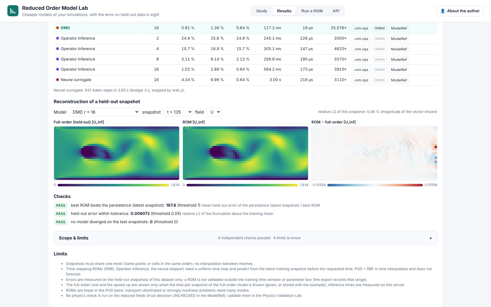
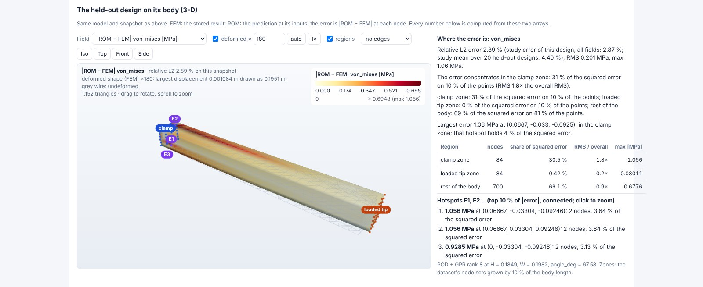
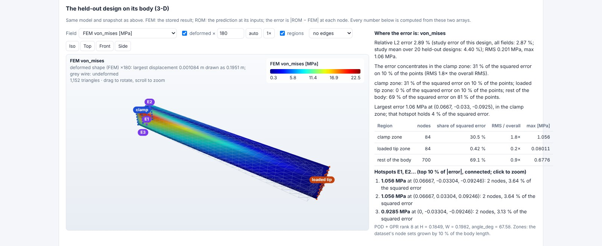

# Reduced Order Model Lab (day 19)

**Cheaper models of your simulations, with the error on held-out data in sight.** Live at
<https://rom.pinneapple.org>. Source: [`apps/rom_lab`](https://github.com/PINNeAPPle-Labs/PINNeAPPle/tree/main/apps/rom_lab).

Upload snapshots of one mesh (OpenFOAM times, VTU/VTK/FRD series, NPZ/HDF5 arrays, a CSV/Parquet table). The lab
fits POD + RBF, POD + GPR, DMD, Operator Inference and a neural surrogate at equal wall-clock budget, at several
ranks, and scores each on snapshots it never saw: later times (a forecast), interleaved times, or unseen designs. It
shows the energy of the singular values, error vs rank against the POD projection floor, error vs inference time with
the Pareto front, the speed-up over the full-order model, and the reconstruction of any held-out snapshot.

## Export and chain

- `.rom.npz`: arrays and a JSON manifest, no pickle; `ReducedModel.from_bytes(b).predict(times=...)`.
- ONNX (POD + RBF, nearest, parametric neural, DMD) plus the `spec` for `ModelGateway.publish(kind="onnx")`.
- `ModelRef` per model (held-out metrics, split, training range, SHA-256) and a `StudyResult` for the study.

## The held-out design on its body (3-D)

When the snapshots carry a mesh (a VTU/VTK/FRD series, or arrays with `cells_<type>`), the result page shows the
held-out snapshot on its own body: the full-order field, the ROM prediction and the pointwise error |ROM − FEM|, each
with a colour bar, on the shape deformed by the FEM or the ROM displacement (scale factor, true scale, undeformed
wire). The dataset's node sets are marked (the cantilever's clamp and loaded tip), with the error hotspots. A short
text, computed from the two arrays only, says where the error concentrates and compares it with the study's number
for that design and its mean over the held-out designs.

Library: `pinneapple_neural.architectures.rom.views.reconstruction_view`, built on
`pinneapple_analysis.validation.error_map` and `pp.viz.field_view`; the page uses the shared viewer
`apps/_shared/static/shared/fieldview3d.js`.

## Limits

Snapshots must share one mesh; time steppers need a uniform step and are not validated outside the training window;
no physics check runs on the reduced fields (`ModelRef.trust_decision = UNCHECKED`). See the app README.

Monetization: building, exporting and running reduced models.
