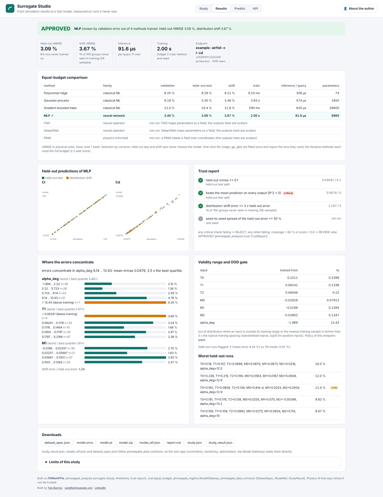
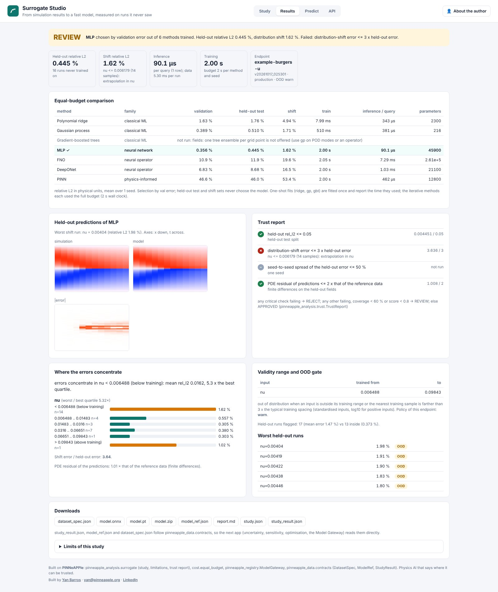
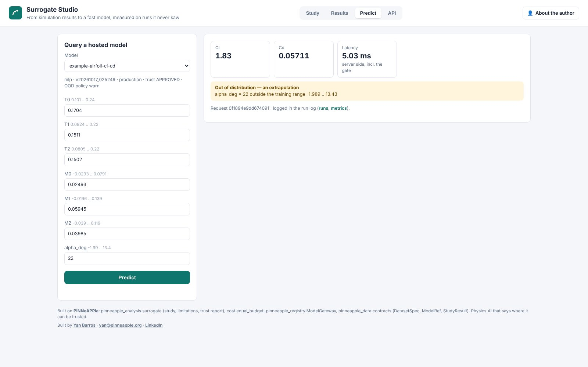
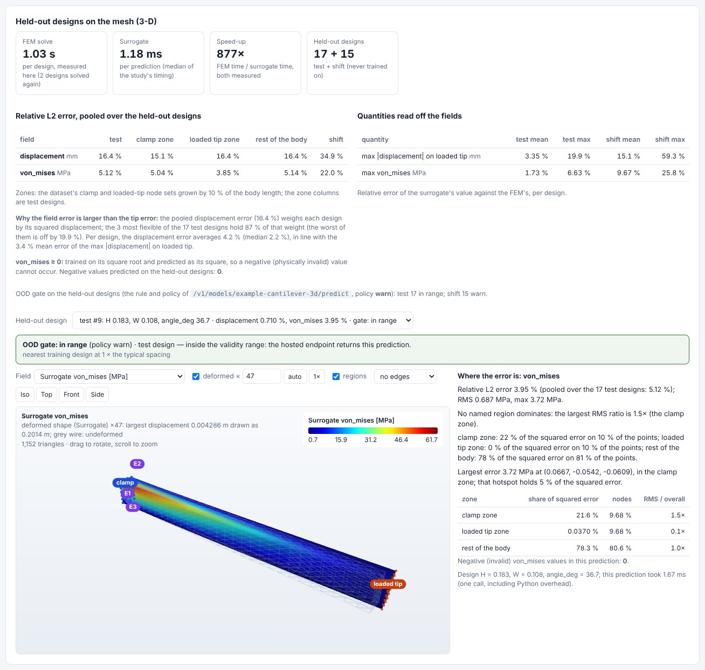
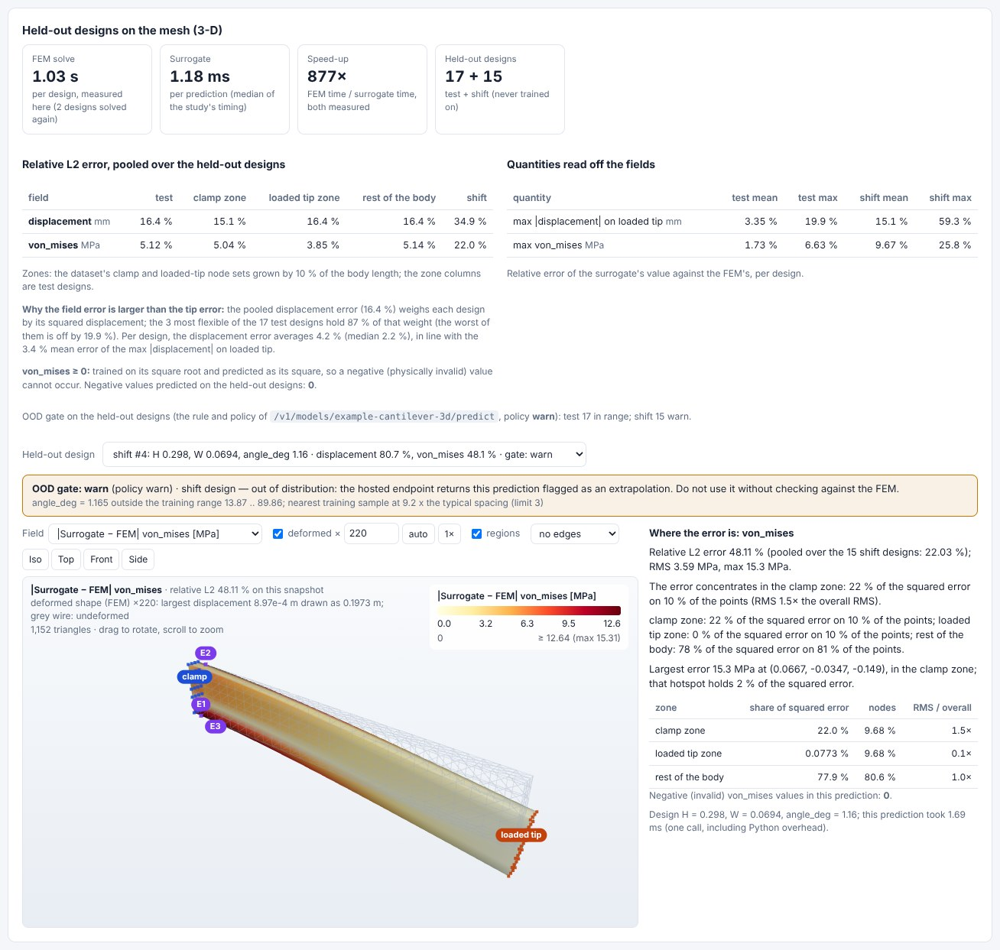

# Surrogate Studio

[surrogate.pinneapple.org](https://surrogate.pinneapple.org) · source `apps/surrogate_studio`

Turns simulation results into a fast predictive model, measured on runs it never saw, and serves it behind a
versioned endpoint that enforces its validity range.

**What it does.** You upload a table of runs (CSV, Parquet, JSON, HDF5, NPZ, or a `DatasetSpec`) and pick the
inputs and outputs. The studio then trains every applicable method on the same splits and compute budget:

- polynomial ridge, a Gaussian process, gradient-boosted trees and an MLP;
- FNO and DeepONet when the output is a field;
- a PINN when a PDE is declared.

It measures each method on a random held-out split and on a distribution-shift split (new geometries, the edge of the
design space), then picks the method with the lowest validation error. The chosen model is hosted at once at
`/v1/models/<name>/predict`, the Model Gateway's API, and screens every query with an OOD gate.

**Outputs.**

- A comparison table (error with spread over seeds, training and inference cost).
- A trust decision with every check.
- The limitations: validity bounds, where the errors concentrate, worst runs and, for fields, the error map and PDE
  residual.
- The contracts (`StudyResult`, `ModelRef`, `DatasetSpec`), a Markdown report, and ONNX and TorchScript files.

## 3-D case: the solid FEM cantilever

The ROM Lab's 100 solid-FEM cantilevers become one field dataset: displacement and von Mises stress on the
31 × 4 × 7 node lattice. A surrogate is trained with the app's methods. The results page then shows:

- the measured speed-up (FEM solve time on this machine against the surrogate's time per prediction);
- the held-out errors per field and per zone (clamp, loaded tip, rest of the body), for the test and the
  extrapolated (smallest load angle) designs;
- the errors on the tip displacement and on the largest stress;
- any held-out design on its deformed body: surrogate, FEM reference and their difference, with a colour bar, and
  the verdict of the hosted endpoint's OOD gate (in range, warn or refuse) for that design.

The von Mises stress is declared non-negative: it is trained on its square root and predicted as its square, so no
prediction can be negative. A line under the error table says why the pooled displacement error is larger than the
tip error.

**Library.** `pinneapple_analysis.surrogate` (study, splits, methods, limits, contracts),
`pinneapple_analysis.cost.equal_budget`, `pinneapple_registry.ModelGateway` and `gateway_api`; guide:
[Surrogates from simulation results](../guides/surrogates_arena_gateway.md).

**Limits.** These are measured on the same campaign, so other regimes are not covered. Methods run with their library
defaults. The physics checks are only the declared PDE residual and constraints. FNO needs a uniform 1-D or 2-D grid.
Hosted models are public unless the login or API keys are on.
