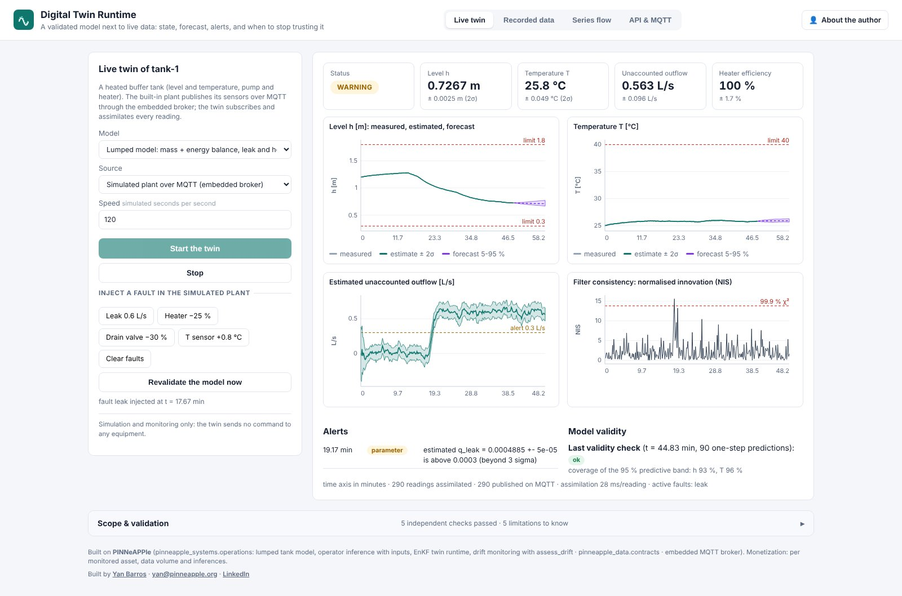
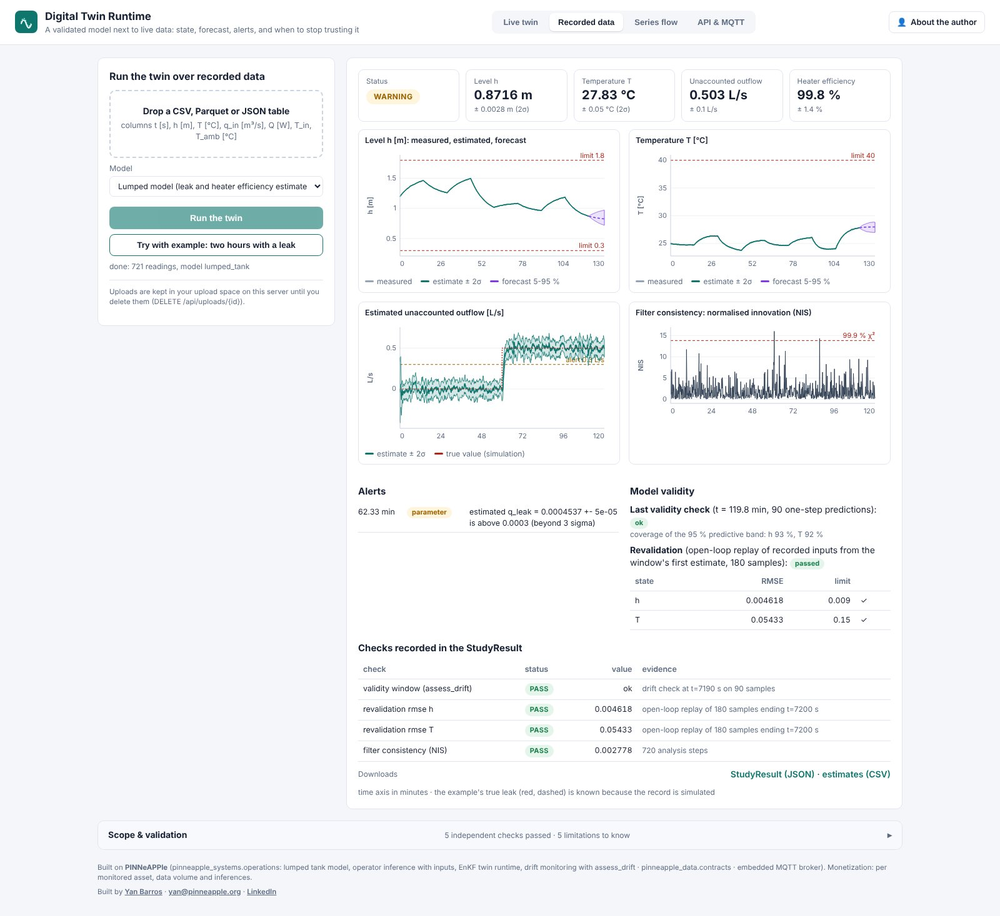
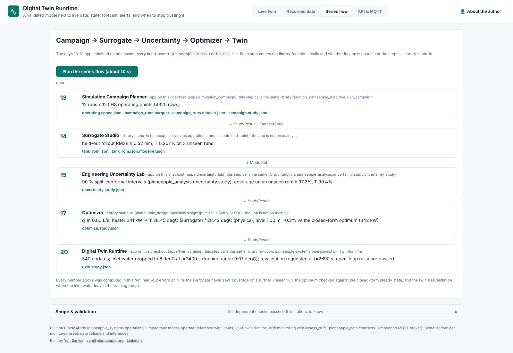

# Digital Twin Runtime (day 20)

**Put a validated model to work next to live data, and know when to stop trusting it.** Live at
<https://twin.pinneapple.org>. Source: [`apps/twin_runtime`](https://github.com/PINNeAPPle-Labs/PINNeAPPle/tree/main/apps/twin_runtime).

The runtime is deliberately small: **one model type** and **one live data source** per asset. The model is either
the heated-tank lumped model (mass and energy balances) or a reduced-order surrogate given as a `ModelRef`. The
source is MQTT (an embedded broker or yours), REST pushes, or OPC UA (experimental).

For every reading the twin:

1. **Estimates the state** with an ensemble Kalman filter (level, temperature, and optionally a leak flow and the
   heater efficiency as parameters).
2. **Forecasts** the next 10 minutes with a 5-95 % band. The band includes the uncertainty of the held inputs.
3. **Raises alerts** from explicit rules:
   - the estimate is outside its limits;
   - the forecast band reaches a limit;
   - a parameter is beyond 3σ of its limit;
   - the normalised innovation stays above its χ² quantile, which means the data disagree with the model.
4. **Watches its own validity** with `pp.assess_drift` on its one-step predictions: bias, coverage, trend, and
   inputs outside the model's training box. When the drift check says `review` or `retrain`, it requests
   revalidation, which re-scores the model open loop on the recent history.

Other systems read `GET /api/assets/{asset}/state`. The history is in SQLite or Postgres, and the run can be
downloaded as a `StudyResult`.

## The series, end to end

The *Series flow* tab chains the days 13-31 apps on one asset through the shared contracts. The campaign
(`ParameterSpace`, `DatasetSpec`) feeds the surrogate (`ModelRef` with held-out metrics), then the uncertainty
step (coverage on an unseen run), then the optimizer (checked against the closed-form physics optimum), then this
twin. The twin requests revalidation once the inlet water leaves the surrogate's training range. The campaign and
uncertainty steps call the library functions of the Campaign Planner and the Uncertainty Lab. The surrogate and
optimizer steps run as library stand-ins until those apps are on main, and the page says which is which.

## Automate it

- `POST /api/live/start` with `{"asset": "pump-7", "source": "rest"}`, then `POST /api/assets/pump-7/readings`.
- MQTT: publish JSON readings to `pinneapple/<asset>/sensors`.
- `POST /api/replay` runs a twin over a CSV, Parquet or JSON record (upload it with `POST /api/uploads` first).
- In Python, `pinneapple_systems.operations.live.replay(table, model)` and `LiveTwin`.

## Limits

- One model type and one source per asset. FMUs are not supported yet.
- Alerts are screening rules, not a safety system. The twin sends no command to equipment.
- The filter assumes Gaussian noise. Parameters move as random walks.
- OPC UA is experimental and not in the default image.

Monetization: per monitored asset, data volume and inferences.
