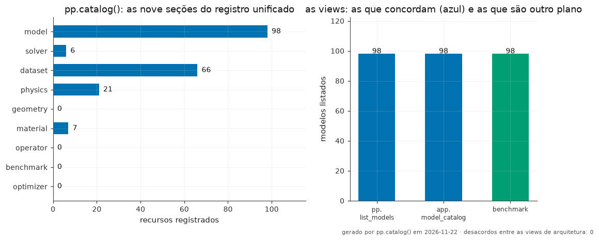

# Registro de execução do backlog 2026

Este é o registro vivo do lote de issues do plano [EXECUTION_PLAN_2026.md](../EXECUTION_PLAN_2026.md)
(espelhado em PINNeAPPle e pinneapple-engineering-api). Ele existe para responder três perguntas sem
reler 91 issues: o que está feito com evidência, o que está bloqueado e por quê, e qual é o próximo passo
de cada item.

**Regra que vale para tudo aqui:** issue só fecha com código integrado, critério de aceite satisfeito e
evidência (commit, teste, PR). O que não tem evidência fica aberto com o motivo escrito, mesmo que a data
do cronograma tenha passado.

## Estado dos dois repositórios em 2026-11-22

| Repositório | `main` | Actions |
|---|---|---|
| PINNeAPPle | `3133417b1` | rodou em 22/11 (noturna verde em `main`), mas a cota do Actions esgotou no mesmo dia: no PR #2285 parte dos jobs morre por infraestrutura (por exemplo `git` saindo 128 no diff da base). O gate desta campanha é local |
| pinneapple-engineering-api | `e1ddcea` | **parado**: os jobs morrem em 2–3 s com zero steps (runner não inicia); `MERGEABLE` ali significa só que o git mergeia |

O gate real da API é local: `ruff check .` mais `pytest -q` no `.venv`. Isto já está registrado nas
issues #154 e #216 daquele repositório.

### Portões vermelhos herdados em `main` (conferidos em worktree limpo de `origin/main`)

| Portão | O que acontece | Situação |
|---|---|---|
| `tests/test_hub_library.py` | três nós sem categoria (`vortex.cylinder`, `process.valve_joule_thomson`, `vortex.spoiler`) e o exemplo `data_readiness` sem execução gravada | **aberto**, anterior ao lote; o nó `data.public_dataset` do #1891 estava na mesma lista **por causa do lote** e foi corrigido no #2296 |
| `tests/test_digital_twin_product.py::test_export_scene_writes_a_viewer_folder` | depende de `trimesh`, que não está instalado no interpretador do gate | **ambiente**: `pip install trimesh`; não é código do lote |
| `tests/test_method_status_drift.py` | seis métodos (E10, E7, P1.1, S2, S21, S24) têm evidência de teste a mais no snapshot | **aberto**, não é deste lote: o mesmo diff num checkout de `origin/main`. Regenerar `pinneapple_catalog/method_status.json` com o scan já quebrou as fixtures de `examples/physics_check/fail` antes, então o refresh pede revisão item a item, não um comando |
| `pytest` sem argumentos | a suíte inteira não coleta: dois pares de arquivos com o mesmo basename em `tests/` (`test_registry.py`, `test_physicsnemo_bridge.py`) colidem na importação | **aberto**, idêntico num checkout de `origin/main`; rodar por diretório ou com `--ignore` de um de cada par |
| `tests/test_example_catalog.py::test_the_page_lists_every_example` | a página gerada não listava o exemplo `data_readiness`, que entrou no tier de CI | **corrigido** em `docs/guides/example_catalog.md` (commit 8d7452295), uma linha de `scripts/example_catalog.py --docs` |

`pp.catalog()` (#1478): as nove seções lidas do registro e as views que alguém lê. Azul são as que devem
concordar com o catálogo; verde é uma view que é outro plano por construção (o benchmark lista as suítes
que pontua). Zero desacordos entre as que devem concordar.

## Dia 1 — 23/11/2026 (91 issues: 69 da biblioteca + 22 da API)

Saldo depois da triagem: **6 feitas com evidência, 5 com PR aberto para revisão, 9 parciais, 5 bloqueadas e 66 pendentes.** Desde então entraram, com código integrado e teste: #59, #201, #227, #933, #1871, #918 (parcial, com gate e dois lotes), #1478, #1891, #1480, #31, #215, #167, #110, #106, #40, #1494, #205, #104, #225, #171 (parcial), #61, #62 e #102 — **vinte e dois itens do lote**, mais a integração do #1889, que era dependência do #1891. O que continua aberto tem motivo escrito na última coluna. A meta nominal do dia era 91; a diferença está descrita linha
a linha, e o plano já diz que o cronograma é fila nominal, não promessa de 91 implementações validadas.

As seis feitas nesta sessão: #59 (reprodutibilidade numérica), #201 (namespace público), #227 (sete
planos), #1494 (reparo de malha), #1871 (validação no nível da decisão) e #933 (QA revalida contra o bundle reconstruído). Cada uma tem commit, teste e,
quando o critério de aceite pedia, página de documentação — e nenhuma fecha por contagem.

### PINNeAPPle (69)

| # | Issue | Tam. | Prio | Estado | Próximo passo |
|---|---|---|---|---|---|
| 59 | [D9] Numerical reproducibility | M | P1 | **feito** | pinneapple_core.reproducibility: deterministic(), environment_fingerprint(), run_twice(); 15 testes. Commit 88b13c9d6. |
| 201 | [X17] Public namespace layout and positioning (pp.physics, … | S | P1 | **feito** | docs/architecture/public_namespace.md + README + ROADMAP §13 + tests/test_public_namespace.py. Commit 61f7e834b. |
| 227 | [X40] Architecture decision rule: seven planes (Physics IR,… | S | P1 | **feito** | docs/architecture/seven_planes.md + CONTRIBUTING + ROADMAP §13. Commit 61f7e834b. |
| 38 | [B12] run_results as verifiable evidence | M | P1 | **PR** | PR #2275 abre o manifesto de integridade determinístico de run_results; revisar e integrar. |
| 159 | [S10] Automatic conservation and boundary-condition checks | M | P1 | **PR** | Seis PRs abertos (#2276–#2283) cobrem conservação 1D/2D/3D, malha não estruturada e OpenFOAM; revisar e integrar em ordem. |
| 933 | QA pipeline: repair re-validates the source but does not re… | M | P1 | **feito** | QualityPipeline(rebuild_from_source=...): cada tentativa repara, executa, reconstrói o bundle e valida contra os dados novos, com bundle_source fresh/stale e rebuild_error; 8 testes (c35d9fcb4). |
| 1494 | [PDI 4] Mesh repair: turn the report's suggested fix into a… | M | P1 | **feito** | pinneapple_data/cae/repair.py (merge em #2285): merge_vertices, drop_degenerate_faces, drop_duplicate_faces, orient_consistently, close_holes e repair_surface; cada uma devolve o resultado com antes/depois, garantias, o que não corrige e o que regrediu. |
| 1871 | Decision-level surrogate validation: flip rate, ranking pre… | M | P1 | **feito** | pinneapple_analysis/decision: flip_rate, rank_preservation, regret, failure_map e decision_card com limiares explícitos; 20 testes (7b4d60747). |
| 31 | [B4] Unified PhysicsValidator | M | P1 | **feito** | Cinco tipos de checagem no mesmo relatório: conservação, contorno, simetria, dimensional e OOD (#2290). A dimensional compara a unidade devolvida pelo modelo e falha reportando o fator quando as dimensões batem mas a escala não; modelo sem unidade volta como "not run", nunca como passe. A OOD exige recall **e** limite de falso alarme. CheckResult ganhou `passed=None` = "not run" e `status`. 13 testes. |
| 75 | [G2] Backend per problem (PyTorch, JAX, PhysicsNeMo) | L | P1 | **parcial** | compute_backends já cobre PyTorch/JAX; falta problem.backend(...) e o caso 02 do benchmark no PhysicsNeMo. |
| 106 | [K7] Credibility and V&V report in the industry standard (ASME V&V 20) | M | P1 | **feito** | `validation` aplica o orçamento do V&V 20 (E = S − D contra u_val = sqrt(u_num² + u_input² + u_ref²)), com `u_numerical` sem default e `validation_from_gci` tirando-o de um estudo de malha; `CredibilityMatrix` segue a V&V 40 e nomeia as lacunas (#2295). 18 testes. |
| 110 | [K11] Mandatory unit layer in the API, com não-dimensionalização automática | M | P1 | **feito** | `missing_units()` + `validate(require_units=True)` recusam valor sem unidade (#2293); `to_unit_system({nome: unidade})` converte limites, faixas e parâmetros numa cópia, e recusa nome desconhecido, nome sem unidade, dimensão incompatível e unidade não lida. 11 testes. A não-dimensionalização automática segue como `ScaleSpec`, fora do escopo do aceite. |
| 167 | [S18] Reproducibility: lineage of commit, environment, seed, hardware | M | P1 | **feito** | O run record guarda commit, versões, plataforma, máquina, CPUs, seed, fingerprint do problema e pontos de avaliação (teste conferindo o `result.json` real), e `pinneapple reproduce <registro>` é o comando do aceite, com códigos de saída 0/1/2 (#2292). |
| 215 | [X31] StateEstimator: EKF, UKF, EnKF, particle filter | M | P1 | **feito** | UKF (pontos sigma, exato contra o Kalman fechado em modelo linear, 0,024 vs 0,057 do EKF na observação cúbica) e filtro de partículas (bootstrap, verossimilhança em log, ESS, reamostragem só no colapso, e duas modas) mais `StateEstimator` escolhendo entre os quatro (#2291). Os quatro recuperam o pêndulo com rmse 0,019 no ângulo medido. 15 testes. |
| 528 | Dataset and model catalogue: one registry for public physic… | M | P1 | **parcial** | pinneapple_hub.zoo já carrega datasets; falta o registro único com licença e citação e a tabela gerada. |
| 918 | One house theme for all 2-D figures (extend pinneapple_tool… | M | P1 | **parcial** | Tema, helpers (53b8ccacf) e, no #2301, codemod + gate de figura: `scripts/apply_house_theme.py --check` reprova exemplo que desenha sem `use_theme`, com dívida declarada em `examples/.house_theme_baseline` que só encolhe (114 de 139 restantes) e 21 testes próprios, incluindo o do import multilinha que o codemod quebrava (#2309). 25 exemplos migrados, cada lote com sheet antes/depois em `docs/assets/house_theme/`. Falta migrar os 114. |
| 1474 | [E3] Plugin diagnostics: list, inspect, doctor, enable, dis… | M | P1 | **bloqueada** | Depende de #1472 (contrato de plugin) e #1473 (busca por capacidade), ambas abertas; hoje não há sistema de plugins para diagnosticar. |
| 33 | [B7] DesignPipeline: from problem to validated design | L | P1 | **pendente** | Encadear geometria → surrogate → otimizador → verificação sobre DesignOptLoop, com orçamento e critério de parada. |
| 34 | [B8] ActiveLearning behind one interface on Experiment | M | P1 | **pendente** | ResidualBasedAL e AdaptiveCollocationTrainer existem; falta a opção active=True em Experiment e a medida de ganho no benchmark. |
| 35 | [B9] Multi-fidelity workflow | L | P1 | **pendente** | Dois níveis de dados; medir ganho contra usar só alta fidelidade. Depende do custo medido (D1) e de K4. |
| 40 | [B14] Generated cards for models, datasets and benchmarks | M | P1 | **feito** | `pinneapple model-card <registro>` gera do `result.json` e valida na mesma chamada: métricas registradas, custo medido (wall time, pontos, opções e parâmetros), domínio de validade e proveniência; `validate(require_cost=True, require_validity=True)` é o portão do caminho gerado (#2296). 11 testes. |
| 46 | [A5] Errors that teach | M | P1 | **pendente** | Auditar os 30 erros mais comuns e reescrever com a ação sugerida. |
| 52 | [D1] Measured cost for every method in the catalog | L | P1 | **pendente** | pinneapple_analysis.cost existe; falta medir tempo, memória, FLOPs e expoente por método do catálogo. |
| 53 | [D2] Cost regression gate in CI | M | P1 | **pendente** | O Actions do PINNeAPPle voltou a rodar (noite de 22/11 verde em main), então o gate de FLOPs com baseline versionado é possível; falta o baseline. |
| 57 | [D6] Digital twin benchmark | L | P1 | **pendente** | Caso de gêmeo (canal aquecido) com protocolo e tabela de resultados. |
| 58 | [D7] Extrapolation error and validity domain in every case | M | P1 | **pendente** | Coluna de extrapolação em cada caso, com o envelope declarado. |
| 61 | [E2] Render PINN and surrogate fields on arbitrary meshes | M | P1 | **feito** | `pp.viz.render_field(model, domínio)` avalia o modelo onde a pergunta está e escreve a figura e o `.vtu` dos mesmos números; `write_vtu` escreve VTK XML sem dependência opcional, com células de vértice para nuvem de pontos e conectividade própria para malha (#2306). O nome não é `render(model, domain)` porque `pp.viz.render` já é o render de cena do Blender. 13 testes, incluindo a leitura do arquivo pelo pyvista. |
| 62 | [E3] Streamlines, isosurfaces, slices and vectors | M | P1 | **feito** | `scripts/gallery_postprocessing.py` gera as seis figuras (corte com vetores, isosuperfície, linhas de corrente, tubos, setas, composto) do ABC de Euler numa caixa 2π, no tema da casa; imagens em `docs/assets/postprocessing/` e guia com as seis (#2307). 4 testes rodam o script. |
| 68 | [F1] CalculiX in the benchmark | L | P1 | **pendente** | Caso estrutural (viga e suporte) com referência ccx no benchmark. |
| 70 | [F3] CalculiX Docker image: multi-platform and tested in CI | S | P1 | **pendente** | A imagem existe e o CI do PINNeAPPle roda; falta o teste de um caso ccx real e o pin por digest. |
| 77 | [G5] Parameter discovery with identifiability | M | P1 | **pendente** | Fluxo dado medido → estimativa → intervalo, com aviso de não identificabilidade. |
| 79 | [G7] Design optimization with a budget | L | P1 | **pendente** | Loop com surrogate, validação no solver e parada por custo. |
| 83 | [G11] Geometry-conditioned surrogates | L | P1 | **pendente** | Caso com geometria fora do treino e erro reportado (caso 03 do benchmark). |
| 84 | [H1] End-to-end digital twin with real sensors | L | P1 | **pendente** | Fluxo único com stream simulado e as métricas do benchmark de gêmeos. |
| 93 | [I6] Python, PyTorch and OS version matrix | M | P1 | **pendente** | Com o CI do PINNeAPPle ativo, a matriz Python 3.10–3.13 x PyTorch atual/anterior x Linux/macOS/Windows é montável. |
| 101 | [K2] Export a validated surrogate as an FMU (Simulink, Mode… | L | P1 | **pendente** | Exportar surrogate validado como FMU com envelope de validade embutido. |
| 102 | [K3] Bayesian optimization and sequential experimental design | M | P1 | **feito** | `pp.BayesianOptimizer` com GP de kernel anisotrópico, EI/PI/UCB, batelada, maximização e restrições por um segundo GP (#2308). Medido, 5 sementes: branin em 24 chamadas, o laço atinge o alvo em 5/5 com mediana de 16 chamadas contra 1/5 do aleatório; hartmann3 em 30, 5/5 com mediana 12 contra 3/5. 19 testes. |
| 103 | [K4] Multi-fidelity models and data (co-kriging, discrepanc… | L | P1 | **pendente** | Co-kriging e correção de discrepância; dois níveis batendo o melhor nível único a custo igual. |
| 104 | [K5] Classical uncertainty propagation (polynomial chaos, M… | M | P1 | **feito** | Já estava entregue: `propagate_space` (Monte Carlo, hipercubo latino, Sobol) e `polynomial_chaos` com índices de Sobol e erro de estimativa LOO Q², sobre cinco distribuições de entrada. Fechado com a medida do aceite — caos polinomial grau 1 contra Monte Carlo de 200 mil amostras em `f = a*b`: média 2,0052 vs 1,9999 (exato 2), desvio 0,1657 vs 0,1635 (exato 0,1634), LOO Q² 0,9979. Testes em `tests/test_uncertainty_study.py` (Ishigami com tolerância de 3 % na variância). |
| 105 | [K6] Bayesian parameter inference (MCMC and simulation-base… | L | P1 | **pendente** | Posterior com MCMC ou inferência baseada em simulação, com diagnóstico de convergência. |
| 136 | [G4] PINN surrogate in parametric studies | M | P1 | **pendente** | Surrogate tipo pinn em estudo paramétrico, com campos por amostra. |
| 152 | [S3] Generic simulation factory (CAD → DOE → solver → datas… | L | P1 | **pendente** | Fábrica CAD → DOE → solver → dataset → QC. |
| 153 | [S4] Active learning: choose the next simulations from unce… | M | P1 | **pendente** | Escolher as próximas simulações pela incerteza. |
| 155 | [S6] Common PhysicsModel interface over PINN, operator, GNN… | L | P1 | **pendente** | Interface comum sobre PINN, operador, GNN, ROM e híbridos. |
| 156 | [S7] Physical Data Graph: lineage from problem to prediction | L | P1 | **pendente** | Grafo de dados físicos: linhagem do problema à predição. |
| 171 | [S22] Dataset coverage and regime audit | M | P1 | **parcial** | Regimes no auditor com `regimes=` e presets (Reynolds de tubo e de placa plana, Mach, Prandtl, Rayleigh): faixa sem amostra reprova e `missing_regions()` devolve o intervalo a amostrar (#2305). Medido nas 436 corridas de aerofólio do repositório: laminar e transitional ausentes, e todas as faixas compressíveis ausentes. Falta o segundo benchmark público, que exige download (AirfRANS/NASA TMR). |
| 172 | [S23] Typed design constraints checked in stages | L | P1 | **pendente** | Restrições de projeto tipadas, checadas por etapa. |
| 205 | [X21] Dimensional consistency checker for equations (pp.che… | M | P1 | **feito** | `pp.check_dimensions` lê a equação termo a termo (`dT/dt`, `∂²T/∂x²`, `∇²T`, `laplacian/lap/grad/div`) e dá a unidade de cada um a partir das unidades do problema, citando o termo que quebrou; recusa por nome o que não sabe em vez de assumir unidade. `PhysicalProblem.dimensions()` e `validate(equations=...)` põem o problema dimensional na mesma lista dos estruturais (#2302). 29 testes com a equação de calor consistente e a semeada inconsistente. |
| 209 | [X25] Adaptive sampling engine with multi-signal scoring | M | P1 | **pendente** | Sampler adaptativo com pontuação multi-sinal batendo Sobol a orçamento igual. |
| 225 | [X38] Cross-version compatibility and schema migrations | M | P1 | **feito** | O leitor separa esquema (o que é legível) de versão da biblioteca (do que avisar): esquema antigo com migração registrada lê e reporta `migrated`, sem migração e mais novo recusam com a versão que escreveu e o que fazer; major diferente recusa (#2304). `MIGRATIONS` é o registro em cadeia, vazio hoje porque o formato só teve uma versão. 11 testes. |
| 265 | NASA Turbulence Modeling Resource verification suite in Ope… | M | P1 | **pendente** | Suíte TMR: precisa das malhas do TMR e de OpenFOAM; o helper de convergência não existe ainda. |
| 272 | Classical CFD validation cases: lid-driven cavity (Ghia), b… | M | P1 | **pendente** | Cavidade (Ghia), degrau (Armaly), pitzDaily e damBreak como benchmarks de registro. |
| 281 | Shared 3D result viewer: extract the aero_optimizer glTF/Th… | M | P1 | **pendente** | Extrair o visualizador glTF/Three.js do aero_optimizer para pp.viz. |
| 294 | Low-fidelity solver ladder for external flow: VLM/panel, co… | M | P1 | **pendente** | Escada de fidelidade com tabela custo-precisão medida. |
| 295 | Simulation campaign runner: thousands of runs with a job qu… | M | P1 | **pendente** | Runner de campanha com fila, retentativas e cache por hash; apps/simulation_campaign é o embrião. |
| 447 | Lab: rerun car_surrogate (interrupted during FNO training) … | M | P1 | **pendente** | Rerodar car_surrogate solto da sessão (job longo) e commitar a corrida. |
| 494 | Surrogate warm start for OpenFOAM: initialise runs from the… | M | P1 | **pendente** | Warm start do OpenFOAM a partir do campo previsto, com tabela de speedup. |
| 515 | yt reader: load Enzo, FLASH, RAMSES, GADGET, AREPO, Athena+… | M | P1 | **pendente** | Leitor yt para Enzo, FLASH, RAMSES, GADGET, AREPO e Athena++. |
| 625 | Full regression suite: re-measure the failures on v0.7.0 an… | M | P1 | **pendente** | Rodar a suíte completa em v0.7.0, classificar cada falha e corrigir ou quarentenar. |
| 911 | Football: calibrate broadcast ball height with gravity as t… | M | P1 | **pendente** | Calibrar a altura do feed com g = 9,81 fixo e inferir arrasto e rotação. |
| 917 | Football: broadcast-style 3-D replays and a club-grade matc… | M | P1 | **pendente** | Replays 3-D e relatório de partida em estilo de transmissão. |
| 923 | Experiment quality checklist and badge (baseline, held-out,… | M | P1 | **pendente** | Bloco de qualidade no experiment.json com selo; o CI do PINNeAPPle roda, então os selos podem ser gerados no workflow. |
| 927 | Sensitivity Lab: propagate surrogate error into the Sobol i… | M | P1 | **pendente** | Propagar o erro do surrogate para os intervalos de Sobol e reportar estabilidade de ranking. |
| 1477 | [E6] One model provider interface (PyTorch, JAX, ONNX, Torc… | M | P1 | **pendente** | Contrato ModelProvider sobre zoo, hub, pinneapple_neural e model_export. |
| 1478 | [E7] One catalogue facade over the five list_models() | M | P1 | **feito** | pp.catalog() em pinneapple_core/catalog.py: nove seções lidas do registro unificado, units/variables/provenance None quando não declarados, as views com os ids de cada uma, view_notes() para as que são outro plano e discrepancies() para as que devem concordar; to_markdown() gera a tabela. 11 testes (#2286, 7e1b18d20). |
| 1479 | [E8] Kubernetes and cloud batch executors behind the existi… | M | P1 | **pendente** | Executores Kubernetes e batch atrás do contrato existente; verificável com dublê, sem cluster. |
| 1480 | [E9] Reproducible execution from an experiment id | M | P1 | **feito** | pp.experiments.reproduce(id) em pinneapple_physics/experiments.py: resolve, verifica, roda, compara e devolve reproduced / divergent / refused, nomeando o que mudou (software, hardware, entrada, métrica). Recusa é resultado, não exceção. Dois tipos de registro: experimento (experiment.json + result.json) e run de fluxo (pf.reproducibility.save_run grava flow/run/environment e o reprodutor re-roda com cache desligado). Registro sem ambiente não vira reproduced. 16 testes; docs/guides/reproducing_a_run.md. |
| 1481 | [E10] Workflow and experiment observability: structured run… | M | P1 | **pendente** | Eventos estruturados de run/step e pp runs why. |
| 1891 | A pipeline node that reads a catalogued public dataset, wit… | M | P1 | **feito** | data.public_dataset (#2287, 3133417b1): bundle → tabela X/Y igual à do data.ingest, recusa sem leitor citando formatos e homepage, portão não comercial com PINNEAPPLE_COMMERCIAL_MODE=1, licença e digest dentro do npz, gates de schema nas métricas e escolha registrada com os candidatos quando não há id. 10 testes com um HDF5 real no layout do PDEBench. Dependia de #1889, integrado em main no mesmo dia. |

### Engineering API (22)

| # | Issue | Tam. | Prio | Estado | Próximo passo |
|---|---|---|---|---|---|
| 37 | Engineer 5/5: action log: every action, generated code, que… | M | P1 | **PR** | PR #780 fecha o log de auditoria à prova de adulteração; revisar e integrar. |
| 104 | Aponte CCX_BIN no deploy de produção (sem solver, contact.*… | S | P1 | **PR** | PR #781 liga o CalculiX opcional no deploy; revisar e integrar. |
| 105 | Ajuste forçado com dois materiais (Lamé com E1 ≠ E2) | M | P1 | **PR** | PR #779 traz a referência de Lamé com dois materiais; revisar e integrar. |
| 102 | CI: instalar o CalculiX e rodar as verificações de contato … | S | P1 | **parcial** | Código já em feat/prepomax-contato (68f2198, ad4f143, 9574349), mas o CI da API não inicia runner (0 steps), então o aceite "roda de verdade no CI" não pode ser verificado. |
| 29 | Numerical lab in the app (cálculo numérico): methods, measu… | L | P1 | **bloqueada** | Depende de #1048 (módulo de métodos numéricos), aberta na biblioteca. |
| 30 | Physics by area in the app: one page per area, experiments … | L | P1 | **bloqueada** | Depende de #1049 (experimentos por área em pp.science), aberta na biblioteca. |
| 31 | "New study" wizard: generic Physics AI studies without code… | L | P1 | **bloqueada** | Depende de #1036 (study spec e run_study), aberta na biblioteca. |
| 103 | Tela dos casos de contato no Studio (#/contato) | M | P1 | **bloqueada** | Depende de app/prepomax, que só existe em feat/prepomax-contato; integrar a branch primeiro. |
| 27 | Paused work: Engineer step titles, rules-path tool choice, … | M | P1 | **pendente** | Itens de Studio (tour e capturas) e bump do PINNEAPPLE_COMMIT; a parte de Engineer foi entregue em #26. |
| 28 | Control engineering and naval in the app (Studio cards, plo… | L | P1 | **pendente** | #1046 (control/naval) já está em main: dá para subir o PINNEAPPLE_COMMIT e fazer cards, gráficos e galeria. |
| 32 | LLM-driven Engineer with PINNeAPPle as context: goals to pi… | L | P1 | **pendente** | Guarda-chuva do Engineer (5 sub-issues); fechar só quando as cinco estiverem integradas. |
| 33 | Engineer 1/5: LLM fallback with PINNeAPPle as context when … | L | P1 | **pendente** | Fallback por LLM com contexto da biblioteca, com resposta validada por esquema. |
| 34 | Engineer 2/5: "Mapped problems" screen: equations, conditio… | M | P1 | **pendente** | Tela de problemas mapeados com equações em LaTeX e revisão versionada. |
| 35 | Engineer 3/5: experiment session: from a hypothesis to a Ve… | L | P1 | **pendente** | Sessão de experimento: hipótese → claims pré-registrados → veredito VeriPhysics. |
| 36 | Engineer 4/5: goal → conversational pipeline over existing … | L | P1 | **pendente** | Meta → pipeline conversacional e criação de ferramenta faltante com gates. |
| 38 | UGS operations in the app: scenario comparison, recommended… | L | P1 | **pendente** | Operações de UGS no app (comparação de cenários, cronogramas, aprovação). |
| 44 | Execution beyond the CPU sandbox: external solver workers (… | L | P1 | **pendente** | Workers por capacidade (gpu, openfoam, calculix, fenics) e jobs longos com checkpoint. |
| 87 | Architecture: establish the commercial platform contracts (… | M | P1 | **pendente** | Contratos comerciais (Core, Runtime, Modules, Entitlements, Frontend) como documento. |
| 97 | Define proprietary product licensing boundaries and third-p… | M | P1 | **pendente** | Licença proprietária, avisos Apache-2.0 e inventário de dependências; exige revisão jurídica. |
| 98 | Enterprise Deployment Profiles & Data Governance | L | P1 | **pendente** | Perfis de implantação (SaaS, nuvem do cliente, on-prem) e governança de dados. |
| 99 | Cloud Execution Observability & Operational Telemetry | L | P1 | **pendente** | Observabilidade operacional: logs, métricas, traços e correlação de IDs. |
| 100 | Production Model Lifecycle & Release Governance | L | P1 | **pendente** | Ciclo de vida de modelo em produção: promoção, aprovação, sombra, rollback. |

## Parciais: o que falta, em uma linha

- **#31 PhysicsValidator** — falta o tipo dimensional e o de OOD; conservação, contorno e simetria já rodam.
- **#75 backend por problema** — `compute_backends` cobre PyTorch/JAX; falta `problem.backend(...)`.
- **#106 V&V** — soluções manufaturadas e GCI existem; falta o relatório ASME V&V 20.
- **#110 camada de unidades** — `physical_units` existe; falta o `PhysicalProblem` rejeitar campo sem unidade.
- **#167 linhagem** — o fingerprint de ambiente (#59) e o `.ppx` cobrem parte; falta amarrar commit e hardware.
- **#215 StateEstimator** — EKF e EnKF existem; faltam UKF, partículas e estado latente.
- **#528 catálogo de datasets** — `zoo` carrega; falta o registro único com licença, citação e tabela gerada.
- **#918 tema único** — módulo, helpers, testes e guia entregues; falta migrar os exemplos e o gate de figura.
- **API #102 CalculiX no CI** — código pronto na branch; o CI da API não inicia runner.

## Bloqueadas e por quê

| Issue | Dependência | Próximo passo |
|---|---|---|
| PINNeAPPle #1474 | #1472 e #1473 (contrato e busca de plugin), abertas | Não há plugin para diagnosticar antes do contrato existir |
| API #29 | PINNeAPPle #1048 | Subir `PINNEAPPLE_COMMIT` quando o módulo numérico entrar |
| API #30 | PINNeAPPle #1049 | Idem, para os experimentos por área |
| API #31 | PINNeAPPle #1036 | Idem, para o study spec e o `run_study` |
| API #103 | `app/prepomax` só existe em `feat/prepomax-contato` | Integrar a branch antes da tela |

## O que mudou no plano

- **CI do PINNeAPPle voltou.** As issues #53, #70, #93 e #923 estavam bloqueadas por "CI sem billing" e
  deixam de estar: o Actions roda e a noturna de `main` passou. O CI da API continua parado.
- **O gate de cobertura do Flow estava vermelho em `main`**: `physics_tensor`, `provenance`, `readiness` e `review`
  não tinham nó nem razão. Corrigido junto com os módulos desta branch (#1494, #1871), com a razão que cada módulo
  de fato tem.
- **A campanha paralela já abriu PR por issue em algumas frentes.** Antes de implementar qualquer item,
  consultar os PRs abertos: #2275–#2283 (conservação e evidência) na biblioteca, #779, #780 e #781 na API.

## Cadência

Os checkpoints nominais do plano são 455 em 27/11, 910 em 04/12, 1.365 em 11/12 e 1.627 em 16/12. Eles são
aritmética, não previsão: o que vale é o que este registro mostrar ao fim de cada dia, com a velocidade
real por tamanho (S/M/L) medida contra o que foi entregue.
