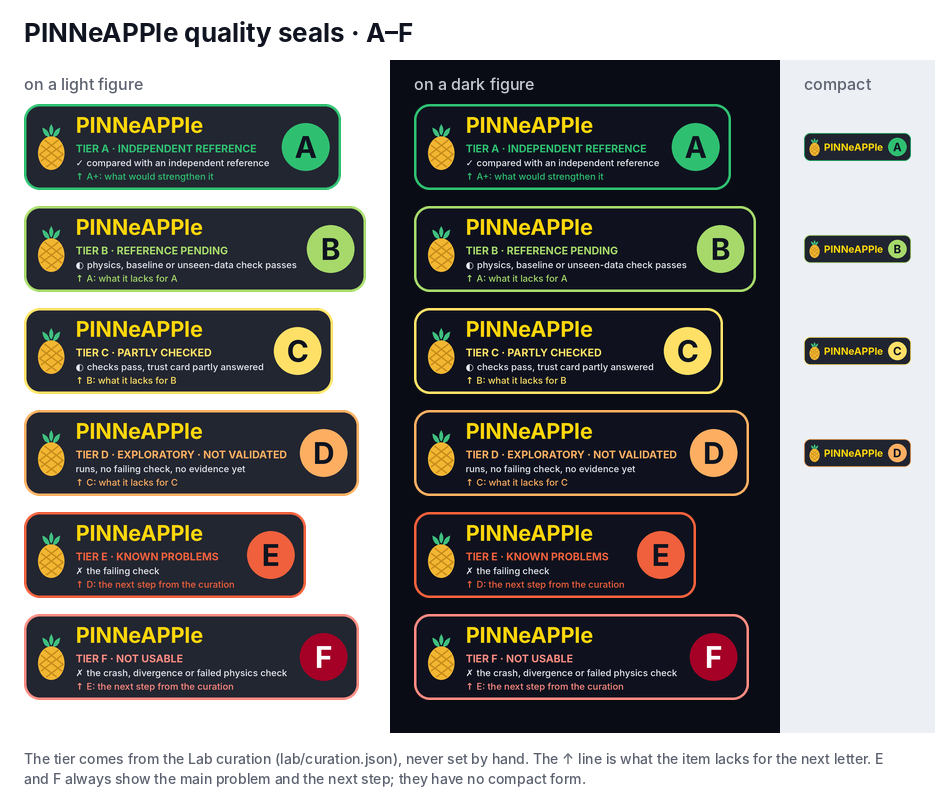
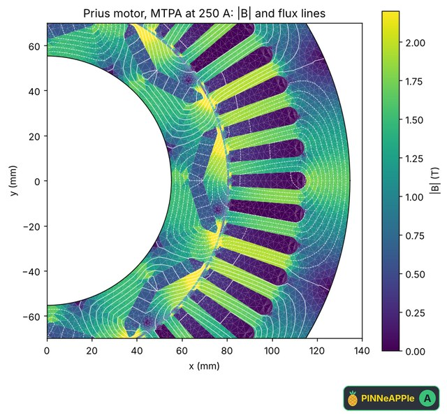
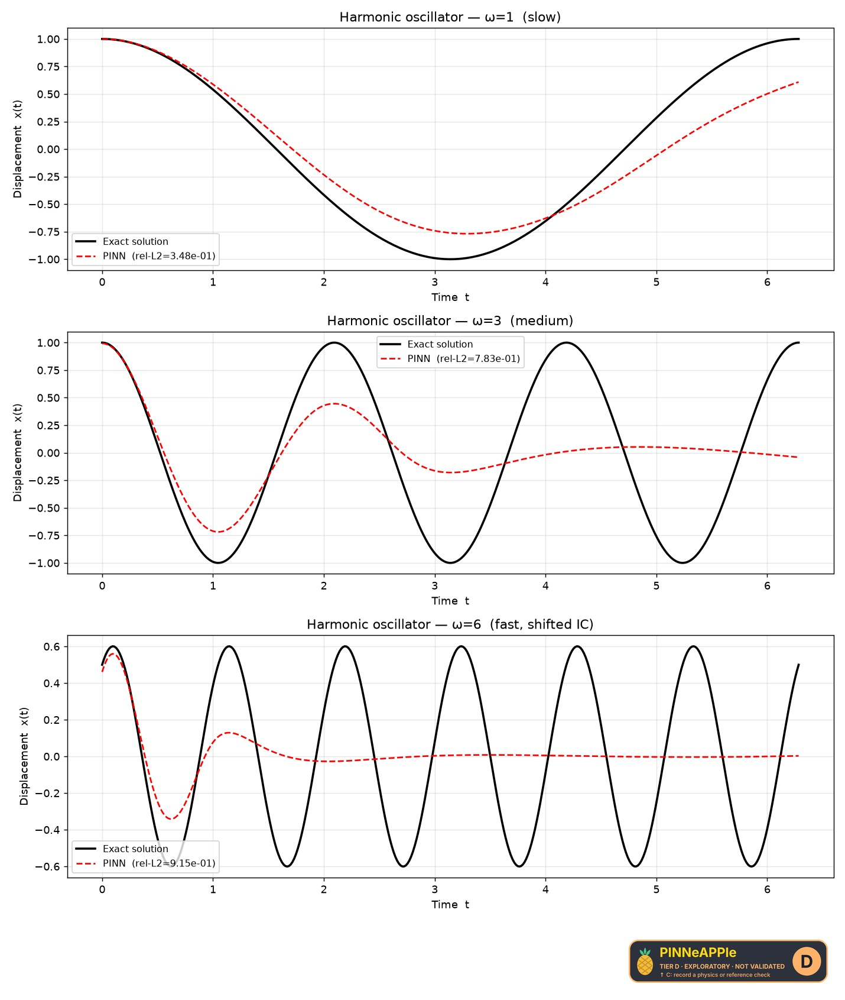
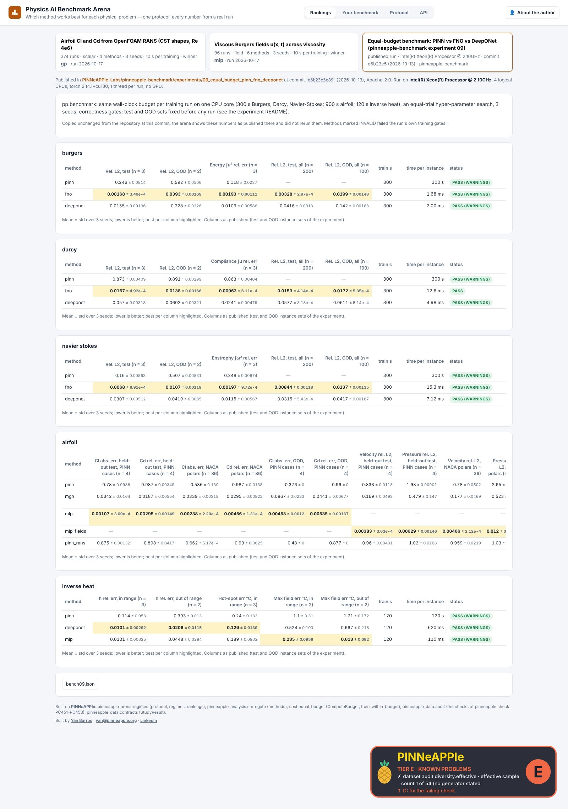
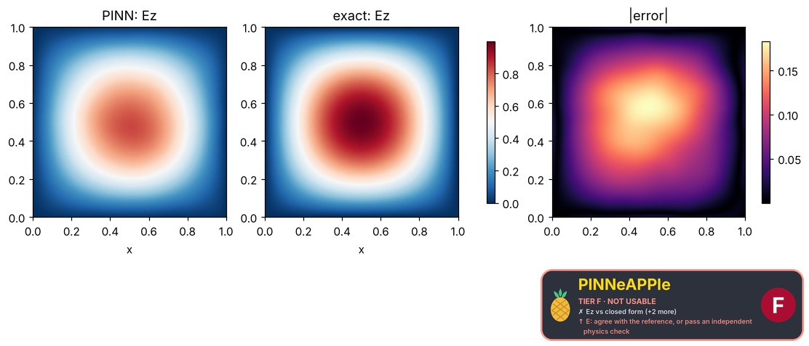
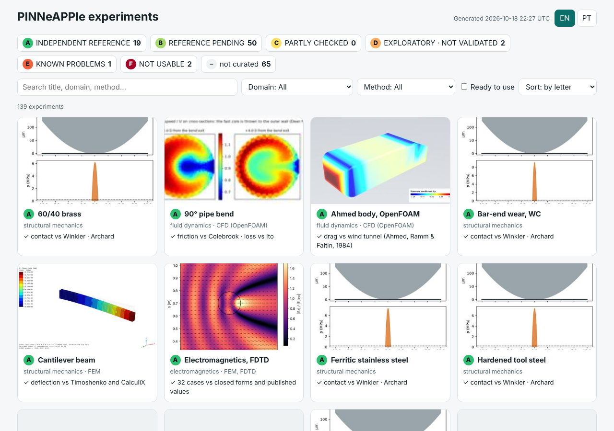
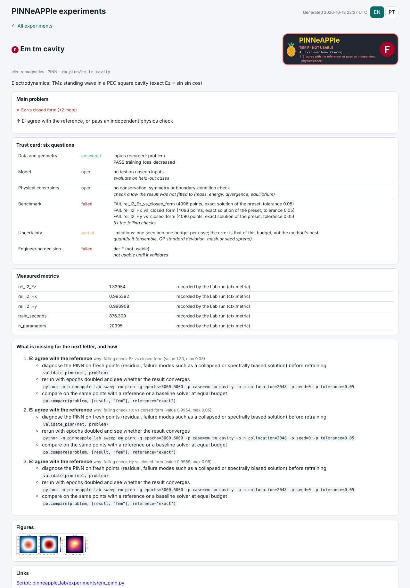
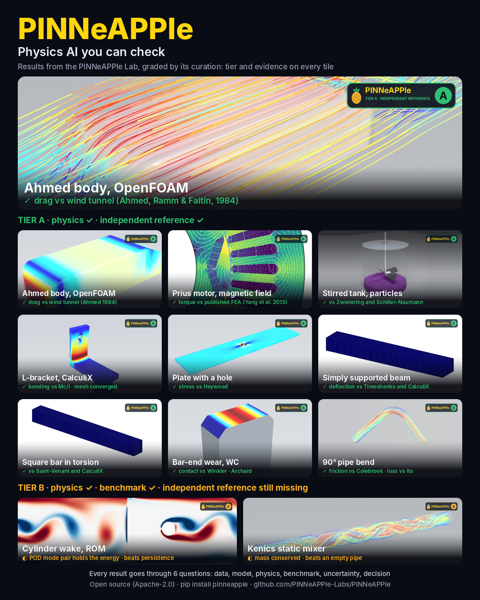

# PINNeAPPle Lab: experiments at scale, and a database of results and datasets

**[Open the experiment catalogue](../lab/index.html)**: every experiment with its figures, movies, checks, tiers and trust card, generated by `python -m pinneapple_lab site docs/lab`.

`pinneapple_lab` runs experiments reproducibly and stores everything they produce in one place. The goal is a growing
database of physics experiments that can be used as demonstrations and use cases, and as training data for
future PINNeAPPle models.

## The idea

An **experiment** is a class with parameters and a `run(ctx)` method. A **run** is one execution with one set of
parameters. Its id is a hash of the experiment, its version and the parameters, so:

- the same run is never computed twice; an existing result is returned as `cached:...`;
- changing the experiment's code meaning means bumping `version`, which keeps the old results apart.

Through the `RunContext`, an experiment records:

| what | how | where |
|---|---|---|
| inputs and outputs | `ctx.input(name, value)`, `ctx.output(name, value)`: arrays → `.npy`, dicts / numbers → `.json`, files → copied | `inputs/`, `outputs/` |
| metrics | `ctx.metric(name, value, step=None)`; final values plus a curve log | `metrics.json`, `metrics_log.jsonl` |
| validation | `ctx.check(name, passed)` or `ctx.check(name, value=..., reference=..., rtol=..., max=...)`; a failed check ends the run as `failed_validation` | `validation.json` |
| status and stages | `with ctx.stage("train"):`; statuses `running`, `completed`, `failed_validation`, `failed` (with traceback) | `run.json`, `progress.json` |
| figures and animations | `ctx.figure(name, fig)`, `ctx.image(name, array)`, `ctx.gif(name, frames)` | `figures/` |
| datasets | `ds = ctx.dataset(name, units=...)`, then `ds.add(**sample)`; samples are written in shards, with a card (schema, shapes, value ranges, units, provenance, checksum) | `datasets/<name>/` |
| provenance | parameters, git commit, Python and package versions, timings | `run.json` |

Runs live in `lab/runs/<experiment>/<run_id>/` and are indexed in `lab/index.sqlite`. Set the location with `--root`
or `$PINNEAPPLE_LAB`.

## Use

```python
from pinneapple_lab import Experiment, register, run, sweep, LabStore

@register
class MyExperiment(Experiment):
    name = "my_experiment"
    version = "1"
    params = {"Re": 100.0, "seed": 0}
    space = {"Re": ("log", 10.0, 1000.0)}           # for random / Latin-hypercube sweeps

    def run(self, ctx):
        with ctx.stage("simulate"):
            field, cd = simulate(ctx.params["Re"])
        ctx.metric("drag_coefficient", cd)
        ctx.check("drag_positive", value=cd, min=0.0)
        ctx.dataset("fields").add(u=field, Re=ctx.params["Re"])
        ctx.figure("field", plot(field))

run("my_experiment", {"Re": 200.0})
sweep("my_experiment", grid={"Re": [50, 100, 200]}, n_jobs=3)
sweep("my_experiment", samples=100)                 # Latin hypercube over `space`

store = LabStore()
store.table("my_experiment")                        # pandas: params and metrics per run
store.export_dataset("my_experiment", "fields", "train.npz")   # completed runs only
store.catalog()                                     # lab/CATALOG.md
```

From the command line:

```bash
python -m pinneapple_lab list
python -m pinneapple_lab sweep cylinder_lbm -g Re=20,40,60,80,120,160,200 -j 4
python -m pinneapple_lab sweep oscillator -n 200
python -m pinneapple_lab status
python -m pinneapple_lab report
python -m pinneapple_lab export cylinder_lbm vorticity data/cylinder_vorticity.npz
```

An experiment defined outside the package is addressed as `package.module:ClassName`.

## Built-in experiments

| name | what | checks | dataset |
|---|---|---|---|
| `oscillator` | damped oscillator: RK4, Euler and symplectic Euler against the exact solution | error within the method's order | trajectories |
| `heat_xtfc` | 1D heat equation by X-TFC against the exact solution | relative L2 below 1e-3 | fields |
| `bondi_accretion` | black-hole hydro started from exact Bondi accretion | accretion rate and density steady within 2 % | radial profiles |
| `accretion_flow` | torus accreting onto a Schwarzschild hole | mass and angular-momentum budgets | density movies (forecasting) |
| `cylinder_lbm` | lattice-Boltzmann flow past a cylinder | Strouhal number in its physical range; steady below the onset | vorticity images labelled by regime (vision) |
| `kepler_law`, `pendulum_video`, `lorenz_discovery`, `oscillator_discovery` | physical laws discovered from data (planet ephemerides, a pendulum video, a chaotic trajectory) | recovered exponents and coefficients against the known law | orbits, video frames, discovered laws |
| `repo_results` | results already produced by repository scripts, re-validated: Burgers PINN, fin inverse PINN (2D, 3D), LBM Strouhal, MeshGraphNet, delta-wing polar, black-hole forecast skill | exact solution, true h, published Strouhal, solver baselines | fields, polars, skill curves |
| `example_script` | any script of `examples/` (examples and use cases) | exits cleanly within its timeout | artifacts (arrays the script wrote) |
| `benchmark_case` | the landing-page cases of the public PINNeAPPle-Benchmark and PINNeAPPle-Climate repositories: soil-temperature twin, bumper crash surrogate, terramechanics, heated-channel twin, pedestrian dead reckoning, supersonic shock train, SST forecasts | each headline claim against its baseline (model vs persistence, improvement vs reproduction, ...) | arrays behind the paper figures, sweeps, lead skill |
| `car_lbm` | a parametric 2-D car body (six design parameters, `pinneapple_design.geometry.gen.car2d`) in a lattice-Boltzmann wind tunnel with moving road | finite fields, converged drag, drag in the bluff-body range | geometry + mean flow + coefficients; wake vorticity |
| `car_surrogate` | Physics AI on the `car_lbm` database: FNO geometry → mean flow (with and without a mass-conservation loss), MLP ensemble design → drag/lift, then a low-drag design found by the surrogate and verified by LBM | errors on unseen designs vs baselines; surrogate optimum confirmed by a new simulation | predictions |
| `bar_wear` / `bar_wear_ranking` | sliding wear of a crowned bar end on a flat counterface, one run per material (Archard & Hirst data: mild steel, brass, tool steel, stellite, PTFE, stainless steel, polyethylene, tungsten carbide); Archard wear with contact pressure on an elastic layer (`pinneapple_physics.tribology`) | worn volume = K F s, initial contact vs closed form, steady rate vs flat punch, running-in distance; ranking follows K = k/H | wear history (profiles, pressures), ranking |
| `pipe_flow` | internal flow in OpenFOAM on a structured O-grid swept along the pipe (`pinneapple_simulation.numerical_solvers.internal_flow`): laminar pipe, turbulent 90° bend, Kenics static mixer with a passive scalar | f vs 64/Re and Colebrook, bend loss vs Ito, Dean vortices, scalar balance, mixer vs empty pipe | section averages, cross-section grids, wall shear |
| `solid_fem` | 3-D linear elasticity with hexahedra with incompatible modes (`pinneapple_simulation.numerical_solvers.solid_fem`): cantilever, simply supported beam, bar in torsion; post-processor figures (deformed mesh, von Mises bands), loading GIF, Blender render, 3-D viewer | deflection and bending stress vs beam theory, twist rate and shear vs Saint-Venant, CalculiX on the same mesh, equilibrium | mesh, nodal displacements and stresses |
| `rom_study` | reduced-order models on the lab's solvers: POD / DMD / Operator Inference on a cylinder wake (LBM), parametric POD-RBF / POD-GPR on 3-D FEM cantilevers | POD mode pair, DMD frequency vs probe spectrum, forecasts vs persistence; unseen designs vs nearest design | wake snapshots and modes, parametric FEM designs |
| `particle_suspension` | solids suspension in a stirred tank: soft-sphere DEM with drag, buoyancy and turbulent dispersion in an analytic divergence-free stirred-tank flow; process video (particles by speed, turning impeller, live charts) | settling velocity vs Schiller-Naumann, divergence-free flow, particles in the tank, contact overlap, just-suspended speed vs Zwietering | particle positions and speeds over time |
| `calculix_case` | CalculiX studies built in Python (`pp.fea`): plate with a hole and L bracket meshed by gmsh (C3D10), cantilever modes, column buckling, cooling fin | Kt vs Heywood, bending vs M c / I, frequencies vs Euler-Bernoulli, buckling vs Euler, fin vs 1-D solution, mesh convergence, equilibrium | mesh and nodal results |

`repo_results` and `benchmark_case` let the long runs (an hour of LBM, 30 minutes of 3D PINN) enter the database without being repeated:
it reads what the script wrote, checks it against the reference again, and snapshots the generating script with
the run.

## Curation: which experiments are good enough

`python -m pinneapple_lab curate` (also run by `report`) grades every run and experiment and writes
`lab/curation.json` and `lab/CURATION.md`; the catalogue page shows the tier of each run, a quality filter and, in
each run's sheet, the dimensions, the readiness for each use and what to do next. It uses the vocabulary of
`pinneapple_veriphysics.applicability`: a dimension without evidence is *not run*, never a neutral pass, and evidence
is *verified* (a check measured it in this run), *inferred* (metrics, files, names) or *unsupported*.

| dimension | what counts | kind |
|---|---|---|
| validation | fraction of the run's checks that pass | quantitative |
| reference | checks against an independent truth: exact solution, experiment, published value | quantitative |
| baseline | checks that the method beats a simpler one (persistence, linear, nearest design, the original) | quantitative |
| physics | conservation, symmetry, monotonicity, a physical range or law the method was not trained on | quantitative |
| generalization | checks on unseen inputs (held-out designs, out-of-distribution cases, beyond the observed window) | quantitative |
| uncertainty | an uncertainty estimate is reported (ensemble spread, sigma, intervals) | quantitative |
| reproducibility | code snapshot, git commit, parameters, saved diff; agreement of repeats with other seeds | quantitative |
| data | datasets with documented cards | quantitative |
| assets | figures, movies, photoreal renders, a 3-D viewer | qualitative |
| documentation | description, docs pages that cite the experiment, papers / references | qualitative |
| review | a human review: novelty, clarity, visual appeal (1-5), a one-line story, approvals, limitations | qualitative |

A check says what it is evidence of with `ctx.check(..., kind="reference" | "baseline" | "physics" |
"generalization" | "verification" | "sanity")`; left out, the kind is inferred from the name and the arguments.
`"reference"` is kept for independent results: an exact solution of the same problem, a measurement, a published
result of another group, another code that does not share the model's inputs. Agreement with a second code that
shares the geometry, materials or loads (GetDP on the same machine polygons, a reduced model inside the same
pipeline), and solver checks on canonical problems, are `"verification"`: they answer the *model* question of the
trust card ("is the solver right?") and never count toward a tier. `label="drag vs Ahmed 1984"` gives a check the
short line that seals and showcase tiles print.

Tiers are gates, not averages, so a strong figure never hides a failed check. There are six, A to F, and every
run gets exactly one: the rules below are tried in this order and the first that holds gives the letter
(`pinneapple_lab.curation.problem` for E and F, `assess_run` for the rest).

| letter | name | exact rule |
|---|---|---|
| **F** | not usable | the run crashed; or a sanity check on finiteness or convergence failed (diverged: a check named `*finite*`, `*nan*`, `*converg*`, `*diverg*`, `exits_cleanly`); or a `physics` check failed (conservation, symmetry, equilibrium); or every `reference` check failed and no other independent check (reference, baseline, physics, generalization) passed: the result contradicts the reference |
| **E** | known problems | any other failing check: a `reference` check failed while another independent check passed (large error vs the reference), a `generalization` check failed (outside the validity range), a `baseline` was not beaten, or a `verification` / unclassified check failed |
| **A** | flagship | all checks pass; a reference check and a baseline or physics check pass; reproducible (code snapshot, commit); at least three figures or a movie / render / 3-D view; documented; for machine-learning experiments (surrogates, forecasters, neural operators) a generalization check passes. Ready to become a product, a paper or marketing once a human review approves it |
| **B** | solid | all checks pass, at least one independent check (reference, baseline or physics) passes, reproducible. Demos, use cases, training data |
| **C** | plausible | all checks pass and the trust card's *model*, *physics* or *benchmark* stage is answered by a passing check, but the B gates are not met: the only evidence is a verification against a code that shares the inputs, or the run is not reproducible |
| **D** | exploratory | ran, no failing check, but none of those stages is answered (no checks, or only sanity checks): consistent, not validated |

A and B mean what they meant before the scale had six letters, so the published showcase panel (A and B only)
still shows the right items with the right tiers; it was rendered before B's seal turned from amber to light green.
The old C (*exploratory*) is now C or D and the old D (*not usable*) is now E or F
(`pinneapple_lab.curation.TIER_HISTORY`). The tier is never set by hand: it is recomputed from the run's stored
checks by every `curate`, and the same runs give the same letters (a test re-curates the committed lab and compares).

An E or F item's headline is its **main problem** and the **next step**: the failing check (by priority: divergence,
physics, reference, unseen data, baseline, then the first failing check; "+N more" when several fail) or the crash's
last error line, and `hint` / `hint_pt`, the action that would lift it one letter (F → E, E → D):

| rule | letter | next step (EN) | next step (PT) |
|---|---|---|---|
| crashed | F | E: make the run finish without an error | E: fazer a execução terminar sem erro |
| diverged | F | E: make the result finite and converged | E: tornar o resultado finito e convergido |
| physics | F | E: make the physics check pass | E: fazer a verificação física passar |
| contradicts | F | E: agree with the reference, or pass an independent physics check | E: concordar com a referência ou passar numa verificação física independente |
| reference | E | D: bring the error vs the reference within its tolerance | D: trazer o erro face à referência para dentro da tolerância |
| generalization | E | D: pass on the unseen inputs | D: passar nos dados não vistos |
| baseline | E | D: beat the baseline | D: superar o baseline |
| other | E | D: fix the failing check (or "the N failing checks") | D: corrigir a verificação que falha |

`lab/CURATION.md` lists every E and F item with both.

#### What is missing for the next letter, and how to get there

Every item also records its **path to the next letter** (`next_steps` in `lab/curation.json`), computed from the same
evidence and thresholds that gave the letter:

| letter | gaps it lists |
|---|---|
| F, E | every failing check, with the measured value against its tolerance or bound (`value 1.33, max 0.05`), or the crash |
| D | the trust-card stages (model, physics, benchmark) no passing check answers |
| C | no independent check passes; reproducibility score below 0.6 |
| B | each flagship gate it misses: reference, baseline or physics, unseen data (learned models), reproducibility below 0.75, figures or documentation score below 0.6 |
| A | what would strengthen it (`A+`): a second independent reference, a check that quantifies uncertainty, a baseline or benchmark comparison, a human review |
| any | lowered because fewer than half of its runs are A or B: that comes first |

Each gap carries the PINNeAPPle actions that address it, from a curated registry (`pinneapple_lab.next_steps.ACTIONS`),
with the item's experiment and parameters filled in: a rerun or a refinement sweep (`python -m pinneapple_lab run` /
`sweep`), `pinneapple check` on the run folder, `ctx.check(..., kind="reference" | "physics" | "generalization")`,
`pp.compare`, `pp.trust_card`, `pp.validate`, `validate_pinn` (PINNs), `TrustGate` (narrow the validity range),
`pinneapple_lab.uq.gci_check` / `coverage_check`, `ensemble_study`, `pp.benchmark.run`, `ctx.figure`,
`pp.viz.field_view`, `Experiment.references`, `python -m pinneapple_lab review`. A test resolves every action's import
path or command and checks every gap type the curation can emit has at least one; a gap without one would print "no
PINNeAPPle action yet" (none does today).

```python
from pinneapple_lab.curation import next_steps

for gap in next_steps("solid_fem/cantilever"):          # list[pinneapple_lab.next_steps.Gap]
    print(gap.to, gap.short, gap.why, gap.measured)
    for a in gap.actions:                               # Action: id, kind, target, command, params, text, runnable
        print("  ", a.command)
```

`Gap` and `Action` are the stable API (`to_dict` / `from_dict`); the Flow Studio reads them to offer the suggested
nodes. On the command line:

```bash
python -m pinneapple_lab seal --explain em_pinn/em_tm_cavity            # gap, why, the suggested commands
python -m pinneapple_lab seal --explain em_pinn/em_tm_cavity --lang pt
python -m pinneapple_lab improve em_pinn/em_tm_cavity                   # dry run: what --run would execute
python -m pinneapple_lab improve em_pinn/em_tm_cavity --run             # run them, then re-curate
```

`improve` executes only the registry's runnable lab commands (rerun, refinement sweep, seed sweep, `pinneapple
check`), and only with `--run`; everything else is printed for a person to do. A rerun cannot fix a result whose
method is wrong: the re-curation then reports the same letter.

Example (`seal --explain em_pinn/em_tm_cavity`, first gap):

```text
em_pinn/em_tm_cavity: tier F
problem: Ez vs closed form (+2 more)
1. [E] agree with the reference
   why: failing check Ez vs closed form (value 1.33, max 0.05)
   -> diagnose the PINN on fresh points (residual, failure modes such as a collapsed or spectrally biased solution) before retraining
      validate_pinn(net, problem)
   -> rerun with epochs doubled and see whether the result converges
      python -m pinneapple_lab sweep em_pinn -g epochs=3000,6000 -p case=em_tm_cavity -p n_collocation=2048 -p seed=0 -p tolerance=0.05
   -> compare on the same points with a reference or a baseline solver at equal budget
      pp.compare(problem, [result, "fem"], reference="exact")
```

Reports (HTML, Markdown, PDF) and the catalogue's roadmap and report sheet show the same list.

**Lab items per letter.** Measured by `python -m pinneapple_lab curate` over the committed lab runs
(`lab/curation.json`, 2026-10-18); an item is an experiment, or one case of it when the experiment declares
`case_param`.

| letter | items | runs | items by their tier before the six-letter scale |
|---|---|---|---|
| A flagship | 19 | 19 | 19 from A |
| B solid | 50 | 170 | 50 from B |
| C plausible | 0 | 0 | none |
| D exploratory | 6 | 7 | 6 from C |
| E known problems | 1 | 1 | 1 from D |
| F not usable | 5 | 11 | 5 from D |
| total | 81 | 208 | |

The E item is the benchmark arena import (a dataset-audit check fails: one effective sample pattern in 54). The F
items are three getting-started example scripts that did not finish within the example runner's time limit
(crashed) and two electromagnetic PINN cases whose every closed-form reference check fails (contradicts).

An experiment takes the tier of its best run, one level lower when fewer than half of its runs are usable. The score
(0-100) is the weighted mean of the dimensions that ran, shown with its coverage, like the Veriphysics trust score.
Readiness lists what each use still needs: *product* (generalization, uncertainty, a reference or physics check,
reproducibility), *paper* (reference, baseline or physics, reproducibility, novelty review), *marketing* (strong
visuals, a validated headline number, a story), *training data* (a documented dataset of validated runs).

The catalogue opens on **What can we present?**: for each use (product, publication, marketing, training data) the
items that are ready or approved, and the closest candidates with their distance in effort points (S = 1, M = 3,
L = 8) and what they miss. Below it, the **roadmap** lists every item (an experiment, or one case of it when the
experiment declares `case_param`) with its limitations — declared by the experiment (`Experiment.limitations`, a list
or a dict per case), by the reviewer, or detected (failed runs, inferred-only evidence, low coverage) — and the path
forward: the actions that close each gap, specific to the kind of experiment (a persistence baseline for a forecast,
a grid-convergence study for CFD, held-out designs for a surrogate, ...), with their effort and what each unlocks.

**Reports** for one item or a filtered set, as HTML, Markdown or PDF: a summary table (tier and distance to each use)
and, per item, the story, description, key figures, readiness, headline metrics, every validation check with its
kind, the evidence dimensions, limitations, path forward, references and the command that reproduces it.

```bash
python -m pinneapple_lab brief --item kepler_law -o kepler.html
python -m pinneapple_lab brief --tier A,B --use paper --limit 10 -o paper_candidates.pdf
python -m pinneapple_lab brief --ready marketing --format md -o marketing.md
python -m pinneapple_lab brief --experiment benchmark_case -o landing_cases.pdf
```

The catalogue has the same reports one click away (an item, a use's ready and closest items, or everything the
current filter shows); served by `python -m pinneapple_lab serve` they also download from
`/report.pdf|.html|.md?items=...&tier=...&use=...&ready=...`. The **Showcase** at the top of the catalogue gathers
the most striking figures of the database (photoreal renders, general-relativistic views, 3-D twins, movies).

Human review is the qualitative half and is never filled in automatically:

```bash
python -m pinneapple_lab review kepler_law --reviewer "name" --novelty 4 --clarity 5 --visual-appeal 3 \
    --story "Kepler's third law and the Sun/Jupiter mass ratio recovered from planetary data" --approve paper
python -m pinneapple_lab curate
```

### Trust card: six questions

Every run and portfolio item also answers the six questions a reviewer asks of a physics or Physics-AI result,
each from the run's own evidence:

| stage | question | answered by |
|---|---|---|
| Data and geometry | Was the physical problem represented correctly? | recorded inputs plus a mesh, domain or input check |
| Model | Can the model (or solver) represent the relevant dynamics? | unseen-data checks (learned models); a known-answer or convergence check (solvers) |
| Physical constraints | Are the equations and the boundary conditions respected? | `kind="physics"` checks (conservation, divergence, equilibrium) |
| Benchmark | How does the result compare with a solver or reference data? | `kind="reference"` / `"baseline"` checks |
| Uncertainty | Where may the prediction not be reliable? | uncertainty checks (answered); reported spread or declared limitations (partial) |
| Engineering decision | Is the result adequate for the intended use? | tier A/B, readiness for a use, and the declared limitations (failed at E and F) |

The status of each stage is answered, partial, open or failed (a failing check).

Uncertainty is answered only by a number. `pinneapple_lab.uq` provides the checks:
`coverage_check` (a learned model's 90 % interval must hold about 90 % of unseen values) and `gci_check` (the grid
convergence index of a solver result from two or three meshes, with the Richardson-extrapolated value).
`rom_study/beam_parametric` and `calculix_case/plate_hole` use them. The card appears in the
catalogue's run sheet, in every report (HTML, Markdown, PDF) and as a table in `lab/CURATION.md`.

### Quality seal

`pinneapple_lab.seal` stamps an item's figures, renders and movies with a small PINNeAPPle badge: the pineapple
mark, the wordmark, the tier letter on a disc in its colour, the tier line and, optionally, the one-line evidence.
Every letter has a seal, so a figure always says where its result stands, not only when it is good.



| letter | colour | EN | PT |
|---|---|---|---|
| A | green `#2FBF71` | INDEPENDENT REFERENCE | REFERÊNCIA INDEPENDENTE |
| B | light green `#A6D96A` | REFERENCE PENDING | REFERÊNCIA PENDENTE |
| C | yellow `#FFE066` | PARTLY CHECKED | VERIFICAÇÃO PARCIAL |
| D | orange `#FDAE61` | EXPLORATORY · NOT VALIDATED | EXPLORATÓRIO · NÃO VALIDADO |
| E | red `#F0603C` | KNOWN PROBLEMS | PROBLEMAS CONHECIDOS |
| F | dark red `#A50026` | NOT USABLE | NÃO UTILIZÁVEL |

* The tier is read from `lab/curation.json`; no argument sets it, and stamping again after `curate` picks up the
  new tier. The evidence line is the item's curation **headline**: the first passing reference check (✓, A), the
  first passing physics, baseline or unseen-data check (◐, B), the verification check (◐, C), or for E and F the
  failing check (✗).
* **E and F always carry the main problem and the next step** (↑, from the curation), whatever `reason=` says, and
  have no compact form: the badge grows instead (the problem and the next step each wrap onto up to two lines,
  so neither is cut), and it is at least 56 px tall on a stamped figure.
* Colour is never the only cue: the letter and the tier line are always printed. The badge carries its own dark
  panel, so it reads the same on light and dark figures; on that panel the tier line and each letter on its disc
  have a WCAG contrast ratio of at least 4.5 (`contrast_ratio`, checked by a test). F's outline and tier line use a
  lighter red (`#FF8A80`) because dark red is too dark on the panel; its letter is white.
* The full form carries a **↑ next** line: the first gap of the item's path to the next letter ("A: compare with an
  independent reference", "A+: quantify the uncertainty"); `next_step=False` (`--no-next`) leaves it out of an A–D
  seal.
* Below 56 px tall an A–D badge drops the small print (mark, wordmark, letter) so it stays legible.
* `lang="pt"` writes the tier line, the reason (the display label's Portuguese form when the experiment gives one)
  and the next step in Portuguese.

```python
from pinneapple_lab.seal import seal_for, save_seal, stamp_figure, stamp_file, sealed_savefig

s = seal_for("repo_results/prius_pmsm")             # tier and evidence from lab/curation.json
save_seal(s, "seal.svg"); save_seal(s, "seal_pt.png", lang="pt")
stamp_figure(fig, s)                                 # matplotlib: keeps off colour bars, picks the emptiest corner
with sealed_savefig(s):                              # a savefig hook: every figure saved in the block is stamped
    fig.savefig("torque.png")
stamp_file("render.jpg", s)                          # PNG / JPG / WebP -> render.sealed.jpg
stamp_file("wake.gif", s, corner="tl", size=0.3, opacity=0.9)   # GIF frame by frame, MP4 by an ffmpeg overlay
seal_for("repo_results/prius_pmsm", tiers="A,B")     # SealError unless the item is A or B
```

`corner="auto"` (the default) scores each corner by the colour gradient and spread under the badge, so colour
bars, axis labels and the subject push it elsewhere; for figures it also never overlaps a colour-bar axes.
`size` is the badge width as a fraction of the image width, `opacity` its alpha. A plot filled to its edges has no
free corner; then the badge goes in a strip added under it (`extend="auto"`) instead of covering the axes:



Figures of Lab items at other letters, stamped by the commands below:

| D: exploratory | E: known problems | F: not usable |
|---|---|---|
|  |  |  |

```bash
python -m pinneapple_lab seal repo_results/prius_pmsm -o seal.svg --lang pt
python -m pinneapple_lab stamp repo_results/prius_pmsm figure.png -o figure_sealed.png
python -m pinneapple_lab stamp --all --out export/sealed                    # every figure of every item, A to F
python -m pinneapple_lab stamp --all --tiers A,B --out export/validated     # validated items only, for posts
python -m pinneapple_lab legend --lang pt -o seal_legend_pt.png             # the six seals
```

`--tiers` (also `--tier`) filters, it never changes a letter: `stamp ITEM FILE --tiers A,B` on a D item writes
nothing and exits with status 2. Every `stamp --all` writes `manifest.json` (item, tier, reason, next step, files).

### Experiments page

`pinneapple_lab.explorer` builds the page of every experiment, served by the Lab server at `/experiments` (behind
the same `LAB_USER` / `LAB_PASSWORD` login) and exported as static HTML by `python -m pinneapple_lab site --out
<dir>` (`<dir>/experiments/`). It reads the Lab curation and the experiment manifests
([adding an experiment](../guides/adding_an_experiment.md)) and nothing else:

* every Lab item, with its A-F seal and reason, the trust card, its best run's measured metrics, the failing check
  for E and F, the path to the next letter with the suggested commands, its figures stamped with the seal, movies
  (loaded on demand), the 3-D viewer and links to the guide, the script and the pull request;
* every `examples/*` folder, from its `experiment.json`: the Lab items made from its scripts and the best letter
  among them, or "not curated" with `python -m pinneapple_lab register examples/<folder>`.

Filters by letter, domain, method and "ready to use", search, sort by letter or date, a bar with the number of
experiments per letter (counted from the list), a page per experiment, EN / PT, lazy thumbnails, and a layout that
works on a phone. `python -m pinneapple_lab coverage -o docs/lab/coverage.md` writes the coverage list (experiment ->
curated yes / no); the committed one is [here](../lab/coverage.md).

| route | what |
|---|---|
| `/experiments` | the page |
| `/api/experiments?letter=&domain=&method=&ready=1&q=&sort=letter\|date` | its entries, filtered |
| `/api/experiment?key=KEY` | one entry |
| `/api/coverage` | experiment -> curated yes / no |
| `/stamped/EXPERIMENT/RUN_ID/PATH?key=ITEM`, `/stamped-repo/PATH?key=ITEM` | a figure stamped with the item's seal |
| `/seal.png?key=ITEM&lang=en\|pt` | an item's seal |
| `/repo/PATH`, `/repo-thumb/PATH` | files an experiment manifest lists (nothing else under the checkout) |





### Showcase panel

`pinneapple_lab.showcase.panel` renders the animated panel of the Lab's best results, 1080 x 1350 on `#090C14`:
the header, a hero tile with a slow Ken Burns zoom, a 3 x 3 grid of Tier A tiles, a row of two Tier B tiles and the
footer. It writes an MP4 (H.264, yuv420p, faststart), a GIF (720 wide, 12 fps, palettegen), a still PNG and a JSON
of the tiles it used.



* Tiles come from the curation: Tier A first (hero and grid), then the strongest B. `picks=[(item, figure)]`
  overrides the order and the figure; an item still lands where its tier puts it, and a C to F item is never shown.
* Every tile's green "✓" or amber "◐" line is the item's curation headline: the display label its experiment gives
  the check (`Experiment.check_labels`, English and Portuguese, a short form for small tiles), used only when every
  check the line names passed, else the check's own line. Lines are fitted to one row by a smaller font or by dropping
  a whole " · " clause, never cut mid-word. The hero carries the full seal; grid tiles a small compact one.
* GIF and MP4 figures play in their tiles, resampled to run once over the 8 s loop at 15 fps.
* Framing: `picks=[(item, figure, {"focus": box, "fill": bool, "rotate": bool})]`. `focus` is the subject's box in
  figure fractions (or several boxes laid side by side), so axes, legends and colour bars outside it are left out
  whole; `fill` crops the tile from the box instead of showing all of it; `rotate` turns a tall render to fit.
  Without a focus, plots are cut only at empty rows and columns. The Ken Burns window stays inside the image, so no
  black bars appear.

```bash
python -m pinneapple_lab showcase --lang en,pt --out docs/assets/showcase
```

## Examples and use cases

Every script under `examples/` (224 today, use cases included) is also a lab experiment, `example_script`. A run
executes the script from the repository root as a user would, then keeps what it produced anywhere in the checkout:
figures, JSON files (outputs, and their numbers as metrics), the `name: value` lines it printed (metrics prefixed
`stdout.`), arrays from `.npy` / `.npz` / `.csv` (the `artifacts` dataset), the console output, and the script with
its neighbouring Python files as the code that ran. Data files it overwrote in the checkout are restored, and
untracked files it left in the working tree are moved into the run, so the checkout stays clean. A script that needs
a GPU, a download or a missing optional dependency fails and is recorded, so the catalogue doubles as a health
report of the examples.

```bash
python -m pinneapple_lab examples                                   # list them, grouped by folder
python -m pinneapple_lab examples --run --match use_cases --timeout 1800
python -m pinneapple_lab run example_script -p script=examples/getting_started/03_heat_diffusion_1d.py
```

Scripts run one at a time, and the checkout should not be edited while they run: a run attributes every file that
changes during it to the script (sources and docs are never restored, but they are recorded as produced).

## Serving the catalogue

`python -m pinneapple_lab serve --host 0.0.0.0 --port 8093` serves the lab as a web app (standard library only):
the catalogue page, live from the database (new runs appear on reload), every run's files (`/files/...`), a JSON API
(`/api/catalog`, `/api/status`, `/api/runs`, `/api/runs/<id>`, `/api/datasets`) and each dataset over all validated
runs as one `.npz` (`/download/<experiment>/<dataset>.npz`). `LAB_USER` / `LAB_PASSWORD` turn on HTTP Basic login
(except `/health`). `pinneapple_lab/deploy/Dockerfile` packages it, and `apps/deploy` runs it as the `lab` service
behind Caddy next to the other apps. On a fresh checkout the run records are present but the dataset shards are not:
sweeping again recomputes exactly the runs whose shards are missing.

## Versioning the database

The run metadata, metrics, validation, figures and dataset cards are small and versioned in git under `lab/`. Arrays,
dataset shards and the SQLite index are not versioned (see `.gitignore`). Rebuild the index with
`python -m pinneapple_lab reindex`. `python -m pinneapple_lab report` also writes `lab/DATASETS.md`: every dataset
with its schema (shapes, ranges, units), its sample count over validated runs, and the sweep and export commands
that rebuild it (runs are cached by parameters, so the sweep only computes what is missing). Large datasets are exported (`export`) and published separately, for example to
the Hugging Face Hub with `pinneapple_hub`.
