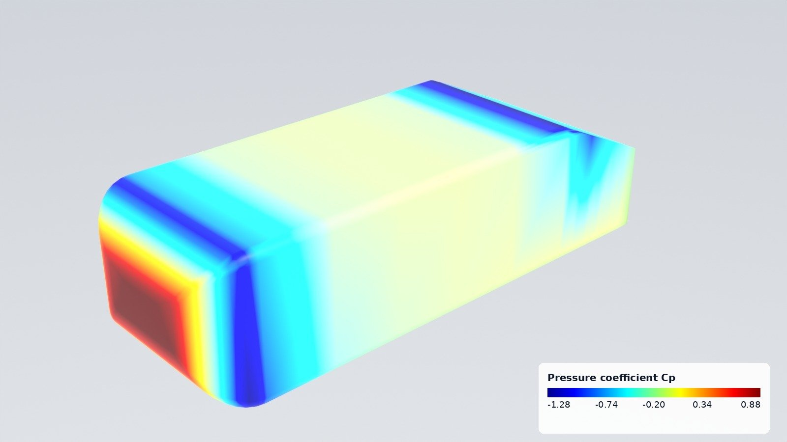
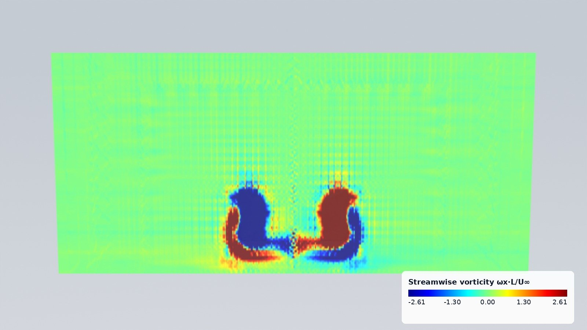
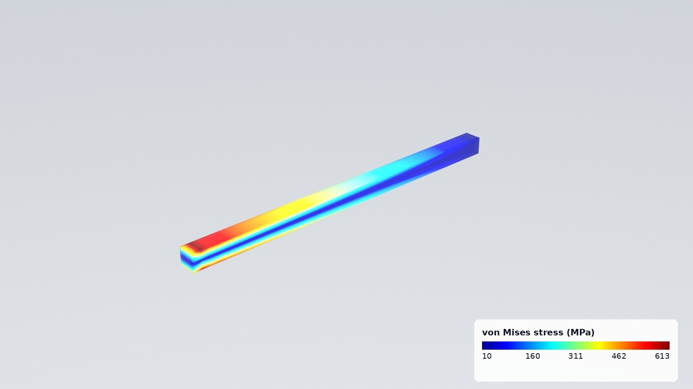
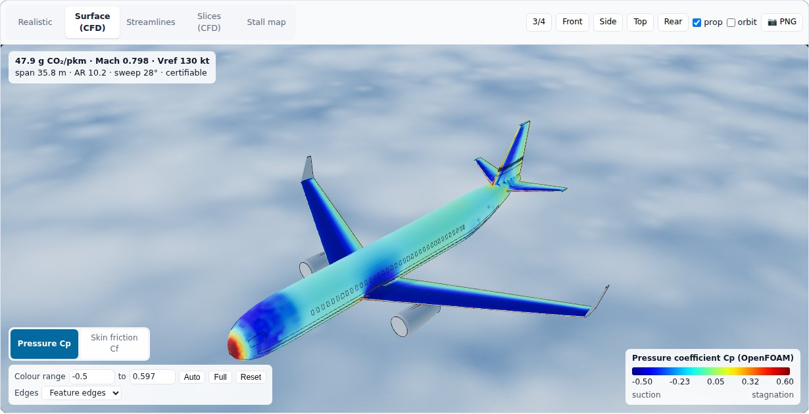

# 3D studio and external flow

Two layers turn any geometry and its physics into pictures people understand: `pp.viz`, which renders, exports and
browses, and `pp.cfd`, which runs OpenFOAM around any body. They came out of the Aircraft Design Optimizer
(`apps/aero_optimizer`) and work the same way for a car, a building, a heat sink or a beam.

```python
import pinneapple as pp

scene = pp.viz.Scene.from_file("result.frd")          # any result pinneapple_data.cae reads, or an STL/OBJ
scene.save("result.glb")                              # glTF with the fields; .usda for Omniverse; .stl
pp.viz.render(scene, "stress.jpg", field="STRESS")    # Blender Cycles, jet scale, colour bar
pp.viz.web_viewer(scene, "viewer/")                   # interactive page (python -m http.server -d viewer)
```





## Scene

A `Scene` holds surfaces (vertices, triangles, a material and per-vertex fields), polylines with values
(streamlines) and slice planes (a value grid on a rectangle, NaN where there is no fluid).

| Build it from | Call |
|---|---|
| STL (binary/ASCII, one surface per solid), OBJ | `Scene.from_file("part.stl")` |
| glTF/GLB (node transforms applied; float attributes `_NAME` become fields) | `Scene.from_file("model.glb")`, `axes="aircraft"` for files written in aircraft axes |
| VTK PolyData `.vtp` (needs `pip install vtk`) | `Scene.from_file("surface.vtp")`: point and cell data |
| OpenFOAM case or zip, CalculiX `.frd`, Abaqus `.inp`, Gmsh, VTK | `Scene.from_file(path)`: boundary surface with the cell or point fields; vectors become magnitudes, stress tensors von Mises |
| A `pinneapple_data.cae` mesh you already have | `Scene.from_mesh(mesh)` |
| Arrays | `Scene.from_arrays(vertices, faces)` |
| Parts of `pinneapple_design.aero` | `Scene.from_parts(parts)` (aircraft axes) |

Data known at other points (CFD wall faces, FEA nodes, sensors) goes onto the surface with
`scene.map_field("cp", points, values, mirror_y=True)`, using inverse distance over the nearest points. `mirror_y`
handles half models. `scene.labels["cp"] = "Pressure coefficient Cp"` sets the colour-bar title.

## Renders

`pp.viz.render(scene, out, field=..., lines=..., slice=..., view="iso", background="studio")` needs
`pip install "bpy>=4.2"` (Blender as a Python module, CPU Cycles; tested on 4.2 LTS and 5.2, older versions raise
an error, `blender.MIN_BPY`). The surfaces are built directly as Blender meshes with their `MATERIALS` /
`scene.materials` (no glTF import: Blender 4.2's importer crashes the interpreter at exit).

- **Field colours:** CFD colours use the jet scale, blue for low and red for high. The colour bar, with five ticks,
  is burnt into the image.
- **Views:** `iso`, `iso_back`, `iso_low`, `front`, `back`, `side`, `side_left`, `top` or `bottom`. The names assume
  x is the object's length (the flow direction) and z is up. A direction vector also works.
- **Backgrounds:** `background="studio"` gives a light gradient with true colours; `"sky"` gives a physical sky
  with filmic tone mapping, for the realistic materials.

## Browser viewer

`pp.viz.web_viewer(scene, folder)` writes `index.html`, `viewer.js`, `studio-core.js`, `scene.glb`, `scene.json` and
a copy of three.js, so no internet is needed. `pp.viz.serve(scene)` does the same in a temporary folder and serves it.
The page has these modes:
- **Realistic:** the materials;
- **one mode per field:** jet scale with a colour bar;
- **Streamlines:** coloured by their values;
- **one mode per slice group:** slices added with the same `group` form a stack.



Controls under the modes:
- **Colour range:** type the ends, or press *Auto* (1st to 99th percentile, the default) or *Full* (minimum to
  maximum). Each field, the lines and each slice group keep their own range.
- **Slice position:** a slider through the slices of a stack, for example the wake planes of `ExternalFlow`.
- **Line density:** shows an evenly spread share of the streamlines.
- **Edges:** off, feature edges (creases above 30°) or wireframe.

`studio-core.js` holds the colour scale, colour bar, tubes, slice textures and edges. The apps load it from
`/studio/studio-core.js` (the aircraft app's viewer is built on it), and its tick labels match the Python colour bar
of the renders. Its tests run with `node --test tests/js/studio_core.test.mjs`.

**How big a mesh?** Measured with a closed surface carrying two fields, in headless Chromium with software WebGL on 4
CPU cores. That is a worst case: a laptop GPU draws frames much faster, while loading and recolouring run on the CPU
anyway.

| Triangles | scene.glb | Export | Page load | First frame | Field switch |
|---|---|---|---|---|---|
| 25 k | 0.7 MB | < 0.1 s | 2.4 s | 0.5 s | 0.1 s |
| 130 k | 3.6 MB | 0.1 s | 1.9 s | 0.8 s | 0.3 s |
| 260 k | 7.3 MB | 0.1 s | 2.5 s | 0.9 s | 0.5 s |
| 520 k | 14.5 MB | 0.2 s | 2.3 s | 1.4 s | 0.8 s |
| 1.04 M | 29.1 MB | 0.5 s | 2.8 s | 2.0 s | 1.7 s |

The file grows by about 28 bytes per triangle, plus about 2 bytes per triangle for each extra field.
- **Up to about 500 k triangles:** stays interactive.
- **Above 1 M triangles** (`web_viewer(..., max_faces=1_000_000)`, the default): the page gets a decimated copy.
  The scene itself is not changed, and `max_faces=None` keeps every triangle.
- **For a smaller file:** call `scene.decimate(n)` yourself. It uses vertex clustering and averages the fields, so
  thin features below the cluster size can close up.

Slices are stored as JSON grids, about 7 bytes per value. Keep them to a few hundred cells a side.

## Fields, errors and deformed shapes in the apps: `pp.viz.field_view`

The apps show a result on its mesh with one shared page module, `apps/_shared/static/shared/fieldview3d.js`, served at
`/shared/fieldview3d.js` and built on the same vendored three.js and `studio-core.js`. The library builds what it
shows:

```python
import pinneapple as pp
from pinneapple_analysis.validation.error_map import error_map, grow_region

em = error_map(mesh.points, pred, ref, regions={"clamp zone": grow_region(mesh.points, clamp, 0.2)})
fv = pp.viz.field_view(mesh, [
    {"name": "ref", "values": ref, "label": "FEM von Mises", "unit": "MPa", "group": "vm", "deform": "FEM"},
    {"name": "pred", "values": pred, "label": "ROM von Mises", "unit": "MPa", "group": "vm", "deform": "FEM"},
    {"name": "err", "values": em.error, "label": "|ROM − FEM|", "unit": "MPa", "kind": "error"}],
    deform={"FEM": u}, length_unit="m",
    markers=[{"name": "clamp", "kind": "bc", "points": mesh.points[clamp]}])
fv.glb(), fv.meta                  # the glTF (fields as vertex attributes) and its description
em.summary()                       # where the error concentrates, against the global number
```

- **Colours.** Values use the jet scale from their minimum to their maximum on the surface; fields of one `group`
  share a scale. Errors use the sequential error scale (`ERR` in `studio-core.js`, white = 0) from 0 to their 99th
  percentile, and the colour bar says when the maximum lies above it.
- **Deformed shape.** Each `deform` entry gives a nodal displacement. The page draws it with a scale factor. By
  default the largest displacement is drawn as 10 % of the body, and `1×` shows the true scale. The undeformed shape
  stays as a grey wire.
- **Markers.** Boundary conditions, loads, error hotspots and other regions get coloured points and a label. A
  marker can belong to some fields only.
- **Size.** Above `max_faces` triangles (`VIEW_MAX_FACES` = 250 k by default) the surface is decimated, and the page
  says so. 250 k triangles is about 7 MB and a 0.5 s field switch in the table above.

## Lighting presets, Sun shadows and planetary surfaces

`studio.lighting` holds lighting and sky presets that PyVista, Blender and the browser viewer share:

| Preset | Sky | Sun | Used for |
|---|---|---|---|
| `studio` | grey-blue gradient | soft, 45° | the CFD renders (aircraft, Formula car) |
| `lunar_south_pole` | black | 5°, 0.53° disc | the lunar south pole: within about 5.5° of the horizon at 86° S |
| `lunar_low_sun` | black | 12° | long hard shadows, with small crater floors partly lit |
| `lunar_day` | black | 30° | mid latitudes |

How each renderer uses them:
- **PyVista:** `apply_pyvista(plotter, "lunar_south_pole", earth=True)` adds the Sun, a weak regolith bounce
  light and, optionally, Earth at its 1.9° apparent size.
- **Blender:** `pp.viz.render(scene, "x.jpg", background="lunar_south_pole")` lights the scene with one Sun lamp of
  the Sun's angular size and no sky light.
- **Browser viewer:** `scene.set_lighting("lunar_low_sun")` makes the viewer draw the black sky and the low Sun.

`studio.shadows` bakes hard Sun shadows into heightfield terrains, independent of the renderer:
- **Self-shadowing:** `terrain_self_shadow` marches towards the horizon along the Sun direction.
- **Cast shadows:** `cast_shadow` projects vehicle and rock meshes along the Sun onto the terrain.
- **Shadowed points:** `points_in_terrain_shadow` darkens meshes the terrain hides from the Sun.

Regolith is shaded with the Lunar-Lambert photometric function of McEwen (1991), which keeps it readable at grazing
Sun angles where a Lambert surface turns black. `studio.planetary.render_surface(SurfaceView(...))` puts it all
together: terrain with baked photometry and shadows, a far-field ring, rocks, vehicle parts with their materials,
optional field colour maps on the terrain and the parts with a colour bar, and Earth.


The lunar rover page ([Lunar rover terramechanics in 3D](lunar_rover_terramechanics.md)) shows these in use.

## Animations: bodies moving through a scene

`pinneapple_tools.visualization.studio.animation.Animation` adds time to a `Scene`: rigid tracks (an aircraft on a
runway, a vehicle, a rotor), arrows per frame, a trail drawn up to the current time, per-vertex fields that change
with time (e.g. a wing-load lattice) and head-up numbers. Surfaces whose `group` matches a track are given in the
body frame and placed at frame k by `R(q_k) v + positions[k]`; quaternions are `[w, x, y, z]`, everything in the
scene's axes.

```python
from pinneapple_tools.visualization.studio import Scene, Surface
from pinneapple_tools.visualization.studio.animation import Animation
from pinneapple_tools.visualization.studio.blender import render_animation
from pinneapple_tools.visualization.studio.web import screenshot, web_viewer

sc = Scene([Surface("runway", Vr, Fr, "concrete"), Surface("aircraft", Va, Fa, "paint", group="ac")])
anim = Animation(t, camera="follow")                      # times (T,)
anim.add_track("ac", positions, quaternions)              # (T, 3), (T, 4)
anim.add_vectors("loads", origins, vectors, values=mag, attach="ac", label="Load [kN]")   # (T, M, 3), (T, M)
anim.add_trail("path", positions)
anim.add_hud("V", speed, "Speed", "m/s")
sc.animation = anim.resample(200)                         # keeps scene.json small
web_viewer(sc, "viewer/")                                 # play, time slider, speed, Follow, Vectors
screenshot("viewer/", "f100.png", frame=100)              # headless Chromium (playwright)
render_animation(sc, "frames/", camera="chase", samples=16, gif=True)   # Cycles PNGs + HUD, MP4 and GIF
```

- **Viewer:** a bottom bar with play / pause, a time slider, the playback speed (0.25x to 4x), the time, a *Follow*
  checkbox (chase camera; orbiting still works) and a *Vectors* toggle; the HUD values sit top left and the colour
  bars of arrows and animated fields top right. Between frames positions are linear and rotations slerp. The camera
  fit covers the static scene and the trajectories, and the clip planes follow the distance, so a 3 km runway with a
  37 m aircraft works. `window.studio.setFrame(k)` and `window.studio.play(true)` drive it from scripts.
- **Blender:** `render_animation` imports the surfaces once, parents each tracked group to an Empty, draws the arrows
  as cylinders and cones and the trails as growing tubes, burns the HUD into each PNG and encodes an H.264 MP4
  (yuv420p) and optionally a GIF with ffmpeg. Cameras: `"chase"`, `"follow"`, `"side"`, `"tower"`, `"fixed"`.
- `Animation.at(t)`, `pose(group, k)`, `frame(k)`, `transform(group, k, points)` give the transforms; `to_dict` /
  `from_dict` round-trip the JSON.
- **Colours:** arrows, trails (`add_trail(..., values=nz, label="n_z [g]", radius=..., alpha=...)`), animated
  surface fields and static `Lines` (`cmap`, `alpha`, `radius`, `color_range`) take `cmap="jet"` or the diverging
  `"coolwarm"` / `"bwr"` (neutral midpoint, range symmetric about zero by default); the viewer and the Blender
  colour bars use the same stops (`compose.CMAPS`, `studio-core.js` `CMAPS`).
- **Cinematic clips:** `render_animation(sc, "frames/", camera="chase_low", motion_blur=True, dof=5.6, haze=1.0,
  sparkline="nz", hud_keys=["V", "nz"], trails={"alpha": 0.7}, colorbars={"lines": False}, crf=27)` and
  `render_still(sc, "still.png", frame, size=(1920, 1080), samples=64, ...)` (same options, one frame).
  Motion blur uses a shutter in scene seconds (default 1/30 s) and keyframes the bodies and the camera, so the
  ground blurs and the tracked body stays sharp; `dof` is the f-stop, focused on the tracked body; `haze` is a
  noise-modulated volume (optical depth over ten camera distances) that thins out near the tracked body. Imported
  meshes are smooth-shaded with sharp edges above 35 degrees; materials named `asphalt` and `grass` become
  procedural (colour patches, roughness variation, bump) and `marking` surfaces are lifted so the paint stays crisp.
  Trails show the last `trail_seconds` (default 8 s) of the path, 0.003 x the body size thick, fading to
  transparent at the tail and never running through the camera. Materials missing from `MATERIALS` and
  `scene.materials` render grey and are named in the log: put a model's own material table in `scene.materials`.
- **Panels:** `compose.compose_grid(pngs, "grid.png", labels=..., ncols=2, colorbar=(title, lo, hi, cmap))` and
  `compose.compose_grid_video(mp4s, "grid.mp4", labels=..., colorbar=..., crf=28, webm=True)` (ffmpeg `xstack`,
  H.264 yuv420p, optional VP9) put several clips side by side with one common colour bar.

## Particle process videos

Thousands of spheres coloured by a value inside glass or steel equipment that moves (an impeller turning), rendered
with Cycles point clouds, then composed with charts that draw themselves as time runs, a colour bar and a clock.
Any Lagrangian result works: DEM, stirred tanks, fluidised beds, hoppers, sprays.

```python
from pinneapple_simulation.numerical_solvers.particles import StirredTank, suspend
from pinneapple_tools.visualization.studio.particles import compose_video, render_particle_frames

tank = StirredTank(R=0.075, H=0.15)                                   # pitched-blade turbine, glass tank
res = suspend(tank, n=12000, d=3e-3, rho_p=1200.0, rpm=lambda t: min(400.0, 16.0 * t), t_end=30.0)
angle = ...                                                           # impeller angle per frame
pngs = render_particle_frames(res["frames"], 3e-3, "frames/", field_range=(0, 0.4),
                              equipment=lambda k: tank.surfaces(angle[k]))
compose_video(pngs, res["times"], "tank.gif", mp4=True, frame_dir="composed/",
              charts=[("Particles Top [%]", res["times"], 100 * res["top_fraction"]),
                      ("Stirrer Speed [RPM]", res["times"], res["rpm"])],
              colorbar=("Velocity Magnitude (m/s)", 0, 0.4))
```

`frames` is a list of dicts with `x` (n, 3) and a value per particle (`speed` or `value`). `equipment(k)` returns
the surfaces of frame k as (name, vertices, faces, material) with material "glass", "liquid", "steel" or "grey".
Surfaces keep their topology between frames, so only the vertices move. The MP4 goes through Blender's own encoder,
so no ffmpeg binary is needed. The lab experiment `particle_suspension` runs the whole chain with checks: settling
velocity against Schiller-Naumann, a divergence-free flow, particles kept in the tank, and the just-suspended speed
against Zwietering.

## Structural FEA with CalculiX: `pp.fea`

The same few lines for any part: a mesh, sets picked by geometry, one step, results as arrays, the post-processor
figure or a Blender render.

```python
import pinneapple as pp

m = pp.fea.FEModel.from_gmsh(pp.fea.geo_l_bracket(), size=0.0025)      # gmsh C3D10; or FEModel.from_box(...)
m.material = pp.fea.Material("steel", E=210e9, nu=0.3, density=7850.0)
base = m.nodes_where(lambda X: X[:, 2] < 1e-9)
top = m.nodes_where(lambda X: X[:, 2] > 0.08 - 1e-9)
res = pp.fea.solve(m, pp.fea.Static(fix=[(base, (1, 2, 3))], loads=[(top, (2000.0, 0, 0))]), "work/bracket")
res.u, res.stress, res.von_mises, res.reactions
modes = pp.fea.solve(m, pp.fea.Frequency(6, fix=[(base, (1, 2, 3))]), "work/modes")   # .frequencies, .modes

from pinneapple_simulation.numerical_solvers.solid_fem import fea_figure
fig, _ = fea_figure(res)                                                # deformed mesh, S Mises bands, legend
```

Steps: `Static` (point loads, face pressure, gravity, nonlinear geometry, plasticity through `Material.plastic`),
`Frequency`, `Buckle`, `Heat` (fixed temperatures, film convection, surface flux). Faces come from
`m.faces_where(pred)` on face centroids. `ccx` runs natively or in the bundled Docker image, and gmsh meshes
any `.geo` script, OpenCASCADE booleans included. The lab experiment `calculix_case` checks five studies against
closed-form references: a plate with a hole (Heywood), an L bracket (M c / I, mesh convergence), modes
(Euler-Bernoulli), buckling (Euler) and a fin (1-D fin).

## External flow: `pp.cfd.ExternalFlow`

```python
flow = pp.cfd.ExternalFlow({"ahmed": pp.bodies.ahmed_body(25)}, speed=40.0, ground=0.0, half_model=True,
                           resolution="medium")
res = flow.solve("cases/ahmed", procs=4)      # write, snappyHexMesh, simpleFoam, read
res.coefficients                              # CD, CL, CS, pressure/friction split, per body, newtons
scene = res.to_scene()                        # skin Cp and Cf, streamlines by |U|/U∞, mid-plane and wake slices
```

**Setup**
- Steady incompressible RANS: simpleFoam, k-ω SST, wall functions.
- Bodies: a dict of `(vertices, faces)`, an STL path or a `Scene`.
- The domain and background cells scale with the bodies' length. `resolution` sets the surface refinement levels:
  `coarse`, `medium` or `fine`.
- `alpha` and `beta` tilt the flow.
- `half_model` adds a symmetry plane at y = 0.
- `wake_planes` (default `(0.25, 0.5, 1.0, 1.5)` body lengths behind the bodies): the cross-flow slices, one stack
  per field in the viewer.
- `ground` adds a road (`True`: at the lowest point of the bodies; a number: its height), moving with the flow unless
  `ground_moving=False`.

**Results**
- Forces: pressure plus wall-function shear from the log law at the first cell.
- Coefficients use `ref_area`; the default is the frontal area of the bounding box.
- A `FlowResult` can be saved with `res.save("result.npz")`.

**Validation, Ahmed body, 25° slant, 40 m/s, half model, moving road**

| Mesh | Cells | CD | Time (2 cores) |
|---|---|---|---|
| coarse | 0.15 M | 0.321 | 4 min |
| medium | 0.20 M | 0.298 | 10 min |
| wind tunnel (Ahmed et al. 1984) | | ≈ 0.285 | |

Needs OpenFOAM (v1912 and later tested). Set `FOAM_BASHRC` if its bashrc is not at
`/usr/share/openfoam/etc/bashrc`. `pp.cfd.openfoam_available()` checks it. The aircraft case
(`pinneapple_design.aero.case3d`) is built on the same pieces: `write_flow_fields`, `snappy_dict`, `run_case` and
`CaseFields`, which provides wall forces, streamline tracing and plane sampling for any case.

## Example: Formula car at 70 m/s

`pinneapple_design.geometry.vehicles3d.FormulaCar` is a parametric open-wheel car. It has:

- a tub and engine cover lofted from superellipse rings;
- a flat floor with a diffuser ramp;
- three-element front and rear wings built from NACA 4-digit sections, with a rear flap that opens for DRS;
- endplates, a helmet, a halo and four wheels.

`cfd_bodies()` groups the closed surfaces into body, floor, front wing, rear wing, helmet and wheels, so the forces
come out per component. `frontal_area()` rasterises the front view, giving 1.68 m² for the default car.

`examples/studio/06_formula_car_cfd.py [coarse|medium|fine] [procs] [drs]` runs the half model through
`pp.cfd.ExternalFlow` with a moving road at 70 m/s. It writes:

- the coefficients;
- the glTF scene and the browser viewer;
- PyVista stills;
- a Plotly page;
- a Rerun recording.


The pressure side of both wings is red. Suction peaks sit over the airbox, on the shoulders of the tyres and under
the wing flaps.


The wake plane 0.25 L behind the car shows two vortex pairs: one from the rear-wing tips and upper tyres, one low,
from the rear tyres, the floor edges and the diffuser.

Medium mesh (0.21 M cells), 800 iterations, 4 cores, about 20 minutes per case:

| Case | CD | CL | L/D | Drag at 70 m/s | Downforce at 70 m/s |
|---|---|---|---|---|---|
| DRS closed | 0.596 | -0.865 | 1.45 | 3.01 kN | 4.36 kN |
| DRS open | 0.580 | -0.826 | 1.42 | 2.87 kN | 4.09 kN |

The coefficients use each case's frontal area (1.68 m² closed, 1.65 m² open), so compare the forces in newtons.
Opening the flap cuts the rear-wing drag from 489 N to 214 N (−56 %) and its downforce from 1.80 to 1.41 kN (−21 %).
The car's total drag falls by only 4.5 %, because the wheel drag rises by 144 N in the changed flow behind the wing.


Per component, DRS closed (share of the net downforce):

| Component | Downforce | Drag |
|---|---|---|
| front wing | 4.35 kN (100 %) | 0.76 kN |
| rear wing | 1.80 kN (41 %) | 0.49 kN |
| floor | 1.28 kN (29 %) | 0.15 kN |
| body | -1.96 kN (-45 %) | 0.75 kN |
| wheels | -1.06 kN (-24 %) | 0.87 kN |
| helmet | -0.04 kN (-1 %) | 0.00 kN |

The car is a simplified shape on a coarse mesh, so it shows the workflow; it is not a validated F1 aero model:

- The floor has no Venturi tunnels or edge vortex generators, so it gives under a third of the downforce, much less
  than on a modern car.
- The front wing carries almost all of the net downforce, while the tub and the wheels lift.
- Wall functions on 0.2 M cells resolve neither the wing boundary layers nor the tyre wakes.

Treat the numbers as a demonstration of the pipeline, not as a design result.

## Bodies

`pp.bodies.ahmed_body(slant_deg)`, `sphere`, `cylinder` and `box` return closed, outward-facing triangle meshes in
metres, with x along the flow and z up.

## Examples

- `examples/studio/01_any_result_in_3d.py`: a CalculiX result as glTF, USD, viewer and render.
- `examples/studio/02_ahmed_body_cfd.py`: from geometry to pictures, through OpenFOAM.
- `examples/studio/03_airliner_with_cfd.py`: the aero app's airliner with its OpenFOAM skin pressure.
- `examples/studio/06_formula_car_cfd.py`: the Formula car above, with DRS closed or open.
