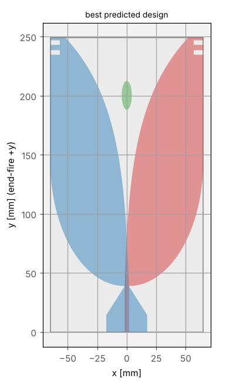
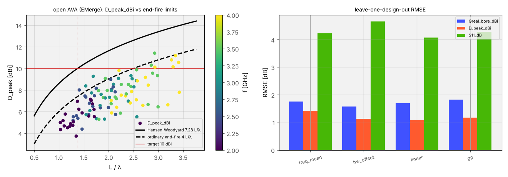

# Antenna design: an end-fire Vivaldi with an external FEM solver

This guide runs, end to end, a study of an antipodal Vivaldi antenna (AVA) for 2–4 GHz with a 10 dBi target, the
kind of study usually done by hand in a FEM simulator: a few variants, a table of S11 and gains, a plot. Here the
FEM solver is [EMerge](https://pypi.org/project/emerge/) (open source, `pip install emerge`), the antenna is an
open parametric model written for this library, and PINNeAPPle adds the physical limits, the checks, the surrogate
errors measured honestly, the design loop and a trust card per prediction.

Everything lives in `pinneapple_simulation.electromagnetics.antenna`; the example
`examples/use_cases/antennas/vivaldi_2to4ghz.py` only calls it.

```bash
pip install emerge                                                         # GPL-2.0, called, never copied
python examples/use_cases/antennas/vivaldi_2to4ghz.py --quick              # 3 designs x 2 frequencies, ~3 min
python examples/use_cases/antennas/vivaldi_2to4ghz.py                      # 16 designs x 5 frequencies + fine runs
python examples/use_cases/antennas/vivaldi_2to4ghz.py --package <dir>      # an external study package
```

## 1. How long must the antenna be? (`bounds`)

A Vivaldi radiates end-fire, along the board. Its gain is bounded by its **length** `L`, not by its broadside area:
an end-fire travelling-wave antenna is at best a Hansen–Woodyard line source, `D ≈ 7.28 L/λ` (ordinary end-fire:
`D ≈ 4 L/λ`; C. A. Balanis, *Antenna Theory*, ch. 6). The aperture formula `G = η 4πA/λ²` applies to a broadside
aperture; used on a 100 × 200 mm Vivaldi it gives an optimistic bound for the wrong direction.

```python
from pinneapple_simulation.electromagnetics.antenna import bounds

bounds.min_length(10.0, 2e9)               # 0.2059 m: 10 dBi at 2 GHz needs L >= 206 mm (HW limit)
bounds.min_length(10.0, 2e9, "ordinary")   # 0.3747 m
bounds.feasibility_frequency(10.0, 0.206)  # 2.00e9 Hz: below it no 206 mm design reaches 10 dBi
```

| f [GHz] | L for 10 dBi, Hansen–Woodyard [mm] | ordinary end-fire [mm] |
|---|---|---|
| 2.0 | 206 | 375 |
| 2.5 | 165 | 300 |
| 3.0 | 137 | 250 |
| 3.5 | 118 | 214 |
| 4.0 | 103 | 187 |

The feasibility frontier (lowest frequency where the target fits a board of length `L`): 2.75 GHz for 150 mm,
2.00 GHz for 206 mm, 1.58 GHz for 260 mm. A 10 dBi requirement down to 2 GHz on a board shorter than 206 mm is
infeasible whatever the flare, the slots or the director; no simulation is needed to know it.

## 2. The open AVA model (`ava`)

`AVAParams` + `layout` describe the antenna in millimetres; `layout` is pure NumPy and raises `InvalidGeometry` for
designs that cannot be built (arms thinner than 0.5 mm, slots cutting through an arm, a director touching the
flare), which the DOE skips. `simulate` builds it in EMerge:

* substrate εr 3.55, tan δ 0.003, h 1.524 mm; PEC conductors of zero thickness;
* top layer: 50 Ω microstrip (width from Pozar eq. 3.197: 3.41 mm) then an exponential flare towards +x; bottom
  layer: ground of width `Wg` and length `Lo`, a linear taper to the strip width (the transition / balun), then the
  mirrored flare; optional corrugation slots (`nslot`, `Ls`, `ws`, `ps`) on the outer edges and an elliptical
  director (`dir_a`, `dir_b`, `dir_x`);
* air box with `air · λ` of margin and a second-order absorbing boundary, lumped 50 Ω port at the board edge;
* mesh size `res · λ` at the simulated frequency (one mesh per frequency);
* per frequency: complex S11, directivity, IEEE gain and realized gain at boresight (+y) and at the peak, radiation
  efficiency, the far field (θ, φ, E_θ, E_φ) in `ff_<f>GHz.npz`, and the radiated power two ways (integral of the
  pattern, Poynting flux through the box) for the power-closure check.



## 3. Running a parametric CLI solver (`runner`)

`CLISimulator(argv, workdir)` runs any script that takes `--params JSON --freq GHz --out DIR` (flags configurable)
and writes `result.json`: one process per design and per frequency, a timeout, the exit status and the peak memory
of each child (`os.wait4`). Lessons measured on this 4-core, 15 GB container and built in:

* EMerge's PARDISO backend can die with SIGBUS without a usable MKL: the AVA CLI uses SuperLU
  (`emerge._emerge.solver._PARDISO_AVAILABLE = False`); `fallback_args` re-runs a sample once after a SIGBUS;
* three frequencies in one process with SuperLU went past 15 GB and were SIGKILLed: one frequency per process
  (also gives each frequency its own λ-sized mesh);
* `grid.model_S` fails with a single frequency: the CLI reads `grid.S`;
* the first EMerge run compiles Numba kernels (about 4 min here, 375 s for the first 3 GHz solve); later runs load
  them from the cache.

`read_table` / `write_table` handle the (design, frequency) table: `tag`, the parameters, `f_GHz`, `S11_dB`,
`D_bore_dBi`, `G_bore_dBi`, `Greal_bore_dBi`, `D_peak_dBi`, `Greal_peak_dBi`, `rad_eff` (CSV, TSV or whitespace).

## 4. Checks of every row (`checks`)

`antenna_checks(row)` returns a `TrustReport` (`supports` / `contradicts` / `not_run`):

| check | relation | critical |
|---|---|---|
| `realized_gain` | `G_realized = G + 10 log10(1-|S11|²)` | no |
| `efficiency_is_G_over_D` | `e = G/D` | no |
| `efficiency_le_1` | `e <= 1` (+1 %) | **yes** |
| `peak_ge_boresight` | peak >= boresight | no |
| `directivity_le_hw` | `D <= 7.28 L/λ` + 0.5 dB | no |
| `s11_resolved` | a vector-fitted (interpolated) S11 needs >= 5 solved frequencies | no |
| `power_closure` | pattern power = Poynting flux through the box, within 10 % | no |

Missing inputs make a check `not_run`, never a silent pass.

## 5. Surrogates and honest errors (`surrogates`)

Four models, all predicting a column from (design, frequency): the per-frequency mean (baseline), the HW limit plus
one fitted offset, ridge regression on physical features (`log L/λ`, `W/λ`, `Wa/λ`, slots on/off, director on/off),
and a Gaussian process on the same features with the HW limit as prior mean (its std is the stated uncertainty).
`lodo(table, target)` leaves one **design** out at a time — all its frequencies together — because leaving one row
out lets the model see the same design at the neighbouring frequencies. `holdout` uses a fixed test set.
`coverage95` says how often the truth fell inside ±1.96 std.

## 6. Design loop (`design`, `study`)

* `doe(n)`: LHS or Sobol over `AVA_RANGES` (configurable), unbuildable designs skipped and counted;
* `optimize(models, freqs)`: NSGA-II (`pinneapple_design.design_optimizer`) maximising the minimum realized gain over
  the band and minimising `Lb·W`, with `max S11 <= -10 dB` over the band, inside the span of the trained designs;
* `active_learning(simulate, table, freqs)`: GP variance picks the next designs
  (`pinneapple_data.active_learning.VarianceBasedAL`), EMerge verifies them, and the error of the prediction made
  **before** the simulation is recorded;
* `multi_fidelity(coarse, fine, target)`: many coarse runs (`res` 0.25 λ), a few fine ones (0.2 λ); the
  coarse-to-fine bias per frequency, validated leaving one fine design out;
* `prediction_card(model, params, f, train)`: in the training domain (feature space, critical), buildable
  (critical), std below 1 dB, below the HW limit, LODO error known and below 1.5 dB.

`study.open_study(out)` chains all of it; `study.package_study(dir, out)` reproduces an external package.

## 7. Measured results (open model, this container)

All numbers below were measured by `vivaldi_2to4ghz.py` (full mode) on a 4-core, 15 GB container, EMerge 2.8.9,
SuperLU, files in `examples/use_cases/antennas/results/` (`summary.json`, `results_*.csv`, figures). Coarse mesh
`res = 0.25 λ` (3 160 to 9 721 tetrahedra), air margin 0.25 λ, fine mesh `res = 0.2 λ`.

**Cost.** 125 EMerge processes (one frequency each), all `ok`: median 10.8 s, peak memory 2.85 GB per process,
1 595 s of solver time, 1 633 s for the whole study (DOE, fine runs, checks, LODO, NSGA-II, verification, active
learning). `--quick` (12 processes): 184 s. The very first EMerge run on a machine adds about 4 min of Numba
compilation. The first 3 GHz solve, repeated later through the runner, gave the same S11 to the last digit
(−19.431 dB).

**DOE.** 16 buildable designs out of 31 LHS samples (15 rejected by `layout` before any solve).

**Against the target.** No simulated design (20 designs × 5 frequencies, plus the optimiser's pick) reaches
10 dBi realized gain anywhere in the band. Best realized boresight gain per frequency: 5.4 dBi at 2 GHz, 7.1 at
2.5, 7.9 at 3.0, 9.5 at 3.5, 9.1 dBi at 4 GHz. The peak directivity stays 1.6 dB (best case) and 4.3 dB (median)
below the Hansen–Woodyard limit of each design's length, so `directivity_le_hw` never failed; at 2 GHz even the
limit of the longest board (260 mm) is 11.0 dBi. Only 3 of the 20 designs keep S11 ≤ −10 dB over the whole band.



**Checks.** 80 coarse rows: 525 checks support, 35 contradict, all of them `power_closure` (35 rows, REVIEW);
`realized_gain`, `e = G/D`, `e <= 1`, peak ≥ boresight and the HW limit hold on every row. Fine rows (20): 12
`power_closure` failures. The pattern power and the Poynting flux differ by 7.2 % (median) and up to 34.6 %. On the
default design at 3 GHz the gap does not shrink with the mesh (13.2 %, 14.0 %, 15.1 % for `res` 0.25, 0.2,
0.15 λ) but it moves with the air margin: at 0.5 λ the far field gives more power than the surface flux and the
efficiency becomes 1.018, which `efficiency_le_1` (critical) rejects. Gains and efficiencies of this model at
these settings therefore carry an uncertainty of order 10 % (≈ 0.5 dB); directivity, computed from the pattern
itself, does not depend on that normalisation.

**Surrogates, leave-one-design-out (16 designs, 80 rows), RMSE [dB]:**

| target | frequency mean | HW + offset | linear features | GP |
|---|---|---|---|---|
| realized gain, boresight | 1.76 | **1.58** | 1.70 | 1.83 |
| peak directivity | 1.43 | 1.14 | **1.08** | 1.17 |
| S11 | 4.22 | 4.66 | **4.07** | 4.28 |

With 16 designs and 14 parameters the physical features only beat the per-frequency baseline by 0.2–0.35 dB on
gain and directivity, and no model predicts S11 (4 dB error, the features do not see the flare rate or the
transition that set the match). The GP's 95 % intervals contain 82–94 % of the held-out values.

**Multi-fidelity (4 designs at both meshes, 20 pairs).** Coarse against fine: 0.62 dB RMSE on realized gain,
0.49 dB on peak directivity, 3.49 dB on S11. A per-frequency bias learnt on the other fine designs does not reduce
it (0.62, 0.55, 3.61 dB): the coarse-to-fine difference is design-dependent, not a constant offset, so with these
meshes more fine runs, not a bias correction, are needed.

**NSGA-II on the GP (800 evaluations, 1.3 s, 83 designs on the front).** The pick with the highest predicted
minimum gain (Lb 249 mm, W 130 mm, 2 slots, director) was predicted at 5.75 ± 0.90 dBi at 2 GHz and simulated at
5.37 dBi, with 7.81 ± 1.53 predicted against 8.69 dBi at 4 GHz; its band minimum (5.37 dBi) did not beat the best
DOE design (5.39 dBi), and its S11 is −9.8 dB at 3 GHz where the surrogate predicted at most −10.9 dB over the band. Its
trust card: in domain, buildable, below the limit, but REVIEW because the LODO error of the GP (1.83 dB) is above
1.5 dB.

**Active learning (2 rounds × 2 designs, verified in EMerge).** Prospective RMSE of the GP on the new designs
before simulating them: 2.01 dB (round 1, 16 training designs, 70 % inside the 95 % interval), 1.60 dB (round 2,
18 designs, 90 %).

**What this says about the 10 dBi goal.** At 2 GHz the target needs `L ≥ 206 mm` in the HW limit and this AVA
family reaches about 4 dB less than its limit, so 10 dBi at 2 GHz with an AVA of this size class is not supported
by any simulated design; at 3.5–4 GHz the best designs come within 0.5–1 dB of it.

## 8. Reproducing an external study package (`--package`)

A package is a local folder with the (design, frequency) table and, optionally, the CLI script that produced it,
plus an optional `package.json` (`table`, `script`, `argv`, `flags`). Nothing is copied into the repository.
`--package <dir>` checks every row, draws the measured directivity against the end-fire limits, computes the LODO
errors of the four surrogates, and re-runs one design (`--rerun <tag>`, `--rerun-freqs n`) through the runner to
compare with the table. `--interpolated` tells the checks the package's S11 came from a vector fit (the
`s11_resolved` check then needs at least 5 solved frequencies).

Measured on a package made from the full run above (the coarse table and a copy of the AVA CLI in a folder outside
the repository, `package.json` naming them): 80 rows, 16 designs, 5 frequencies, the same check counts and LODO
errors as above, and design `d05` re-run at 2 and 2.5 GHz (9.6 s and 10.4 s, 0.96 and 1.03 GB) reproduced every
column of the table exactly (difference 0.0). Whole `--package` run: 59 s.

## 9. What PINNeAPPle adds to a manual study of variants

* **The right physical limit.** The end-fire bound `7.28 L/λ` (and `4 L/λ`), not the broadside aperture formula: it
  says before any simulation that 10 dBi at 2 GHz needs 206 mm, and from which frequency a given board can reach it.
* **Automatic checks of every number.** Realized gain against S11, `e = G/D`, `e <= 1`, peak against boresight,
  directivity against the limit, power closure, interpolated S11 with too few points. In this study they flagged
  what a table of variants hides (section 7).
* **Honest surrogate error.** Leave-one-design-out and held-out errors for four models, the baseline included, and
  the calibration of the stated uncertainty; a surrogate that does not beat the per-frequency mean is reported as
  such.
* **DOE, optimisation and active learning.** Space-filling designs with geometric validity, NSGA-II on gain, match
  and area, and active learning whose prospective error is measured against the solver.
* **Multi-fidelity.** Coarse meshes for many designs, fine ones for a few, the bias between them measured.
* **A trust card per prediction.** Domain, buildability, uncertainty, physical limit, known error: a prediction
  outside them says so.
* **Reproducibility on another machine.** One command, an open model, the solver called with recorded settings,
  per-process time and memory, tables and figures written next to the script, and the same flow as a Flow Studio
  node (`lib.antenna.limits`, `lib.antenna.package`, `lib.antenna.open_study`; flow `antenna_vivaldi_limits`).
