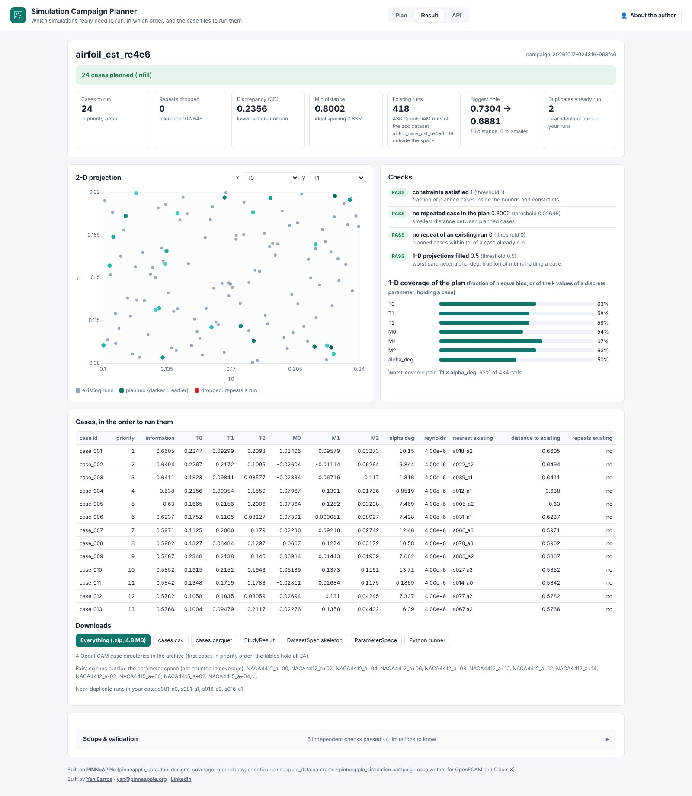

# Simulation Campaign Planner: which simulations need to run

The [Simulation Campaign Planner](https://campaign.pinneapple.org) (day 13 of the app program) decides which cases
of a simulation campaign are worth their compute. You describe the parameter space and the budget. It returns
a design of experiments, its coverage, the planned cases that repeat runs you already have, a run order, and the case
files for OpenFOAM, CalculiX or your own Python code.



## In the library

Everything the app does is a library call:

```python
from pinneapple_data.contracts import Parameter, ParameterSpace
from pinneapple_data.doe import plan_campaign
from pinneapple_simulation.external_solvers.campaign_cases import write_campaign

space = ParameterSpace(name="cantilever", budget=30, parameters=[
    Parameter(name="length", low=0.2, high=1.0, unit="m", group="geometry"),
    Parameter(name="height", low=0.02, high=0.08, unit="m", group="geometry"),
    Parameter(name="material", kind="categorical", values=["steel_S355", "aluminium_6061_T6"], group="material"),
    Parameter(name="tip_load", low=100, high=5000, unit="N", log=True, group="boundary")],
    constraints=["length >= 8 * height"])
plan = plan_campaign(space, method="maximin", existing=runs_done, existing_id_column="run_id")
plan.summary()            # coverage of the plan, of the existing runs and of both; repeats dropped
plan.study_result()       # StudyResult: metrics, checks with their values, limits
write_campaign(plan, "campaign/", outputs=["tip_deflection"])
```

| Module | What |
|---|---|
| `pinneapple_data.doe.design` | `lhs`, `maximin`, `sobol`, `halton`, `random`, `full_factorial`, `fractional_factorial` (minimum-aberration generators, resolution reported), `infill` (greedy maximin around existing runs; adaptive with outputs) |
| `pinneapple_data.doe.coverage` | discrepancy (centred L2), minimum / mean nearest-neighbour / fill distance, 1-D and 2-D projection coverage |
| `pinneapple_data.doe.redundancy` | planned cases within a tolerance of an existing run or of each other; near-duplicate pairs in the existing data |
| `pinneapple_data.doe.prioritize` | greedy-maximin run order: every prefix is spread out |
| `pinneapple_simulation.external_solvers.campaign_cases` | case tables, `run_cases.py`, OpenFOAM airfoil cases, OpenFOAM base-case copies with dictionary edits plus the `openfoam.campaign` plan, CalculiX cantilever decks, `.inp` templates |

## What to trust

The fractional factorials match the minimum-aberration designs of the literature, and the space-filling designs
are tested against random sampling. The generated CalculiX decks run with CalculiX 2.21 within 1 % of beam
theory. The coverage is measured in the unit cube of the parameters, so it shows where you have no data, not where
the response is difficult. Read the limits in the [app README](https://github.com/PINNeAPPle-Labs/PINNeAPPle/tree/main/apps/simulation_campaign).

## Next steps in the chain

The plan exports `dataset.skeleton.json`, a DatasetSpec whose outputs are still to come. The Workflow Runner (day
27) runs the cases and fills it. The Surrogate Studio (day 14) trains on the finished dataset.
