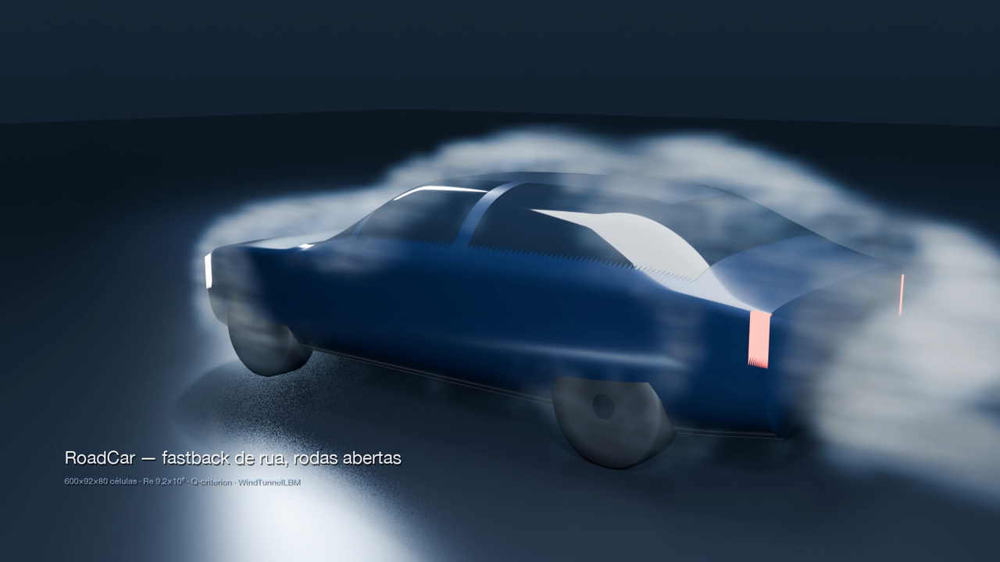

# Cinematic flow films

Three films of real wakes — a road car, a wing at incidence, a launcher — solved by the library's own lattice
Boltzmann wind tunnel and rendered as smoke. Nothing in the picture is a texture, a particle system or a stock
asset: the volume is the simulated Q-criterion written as an OpenVDB grid, the surface is the library's
parametric geometry, and each film ships with `ficha.json` recording the mesh, the Reynolds number and the steps
it came from.

| Case | Body | Mesh | Re (lattice) | Film |
|---|---|---|---|---|
| `carro` | RoadCar fastback, moving road | 600×92×80 = 4.4 M | 1200 | [mp4](../assets/cinematic/carro.mp4) |
| `asa` | NACA 2412 at 16°, free tip | 299×135×52 = 2.1 M | 1200 | [mp4](../assets/cinematic/asa.mp4) |
| `foguete` | two-stage launcher, four fins | 380×60×82 = 1.9 M | 1200 | [mp4](../assets/cinematic/foguete.mp4) |

Each film is six seconds at 24 fps and 1920×1080, and each ships with its record next to it
(`docs/assets/cinematic/<caso>.json`): the mesh, the lattice Reynolds number reached, the physical Reynolds
number the film stands for and the step count. The volume in every frame is the simulated field of that solve.



## The three steps

| Step | Module | Writes | Cost |
|---|---|---|---|
| Solve | `solve.py` | `snap_*.npz`, `meta.json` | 8–30 min on MPS |
| Render | `scene.py` (inside Blender) | `frames/*.png` | 7–19 s a frame at 1080p, by how much of the frame the volume covers |
| Assemble | `film.py` | `<caso>.mp4`, `ficha.json` | seconds |

They are separate on purpose. The stored field is the two scalars the picture needs — speed and Q — and the
density that becomes smoke is built at render time from those, so the threshold that decides what reads as smoke
can be moved without paying for another solve.

```bash
python -m pinneapple_simulation.pipelines.cinematic_flow carro --out filmes/carro
python -m pinneapple_simulation.pipelines.cinematic_flow asa   --out filmes/asa --still   # one frame first
```

## What the smoke is

The density is the Q-criterion,

```
Q = ½ (|Ω|² − |S|²)          Ω = ½(∇u − ∇uᵀ),   S = ½(∇u + ∇uᵀ)
```

cut above a high percentile of the fluid. Vorticity magnitude is the obvious choice and it is wrong here: the
road under the car is a *moving wall*, and its boundary layer carries more vorticity than the wake does, so a
picture built on `|ω|` paints the floor white and leaves the wake empty. That is not a rendering nicety — it is
the difference between a picture of the flow and a picture of the boundary condition. Q is zero for pure shear
and positive only where rotation beats strain, which is the structure a flow picture is trying to show. The
example checks all three cases before it renders anything (`examples/cinematic_flow/run.py`):

| Field | Q normalised | Expected |
|---|---|---|
| solid rotation `u = (−y, x, 0)` | +1.0 | +1 |
| pure shear `u = (y, 0, 0)` | 0.0 | 0 |
| pure strain `u = (x, −y, 0)` | −1.0 | −1 |

The wing is the exception that proves the rule. The Q of a lifting surface lives in a boundary layer one cell
thick: cut above the ninety-ninth percentile it leaves a rim around the planform and an empty wake, because the
wake a wing actually leaves is a *momentum deficit*, not a vortex. So the wing's density is the deficit with Q
added at half weight, the bluff bodies use Q alone, and the caption on each film names what is on screen rather
than asserting one formula everywhere (`SMOKE_BY_CASE` in `film.py`).

## Four things that are easy to get wrong

- **The volume march.** EEVEE marches the volume a fixed number of samples between two distances from the
  camera. Left on the scene's clip range — 0.05 m to 400 m — 96 samples give a 4 m step over a field whose
  voxels are 8 cm, and every wisp smears into one fog: the whole tunnel reads as a milky blanket however sparse
  the grid is. The range is set to the distance from the camera to the far corner of the tunnel.
- **The emission.** `Principled Volume`'s emission is emitted through the volume's whole bounding box whatever
  the density is, so a sparse field lights up as a solid slab. The shader here is built by hand — scatter plus
  an emission whose strength is multiplied by the grid density — and the texture that breaks up the cloud
  multiplies the field down to zero rather than down to a fraction of itself.
- **The box edges.** The field is a box and a box has edges. Where the wake still has density at the boundary
  the render shows a straight cut, and that cut reads as a box rather than as air. A raised cosine over the
  outer 14 % of each axis takes the field to zero before it reaches the wall.
- **The hand-off between snapshots.** Ten snapshots over 144 frames are crossfaded in the render. Keyed end to
  end, the outgoing and the incoming grid are both at zero on the same frame and the smoke blinks out once per
  snapshot — a fault that exists only in the animation and never in a still. The windows overlap by half a fade
  on each side and the keys are linear, so the two ramps add to a constant density.

## Rendering cost on this machine

Measured at 1920×1080, Apple M5, EEVEE with one OpenVDB volume in the scene:

| Samples | Volume tile | Volume samples | Per frame |
|---|---|---|---|
| 48 | 2 px | 256 | 57 s |
| 32 | 4 px | 160 | 23 s |

The cheaper row is indistinguishable from the expensive one at this resolution, because the field is smooth and
the volume is what costs the frame. Cycles is not an option: tens of minutes per 720p frame with a volume in the
scene against seconds in EEVEE — the difference between a film per evening and a film per week.

The caption is drawn at assembly time as a transparent overlay rather than inside the scene. Text placed in the
scene goes through the camera's depth of field and its motion blur, and a caption that blurs with the subject
reads as a mistake.

## What the film records

`ficha.json` holds the mesh (`malha`, `celulas`, `dx_m`), the lattice Reynolds number actually reached (the
collision model's stability limit caps the requested one, and the cap is recorded rather than silently applied),
the physical Reynolds number the film stands for at `u_inf`, the step count, the render settings and the field
the volume was built from. A film without that record is a picture of nothing.
