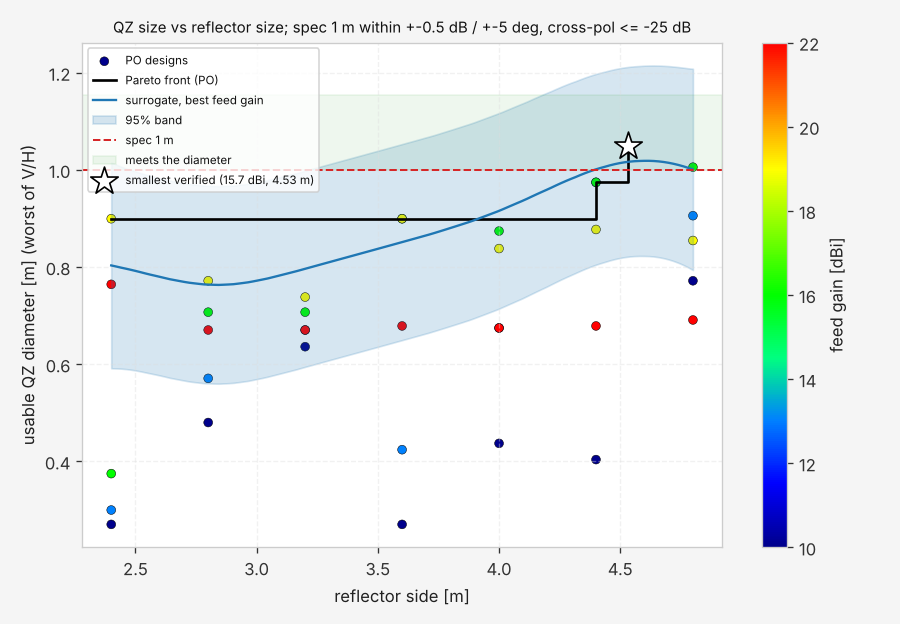
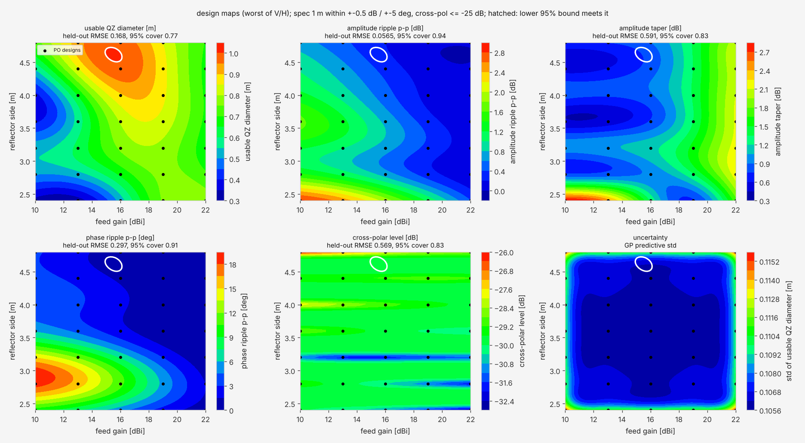
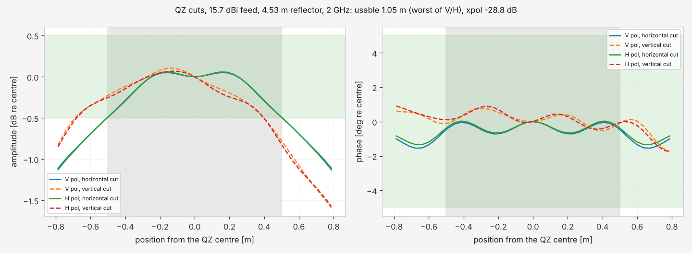

# Compact range quiet zone: feed gain × reflector size

A compact range turns the spherical wave of a feed into a plane wave with an offset paraboloid. The antenna under
test sits in the **quiet zone** (QZ), where the field must stay within a few tenths of a dB and a few degrees of a
plane wave. This guide sweeps the two inputs a range designer controls first, the feed gain (the illumination taper)
and the reflector size, plus the rolled-edge size, computes the QZ metrics by physical optics, validates the PO code
against closed forms, fits a surrogate with held-out error and draws the trade-off map.

Everything lives in `pinneapple_simulation.electromagnetics.reflector`; the example
`examples/use_cases/antennas/compact_range_qz.py` only calls it.

```bash
python examples/use_cases/antennas/compact_range_qz.py --quick     # 3 x 3 designs, coarser mesh (about 3 min)
python examples/use_cases/antennas/compact_range_qz.py             # 7 gains x 6 sizes x 2 rolled edges
```

## Model

* **Reflector** (`geometry.OffsetReflector`): the paraboloid `z = (x² + y²)/(4F)`, a section whose projection is a
  superellipse (half sizes, exponent `n`; large `n` = a square with rounded corners) centred `centre_y` above the
  axis. Past the junction an optional **rolled edge** leaves the paraboloid tangentially and with its curvature,
  blends to a constant curvature `-1/roll` turning away from the QZ and stops at `end_angle`; `roll_aspect`
  stretches it in depth (an elliptic-like roll). This is a blended rolled edge in the spirit of Gupta and Burnside;
  the exact profile of a particular range is a parameter, not built in.
* **Feed** (`po.cosq_feed`): an ideal `cos^q` pattern at the focus, aimed at the section centre, Ludwig-3
  polarised, normalised to 1 W, with `D = 2(2q + 1)`; the feed gain sets `q` (`po.q_from_gain`).
* **Physical optics** (`po.po_currents`, `po.radiate`): `J = 2 n × H_inc` on the lit triangles, and its field at
  the QZ points with the complete dyadic Green's function (no far-field approximation): the QZ is in the reflector's
  near field. Centroid quadrature on λ/8 triangles. PO leaves out the fringe edge currents (PTD) and multiple
  reflections; the edge diffraction it contains is that of the truncated PO current. The feed's direct radiation into
  the QZ is zero for this feed model (the QZ lies behind it).
* **Quiet-zone metrics** (`qz.qz_metrics`) over a disk of the QZ diameter: peak-to-peak amplitude and phase, the
  taper (a quadratic fitted to the amplitude in dB), the ripple (peak-to-peak residual about it), the phase ripple,
  the cross-polar level, and the **usable diameter**: the largest centred disk within ±0.5 dB and ±5° (the field is
  computed over 1.6 × the QZ diameter to find it).

## Validation

1. **PO integrator against a closed form.** The PO current of a normally incident plane wave on a flat disk has an
   exact on-axis field, `E_x = −E0 [e^{−jkz} − ½(1 + z²/R_a² + j a²/(k R_a³)) e^{−jkR_a}]` (`analytic.disk_on_axis`,
   derived in its docstring). Measured maximum relative error over z = 2–40 λ for a 3 λ disk: 4.5e-3 (λ/8, 7 097 triangles), 2.0e-3 (λ/12), 1.1e-3 (λ/16): second-order convergence.
2. **PO against geometrical optics.** In a compact range the smooth part of the QZ amplitude is the GO aperture taper
   of the feed (`sqrt(D(ψ))/ρ`, `analytic.go_aperture_taper_db`); the PO field adds the edge-diffraction ripple. The
   difference between the quadratic fit of the PO amplitude and the GO taper shrinks as the rolled edge grows:
   on the generic example, 2.05 dB maximum / 1.06 dB RMS with a 3 λ roll and 1.03 dB / 0.50 dB with a 6 λ roll.
3. **Mesh convergence** of the QZ metrics: reference design at λ/8 and λ/12: ripple 2.514 vs 2.522 dB, phase 20.25 vs 20.27° peak to peak, usable diameter 0.133 m in both (35.6 s and 73.3 s per evaluation).

No published compact-range measurement was compared here.

## Results (generic example)

`compact_range_qz.py` on the generic design (3 GHz, F = 1.5 m, a 1.2 m square section, superellipse n = 6,
centre 0.9 m above the axis, a 0.15 m rolled edge, a 12 dBi feed, a 0.6 m QZ at z = 3 m), measured on 4 cores:

* **Reference design:** 3.35 dB amplitude and 20.3° phase peak to peak over the 0.6 m QZ, taper 2.26 dB, ripple
  2.51 dB, cross-polar −22.9 dB, usable diameter 0.13 m. 34.5 s per evaluation (74 k triangles, 2 601 QZ points).
* **Sweep:** 7 feed gains (8–20 dBi) × 6 sizes (0.9–1.65 m) × {sharp edge, 0.15 m roll} = 84 designs, median
  28.1 s each, 2 431 s in all (2 791 s with the validation and the maps).
* **No design reaches the 0.6 m QZ within ±0.5 dB / ±5°.** Largest usable diameter: 0.43 m (18 dBi, 1.2 m, rolled
  edge) and 0.40 m (20 dBi, 1.35 m, sharp edge). The ripple falls with the feed gain at every size (the stronger edge
  taper diffracts less) and is not monotone in size (the edge diffraction adds in and out of phase at the QZ):
  0.09 to 3.14 dB with the rolled edge, 0.35 to 6.03 dB without.
* **Why:** the Fresnel number of the section seen from the QZ, `a²/(λ z)` with `a` = 0.6 m and z ≈ 2.9 m, is 1.2:
  the QZ is barely in the collimated region of a 12 λ aperture. A compact range needs a reflector several times the
  QZ and a Fresnel number well above one.
* **Surrogate error** (GP per metric). Random quarter of the designs held out: ripple 0.05 dB (rolled) / 0.04 dB
  (sharp), usable diameter 0.02–0.04 m. **One size held out at a time:** ripple 0.83 dB (rolled) / 2.57 dB (sharp),
  phase 4.5° / 19.3°. Sizes 0.15 m (1.5 λ) apart are too coarse for the diffraction oscillation in size, especially
  with a sharp edge: the map is trustworthy at the simulated sizes, not between them.


## API

```python
from pinneapple_simulation.electromagnetics.reflector import CompactRange, OffsetReflector, evaluate, scaled
from pinneapple_simulation.electromagnetics.reflector.study import qz_figure, qz_study, validate

cr = CompactRange(freq_hz=3e9, reflector=OffsetReflector(focal=1.5, half_x=0.6, half_y=0.6, centre_y=0.9,
                                                         n=6, roll=0.15), feed_gain_dbi=12, qz_z=3.0, qz_diameter=0.6)
evaluate(cr)                                     # metrics, triangles, seconds
validate(cr)                                     # disk closed form, PO vs GO, mesh convergence
qz_study(cr, gains=[8, 12, 16, 20], sides=[0.9, 1.2, 1.5], rolls=[0.0, 0.15], out="cr/")   # sweep, GP, maps
```

`study.fit_surrogates` fits a Gaussian process per metric on (feed gain, side) for each rolled edge
(`antenna.surrogates.GPModel` with `features=columns("feed_gain_dBi", "side")`) and reports two held-out RMSEs:
a random quarter of the designs (interpolation inside the grid) and every design of one size at a time
(interpolation across sizes, the harder case). `study.tradeoff_map` draws the predicted ripple and the predicted
usable QZ diameter over (feed gain, size), the simulated designs, the required diameter and the feasible region (or
says that it is empty).

## Design against a spec: feed gain × reflector size × focal length (#965)

`pinneapple_simulation.electromagnetics.reflector.design` asks the question a range designer asks: which feed gain
and how small a reflector meet a quiet-zone spec? The example `examples/use_cases/antennas/compact_range_2ghz.py`
runs it on a **generic 2 GHz range** (`design.generic_2ghz()`; λ = 0.15 m): a square offset section (superellipse
n = 6) 0.4 m above the axis, a 0.45 m (3 λ) rolled edge, the quiet zone 3 m in front of the focal plane. These are
generic proportions chosen for the example (F/D near 1, a rolled edge of a few wavelengths), not the values of any
installation or of a cited table. Spec: a **1.0 m quiet zone within ±0.5 dB and ±5°, cross-polar ≤ −25 dB**.

```bash
python examples/use_cases/antennas/compact_range_2ghz.py --quick                 # 3 x 3 designs, coarse mesh
python examples/use_cases/antennas/compact_range_2ghz.py                         # 5 gains x 7 sizes x 3 F
python examples/use_cases/antennas/compact_range_2ghz.py --template ~/range.json  # a configuration to edit
python examples/use_cases/antennas/compact_range_2ghz.py --private ~/range.json --out ~/range_results
```

`run_private(config_path, out_dir)` runs any geometry JSON with the template's keys and refuses a configuration or an
output folder inside the repository, so a client's geometry and results never reach a commit. Every PO solve and
check is checkpointed in `<out>/checkpoints/` (git-ignored); running the same command again resumes a killed run.

### What is computed

* `qz_report(cr, spec)`: one PO solve per design for **both feed polarisations** (V and H, two current sets on one
  geometry pass, `po.radiate_fields`), the disk metrics of `qz_metrics` for each, the taper, ripple and phase ripple
  along the **two principal cuts** (horizontal and vertical through the QZ centre), the cross-polar level, the
  usable diameter at the spec, and the worst case over the polarisations.
* `doe(...)`: the (gain × side × F) grid in parallel processes. A new focal length moves the quiet zone with the
  focal plane; a new side keeps the clearance below the section.
* `fit_qz_surrogate(table)`: a Gaussian process per metric on the inputs that vary, with 5-fold held-out RMSE and
  the fraction of held-out designs inside the GP's 95 % interval (`coverage95`; 0.95 when calibrated).
* `design_maps`, `pareto_front` / `pareto_figure`, `cuts_figure`.
* `smallest_reflector(...)`: the smallest side for which some feed gain meets the spec by the GP's lower 95 % bound;
  when no point meets the bound, the smallest side whose mean meets it is solved instead. Each candidate is
  **verified by PO**; a rejected one joins the data and the GP is refitted.

### Checks (measured)

* **Agreement with #887:** the #887 reference design solved by `qz_report` against the numbers #887 recorded:
  largest difference over the seven metrics 6.4e-13 (same PO path, `agreement_887`).
* **Facet size** (16 dBi, 3.6 m, F = 4 m): λ/6, λ/8, λ/12 (166 k, 296 k, 664 k triangles): ripple 0.762, 0.748,
  0.748 dB; phase ripple 2.02, 1.97, 2.02°; taper 0.780, 0.782, 0.778 dB; cross-pol −29.6, −29.8, −29.6 dB; usable
  diameter 0.90 m at all three. The study uses λ/8.
* **QZ grid:** λ/4 against λ/6 sampling of the quiet zone on the same design: ripple 0.747 vs 0.760 dB, usable
  diameter 0.90 m in both. The study uses λ/4.
* **Power balance:** the feed (1 W) puts 0.953 W on the reflector; the PO field carries 0.948, 0.969 and 0.977 of
  it through a plane 4 λ in front of the reflector over disks of 1.0, 1.25 and 1.5 × (side + 2 roll). The rest is
  radiated outside the disks (edge diffraction).

### Results (generic example, measured on 4 cores)

* **105 designs** (feed gain 10–22 dBi × side 2.4–4.8 m × F = 3, 4, 5 m), median 106 s per design (both
  polarisations, λ/8 mesh), 11 520 s of PO in all.
* **F = 4 m:** one grid design meets the spec, 16 dBi with a 4.8 m reflector (usable 1.006 m). **The optimiser found
  15.7 dBi with a 4.53 m reflector and PO verified it:** usable diameter 1.05 m for V and H, ripple 0.24 dB, taper
  0.84 dB, phase ripple 1.7°, cross-pol −28.8 dB. The GP predicted 1.00 ± 0.21 m (95 %) there: its mean met the spec,
  its lower bound did not, and PO settled it in one solve.
* **Pareto front (PO, F = 4 m):** 0.90 m from 2.4 m (19 dBi), 0.97 m at 4.4 m (13 dBi), 1.01 m at 4.8 m (16 dBi).
  The usable diameter is not monotone in size or gain: a low-gain feed lights the edge and the diffraction ripple
  breaks the ±0.5 dB band; a high-gain feed tapers the amplitude past it (22 dBi: taper 2.08–2.21 dB and usable
  0.67–0.69 m at every size from 2.8 m).
* **Focal length is a strong lever:** best usable diameter 0.91 m at F = 3 m (no design meets the spec, cross-pol up
  to −23.2 dB), 1.01 m at F = 4 m, 1.12 m at F = 5 m (16 dBi, 4.0 m; four designs meet the spec). The optimiser
  searches at the base F only; at F = 5 m the grid already holds a 4.0 m design that meets it.
* **Surrogate (all 105 designs, inputs gain, side, F):** held-out RMSE / 95 % coverage: usable diameter 0.14 m /
  0.85, ripple 0.060 dB / 0.94, taper 0.44 dB / 0.90, phase ripple 0.67° / 0.90, cross-pol 0.48 dB / 0.93. The
  usable diameter is a threshold quantity (the first radius where a tolerance breaks) and the GP under-states its
  uncertainty (0.85, not 0.95): use the maps to choose where to solve, and PO to decide.







### Limits of physical optics

PO leaves out the fringe edge currents (PTD) and multiple reflections; the feed is an ideal `cos^q` pattern with no
back radiation, no feed or strut blockage and no chamber; the edge diffraction it gives is that of the truncated PO
current. The optimiser's verification is PO only: no MoM solver is wired in. The issue's textbook comparison
(Hemming, *Electromagnetic Anechoic Chambers*) was not done here: the book was not available to check numbers
against, so no value from it is quoted.

Flow nodes: `antenna.compact_range_design` (the study; `quick` by default) and `antenna.compact_range_check` (one
design against a spec).
