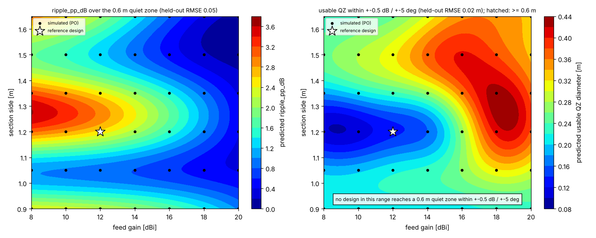
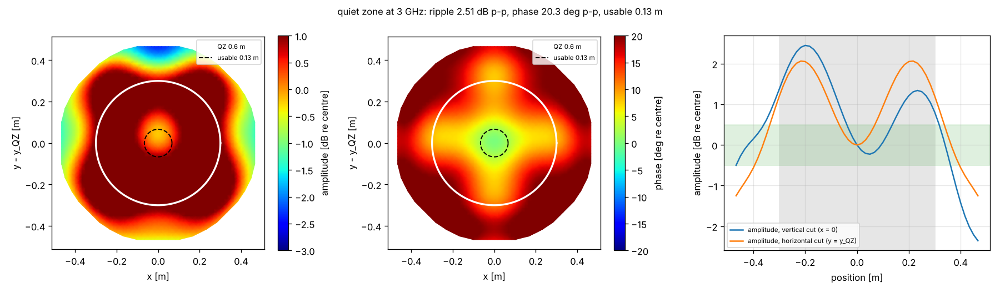

# Compact range quiet zone: feed gain × reflector size

A compact range turns the spherical wave of a feed into a plane wave with an offset paraboloid. The antenna under
test sits in the **quiet zone** (QZ), where the field must stay within a few tenths of a dB and a few degrees of a
plane wave. This guide sweeps the two inputs a range designer controls first, the feed gain (the illumination taper)
and the reflector size, plus the rolled-edge size, computes the QZ metrics by physical optics, validates the PO code
against closed forms, fits a surrogate with held-out error and draws the trade-off map.

Everything lives in `pinneapple_simulation.electromagnetics.reflector`; the example
`examples/use_cases/antennas/compact_range_qz.py` only calls it.

```bash
python examples/use_cases/antennas/compact_range_qz.py --quick     # 3 x 3 designs, coarser mesh (about 3 min)
python examples/use_cases/antennas/compact_range_qz.py             # 7 gains x 6 sizes x 2 rolled edges
```

## Model

* **Reflector** (`geometry.OffsetReflector`): the paraboloid `z = (x² + y²)/(4F)`, a section whose projection is a
  superellipse (half sizes, exponent `n`; large `n` = a square with rounded corners) centred `centre_y` above the
  axis. Past the junction an optional **rolled edge** leaves the paraboloid tangentially and with its curvature,
  blends to a constant curvature `-1/roll` turning away from the QZ and stops at `end_angle`; `roll_aspect`
  stretches it in depth (an elliptic-like roll). This is a blended rolled edge in the spirit of Gupta and Burnside;
  the exact profile of a particular range is a parameter, not built in.
* **Feed** (`po.cosq_feed`): an ideal `cos^q` pattern at the focus, aimed at the section centre, Ludwig-3
  polarised, normalised to 1 W, with `D = 2(2q + 1)`; the feed gain sets `q` (`po.q_from_gain`).
* **Physical optics** (`po.po_currents`, `po.radiate`): `J = 2 n × H_inc` on the lit triangles, and its field at
  the QZ points with the complete dyadic Green's function (no far-field approximation): the QZ is in the reflector's
  near field. Centroid quadrature on λ/8 triangles. PO leaves out the fringe edge currents (PTD) and multiple
  reflections; the edge diffraction it contains is that of the truncated PO current. The feed's direct radiation into
  the QZ is zero for this feed model (the QZ lies behind it).
* **Quiet-zone metrics** (`qz.qz_metrics`) over a disk of the QZ diameter: peak-to-peak amplitude and phase, the
  taper (a quadratic fitted to the amplitude in dB), the ripple (peak-to-peak residual about it), the phase ripple,
  the cross-polar level, and the **usable diameter**: the largest centred disk within ±0.5 dB and ±5° (the field is
  computed over 1.6 × the QZ diameter to find it).

## Validation

1. **PO integrator against a closed form.** The PO current of a normally incident plane wave on a flat disk has an
   exact on-axis field, `E_x = −E0 [e^{−jkz} − ½(1 + z²/R_a² + j a²/(k R_a³)) e^{−jkR_a}]` (`analytic.disk_on_axis`,
   derived in its docstring). Measured maximum relative error over z = 2–40 λ for a 3 λ disk: 4.5e-3 (λ/8, 7 097 triangles), 2.0e-3 (λ/12), 1.1e-3 (λ/16): second-order convergence.
2. **PO against geometrical optics.** In a compact range the smooth part of the QZ amplitude is the GO aperture taper
   of the feed (`sqrt(D(ψ))/ρ`, `analytic.go_aperture_taper_db`); the PO field adds the edge-diffraction ripple. The
   difference between the quadratic fit of the PO amplitude and the GO taper shrinks as the rolled edge grows:
   on the generic example, 2.05 dB maximum / 1.06 dB RMS with a 3 λ roll and 1.03 dB / 0.50 dB with a 6 λ roll.
3. **Mesh convergence** of the QZ metrics: reference design at λ/8 and λ/12: ripple 2.514 vs 2.522 dB, phase 20.25 vs 20.27° peak to peak, usable diameter 0.133 m in both (35.6 s and 73.3 s per evaluation).

No published compact-range measurement was compared here.

## Results (generic example)

`compact_range_qz.py` on the generic design (3 GHz, F = 1.5 m, a 1.2 m square section, superellipse n = 6,
centre 0.9 m above the axis, a 0.15 m rolled edge, a 12 dBi feed, a 0.6 m QZ at z = 3 m), measured on 4 cores:

* **Reference design:** 3.35 dB amplitude and 20.3° phase peak to peak over the 0.6 m QZ, taper 2.26 dB, ripple
  2.51 dB, cross-polar −22.9 dB, usable diameter 0.13 m. 34.5 s per evaluation (74 k triangles, 2 601 QZ points).
* **Sweep:** 7 feed gains (8–20 dBi) × 6 sizes (0.9–1.65 m) × {sharp edge, 0.15 m roll} = 84 designs, median
  28.1 s each, 2 431 s in all (2 791 s with the validation and the maps).
* **No design reaches the 0.6 m QZ within ±0.5 dB / ±5°.** Largest usable diameter: 0.43 m (18 dBi, 1.2 m, rolled
  edge) and 0.40 m (20 dBi, 1.35 m, sharp edge). The ripple falls with the feed gain at every size (the stronger edge
  taper diffracts less) and is not monotone in size (the edge diffraction adds in and out of phase at the QZ):
  0.09 to 3.14 dB with the rolled edge, 0.35 to 6.03 dB without.
* **Why:** the Fresnel number of the section seen from the QZ, `a²/(λ z)` with `a` = 0.6 m and z ≈ 2.9 m, is 1.2:
  the QZ is barely in the collimated region of a 12 λ aperture. A compact range needs a reflector several times the
  QZ and a Fresnel number well above one.
* **Surrogate error** (GP per metric). Random quarter of the designs held out: ripple 0.05 dB (rolled) / 0.04 dB
  (sharp), usable diameter 0.02–0.04 m. **One size held out at a time:** ripple 0.83 dB (rolled) / 2.57 dB (sharp),
  phase 4.5° / 19.3°. Sizes 0.15 m (1.5 λ) apart are too coarse for the diffraction oscillation in size, especially
  with a sharp edge: the map is trustworthy at the simulated sizes, not between them.





## API

```python
from pinneapple_simulation.electromagnetics.reflector import CompactRange, OffsetReflector, evaluate, scaled
from pinneapple_simulation.electromagnetics.reflector.study import qz_figure, qz_study, validate

cr = CompactRange(freq_hz=3e9, reflector=OffsetReflector(focal=1.5, half_x=0.6, half_y=0.6, centre_y=0.9,
                                                         n=6, roll=0.15), feed_gain_dbi=12, qz_z=3.0, qz_diameter=0.6)
evaluate(cr)                                     # metrics, triangles, seconds
validate(cr)                                     # disk closed form, PO vs GO, mesh convergence
qz_study(cr, gains=[8, 12, 16, 20], sides=[0.9, 1.2, 1.5], rolls=[0.0, 0.15], out="cr/")   # sweep, GP, maps
```

`study.fit_surrogates` fits a Gaussian process per metric on (feed gain, side) for each rolled edge
(`antenna.surrogates.GPModel` with `features=columns("feed_gain_dBi", "side")`) and reports two held-out RMSEs:
a random quarter of the designs (interpolation inside the grid) and every design of one size at a time
(interpolation across sizes, the harder case). `study.tradeoff_map` draws the predicted ripple and the predicted
usable QZ diameter over (feed gain, size), the simulated designs, the required diameter and the feasible region (or
says that it is empty).
