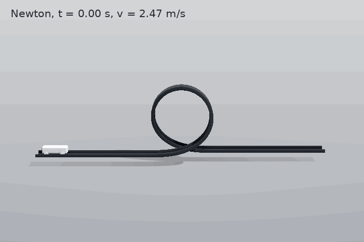
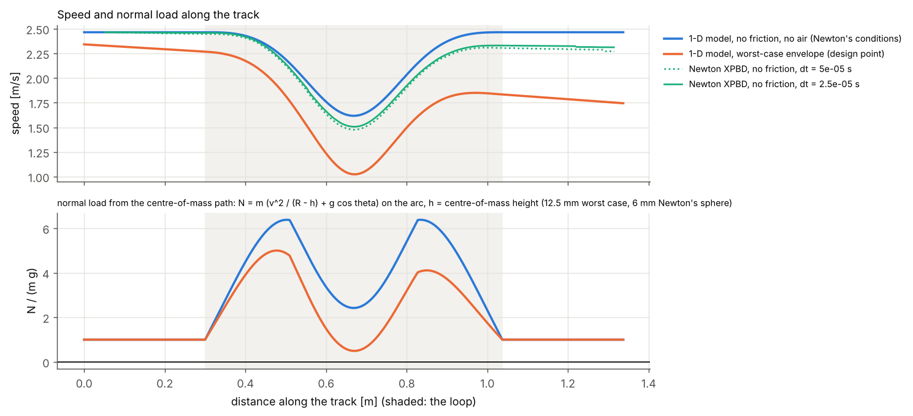
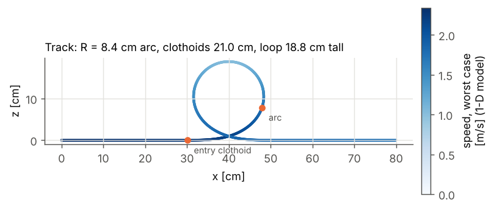
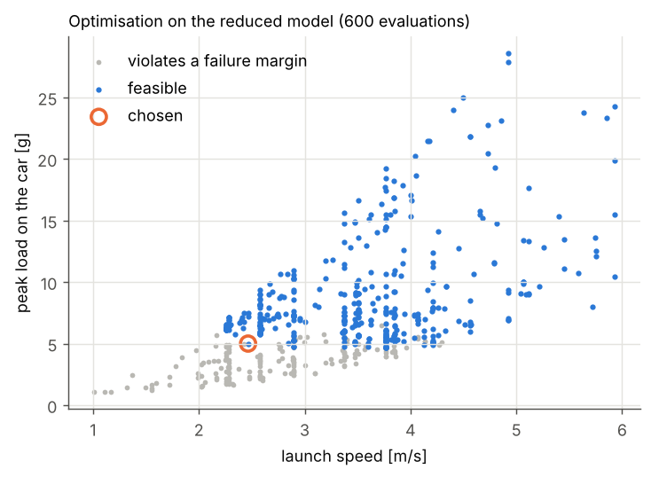
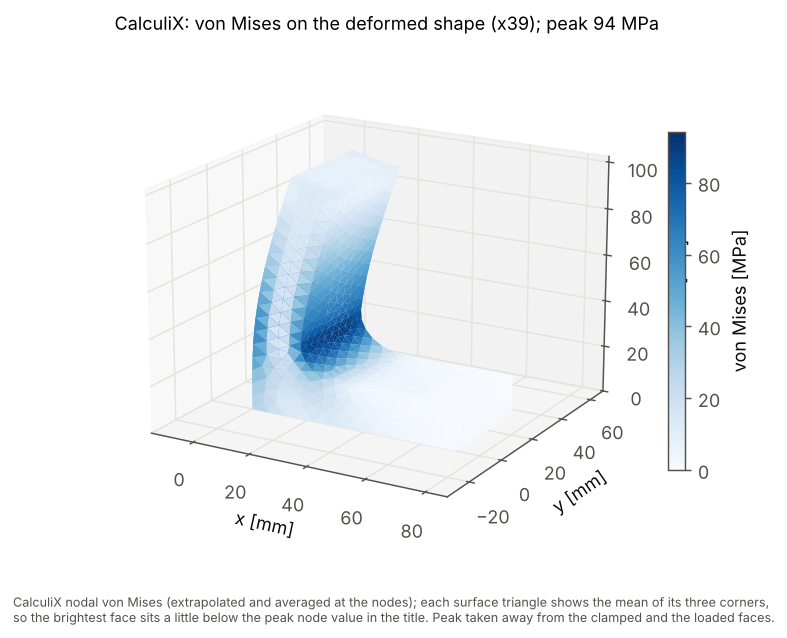
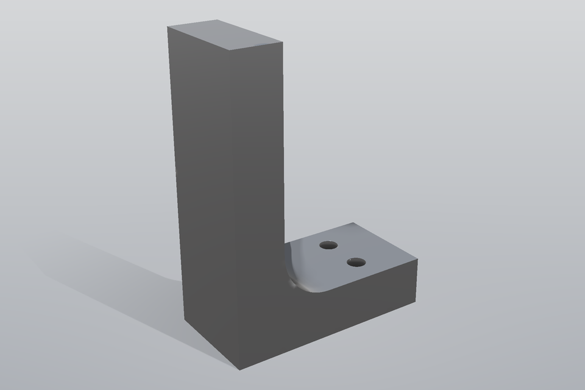
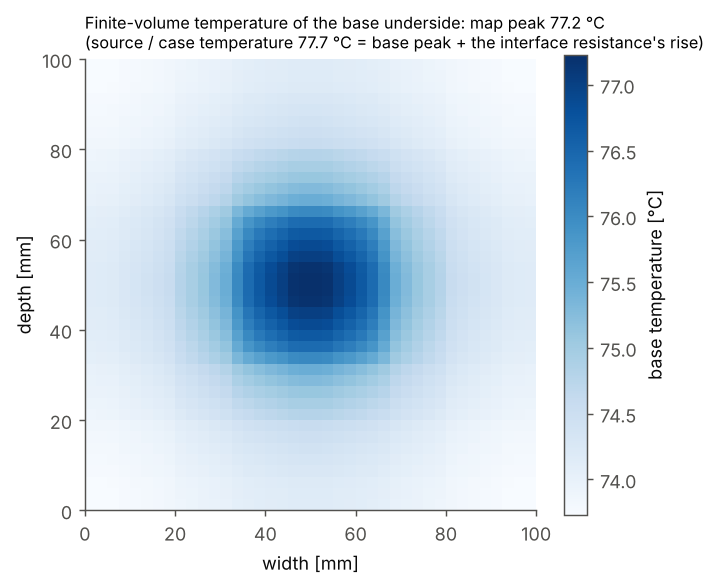
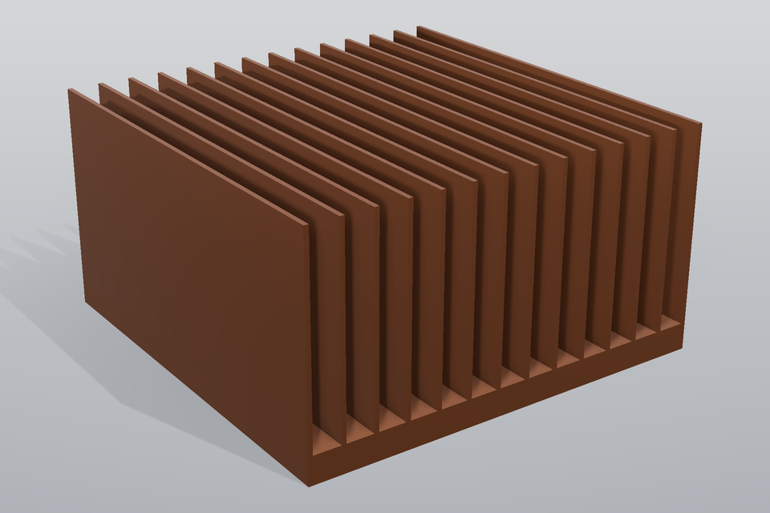
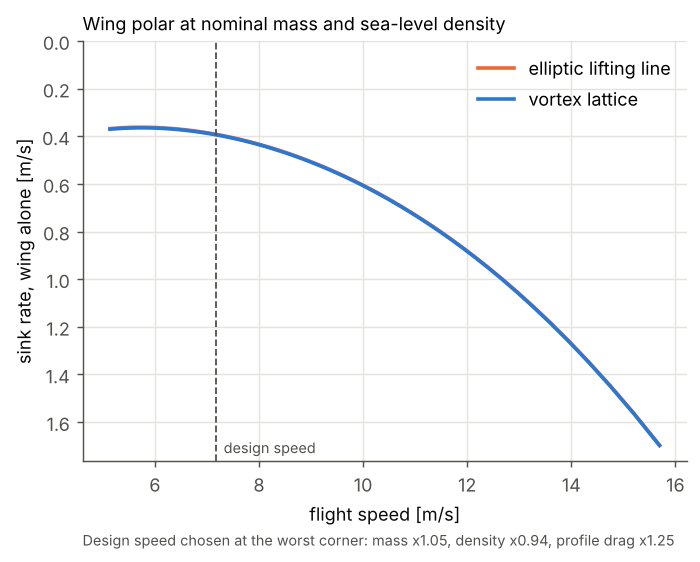

# Design from intent

`pinneapple_design.intent` turns a goal written in plain language into a design you can build: geometry, materials
and operating conditions, with the margin to every failure mode, a trust report and the limits of what was checked.
It never fills a gap with an invented number: a value it needs and cannot read becomes a question, a value it
defaults says where the default comes from, and a request no template covers is refused with what would be needed.

```python
import pinneapple as pp

pp.design("a heat sink for a 40 W chip in still air")
# NeedsInput: What is the highest allowed temperature of the chip's case (or source)? [°C]

pkg = pp.design("a heat sink for a 40 W chip in still air", answers={"t_limit": (85, "°C")}, out_dir="hs")
print(pkg.summary())        # design, verdict with probability, trust decision, model calls
pkg.files["html"]           # hs/report.html; also report.pdf, design.json, geometry/*.step|stl|glb, check/

pp.design("an electric motor for my drone")
# OutOfScope (needs): needs an electromagnetics design template: the interior-PM machine FEA and drive ...
```

The same call from a shell and from an agent:

```bash
pinneapple design "a bracket that holds 2 kN" --answer arm_length=100mm --out bracket
pinneapple design --templates
```

and the MCP tool `design` (`pinneapple-mcp`), which answers questions and refusals at once and runs the design as a
job (poll `job_status`).

## The pipeline

Each stage is a typed object you can inspect, test and replace.

| Stage | Object | What it does |
|---|---|---|
| intent -> requirements | `formulate(text) -> RequirementSpec` | picks a template by keywords, reads every `number unit` pair, checks the unit's dimension and the template's range with `pinneapple_data.physical_units`, fills the template's slots; each value is **stated** (with the quote), **answered**, **defaulted** (with its source) or **missing**; missing critical values become `Question`s |
| requirements -> physics | `plan(spec, template) -> PhysicsPlan` | governing physics, assumptions, design variables, the models at each fidelity with their availability on this machine, failure modes |
| multi-fidelity optimisation | `optimise(...) -> OptimisationResult` | Latin-hypercube screening on the closed form, then the design-study core (`pinneapple_design.design_optimizer`: NSGA-II on the reduced model, or the GP surrogate-assisted loop when the reduced model costs seconds), distinct candidates (the knee of the Pareto front for several objectives) |
| robustness | `robustness(...) -> Robustness` | Monte-Carlo propagation (`pinneapple_analysis.uncertainty.tolerance.propagate`) of the uncertain inputs to the probability that every margin stays >= 0, with a Wilson interval, the 5th percentile of each margin and the rank correlation of each input with the smallest margin |
| verification | `verify(...) -> Verification` | the full solver on the chosen design, its own checks, and the comparison with the reduced and closed-form models output by output |
| assessment | `assess(...) -> Assessment` | the trust report (`pinneapple_analysis.trust.TrustReport`) and the verdict: *will work*, *likely to work* (not verified by the full solver), *marginal*, *will not work*, *unverified* |
| package | `DesignPackage` | geometry (STEP, STL, glTF, renders), bill of materials with cited properties, operating window, build instructions, every number with the model it comes from, model calls per fidelity, limits; `report.html` / `report.pdf`, `design.json`, `check/` for `pinneapple check` |

Every template designs at the worst corner of its own uncertainty (the optimum is robust, not on the nominal edge),
then the Monte Carlo measures the probability of success around it. When the full solver measures something the cheap
models assumed (the bracket's stress-concentration factor), the design is re-checked with the measured value and
re-optimised if it no longer meets its margins.

An LLM is optional. Anything with `extract(text, schema) -> dict` (for example `CallLLM("anthropic")`, which wraps
`pinneapple_llm.call_llm`) can propose the template and values; a value is used only if its quote is in the request
and contains the number, and its unit has the slot's dimension. The deterministic parser always runs and wins on
conflicts, so the pipeline works offline.

## The five demos

`python examples/design_from_intent/design_from_intent.py` runs all five through the same pipeline; the outputs are
in `examples/design_from_intent/_out/`. The numbers below are copied from `_out/summary.json` of that run.

| | request | first reply | design | verdict (P, 95 % interval) | full solver check | model calls (closed form / reduced / full) |
|---|---|---|---|---|---|---|
| (a) | "I want a toy car that does a loop" | complete (every value defaulted with a source) | R = 8.4 cm, clothoids 2.5 R = 21.0 cm, launch 2.47 m/s, car 31 g, 1.5 mm PLA strip | will work (1.000, 0.998-1.000) | Newton: goes round at both time steps, v_top 1.507 m/s >= worst-case envelope 1.023 m/s | 2000 / 6600 / 1 |
| (b) | "a bracket that holds 2 kN" | asks for the arm length (answered: 100 mm) | Al 6061-T6, t = 17 mm, w = 36 mm, mounting leg 72 mm, two M6 8.8 | will work (0.9985, 0.9956-0.9995) | CalculiX: peak 94.3 vs 96.8 MPa (hex FE), deflection 0.380 vs 0.380 mm | 12000 / 19 / 1 |
| (c) | "a heat sink for a 40 W chip in still air" | asks for the temperature limit (answered: 85 °C) | copper C110, base 100 x 100 x 6.5 mm, 14 fins 1.1 x 47 mm | will work (1.000, 0.998-1.000) | finite volume: source (case) temperature 77.7 vs 77.6 °C (network), energy balance 1e-12 | 2000 / 2600 / 1 |
| (d) | "a wing for a 1.2 kg model glider, at most 2 m span" | complete | span 2.0 m, AR 7.69, taper 0.33, NACA 2412 | will work (1.000, 0.998-1.000) | fine lattice: sink 0.4409 vs 0.4406 m/s, e 0.989 vs 0.990 | 2000 / 6600 / 1 |
| (e) | "an electric motor for my drone" | out of scope: needs an electromagnetics design template (current-density, thermal, demagnetisation limits) | - | - | - | - |

The closed-form call counts include the Monte-Carlo samples when a template runs its robustness study on the
calibrated closed form (the bracket). Each report also gives an *estimate*, not a measurement, of the time the full solver would
have needed for every evaluation: the measured seconds of its one full call times the number of evaluations (about
650 h for the loop and 130 h for the bracket on the machine of this run; the measured call time varies between
runs).

### (a) Loop-the-loop car



Nothing in the request is a number, so every value is a default with its source: the rolling-resistance coefficient
and the launcher scatter are **design envelopes**, not measurements (the design must work for any rolling resistance
up to 0.05 and a launcher 5 % slow), the drag coefficient's worst case is the bluff-body end of the range (a cube is
about 1.05, Hoerner), the strip material is the printable PLA with its datasheet yield strength.

- *Closed form*: `v_top^2 = v0^2 - 2 g z_top - losses` with the losses at the mean speed, the top condition
  `v_top^2 >= g (R - h)`, the peak load at the end of the entry clothoid.
- *Reduced*: the 1-D along-track ODE (`d(v^2)/ds` with `N = m (v^2 kappa + g cos theta)`, rolling resistance on `N`,
  drag, the wheels' inertia), RK4, vectorised: 6600 designs in 6.6 s. The car is a point on its centre-of-mass
  path, the track offset inwards by the centre-of-mass height `h` (12.5 mm for the car, 6 mm for Newton's sphere), so
  `kappa = 1 / (R - h)` on the top arc and `N / (m g) = v_top^2 / (g (R - h)) - 1` at the top: 0.49 at the
  worst case (1.023 m/s, R - h = 7.14 cm), not the 0.27 a radius of R would give. Without losses it conserves energy to 0.3 %
  and reproduces the `v0^2 = 5 g R` threshold of a circular loop (tests).
- *Full*: NVIDIA Newton (XPBD) on the 3-D track mesh with its side rails and the helical exit, at two time steps.
  Newton's contact dissipates energy on the curved mesh (5.7 % of the launch energy by the top here, with no friction
  at all, and it does not go away with a smaller step or a finer mesh), and its Coulomb friction, correct on its flat
  analytic case (stopping distance 0.5087 vs 0.5097 m), takes most of the energy of a rolling sphere on the curved
  mesh. So the Newton run is frictionless and judged against the **worst-case envelope**: the car must stay on the
  track (largest gap to the surface 0.1 mm) and keep at least the envelope's speed at the top (1.507 >= 1.023 m/s).

The optimiser minimised the launch speed and the peak load on the car together; the knee of the front uses the
longest clothoid allowed (2.5 R), which cuts the peak load to 5.0 g at the worst case, with a loop 8.4 cm in
radius. Operating window (1-D model): launch 2.24 to 7.02 m/s (the upper end is the strip's
yield / 2), any car from 10 g up, rolling resistance up to 0.0695 at the design speed minus the scatter.





### (b) Bracket, verified with CalculiX

`pp.design("a bracket that holds 2 kN")` asks how far from the mounting face the load acts: the bending moment
depends on it and there is no safe default. With 100 mm:

- *Closed form*: cantilever beam theory (`M c / I`, `P L^3 / 3 E I`).
- *Reduced*: an in-house hexahedral FE model of the L (C3D8I, the fillet as a staircase), 0.53 s per design, so the
  optimiser fits a GP surrogate of it and checks 19 designs with the FE model.
- *Full*: CalculiX on a gmsh C3D10 mesh of the exact part (filleted corner, two M6 clearance holes, ISO 273), two
  mesh sizes. Checks: support reaction = load (1e-7), the arm's bending stress against `M c / I` at mid-arm (0.05 %),
  mesh convergence of the peak (1.2 %). The measured stress-concentration factor of the R = t fillet is 0.97 of the
  nominal stress (the peak is not at the fillet for this proportion), fed back into the reduced model.

The bracket is sized at the worst corner of its stated uncertainty (load +10 %, plate -0.2 mm, yield 90 % of the
datasheet value; all three labelled as assumptions in the report). The two M6 8.8 bolts (proof load from ISO 898-1)
set the mounting-leg length: they are the limiting failure mode (5th-percentile margin 0.017). The STEP file is the
OpenCASCADE B-rep from the gmsh script, with the exact holes and fillet.




### (c) Passive heat sink

The request gives the power and "still air" (read as 0 m/s, quoted in the report); the allowed temperature has no
safe default, so it is asked for. With 85 °C the template reuses the heat-sink sizer physics: the closed form is
the hand calculation (Elenbaas / Bar-Cohen coefficient evaluated once with the fin root at the limit), the reduced
model the converged resistance network, the full model the 3-D finite-volume solve of the base with its energy
balance, spreading cross-check and grid convergence. The design is sized with the convection coefficient 15 % low
and the interface resistance 50 % high (the engine's stated band and the paste's spread). In still air within the
default 100 x 100 x 50 mm envelope only copper meets the limit at that corner: 1.23 kg, source (case) temperature 77.7 °C nominal, 83.9 °C
with the coefficient 15 % low (the base underside peaks at 77.2 °C under the source; the paste's
10 K·mm²/W over 30 x 30 mm adds 0.44 K at 40 W). Operating window: up to 47.2 W at 25 °C, or 31.3 °C ambient at 40 W.




### (d) Glider wing

The lift comes from the vortex-lattice code of `pinneapple_design.aero` (closed form: elliptic lifting line;
reduced: a 3 x 10 lattice per half span; full: 8 x 32, with the lattice convergence of the span efficiency, Munk's
`e <= 1` and the lift slope below Helmbold's estimate as checks), the profile drag from turbulent flat-plate friction
and Hoerner's thickness form factor. The wing is chosen for the lowest sink rate with the design speed taken at the
heavy (+5 %), thin-air (-6 % density) and draggy (+25 % profile drag) corner, so the lift coefficient stays below
the 0.8 design cap in every Monte-Carlo sample: span 2.0 m (the stated limit), aspect ratio 7.7, taper 0.33,
NACA 2412, sink 0.44 m/s at 7.2 m/s (wing alone). No viscous solver ran: the report says so, and that a RANS check
is the next level.



### (e) Out of scope

`pp.design("an electric motor for my drone")` returns `OutOfScope(kind="needs")`: *needs an electromagnetics design
template: the interior-PM machine FEA and drive models exist (`pinneapple_simulation.electromagnetics.machines`), but
no template sizes a machine from a request yet, and it would also need winding current-density, thermal and
demagnetisation limits, which those models do not check.* A motor template is the natural next one to write with the
guide below. Weapons are refused outright (`kind="refused"`); a request no template matches lists the installed
templates; a request a template matches but cannot honestly design (a loop for a roller coaster that carries people,
a bracket under fatigue loading, a liquid-cooled heat sink) is refused by that template's `check_scope` with what it
would need.

## Writing a template

A new domain plugs in with one class and one `register` call. The worked example is
`pinneapple_design/intent/templates/example_spring.py`, a helical compression spring (Shigley, ch. 10):

```python
import pinneapple_design.intent as I
from pinneapple_design.intent.templates.example_spring import CoilSpringTemplate

I.register(CoilSpringTemplate())
pkg = I.design("a steel compression spring that takes 50 N with 10 mm travel", verify=False)
print(pkg.summary())
```

What a template declares, in the order the pipeline uses it:

1. **Selection and reading.** `keywords` (word -> weight; the best total selects the template) and `slots`: each
   `Slot` has an SI unit (its dimension is what the parser matches), the words that point to it in a sentence, its
   valid range, and either `critical=True` (asked for when missing) or a `default` with a `default_source`. Phrases can
   set values through `cues` (`("still air", 0.0)`). `check_scope(spec)` refuses requests the physics does not cover;
   `extra_questions(spec)` asks for "one of these two" values.
2. **Physics.** `physics` and `assumptions` (shown in the plan and the report), `objectives` (`ObjectiveChoice` with
   the words that select each one), `failure_modes` (each names an output that is a *margin*, >= 0 when the mode does
   not occur, typically `capacity / demand - 1`).
3. **Variables.** `variables(spec) -> [DesignVariable]`; integers and choices (materials) are integer variables, and a
   value the user stated is fixed rather than optimised.
4. **Models.** `fidelities` (closed form, reduced, full; each with the modules or programs it needs) and
   `evaluate(level, X, spec, **options)`, which returns every margin and objective for a batch of designs. The full
   solver runs through `verify(design, spec) -> FullResult` with its own checks (equilibrium, energy balance, mesh
   convergence, a closed-form reference) and the outputs to compare with the reduced model (`compare`; `compare_kind`
   "at_least" / "at_most" for a solver known to be biased one way). `reduced_is_expensive = True` makes the optimiser
   fit a GP surrogate of the reduced model.
5. **Robustness.** `uncertainties(spec, design) -> [Uncertain]` (nominal, spread, distribution and *why this range*),
   `design_options(spec)` (the worst corner the optimiser designs at), `robust_level` (a closed form calibrated to the
   best model that ran on the design, when the reduced model is too slow for thousands of samples).
6. **Package.** `geometry` (closed `Body` meshes in metres), `bill_of_materials` (with the cited properties from
   `pinneapple_design.intent.materials`), `operating_window`, `build_instructions`, `limits`, `figures`.

Rules that keep templates honest: every material property comes from `materials.MATERIALS` (each value carries its
source) or from the user; every default has a `default_source`; an envelope that is assumed rather than measured says
so in its source and in `limits`; a model that has no stall, fatigue, buckling or radiation says so in `limits`.

## Tests

`tests/test_design_intent.py`: parsing offline, units and ranges, template selection, refusal, the LLM quote check,
cited materials, each demo's models against closed forms (energy conservation and `v_top^2 = g R` for the loop, beam
theory for the bracket, the finite-volume energy balance for the heat sink, Munk's `e <= 1` for the wing), the
CalculiX bracket when `ccx` and `gmsh` are installed, determinism with a fixed seed, the package files passing
`pinneapple check`, the CLI, the MCP tool and a new template plugged in. The Newton loop check takes minutes and runs
with `PINNEAPPLE_SLOW=1`.
