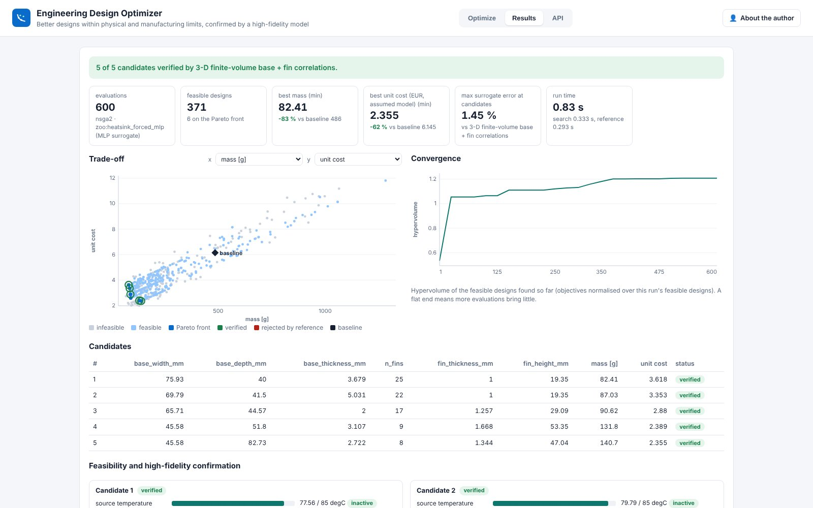
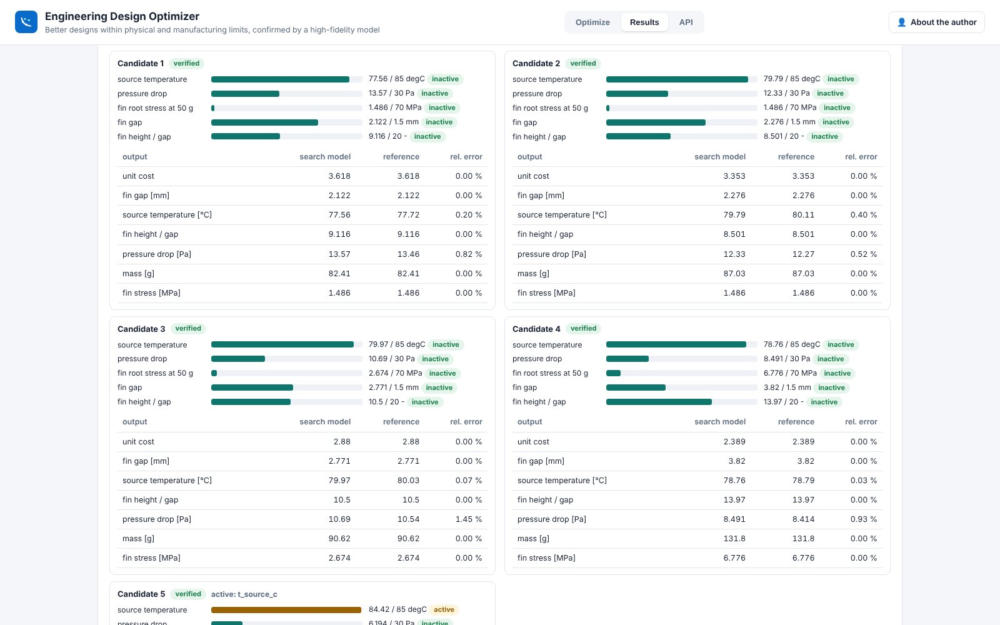

# Engineering Design Optimizer (app, day 17)

Black-box design optimisation within physical and manufacturing limits, with the chosen candidates confirmed by a
high-fidelity model. Live at `https://optimize.pinneapple.org`; source and deployment notes in
[`apps/engineering_optimizer`](https://github.com/PINNeAPPle-Labs/PINNeAPPle/tree/main/apps/engineering_optimizer).



| | |
|---|---|
| **Input** | design variables (or a `ParameterSpace`), objectives, constraints, and an evaluation model: the heat-sink example (zoo surrogate or closed form), a table of designs you evaluated (GP surrogate with held-out error), a `pp.zoo` model (`ModelRef` URI `zoo:<name>`), or an operator-configured solver |
| **Methods** | NSGA-II (library and pymoo), SciPy differential evolution, Bayesian optimisation, Latin-hypercube baseline; optional active learning against the reference |
| **Output** | candidates along the Pareto front with a verification status, trade-off and convergence plots, feasibility report (active constraints, margins), surrogate vs reference errors, CSV / ParameterSpace / ModelRef / StudyResult files |

The engine is the library: [Design studies](design_studies.md). The same problem through Python:

```python
from pinneapple_design.design_optimizer import problem_from_spec, reference_for_spec, run, verify_candidates
from pinneapple_design.design_optimizer import select_candidates

spec = {"source": "preset", "preset": "heatsink", "objectives": [{"name": "mass_g"}, {"name": "cost"}]}
problem, _ = problem_from_spec(spec)
res = run(problem, "nsga2", budget=600)
report = verify_candidates(problem, res.evaluations, select_candidates(res.evaluations, res.pareto(), 5),
                           reference_for_spec(spec))
```



**Limits.** Candidates are optimal for the search model; only those the reference re-evaluated are "verified". The
heat-sink example assumes ducted laminar flow and no radiation, and its cost model is a placeholder for your
numbers. A surrogate from your data is valid inside the range of the data only.
