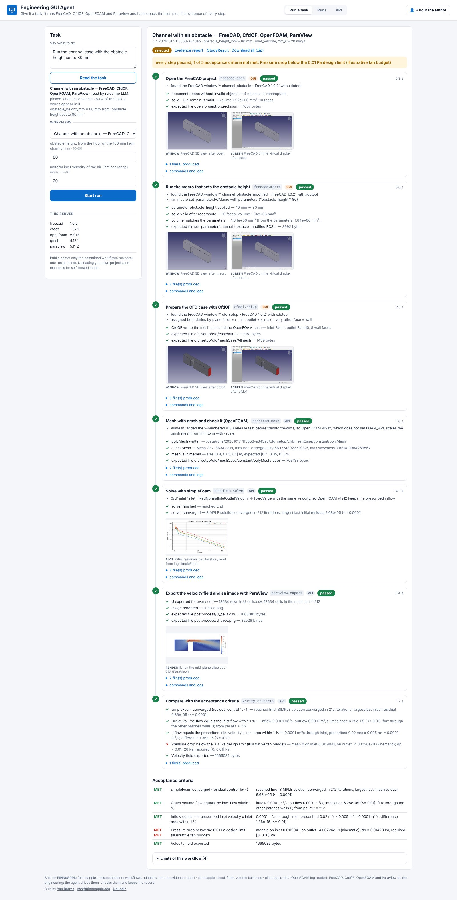

# Engineering GUI agent: run engineering software and keep the evidence

`pinneapple_tools.automation` runs a task in engineering software (FreeCAD, CfdOF, OpenFOAM, ParaView) and delivers
the files plus a record of what happened: every command, log, screenshot, produced file (with its SHA-256) and check,
in an HTML evidence report and a `StudyResult` (the data contract the apps share). Think of it as Selenium for computational engineering: the
application's own API first, the GUI only when there is no API, and a screenshot of each GUI step either way.

## The committed example: channel with an obstacle

`pinneapple_tools/automation/examples/channel_obstacle/` holds a parametric FreeCAD project (a 400 mm long,
100 mm high, 50 mm wide air channel with an obstacle on its floor, every dimension an alias of a spreadsheet), a
macro that changes a parameter, and the workflow:

| # | Step | Action | How |
|---|---|---|---|
| 1 | Open the FreeCAD project | `freecad.open` | FreeCAD Python inside the FreeCAD GUI on a virtual display; window found with xdotool, screen captured |
| 2 | Set the obstacle height | `freecad.macro` | the committed `.FCMacro` sets the alias, recomputes, checks the volume against the parameters, saves a new file |
| 3 | Prepare the CFD case | `cfdof.setup` | CfdOF's Python API: laminar steady incompressible air, velocity inlet, pressure outlet, walls, gmsh mesh |
| 4 | Mesh | `openfoam.mesh` | CfdOF's `Allmesh` (gmsh, gmshToFoam), then `checkMesh`; checks "Mesh OK" and that the mesh is in metres |
| 5 | Solve | `openfoam.solve` | `simpleFoam` via CfdOF's `Allrun`; **asks for confirmation** (expensive); checks end reached and convergence |
| 6 | Post-process | `paraview.export` | `pvpython`: velocity and pressure of every cell to CSV, \|U\| on the mid-plane to PNG |
| 7 | Verify | `verify.criteria` | the acceptance criteria below, computed from the result files |

Acceptance criteria, each computed from the OpenFOAM files with `pinneapple_check`'s finite-volume reader:
converged (residual control 1e-4), outlet flow equals inlet flow within 1 %, inflow equals the prescribed velocity
times the inlet area within 1 %, pressure drop below an illustrative 0.01 Pa design limit, velocity exported.

Measured on FreeCAD 1.0.2, CfdOF 1.37.3, OpenFOAM v1912, gmsh 4.13.1, ParaView 5.11.2 (4 CPU cores), inlet 20 mm/s:

| Obstacle height | Cells | Iterations | Inflow (m³/s) | Mass imbalance | Pressure drop | Decision |
|---|---|---|---|---|---|---|
| 25 mm | 20 193 | 119 | 1.000e-4 | 1e-8 | 1.9 mPa | ACCEPTED |
| 55 mm (default) | 19 370 | 162 | 1.000e-4 | 5e-9 | 3.5 mPa | ACCEPTED |
| 80 mm | 18 618 | 223 | 1.000e-4 | 7e-9 | 14.1 mPa (14.3 in the Docker run) | REJECTED by the 0.01 Pa limit |

The whole workflow takes about 30 s (FreeCAD start-up included). gmsh meshes with several threads, so the cell
count changes by a few hundred between runs of the same input (19 370 and 19 588 for 55 mm); the decisions did not.

```python
from pinneapple_tools.automation import Runner, Workflow, example_workflow

wf = Workflow.load(example_workflow("channel_obstacle"))
run = Runner(wf, "runs/r1", inputs={"obstacle_height_mm": 55}).run()
print(run.state)                     # awaiting_confirmation: the solver step is "expensive"
run = Runner(wf, "runs/r1").run(approve=["solve"], approver="j.doe")
print(run.state, run.message)        # passed / rejected, with the criteria that failed
# runs/r1/report.html, runs/r1/study_result.json, runs/r1/run.json, and every step's files and logs
```

## What the agent found while building the example

These are the reasons the checks exist; each was found by a real run and is now handled and recorded.

* **The mesh stayed in millimetres.** CfdOF picks the `transformPoints` syntax from `FOAM_API`, which OpenFOAM v1912
  does not set. The mesh step edits the test in `Allmesh` and records the edit; the "mesh is in metres" check
  compares the checkMesh bounding box with the expected size.
* **The solver diverged after potential-flow initialisation.** On v1912, `potentialFoam -initialiseUBCs` wrote outlet
  velocities of hundreds of m/s and `simpleFoam` stopped with a floating-point exception. The run stopped at the solve
  step with the solver's stack trace in the report. The example now starts from a uniform field.
* **The inflow was 6 % lower than prescribed.** CfdOF's velocity inlet (`fixedNormalInletOutletVelocity`) did not hold
  the prescribed flux on v1912: the outlet balanced the inlet perfectly, so a mass-balance check alone passed, but the
  inflow was 9.41e-5 m³/s instead of 1.00e-4. The `inflow` criterion rejected the run; the solve step now writes the
  inlet as `fixedValue` on ESI releases before v2006 and records the edit.
* **A bug in `pinneapple check`'s per-patch fluxes.** `FV.patch_sums` read past the end of the boundary arrays the
  balances pass it, so every patch total was 0 (only the net balance was right). Fixed, with a test.

## The app: guiagent.pinneapple.org

`apps/guiagent` (port 8115) puts the library behind a web page and a REST API. You:

1. type a task, or pick the workflow and its inputs;
2. watch the step timeline fill with checks and screenshots;
3. approve or decline the solver step;
4. download the evidence report, the StudyResult and the run as a zip.

Runs execute in the shared job queue of `apps/_shared` (one at a time; others wait), belong to the caller and are
metered in runs, compute seconds and storage. The public server runs only the committed workflows. Uploading your own workflows, projects and macros
is for self-hosted mode (`GUIAGENT_MODE=selfhosted`), because a macro is code. The Docker image is separate and
optional (FreeCAD, CfdOF, OpenFOAM, ParaView, Xvfb); see [apps/deploy/README.md](../../apps/deploy/README.md).

| Waiting for approval before the solver | A finished run (80 mm obstacle, rejected by the pressure-drop limit) |
|---|---|
|  |  |


## Building blocks

| Module | What it does |
|---|---|
| `workflow` | `Workflow` (YAML/JSON): inputs with bounds, steps (`action`, `params`, `after`, `requires`, `expects`, `confirm`), criteria, limits. Templates `{inputs.x}`, `{steps.id.output}`, `{example}`, `{workdir}`. `validate()` lists every problem. |
| `interpret` | `interpret(task, catalog(), llm=None)`: a sentence ("obstacle height 5.5 cm at 3 cm/s") picks a committed workflow and sets its inputs (units converted, bounds checked); a dict or JSON/YAML is validated as is. An `OllamaClient` (`pinneapple_data.formfill.llm`) is optional and goes through the same validation. A sentence can never add steps or run code. |
| `adapters` | `freecad.open`, `freecad.macro`, `cfdof.setup` (FreeCAD GUI on Xvfb), `openfoam.mesh`, `openfoam.solve` (command line), `paraview.export` (`pvpython`), `verify.criteria`, `web.capture` (Playwright). `register()` adds your own. |
| `display` | `VirtualDisplay` (Xvfb, screenshots with Pillow), `XdotoolDriver`, `PlaywrightDriver`, and `PywinautoDriver`: the interface for Windows GUIs (Ansys Workbench, Abaqus/CAE), documented but not runnable in a Linux container. |
| `runner` | `Runner(workflow, folder, inputs).run(approve=[...])`: stops on the first failure, on a missing application (`blocked`) and before any step that needs confirmation (expensive, overwrite, destructive, external). A step whose expected files already exist counts as an overwrite. Runs resume from `run.json`. `plan()` says what a run would need without running it. |
| `verify` | `mass_balance`, `inflow`, `pressure_drop`, `patch_fluxes`, `patch_mean` on OpenFOAM results (`pinneapple_check.fv`); criteria `converged`, `artifact`, `physics_lint` (`pinneapple check`). |
| `report` | `write_report` (one HTML file with images embedded), `to_study_result`: a `pinneapple_data.contracts.StudyResult` (`study_type="runs"`, checks and criteria as `CheckRecord`, files as `FileRef` with SHA-256, limits, provenance), the contract the Evidence Report app reads. |
| `runner_step` | `register()` adds the step kind `guiagent` to the Simulation Workflow Runner (`pinneapple_core.workflows`): one runner step runs a committed workflow with `inputs` and the confirmations it is given in `approve`, and outputs its verdict, criteria and metrics. `available()` names the missing applications. |

A step is `passed` only if its action returned, every check it produced held and every file it was expected to leave
exists. Images are labelled with what they are: `screen` (the virtual display), `window` (one window or the 3D view
cut from the screen), `render` (exported by the application), `plot` (drawn from a log).

## Requirements

FreeCAD 1.0 (the AppImage, extracted), the CfdOF workbench (`~/.local/share/FreeCAD/Mod/CfdOF`), OpenFOAM (the Ubuntu
`openfoam` package), ParaView with `pvpython`, Xvfb and xdotool. `Toolchain.discover()` finds them, or set
`PINNEAPPLE_FREECAD`, `PINNEAPPLE_CFDOF`, `FOAM_BASHRC`, `PINNEAPPLE_GMSH`, `PINNEAPPLE_PVPYTHON`. Without them the
workflow model, interpretation, runner, criteria and report still work (and are tested); the application steps
report `blocked`.

## Limits

* One application chain and one workflow so far. SALOME (scriptable geometry and meshing, GUI actions recorded as
  Python) is the next adapter; ParaView-only post-processing workflows (a `.foam` or `.vtu` in, fields and images out)
  need only `paraview.export` and are the cheapest to add.
* Laminar, steady, one mesh, no mesh-independence study: the pressure drop is a mesh-dependent estimate.
* The GUI is driven through FreeCAD's Python inside its GUI; xdotool finds and observes windows. Pixel-level clicking
  is supported by `XdotoolDriver` but not used by the example, because an API exists.
* `pywinauto` workflows (Windows applications) are an interface only here.
