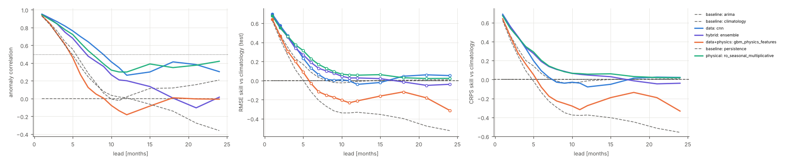
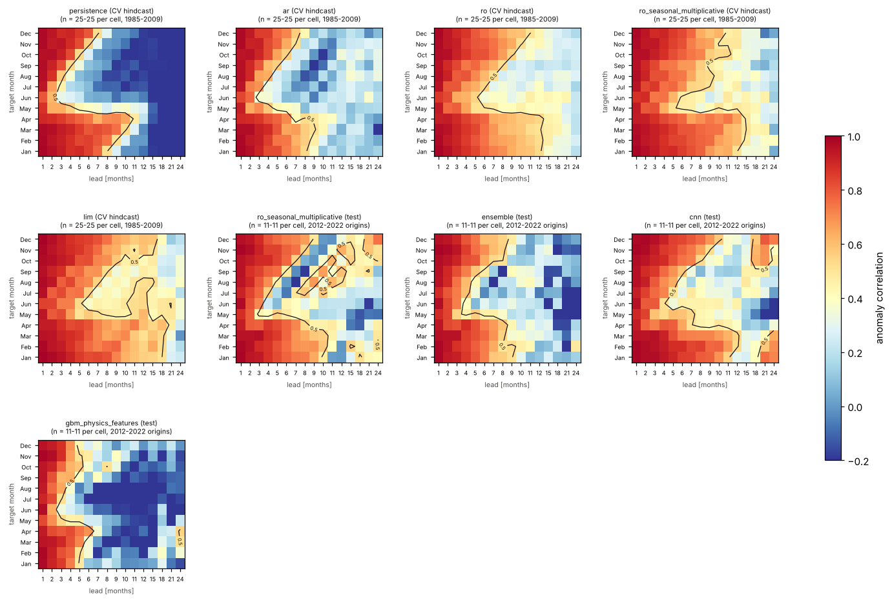
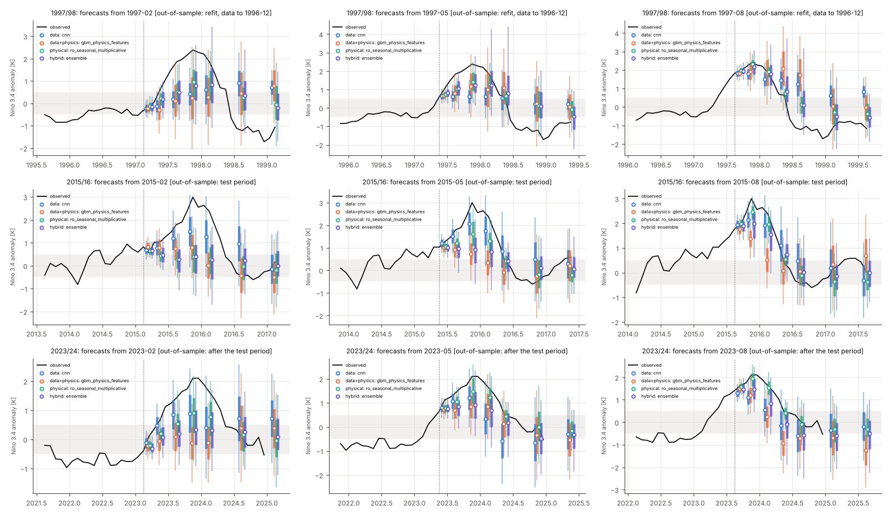
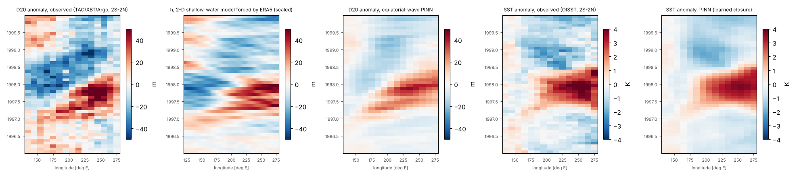
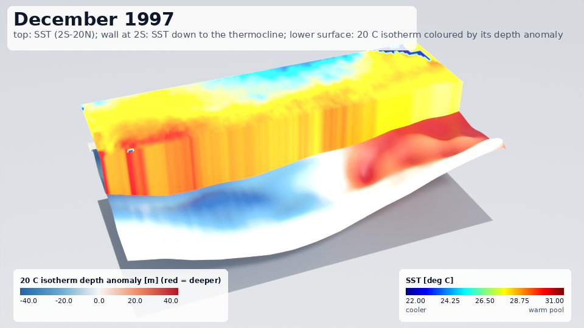

# Predicting El Niño: physical, physics-informed, data-driven and hybrid models under one protocol

This guide compares families of forecasts of the Niño-3.4 sea-surface-temperature (SST) anomaly at leads of 1 to
24 months:

* conceptual physics: the recharge oscillator and the delayed oscillator;
* an intermediate coupled ocean–atmosphere model: an equatorial shallow-water ocean, a Gill atmosphere and an SST
  equation;
* physics-informed networks (PINNs);
* data-driven models, including a CNN on SST maps in the spirit of Ham et al. (2019);
* hybrids: physics plus learned correction, data assimilation with an ensemble Kalman filter, and ensembles.

Every model runs under one protocol, and the guide reports how much skill each one has, measured against the
baselines. Every number below is read from the committed results.

Everything comes from one script, [`examples/enso_forecasting/run_study.py`](../../examples/enso_forecasting/run_study.py).
* Its results are in `examples/enso_forecasting/results/`:
  * `study.json`: the merged zoo, the ENSO scores and the case studies;
  * `tables.md`: generated from the JSON, the source of every table below;
  * `data.json`, `solver_checks.json`, `spring_barrier.json`, `phase.json` and `shallow_water_pinn.json`;
  * `manifests/`: the URL and SHA-256 of every downloaded source file.
* The figures are in `examples/enso_forecasting/figures/`.
* The library code is `pinneapple_systems.time_series.enso`, tested in `tests/test_enso.py`. The protocol, baselines,
  tests and generic forecasters are the ones of `forecast_lab`; see
  [the near-random forecasting guide](near_random_forecasting.md).

**In short** (test period: origins 2012–2022, targets to 2024-12; every number from `results/`):

* **Best at short leads.** At 1–6 months the best models are close together. They are:
  * the recharge oscillator with seasonal coefficients and multiplicative noise (15 fitted numbers);
  * the LIM;
  * the SST-map CNN, with and without pre-training;
  * the multi-model ensemble.
  At lead 6 their anomaly correlation (ACC) is 0.58–0.70, against 0.36 for persistence and 0.42 for ARIMA.
* **Significance.**
  * Against climatology (one-sided DM, Holm across the 23 non-baseline models), every model is significantly better
    at leads 1–2 only. From lead 3 on, no model is distinguishable from climatology on this test period.
  * Against the best baseline chosen on validation, after Holm correction across the 30-model zoo, only three
    models are significantly better: the ensemble and the pre-trained CNN (leads 1–3) and the CNN (lead 1).
  * Against persistence, many models have positive RMSE skill at every lead (up to 0.31 at lead 6). The
    one-sided Diebold–Mariano tests on 132 overlapping monthly forecasts have little power beyond a few months.
* **Beyond about 9 months.** No model keeps ACC above 0.5. At 12–24 months the best ACC is 0.30–0.42. The
  forecasts are close to climatology: CRPS skill against climatology is below 0.07 for every family
  representative beyond lead 9.
* **Spring barrier.** The ACC of forecasts that target June–August collapses at lead 6, to 0.06 for persistence
  (cross-validated hindcasts 1985–2009). The seasonal recharge oscillator keeps 0.64 there; the constant one
  keeps 0.50.
* **PINNs.**
  * The PINN that identifies the recharge oscillator fails on the observations: F2 ≈ 100 instead of 1.3, and
    lead-3 ACC −0.69.
  * Fitting a PINN per origin and extrapolating matches integrating the same equations. It adds nothing.
  * The equatorial shallow-water PINN recovers the wave speed from synthetic data (2.76 vs 2.7 m/s) but not the
    damping or the boundary reflection, and leaves large PDE residuals.
* **The physical intermediate model.** It reproduces the observed thermocline tilt when forced by observed winds
  (r = 0.85). But its fitted coupled version is too damped: Niño-3.4 standard deviation 0.12 K in a free
  stochastic run, against 0.87 K observed. As a forecaster it is no better than ARIMA. Its EnKF ensemble is
  badly under-dispersed: 17 % of the targets fall inside the central 95 % interval at lead 6.

## Quick start

```python
from pinneapple_systems.time_series.enso import dataset, forecasters as F, study
from pinneapple_systems.time_series.forecast_lab.study import evaluate

ds = dataset.build_dataset()                     # first call streams ~92 GB of source files, keeps ~0.2 GB
data = dataset.to_series(ds)                     # columns: nino34, wwv, h_west, h_east, nino4, nino3, nino12
prot = study.protocol(ds.months)                 # test period from 2012-01, leads 1-12, 15, 18, 21, 24
split = prot.final_split(len(data))
ro = F.RechargeOscillatorForecaster(seasonal=("R", "F1", "F2", "eps"), multiplicative=True)
ro.fit(data, split["train"], split["val"], prot.horizons)
print(evaluate(ro, data, split["test"])["rmse"])
res = study.run_model("lim", data, prot)         # tuning by purged walk-forward CV, test scores, DM tests
```

## Data

All sources are public, openly licensed and need no credentials.

The NOAA servers that publish the usual index files cannot be reached from the environment where this study ran:
* CPC: `sstoi.indices`, ONI, SOI;
* PSL;
* PMEL's WWV file.

The same NOAA data were taken instead from NOAA's open-data buckets on AWS. ERA5 came from WeatherBench 2 on
Google Cloud.

Every file is hashed. Its SHA-256 and URL are in a manifest, committed as `results/manifests/*.json.gz`. Passing
those manifests (the script does) makes a download that does not reproduce a recorded hash fail. Raw files are
reduced and deleted; their hashes stay.

| quantity | source | how it is used |
|---|---|---|
| SST, Niño 3.4 / 3 / 4 / 1+2 | NOAA OISST v2.1 AVHRR-only daily 0.25° (Huang et al. 2021, J. Climate 34:2923; DOI 10.25921/RE9P-PT57), bucket `noaa-cdr-sea-surface-temp-optimum-interpolation-pds`, public domain | every final (not preliminary) daily file of 1981-09 to 2026-09 (16 466 files), averaged per month into 1° cells over 30S–30N, 100E–60W; indices are cos-latitude-weighted box means; maps on the model grid (2° × 1°, 20S–20N, 120E–80W) |
| thermocline (20 °C isotherm depth, D20) | World Ocean Database (Boyer et al. 2018, NOAA Atlas NESDIS 87), bucket `noaa-wod-pds`, public domain: moored buoys (TAO/TRITON), XBT and Argo profiles | D20 of every quality-controlled cast (flags 0) in 8S–8N, binned into 10° longitude bins (130E–80W) per month for 5S–5N and 2S–2N; anomalies; empty bins filled month by month from the observed bins with the 4 leading EOFs of the base period |
| WWV proxy, tilt | the 5S–5N D20 bins | `wwv` = zonal mean D20 anomaly (the region of Meinen & McPhaden 2000, J. Climate 13:3551); `h_west` / `h_east` = means west / east of 155W |
| wind stress, SOI proxy | ERA5 (Hersbach et al. 2020, QJRMS 146:1999) 6-hourly on the 64 × 32 grid of WeatherBench 2 (Rasp et al. 2024, JAMES 16:e2023MS004019), `gs://weatherbench2`, Copernicus licence (free use and redistribution with attribution; contains modified Copernicus Climate Change Service information) | bulk stress τ = ρ C_D \|U\| U (C_D = 1.3e-3) from every 6-hourly 10 m wind, monthly means 1959-01 to 2022-12; Tahiti–Darwin pressure index at the nearest cells |
| cross-checks | NCEI 0–700 m heat content, 3-month means 1955–2020 (Levitus et al. 2012, GRL 39:L10603; bucket `noaa-cdr-ocean-heat-content-pds`); the statsmodels El Niño data set (Niño 1+2 SST 1950–2010, NOAA CPC) | correlations below |

Not used, and why:
* **GODAS / ORAS5 thermocline fields.** No credential-free route was reachable from here (PSL is blocked; the ORAS5
  files on AWS are model initial conditions only). The thermocline comes from the in-situ casts instead.
* **The station SOI.** The CPC file cannot be reached; the ERA5 pressure index is a proxy of it.
* **ERA5 after 2022-12.** WeatherBench 2 stops at 2023-01-10. ERA5 enters only the fitting of the intermediate
  model (training years) and the analyses below, never a forecast input.

The record is 1982-01 to 2024-12 (516 months). It is limited by the World Ocean Database, whose 2024 files are the
latest. Anomalies use the calendar-month climatology of 1982–2011, inside the development period, so the test
period does not inform them.

Checks against independent sources (`results/data.json`):
* **Niño-3.4.** OISST against ERA5 SST: r = 0.983, RMSE 0.17 K (492 months, 1982–2022).
* **Niño 1+2.** OISST against the statsmodels CPC series: r = 0.994 (1982–2010), mean difference −0.22 K. The
  difference is in absolute SST: the two products differ in their analysis.
* **WWV proxy.** Against the NCEI 0–700 m heat content of 5S–5N, 120E–80W (3-month means): r = 0.84
  (156 seasons).
* **Pressure index.** Niño-3.4 against the ERA5 Tahiti–Darwin index: r = −0.63.
* **Casts.** 562 280 moored-buoy, 79 730 XBT and 197 197 Argo casts give D20.
  * On average 96 % of the 10° bins have a cast in a month.
  * Coverage is 69–82 % in 1982–1984 and 83 % in 2024 (the WOD 2024 files are incomplete).
  * In 2 months fewer than 4 bins were observed, and the previous month's values were carried forward.
* **Trend.** Over 1982–2024 Niño-3.4 has a linear trend of +0.05 K per decade. The anomalies keep it, so the test
  period is slightly warm relative to the 1982–2011 base. Every model sees the same anomalies.

## The protocol

The protocol is `forecast_lab`'s, unchanged (`enso.study.protocol`):

* **Test period: origins 2012-01 to 2022-12.**
  * There are 132 origins, one per month, for leads 1–12, 15, 18, 21 and 24 months.
  * The test period is fixed before any tuning.
  * Its targets reach 2024-12, so they include the 2015/16 and 2023/24 El Niños.
* **Development period: 1982-01 to 2011-12.**
  * It ends with a validation block of 30 origins, which is used for early stopping, for spread calibration and for
    choosing each family's representative.
  * Training labels stop 24 months (the largest lead) before that block. That leaves 247 training origins.
  * Every input needs 36 months of history.
* **Tuning.** Each tuned model gets 4 configurations drawn from its grid. Each configuration is scored by purged
  walk-forward cross-validation on 3 folds.
* **Scores.**
  * Anomaly correlation (ACC) per lead.
  * RMSE skill against persistence and against the *best baseline*: at each lead, the baseline with the lowest
    validation RMSE among persistence, climatology, AR, ARIMA, exponential smoothing, seasonal naive and the
    phase-aligned mean cycle.
  * CRPS skill against climatology, central-interval coverage and PIT.
  * One-sided Diebold–Mariano tests (HLN correction, long-run variance over the h-step overlap) against
    persistence and against the best baseline, Holm-adjusted across the zoo at each lead.
  * Skill by target calendar month.
  * Categorical scores: El Niño ≥ +0.5 K, La Niña ≤ −0.5 K, monthly Niño-3.4.
* **One process per model.** `forecast_lab.study.merge_zoo` pools the per-model results. It recomputes every
  comparison over the whole zoo, so the Holm adjustment covers all models together (tested to equal a single run
  in `tests/test_enso.py`).

## The models

| family | model (`enso.study.zoo`) | what it is |
|---|---|---|
| baseline | persistence, climatology, AR (AIC), ARIMA, exponential smoothing, seasonal naive, phase-aligned mean cycle | `forecast_lab` |
| data | GBM, MLP, LSTM, TCN, transformer | `forecast_lab` lag models on all seven indices |
| data | `lim` | linear inverse model (Penland & Sardeshmukh 1995, J. Climate 8:1999) on 6, 10 or 15 SST EOFs plus WWV or the west/east D20, analytic Gaussian forecast |
| data | `cnn` | CNN on the last 3 or 6 SST anomaly maps (pooled to 4° × 2°) plus the D20 indices and the season, 5 seeds averaged; the design of Ham et al. (2019), much smaller |
| data + physics | `cnn_pretrained` | the same CNN, first trained on a 300-year stochastic run of the intermediate model fitted to the training years only, then fine-tuned on the observations |
| data + physics | `pinn_ro`, `pinn_ro_closure` | recharge oscillator identified by a PINN on the training years (`pinn.identify_recharge`, via `pinneapple_neural`'s `InversePINN`), without / with a learned closure g(h) of the thermocline feedback; forecasts integrate the identified equations |
| data + physics | `pinn_extrapolation` | for every origin, a PINN fitted to the last 24 months and to the recharge-oscillator residual up to 24 months ahead; the forecast is the network beyond the data (one grouped network for all origins) |
| data + physics | `mlp_physics_loss`, `gbm_physics_features` | `forecast_lab`'s physics-residual MLP and physics-feature GBM on (T, h) with the recharge oscillator |
| physical | `ro`, `ro_stochastic`, `ro_seasonal_multiplicative` | Jin's (1997) recharge oscillator on (Niño-3.4, WWV), deterministic, stochastic (200-member Euler–Maruyama), and with annual cycles in all four coefficients plus multiplicative noise σ(1 + B T) |
| physical | `ro_multiple_shooting` | the same equations fitted by `forecast_lab`'s ODE forecaster (multiple shooting) |
| physical | `delayed_oscillator` | Battisti–Hirst dT/dt = aT − bT(t − τ) − cT³ on Niño-3.4, τ tuned in {3, 6, 9, 12} months |
| physical | `im_nudged` | the intermediate coupled model (below), initialised by nudging its SST to the observed maps (5-day time scale) along the whole record |
| hybrid | `ro+gbm`, `ude_ro` | recharge oscillator + GBM residual correction; universal differential equation (recharge oscillator + neural closure trained through the integrator) |
| hybrid | `im_enkf` | the intermediate model with a localised stochastic EnKF (24 members, Gaspari–Cohn localisation 25° × 8°) assimilating the monthly SST maps and the observed D20 bins; 10-member forecasts with stochastic winds |
| hybrid | `ensemble` | equal-weight mixture of the seasonal recharge oscillator, the LIM and a GBM |

Prior knowledge given to the physical models:
* the form of the equations;
* starting guesses that are not the answer;
* the ocean's wave speed c = 2.7 m/s and damping 1/(900 days). These are fixed, not fitted, in the intermediate
  model.

Every coefficient that is estimated, is estimated from the training years only.

### The intermediate coupled model

`enso.intermediate` is a model in the spirit of Zebiak & Cane (1987, Mon. Wea. Rev. 115:2262), simplified:

* **Ocean.**
  * A linear reduced-gravity shallow-water ocean on the equatorial β-plane, on an Arakawa C-grid of 2° × 1°.
  * The domain is 120E–80W, 20S–20N, with walls east and west and 5° sponges north and south.
  * Time stepping is RK4 with an 8-hour step.
* **Atmosphere.** Gill's (1980) steady damped long-wave response to a heating proportional to the SST anomaly,
  solved exactly per meridional mode by FFT on the whole longitude circle (ε = 0.1, c_a = 60 m/s). The linear map
  SST → stress is stored as a truncated SVD.
* **Coupling.** μ, the stress per unit Gill wind, is fitted by least squares of the ERA5 zonal stress anomalies on
  the Gill winds of the observed SST.
* **SST equation.** dT/dt = −ε_T T + γ(x) S(y) h + κ(x) S(y) τ_x, with S(y) = exp(−(y/6°)²). ε_T, γ and κ are
  regressed per longitude on the observed equatorial SST, the observed D20 and the model's own stress.
* **Amplitude factor.** h_scale converts model h to D20. It comes from the ocean forced by ERA5 stress over the
  training years.

What the fit gives on the training years (`study.json`, `model_info.im_nudged`):
* **Coupling.** μ = 0.0055 N m⁻² per unit Gill wind. The Gill winds of the observed SST explain 28 % of the
  ERA5 zonal-stress variance over 10S–10N.
* **Stochastic forcing.** The standard deviation of the residual stress is 0.011 N m⁻².
* **Ocean alone, forced by ERA5 stress** (the ocean hindcast):
  * its equatorial h correlates with the observed 2S–2N D20 at 0.49–0.79 per 10° bin;
  * the east-minus-west tilt correlates at 0.85 and the zonal mean (WWV) at 0.65;
  * the fitted amplitude factor is 1.22.
* **SST equation.**
  * The damping ε_T is 0.29–0.48 per month (2–3.5 months).
  * The thermocline feedback γ rises from about 0 in the west to 0.026 K m⁻¹ per month in the east.
  * The wind feedback κ is 10–28 K per (N m⁻²) per month.
* **The coupled model with these coefficients is strongly damped.** A 300-year stochastic run (6 members × 50
  years) has a Niño-3.4 standard deviation of 0.12 K, against 0.87 K observed. The intermediate model is
  therefore a weak oscillator. The CNN pre-trained on its run learns from far too little ENSO variability (see
  section 2).

## 1. The solvers are right

`pipeline.solver_checks`, `results/solver_checks.json`, figure `figures/solver_checks.png`:

| check | measured | theory | |
|---|---|---|---|
| Kelvin wave speed (2.5° × 1°, 6 h) | 2.689 m/s | c = 2.7 m/s | −0.42 % |
| Kelvin crossing time 120E–80W | 76.6 days | 76.3 days | |
| Kelvin speed error, dlon 5 → 2.5 → 1.25° (dlat, dt with it) | −1.60 %, −0.42 %, −0.11 % | | observed order 1.93, 1.98 |
| long Rossby (n = 1) speed | −0.863 m/s | −c/3 = −0.9 m/s | −4.1 % (a finite-width packet is slower than the long-wave limit) |
| Gill response vs closed form (ε = 0.1, heating half-width 2 L_a), relative L2 of u / v / p | 72 points: 1.5e-3 / 3.7e-2 / 1.1e-3; 576 points: 5.2e-5 / 1.4e-3 / 3.2e-5 | 0 | easterlies east (u = −0.98) and westerlies west (u = +1.27) of the heating, off-equatorial Rossby lows |
| recharge oscillator (R = −0.05, F1 = 0.02, F2 = 1.5, ε = 0.03 per month), RK4 1 step per month | period 36.3367, growth −0.040000 | 36.3366 months, −0.04 per month | relative errors 1.8e-6 and 3.4e-5 |
| delayed oscillator (a = 1/6, b = 1/3, τ = 6 months), RK4 with dt = 1 → 0.1 month | period error 1.7e-4 → 1.6e-6, growth error −7.6e-3 → −7.6e-5 | Lambert-W root 0.0782 ± 0.1888i per month (period 33.28 months) | second order |

The v error of the Gill check converges more slowly than u and p. The closed-form v needs the x-derivative of the
Rossby amplitude, which is taken by finite differences of the quadrature result, and it has kinks at the edges of
the heating.


## 2. Skill against lead

Anomaly correlation (ACC) of the family representatives on the test period:

| lead (months) | 1 | 3 | 6 | 9 | 12 | 18 | 24 |
|---|---|---|---|---|---|---|---|
| persistence | 0.93 | 0.73 | 0.36 | 0.08 | 0.01 | −0.14 | −0.36 |
| ARIMA (best baseline on validation, leads 2–6) | 0.93 | 0.76 | 0.42 | 0.06 | 0.02 | 0.12 | 0.21 |
| recharge oscillator, seasonal + multiplicative noise (physical) | 0.95 | 0.84 | 0.63 | 0.39 | 0.30 | 0.35 | 0.42 |
| LIM | 0.95 | 0.88 | 0.67 | 0.44 | 0.29 | 0.02 | −0.00 |
| CNN (data) | 0.95 | 0.87 | 0.70 | 0.50 | 0.26 | 0.41 | 0.30 |
| CNN pre-trained on the intermediate model | 0.95 | 0.85 | 0.66 | 0.45 | 0.30 | 0.35 | 0.08 |
| ensemble (RO seasonal + LIM + GBM; hybrid) | 0.95 | 0.84 | 0.58 | 0.36 | 0.20 | 0.01 | 0.02 |
| intermediate model + EnKF | 0.93 | 0.78 | 0.48 | 0.24 | 0.16 | 0.02 | 0.14 |
| intermediate model, SST-nudged | 0.93 | 0.73 | 0.36 | −0.00 | 0.09 | 0.23 | 0.20 |

What the zoo shows:

* **The ranking is close at short leads.** The two CNNs have the best RMSE skill against persistence at leads 1–3
  (0.16–0.30). The seasonal recharge oscillator and the LIM are within 0.06 of them. At lead 6 the seasonal
  recharge oscillator is best (0.31), with the LIM and the pre-trained CNN at 0.30.
* **Only three models pass the strict test.** Against the best baseline chosen on validation, Holm-adjusted over
  the zoo, they are:
  * the ensemble, leads 1–3;
  * the pre-trained CNN, leads 1–3;
  * the CNN, lead 1.
  The seasonal recharge oscillator has positive skill against the best baseline at every lead (0.09 to 0.50), but
  no DM test reaches significance.
* **"Best baseline" is misleading beyond lead 6.**
  * From lead 7 on, the baseline with the lowest validation RMSE was the seasonal naive forecast: the value one
    dominant period before, with the period estimated from the training periodogram.
  * The validation block (30 origins, 2007–2010) happens to suit it. On the test period it is the worst
    baseline, with RMSE skill −0.23 at lead 9 and −0.05 at lead 18.
  * Every model therefore shows a jump of RMSE skill "against the best baseline" at lead 7 in the figure. That
    jump says nothing about the models.
  * Against ARIMA and climatology (both in the zoo table), skill beyond lead 9 is small. The best models' RMSE
    skill against persistence at 12–24 months (0.29–0.38) is mostly that of climatology (0.25–0.34): damping
    towards zero.
  * The protocol is kept as it was fixed. A longer validation block would have chosen ARIMA or climatology. This
    is the main caveat of the comparison.
* **Data-hungry models stay at baseline level.** With 247 training origins, GBM, MLP, LSTM, TCN and transformer
  have ACC 0.26–0.36 at lead 6, the level of persistence. The CNN does better because its inputs are the SST maps
  and the D20 indices, and the LIM does well for the same reason. Both are regularised: the CNN by weight decay
  and early stopping on 5 seeds, the LIM by being linear.
* **The physics feature does not help.** GBM with recharge-oscillator features (the data + physics
  representative on validation) is no better than the plain GBM: ACC 0.27 vs 0.26 at lead 6, 0.00 vs 0.11 at
  lead 9. Its validation score (0.700, the best of its family) did not carry over.
* **The recharge-oscillator variants agree.**
  * Least squares of integrated one-month predictions, `forecast_lab`'s multiple-shooting ODE fit, the stochastic
    200-member version and the UDE give the same scores to ±0.01.
  * The constant-coefficient fit has growth −0.066 per month and period 44 months.
  * The seasonal fit with multiplicative noise has period 50 months and B = −0.03 K⁻¹. That B is negligible: no
    measurable state dependence of the noise.
* **Probabilistic scores.**
  * The ensemble has the flattest PIT (deviation 0.12) and 95 % coverage 0.95.
  * The seasonal recharge oscillator's own 200-member ensemble covers 0.88 (mean over leads).
  * The EnKF intermediate model's 10-member forecasts are far too narrow (0.17 at lead 6).
  * At lead 1, CRPS skill against climatology is 0.64–0.69 for all representatives. Beyond lead 9 it is below
    0.07.



*Representatives of each family (chosen on the validation block) and three baselines (persistence, climatology,
ARIMA). Left: anomaly correlation (dotted line: 0.5). Middle: RMSE skill against climatology on the test period;
filled markers where the one-sided DM test against climatology, Holm-adjusted across the non-baseline models at that
lead, is significant at 5 % (`pipeline.skill_against`). The skill against the validation-chosen "best baseline" is
not plotted, because that reference switches to the seasonal naive forecast at lead 7 (see below). It stays in the
zoo table. Right: CRPS skill against climatology.*

### Skill against climatology, with its own tests

| model | family | RMSE skill vs climatology (h=1,3,6,9,12,18,24) | significant vs climatology (one-sided DM, Holm) at h |
|---|---|---|---|
| ar | baseline | 0.65 0.35 0.10 -0.01 -0.01 -0.01 -0.01 | – |
| arima | baseline | 0.65 0.35 0.09 -0.02 -0.01 0.00 0.01 | – |
| climatology | baseline | 0.00 0.00 0.00 0.00 0.00 0.00 0.00 | – |
| exp_smoothing | baseline | 0.63 0.27 -0.11 -0.32 -0.33 -0.40 -0.52 | – |
| persistence | baseline | 0.63 0.27 -0.11 -0.32 -0.33 -0.40 -0.52 | – |
| phase_climatology | baseline | -0.13 -0.15 -0.19 -0.18 -0.13 -0.12 -0.15 | – |
| seasonal_naive | baseline | -0.67 -0.68 -0.67 -0.62 -0.53 -0.47 -0.47 | – |
| cnn | data | 0.70 0.47 0.13 0.00 -0.04 0.05 0.05 | 1, 2 |
| gbm | data | 0.64 0.29 -0.04 -0.12 -0.18 -0.17 -0.25 | 1, 2 |
| lim | data | 0.67 0.47 0.22 0.09 0.06 0.02 0.02 | 1, 2 |
| lstm | data | 0.62 0.30 0.01 -0.18 -0.14 -0.06 -0.04 | 1, 2 |
| mlp | data | 0.66 0.32 -0.10 -0.27 -0.19 -0.03 -0.02 | 1, 2 |
| tcn | data | 0.62 0.33 -0.08 -0.33 -0.19 -0.06 -0.42 | 1, 2 |
| transformer | data | 0.66 0.33 0.03 -0.07 -0.03 -0.07 -0.03 | 1, 2 |
| cnn_pretrained | data+physics | 0.69 0.48 0.22 0.07 0.00 0.05 -0.06 | 1, 2 |
| gbm_physics_features | data+physics | 0.64 0.31 -0.03 -0.18 -0.21 -0.12 -0.31 | 1, 2 |
| mlp_physics_loss | data+physics | 0.67 0.40 0.15 0.03 -0.01 0.01 0.06 | 1, 2 |
| pinn_extrapolation | data+physics | 0.66 0.40 0.17 0.05 0.03 0.02 -0.00 | 1, 2 |
| pinn_ro | data+physics | 0.47 -0.39 -0.96 -0.30 -0.15 -0.11 -0.18 | 1, 2 |
| pinn_ro_closure | data+physics | 0.28 -1.03 -0.05 -0.00 -0.33 -0.23 -0.29 | 1 |
| delayed_oscillator | physical | 0.64 0.33 0.10 -0.02 -0.02 -0.02 -0.02 | 1, 2 |
| im_nudged | physical | 0.63 0.29 0.03 -0.05 -0.04 -0.01 -0.01 | 1, 2 |
| ro | physical | 0.67 0.41 0.17 0.05 0.03 0.03 0.01 | 1, 2 |
| ro_multiple_shooting | physical | 0.67 0.41 0.17 0.05 0.03 0.02 0.00 | 1, 2 |
| ro_seasonal_multiplicative | physical | 0.68 0.46 0.23 0.09 0.06 0.03 0.02 | 1, 2 |
| ro_stochastic | physical | 0.67 0.40 0.16 0.05 0.03 0.02 0.02 | 1, 2 |
| ensemble | hybrid | 0.68 0.46 0.19 0.08 0.03 -0.01 -0.04 | 1, 2 |
| im_enkf | hybrid | 0.59 0.32 0.08 -0.00 -0.02 -0.05 -0.05 | 1, 2 |
| ro+gbm | hybrid | 0.64 0.29 -0.00 -0.08 -0.10 -0.15 -0.16 | 1, 2 |
| ude_ro | hybrid | 0.67 0.41 0.17 0.05 0.03 0.02 0.01 | 1, 2 |

Against climatology, the test is unambiguous, and sobering:
* Every non-baseline model beats climatology significantly (Holm-adjusted across the 23 models) at leads 1 and 2
  only; `pinn_ro_closure` only at lead 1.
* From lead 3 on, no difference from climatology is significant. The best RMSE skill against climatology is:
  * lead 3: 0.48 (pre-trained CNN), with the CNN, the LIM and the seasonal recharge oscillator at 0.46–0.47;
  * lead 6: 0.23 (seasonal recharge oscillator) and 0.22 (LIM, pre-trained CNN);
  * lead 9: 0.09;
  * lead 12: 0.06.
* The positive RMSE skill against persistence at long leads (zoo table) is therefore mostly the damping of the
  forecast towards climatology, which persistence lacks.
* Persistence itself is worse than climatology from lead 6 on (−0.11 at lead 6, −0.52 at lead 24).

### The whole zoo

| model | family | ACC h=1 | ACC h=3 | ACC h=6 | ACC h=9 | ACC h=12 | ACC h=18 | ACC h=24 | RMSE skill vs persistence (h=1,3,6,9,12,18,24) | RMSE skill vs best baseline (same h) | significant vs best baseline (Holm) at h | params | fit [s] |
|---|---|---|---|---|---|---|---|---|---|---|---|---|---|
| ar | baseline | 0.94 | 0.76 | 0.43 | 0.09 | -0.00 | 0.05 | 0.33 | 0.05 0.11 0.19 0.23 0.24 0.28 0.34 | 0.00 0.00 0.01 0.38 0.34 0.31 0.31 | none | 6 | 0.0 |
| arima | baseline | 0.93 | 0.76 | 0.42 | 0.06 | 0.02 | 0.12 | 0.21 | 0.05 0.11 0.18 0.23 0.24 0.29 0.35 | -0.00 0.00 0.00 0.37 0.34 0.32 0.33 | none | 5 | 0.7 |
| climatology | baseline | -0.00 | 0.00 | 0.00 | -0.00 | -0.00 | 0.00 | -0.00 | -1.70 -0.36 0.10 0.24 0.25 0.28 0.34 | -1.84 -0.54 -0.10 0.38 0.35 0.32 0.32 | none | 2 | 0.0 |
| exp_smoothing | baseline | 0.93 | 0.73 | 0.36 | 0.08 | 0.01 | -0.14 | -0.36 | -0.00 -0.00 -0.00 0.00 0.00 0.00 0.00 | -0.05 -0.12 -0.22 0.19 0.13 0.05 -0.04 | none | 1 | 0.0 |
| persistence | baseline | 0.93 | 0.73 | 0.36 | 0.08 | 0.01 | -0.14 | -0.36 | 0.00 0.00 0.00 0.00 0.00 0.00 0.00 | -0.05 -0.12 -0.22 0.19 0.13 0.05 -0.04 | none | 0 | 0.0 |
| phase_climatology | baseline | 0.17 | 0.16 | 0.12 | 0.10 | 0.14 | 0.14 | 0.07 | -2.05 -0.57 -0.06 0.11 0.15 0.20 0.25 | -2.22 -0.77 -0.30 0.27 0.26 0.24 0.22 | none | 61 | 0.0 |
| seasonal_naive | baseline | -0.28 | -0.27 | -0.27 | -0.25 | -0.19 | -0.19 | -0.20 | -3.52 -1.29 -0.50 -0.23 -0.15 -0.05 0.04 | -3.76 -1.57 -0.83 0.00 0.00 0.00 0.00 | none | 1 | 0.0 |
| cnn | data | 0.95 | 0.87 | 0.70 | 0.50 | 0.26 | 0.41 | 0.30 | 0.18 0.28 0.22 0.24 0.22 0.32 0.38 | 0.13 0.19 0.05 0.39 0.32 0.35 0.36 | 1 | 561360 | 24.9 |
| gbm | data | 0.93 | 0.70 | 0.26 | 0.11 | -0.01 | -0.04 | -0.01 | 0.02 0.03 0.07 0.15 0.11 0.16 0.18 | -0.04 -0.09 -0.14 0.31 0.23 0.20 0.15 | none | 30022 | 3.3 |
| lim | data | 0.95 | 0.88 | 0.67 | 0.44 | 0.29 | 0.02 | -0.00 | 0.12 0.27 0.30 0.31 0.29 0.30 0.36 | 0.07 0.18 0.14 0.44 0.38 0.33 0.33 | none | 73 | 0.2 |
| lstm | data | 0.93 | 0.72 | 0.36 | 0.14 | 0.11 | 0.14 | 0.10 | -0.02 0.04 0.11 0.10 0.14 0.24 0.32 | -0.07 -0.08 -0.08 0.27 0.25 0.28 0.30 | none | 5840 | 1.4 |
| mlp | data | 0.94 | 0.73 | 0.26 | 0.09 | 0.17 | 0.34 | 0.33 | 0.08 0.07 0.01 0.03 0.11 0.26 0.33 | 0.03 -0.04 -0.21 0.22 0.22 0.30 0.31 | none | 24080 | 0.8 |
| tcn | data | 0.92 | 0.74 | 0.31 | 0.07 | 0.11 | 0.14 | -0.39 | -0.03 0.08 0.03 -0.01 0.10 0.24 0.07 | -0.09 -0.04 -0.18 0.18 0.22 0.28 0.03 | none | 4864 | 2.8 |
| transformer | data | 0.94 | 0.75 | 0.35 | 0.09 | 0.12 | 0.10 | 0.11 | 0.08 0.09 0.13 0.19 0.23 0.24 0.33 | 0.03 -0.03 -0.07 0.34 0.33 0.27 0.30 | none | 10160 | 1.8 |
| cnn_pretrained | data+physics | 0.95 | 0.85 | 0.66 | 0.45 | 0.30 | 0.35 | 0.08 | 0.16 0.29 0.30 0.29 0.25 0.32 0.30 | 0.11 0.21 0.15 0.43 0.35 0.35 0.28 | 1, 2, 3 | 561360 | 798.3 |
| gbm_physics_features | data+physics | 0.93 | 0.72 | 0.27 | 0.00 | -0.18 | 0.01 | -0.01 | 0.04 0.05 0.08 0.11 0.09 0.20 0.14 | -0.01 -0.06 -0.13 0.28 0.21 0.24 0.11 | none | 20800 | 1.4 |
| mlp_physics_loss | data+physics | 0.94 | 0.80 | 0.51 | 0.24 | 0.16 | 0.22 | 0.37 | 0.10 0.18 0.24 0.26 0.25 0.29 0.38 | 0.05 0.08 0.07 0.40 0.34 0.33 0.36 | none | 8112 | 1.5 |
| pinn_extrapolation | data+physics | 0.94 | 0.80 | 0.54 | 0.29 | 0.22 | 0.25 | 0.29 | 0.07 0.18 0.25 0.28 0.27 0.30 0.34 | 0.02 0.08 0.09 0.41 0.36 0.33 0.32 | none | 0 | 114.2 |
| pinn_ro | data+physics | 0.94 | -0.69 | -0.35 | -0.08 | -0.01 | -0.13 | 0.36 | -0.42 -0.90 -0.76 0.01 0.13 0.21 0.23 | -0.50 -1.13 -1.15 0.20 0.24 0.24 0.20 | none | 6 | 91.3 |
| pinn_ro_closure | data+physics | 0.93 | -0.71 | 0.27 | 0.23 | -0.05 | 0.14 | -0.24 | -0.95 -1.77 0.05 0.24 0.00 0.12 0.16 | -1.05 -2.11 -0.16 0.38 0.13 0.16 0.12 | none | 13001 | 94.4 |
| delayed_oscillator | physical | 0.93 | 0.74 | 0.45 | 0.14 | 0.06 | -0.00 | -0.11 | 0.04 0.09 0.19 0.23 0.23 0.27 0.33 | -0.02 -0.03 0.01 0.37 0.33 0.31 0.31 | none | 3 | 0.0 |
| im_nudged | physical | 0.93 | 0.73 | 0.36 | -0.00 | 0.09 | 0.23 | 0.20 | 0.01 0.03 0.13 0.20 0.22 0.27 0.33 | -0.05 -0.09 -0.07 0.35 0.32 0.31 0.31 | none | 242 | 120.3 |
| ro | physical | 0.94 | 0.80 | 0.54 | 0.30 | 0.23 | 0.29 | 0.34 | 0.10 0.19 0.25 0.28 0.27 0.30 0.35 | 0.05 0.09 0.09 0.42 0.37 0.34 0.32 | none | 6 | 0.0 |
| ro_multiple_shooting | physical | 0.94 | 0.80 | 0.54 | 0.30 | 0.22 | 0.28 | 0.33 | 0.10 0.19 0.26 0.28 0.27 0.30 0.35 | 0.05 0.09 0.09 0.42 0.36 0.33 0.32 | none | 4 | 0.0 |
| ro_seasonal_multiplicative | physical | 0.95 | 0.84 | 0.63 | 0.39 | 0.30 | 0.35 | 0.42 | 0.13 0.27 0.31 0.31 0.29 0.31 0.36 | 0.09 0.17 0.16 0.44 0.38 0.34 0.34 | none | 15 | 0.2 |
| ro_stochastic | physical | 0.94 | 0.80 | 0.54 | 0.29 | 0.23 | 0.28 | 0.38 | 0.10 0.19 0.25 0.28 0.27 0.30 0.36 | 0.05 0.08 0.08 0.41 0.37 0.33 0.33 | none | 6 | 0.0 |
| ensemble | hybrid | 0.95 | 0.84 | 0.58 | 0.36 | 0.20 | 0.01 | 0.02 | 0.14 0.26 0.27 0.30 0.27 0.27 0.32 | 0.10 0.16 0.11 0.43 0.36 0.31 0.29 | 1, 2, 3 | 62572 | 7.4 |
| im_enkf | hybrid | 0.93 | 0.78 | 0.48 | 0.24 | 0.16 | 0.02 | 0.14 | -0.10 0.07 0.18 0.24 0.24 0.25 0.31 | -0.15 -0.04 -0.01 0.38 0.33 0.28 0.29 | none | 242 | 32.4 |
| ro+gbm | hybrid | 0.93 | 0.71 | 0.31 | 0.18 | 0.10 | -0.13 | -0.02 | 0.02 0.04 0.10 0.18 0.18 0.17 0.24 | -0.04 -0.08 -0.10 0.34 0.28 0.21 0.21 | none | 20806 | 3.0 |
| ude_ro | hybrid | 0.94 | 0.80 | 0.54 | 0.30 | 0.22 | 0.28 | 0.33 | 0.10 0.19 0.26 0.28 0.27 0.30 0.35 | 0.05 0.09 0.09 0.42 0.36 0.33 0.32 | none | 1222 | 4.0 |

### Family representatives: probabilistic scores

| family | representative (val.) | last lead with significant skill vs persistence | vs best baseline | CRPS skill vs climatology (h=1,3,6,9,12,18,24) | 95 % coverage (mean over h) | PIT deviation |
|---|---|---|---|---|---|---|
| baseline | arima | 24 | none | 0.64 0.32 0.06 -0.04 -0.01 0.00 0.01 | 0.94 | 0.20 |
| data | cnn | 1 | 1 | 0.69 0.45 0.09 -0.04 -0.08 0.01 0.02 | 0.98 | 0.28 |
| data+physics | gbm_physics_features | none | none | 0.64 0.28 -0.08 -0.25 -0.28 -0.14 -0.33 | 0.92 | 0.23 |
| physical | ro_seasonal_multiplicative | 1 | none | 0.67 0.44 0.20 0.08 0.06 0.03 0.02 | 0.88 | 0.17 |
| hybrid | ensemble | 1 | 3 | 0.68 0.45 0.19 0.09 0.05 -0.01 -0.04 | 0.95 | 0.12 |

For a baseline (ARIMA here), "last lead with significant skill" counts positive skill only, without a test
(the `forecast_lab` convention).

The best baseline at each lead, chosen on the validation block:

| lead | 1 | 2 | 3 | 4 | 5 | 6 | 7 | 8 | 9 | 10 | 11 | 12 | 15 | 18 | 21 | 24 |
|---|---|---|---|---|---|---|---|---|---|---|---|---|---|---|---|---|
| best baseline (val.) | ar | arima | arima | arima | arima | arima | seasonal_naive | seasonal_naive | seasonal_naive | seasonal_naive | seasonal_naive | seasonal_naive | seasonal_naive | seasonal_naive | seasonal_naive | seasonal_naive |

## 3. The spring predictability barrier

The test period has only 11 forecasts per (target month, lead) cell, too few to map the barrier. So the cheap
models were also run as blocked, purged cross-validated hindcasts over the development period:
* origins 1985–2009, 300 of them, 25 per cell;
* each 4-year block is forecast by a model fitted on the other years;
* 24 months are purged on both sides of each block;
* the test period is never used.

The result:
* **Persistence collapses through the boreal spring.** Its lead-6 ACC is 0.83 for January–March targets but 0.06
  for June–August targets (origins in December–February). That is the barrier.
* **The recharge oscillator carries the thermocline memory across it.** With constant coefficients it keeps 0.50
  for June–August targets. With seasonal coefficients it keeps 0.64, and the LIM keeps 0.55.
* **The seasonal fit's barrier.** Its growth rate R(s) is most negative in late boreal spring (around
  March–April): −0.077 − 0.031
  cos(2πs/12) − 0.165 sin(2πs/12) per month, with s = 0 in January. The annual harmonics of F1, F2 and ε are fitted
  too.
* **The test period shows the same pattern, but noisily.** For the test-period representatives, the 0.5 contour
  bends towards short leads for targets in May–August.

| model | origins | ACC h=6, target Jan-Mar | ACC h=6, target Jun-Aug | ACC h=6, target Sep-Nov |
|---|---|---|---|---|
| persistence | 1985-01 to 2009-12 (300) | 0.83 | 0.06 | 0.31 |
| ar | 1985-01 to 2009-12 (300) | 0.71 | 0.14 | 0.50 |
| ro | 1985-01 to 2009-12 (300) | 0.75 | 0.50 | 0.76 |
| ro_seasonal_multiplicative | 1985-01 to 2009-12 (300) | 0.83 | 0.64 | 0.76 |
| lim | 1985-01 to 2009-12 (300) | 0.79 | 0.55 | 0.78 |



*ACC by target month (rows) and lead (columns), with the 0.5 contour. Top rows: blocked, purged cross-validated
hindcasts over the development period (origins 1985–2009; each block of 4 years is forecast by a model fitted on
the rest, purged by 24 months on both sides). Bottom rows: the test period (11 forecasts per cell, so each cell is
noisy).*

## 4. Categorical forecasts

| model | lead | El Nino hit rate | La Nina hit rate | neutral hit rate | El Nino false-alarm ratio | La Nina false-alarm ratio | accuracy | Heidke skill |
|---|---|---|---|---|---|---|---|---|
| arima | 3 | 0.53 | 0.52 | 0.65 | 0.36 | 0.42 | 0.58 | 0.33 |
| arima | 6 | 0.29 | 0.00 | 0.68 | 0.38 | 1.00 | 0.41 | -0.01 |
| arima | 12 | 0.00 | 0.00 | 1.00 | – | – | 0.43 | 0.00 |
| cnn | 3 | 0.79 | 0.22 | 0.76 | 0.26 | 0.33 | 0.66 | 0.43 |
| cnn | 6 | 0.84 | 0.00 | 0.60 | 0.40 | 1.00 | 0.56 | 0.27 |
| cnn | 12 | 0.79 | 0.07 | 0.58 | 0.46 | 0.83 | 0.55 | 0.28 |
| gbm_physics_features | 3 | 0.70 | 0.22 | 0.60 | 0.39 | 0.50 | 0.55 | 0.26 |
| gbm_physics_features | 6 | 0.60 | 0.04 | 0.63 | 0.46 | 0.80 | 0.50 | 0.16 |
| gbm_physics_features | 12 | 0.31 | 0.00 | 0.56 | 0.67 | 1.00 | 0.36 | -0.07 |
| ro_seasonal_multiplicative | 3 | 0.60 | 0.48 | 0.69 | 0.38 | 0.19 | 0.62 | 0.38 |
| ro_seasonal_multiplicative | 6 | 0.38 | 0.07 | 0.82 | 0.37 | 0.71 | 0.52 | 0.17 |
| ro_seasonal_multiplicative | 12 | 0.10 | 0.00 | 0.96 | 0.29 | 1.00 | 0.45 | 0.05 |
| ensemble | 3 | 0.60 | 0.52 | 0.71 | 0.26 | 0.39 | 0.64 | 0.41 |
| ensemble | 6 | 0.47 | 0.07 | 0.77 | 0.25 | 0.80 | 0.52 | 0.19 |
| ensemble | 12 | 0.21 | 0.00 | 0.93 | 0.29 | 1.00 | 0.48 | 0.10 |

Test period, monthly Niño-3.4, thresholds ±0.5 K.
* At lead 3, all representatives detect 53–79 % of El Niño months.
* At lead 6, La Niña months are almost never forecast (hit rate 0.00–0.07). The 2020–2023 triple-dip La Niña is
  in the targets, and every model damps the forecast back towards neutral.
* The CNN keeps the highest El Niño hit rate at leads 6 and 12 (0.84, 0.79), but at false-alarm ratios of 0.40 and
  0.46.
* Heidke skill at lead 12 is −0.07 to 0.28.

## 5. Case studies: 1997/98, 2015/16, 2023/24

The plume figure shows observed Niño-3.4 and the forecasts of the representatives (median of their predictive
distributions).

**1997/98** (peak 2.38 K, November 1997). The models were refitted on data whose labels end in 1993-06: the
development data before 1997-01, with the last 15 % as validation and a 24-month purge. Median forecasts:
* **From February 1997** (before the onset; the spring barrier), every model predicted at most +0.52 K at lead 6
  (August, observed +1.84 K) and at most +0.94 K at lead 9 (November, observed +2.38 K). The recharge oscillator
  and the ensemble were the highest.
* **From May 1997**, for November the recharge oscillator gave +1.42 K, the ensemble +1.22 K, the GBM with physics
  features +1.19 K and the CNN +0.61 K. Observed: +2.38 K.
* **From August 1997** (already at +1.96 K), the median forecasts for November were +1.8 to +2.3 K. Only the
  recharge oscillator and the ensemble then turned the forecast towards La Niña, at leads 9–12 (+0.74 / +0.82 K at
  lead 9, observed +0.63 K). The CNN, the GBM and persistence stayed warm.

**2015/16** (monthly peak 3.00 K, November 2015).
* From May 2015, for November (lead 6): the CNN gave +2.05 K, the recharge oscillator +1.60 K, the ensemble
  +0.92 K and the physics-feature GBM +0.73 K.
* From February 2015, all medians were at most +1.5 K at leads 3–9.

**2023/24** (monthly peak 2.11 K, December 2023; 2.10 K in November). These origins lie after the test period; the models
are those of the main test.
* From May 2023, for November: the recharge oscillator +1.48 K, the CNN +1.21 K, the ensemble +0.91 K.
* From February 2023: +0.09 to +0.85 K at lead 6 (observed +1.42 K).

In all three events the median forecasts underestimated the peak, from February origins by more than 1 K.



*Forecasts at leads 1, 3, 6, 9, 12, 18 and 24 months from the origin (dotted line), one colour per family
representative: median marker, 50 % (thick) and 90 % (thin) intervals; observed Niño-3.4 in black; grey band
±0.5 K. Each panel title says whether its forecasts are out of sample:
* 1997/98: "out-of-sample: refit, data to 1996-12". The models were refitted on data up to 1996-12 only (training
  labels to 1993-06, the rest as the validation block). No year from 1997 on entered the fit.
* 2015/16: "out-of-sample: test period".
* 2023/24: "out-of-sample: after the test period". These are the models fitted for the main test (training labels
  end in 2007).

No panel is in-sample.*

## 6. The recharge oscillator in phase space

* **Observed phase relation.** Over 1982–2024, h (the WWV proxy) leads T (Niño-3.4) by about 6 months:
  * corr(T(t + 6), h(t)) = 0.53;
  * corr(T(t − 9), h(t)) = −0.51, the discharge after the event.
* **Mean paths.** Started from the observed state at four El Niño onsets (1997-04, 2009-06, 2015-03, 2023-04),
  both fitted oscillators turn clockwise in the (h, T) plane, as the observed loops do. But they decay: growth rate
  −0.066 / −0.076 per month, an e-folding time of 13–15 months. Their mean paths stay well inside the observed
  orbits.
* **Stochastic runs.** One noise realisation of the record's length has a T standard deviation of 0.89 K (constant)
  and 0.80 K (seasonal), against 0.87 K observed. The h standard deviation is 9.0 and 8.7 m, against 7.7 m
  observed. In these fits ENSO is a damped oscillator sustained by noise: the noise amplitudes and the damping
  together reproduce the observed variance.


## 7. PINNs: what they learn and where they fail

**Recharge-oscillator identification.** `pinn.identify_recharge` trained a network X(t) on the 305 training
months. The residual of the recharge-oscillator equations was penalised at 2048 random collocation points per step,
for 4000 steps, with R, F1, F2 and ε learned.
* The residual became small: RMS 0.045 / 0.038 of each variable's standard deviation per month.
* The parameters are far from the least-squares estimates (R = −0.08, F1 = 0.015, F2 = 1.38, ε = 0.06). The PINN
  found R = −0.40, F1 = 0.003, F2 = 101, ε = −0.38.
* The network fitted h (RMSE 0.67 m, against a standard deviation of about 9 m) but not T: RMSE 0.85 K, against a
  standard deviation of 0.87 K. The data are a noise-driven series, and a single smooth trajectory that satisfies a
  deterministic ODE cannot pass through them.
* With the learned thermocline-feedback closure (`pinn_ro_closure`) the outcome is the same (F2 = 98).
* As forecasters these identified equations are the worst models in the zoo: ACC −0.69 at lead 3.
* An honest fit would need a weak-constraint formulation (a noise term in the residual, weighted by its variance) or
  multiple shooting. The least-squares fit of integrated one-month predictions is the latter, and it is what the
  physical models use.

**PINN extrapolation** (`pinn_extrapolation`): one PINN per origin, fitted to the last 24 months and to the
recharge-oscillator residual up to 24 months ahead.
* The residual in the forecast part is small: RMS 0.045–0.054 of the standard deviations, in the first chunks of
  origins.
* The forecast is the integral of the same equations from a smoothed initial state. Its RMSE skill against
  persistence is within 0.03 of the recharge oscillator integrated by RK4 at every reported lead (ACC 0.54 vs 0.54
  at lead 6).
* It costs 114 s of training against well under a second of integration, and adds nothing.

**Equatorial shallow-water PINN** (`shallow_water_pinn.json`). This is the two-mode (Kelvin + first Rossby)
long-wave ocean plus an equatorial SST equation with a learned thermocline-feedback closure g(x, h), over 1996–1999.
It was trained with ERA5 forcing and a PDE weight of 100 (6000 steps, 4096 collocation points).
* **Synthetic data** (the 2-D model forced by ERA5, true c = 2.7 m/s, damping 900 days, closed west wall):
  * the PINN recovered c = 2.76 m/s;
  * it did not recover the damping (43 days) or the west-wall reflection (a_W = 0.004 instead of the two-mode
    value 2);
  * the Kelvin-equation residual stayed at 2.6 times the typical tendency.
  The PINN fitted the data (r = 0.82) with a leaky, strongly damped basin instead of satisfying the wave equations.
* **Observations** (D20 and SST at the 15 bins):
  * it fits the D20 with r = 0.70 (RMSE 15.8 m) and the SST with r = 0.97 (0.37 K);
  * c = 1.90 m/s (the first baroclinic mode is about 2.5–2.9 m/s);
  * damping 51 days and a_W = 0.02;
  * the Kelvin residual is 1.4 times the typical tendency.
  The SST part is well constrained: ε_T = 0.20 per month, κ = −1.8 K per (N m⁻²) per month. The learned closure
  g(x = 210E, h) is positive for deep thermocline anomalies (+0.66 K per month at h = +20 m) and for shallow ones
  (+0.68 K per month at h = −40 m). That is not physical for a thermocline feedback; the closure absorbs whatever
  the linear terms miss.
* **The 2-D model forced by the same ERA5 stress** reproduces the observed D20 better than the PINN: r = 0.79 after
  a fitted amplitude factor of 1.46.

In short:
* PINNs identified one parameter (the Kelvin speed, on synthetic data).
* They did not identify the damping, the reflection or the recharge-oscillator coefficients from these data.
* They forecast no better than the equations they encode.
* Where they "fit", they did so by leaving the physics residual large.



*Equatorial (2S–2N) anomalies against longitude and time, 1996–1999:*
* *the observed D20 (TAO / XBT / Argo bins);*
* *the 2-D shallow-water model forced by ERA5 stress, scaled by its fitted amplitude factor;*
* *the equatorial-wave PINN's D20;*
* *the observed SST;*
* *the PINN's SST, with its learned thermocline-feedback closure.*

## 8. 1997/98 in 3-D



`figures/enso_1997_98_slab.mp4` is the clip, 47 frames, January 1997 to December 1998, one interpolated frame
between months. It was rendered with Blender Cycles through `pinneapple_tools.visualization.studio.render`
(`enso.render`, `pipeline.slab_frames`).
* **The slab** covers 120E–80W and 20S–20N, with depths exaggerated (1 scene unit per 100 m).
* **Top surface** (2S–20N): the observed monthly OISST SST.
* **Wall along 2S:** the SST of that row, from the surface down to the thermocline. It is the southern face of a
  4°-wide equatorial band, so the warm layer's thickness is visible.
* **Lower surface:** the 20 °C isotherm, coloured by its depth anomaly. The scale is diverging, ±40 m, red =
  deeper, with its own colour bar at the bottom left. The surface is built from two parts:
  * the mean D20 of the casts over 1982–2011, in 2° × 10° bins;
  * plus the anomaly of the 2-D shallow-water model forced by ERA5 stress, scaled by its fitted amplitude factor.
  So the 3-D thermocline is model-assisted, not observed.
* **What it shows:** compare January 1997 with December 1997.
  * The warm water spreads east along the equator.
  * In December 1997 the rendered thermocline at 2S–2N is 30–53 m deeper than normal east of 130W (red) and
    21–34 m shallower west of 170W (blue): the tilt has flattened. The observed 2S–2N D20 anomalies that month are
    +34 to +44 m at 125W–95W and −32 to −48 m at 135E–175W.
* **The still above** is December 1997. `figures/enso_1997_01_slab.png` is January 1997.

## Comparison with published systems

No published skill number is quoted as checked here.
* The study could not open the source of any of them from this environment: Nature, the IRI web site, NOAA CPC and
  PSL do not resolve or are refused by the network policy.
* Ham et al. (2019, Nature 573:568) report an all-season Niño-3.4 correlation above 0.5 up to a lead of about
  17 months, for a CNN pre-trained on CMIP5 runs and reanalysis. We could only read this claim in search-engine
  summaries, not in the paper, so the number, its validation period (said to be 1984–2017) and its definition of
  lead are not verified.
* The study's own CNN, trained on 247 monthly samples of observations, drops below ACC 0.5 after lead 9. The
  pre-trained one does too: it was pre-trained on a weakly varying intermediate model, not on CMIP.
* The IRI multi-model plume skill could not be checked.

## Limits

* **One short test period.** It has 132 monthly origins from 2012–2022: two strong El Niños and one long La Niña.
  * Consecutive forecasts overlap; the DM tests correct for that, but their power is low beyond a few months.
  * The target-month cells of the test period hold 11 forecasts each.
* **The best-baseline choice** at leads ≥ 7 fell on the seasonal naive forecast, a validation-block accident (see
  section 2). Read skill against ARIMA, climatology and persistence there.
* **Thermocline data.** The thermocline is the in-situ D20 binned along the equator, not an ocean reanalysis.
  Coverage is thin in 1982–1984 and in 2024, and the WWV proxy is not the PMEL product: no PMEL file could be
  reached.
* **The intermediate model is linear and strongly damped as fitted.** It has no nonlinear advection, no mixed-layer
  physics and only one baroclinic mode. Its coupling and SST coefficients come from regressions on 1982–2007 data.
  A model tuned for self-sustained oscillation (as Zebiak and Cane did) might forecast differently. This study
  reports the regression-fitted one.
* **One seed and one configuration draw per model.** The CNN averages 5 seeds; the others use one.
* **The ensemble is a fixed equal-weight mixture**, not tuned.
* **ERA5 only to 2022-12.** It is used only for fitting and for diagnostics, never as a forecast input.
* **No CMIP pre-training.** The pre-training data come from the study's own fitted intermediate model.
* **Persistence and the anomaly base.** Anomalies use a fixed 1982–2011 base. The +0.05 K per decade trend is not
  removed.

## References

* Battisti, D. S. & Hirst, A. C. (1989) J. Atmos. Sci. 46:1687.
* Boyer, T. P. et al. (2018) World Ocean Database 2018, NOAA Atlas NESDIS 87.
* Burgers, G., Jin, F.-F. & van Oldenborgh, G. J. (2005) GRL 32:L13706.
* Gaspari, G. & Cohn, S. E. (1999) QJRMS 125:723.
* Gill, A. E. (1980) QJRMS 106:447.
* Ham, Y.-G., Kim, J.-H. & Luo, J.-J. (2019) Nature 573:568.
* Hersbach, H. et al. (2020) QJRMS 146:1999.
* Huang, B. et al. (2021) J. Climate 34:2923.
* Jin, F.-F. (1997) J. Atmos. Sci. 54:811.
* Levitus, S. et al. (2012) GRL 39:L10603.
* Matsuno, T. (1966) J. Met. Soc. Japan 44:25.
* Meinen, C. S. & McPhaden, M. J. (2000) J. Climate 13:3551.
* Penland, C. & Sardeshmukh, P. D. (1995) J. Climate 8:1999.
* Rasp, S. et al. (2024) JAMES 16:e2023MS004019.
* Stein, K. et al. (2014) J. Climate 27:4985.
* Suarez, M. J. & Schopf, P. S. (1988) J. Atmos. Sci. 45:3283.
* Zebiak, S. E. & Cane, M. A. (1987) Mon. Wea. Rev. 115:2262.
