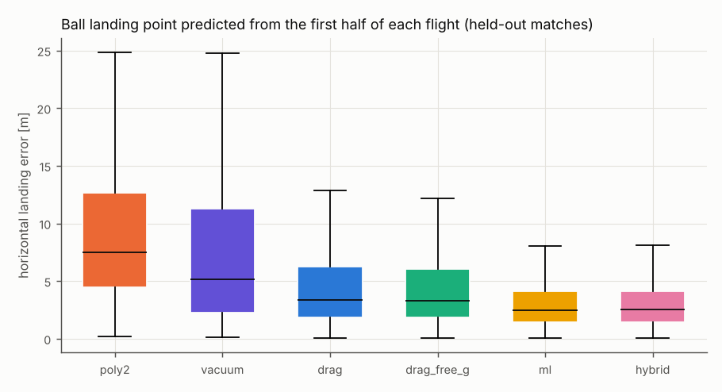
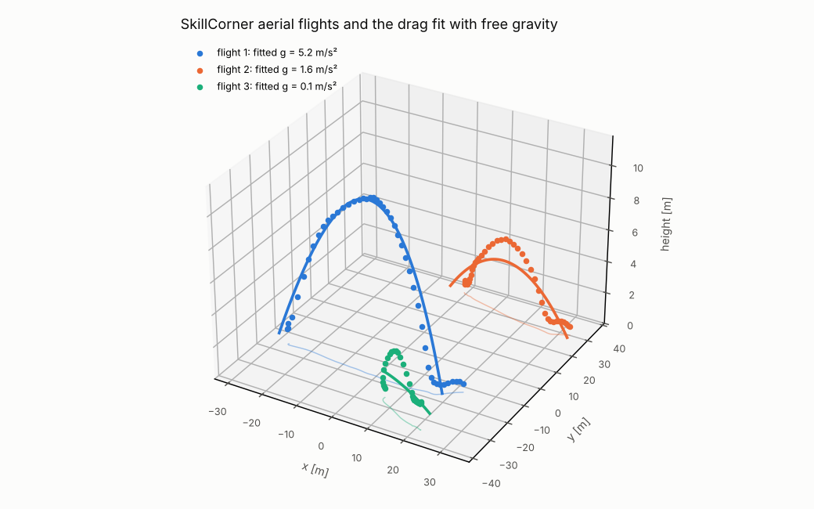
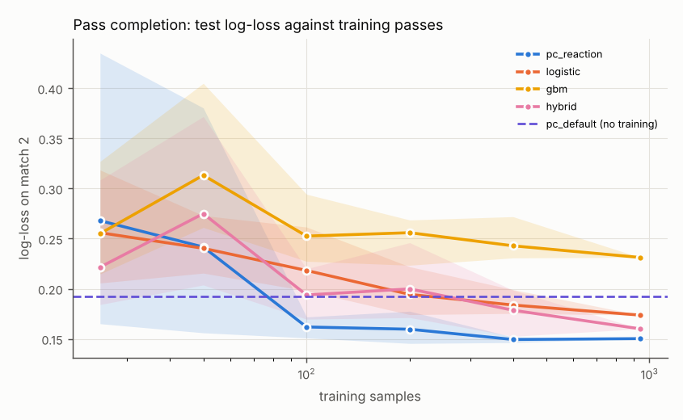
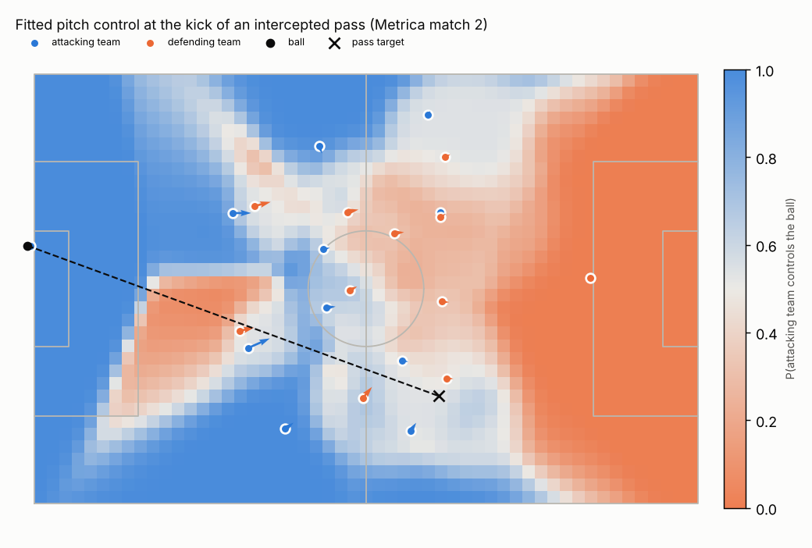
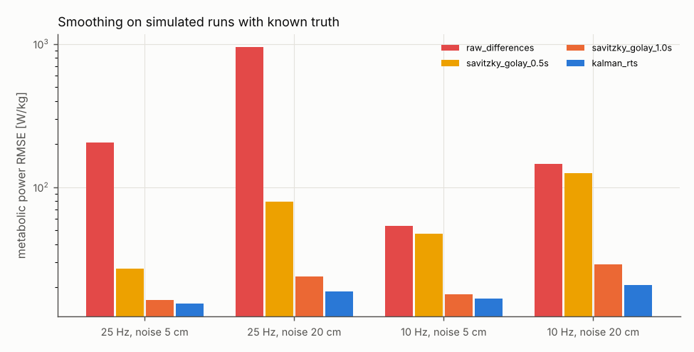
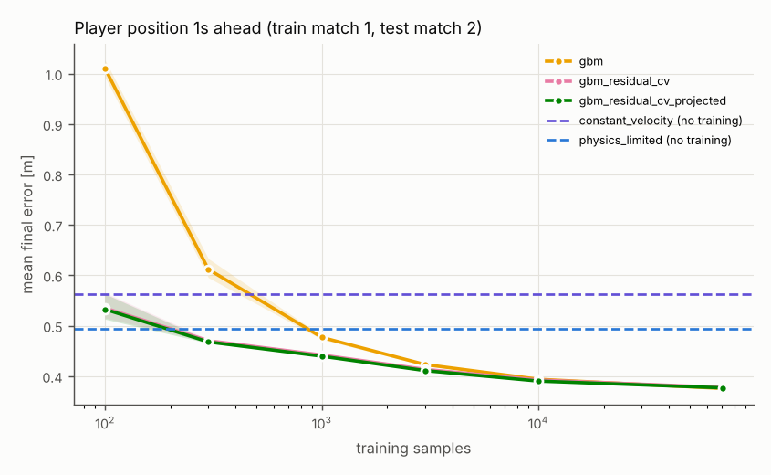
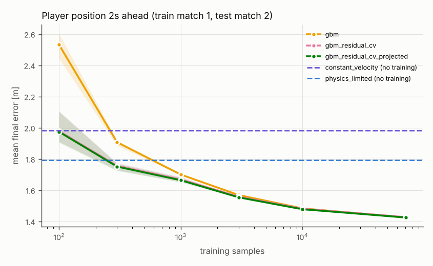

# Football: where physics helps on public tracking data

This guide asks one question about football: **where does a physics-informed model beat, or usefully add to,
pure machine learning or standard analytics, on public data?** It also says plainly where physics does not help.
The cases cover ball flight, pass completion (pitch control), player kinematics and load, and expected goals.
Each one compares models on held-out data, with the same training data for every model.

Everything comes from [`examples/sports`](../../examples/sports/): scripts `01`-`04` run the studies and
[`05_verdict.py`](../../examples/sports/05_verdict.py) writes the verdict table below
(`examples/sports/results/verdict.md`). The library is `pinneapple_systems.sports.football`. The tests are in
`tests/test_football_physics.py`.

## Data (downloaded at run time, never committed)

| Source | What | Licence / terms | Used for |
|---|---|---|---|
| [SkillCorner open data](https://github.com/SkillCorner/opendata) | 20 A-League 2024/25 matches, broadcast tracking at 10 Hz, ball with an estimated height `z` | MIT; credit SkillCorner | ball flight |
| [Metrica Sports sample data](https://github.com/metrica-sports/sample-data) | 2 anonymised matches, 25 Hz tracking of players and ball (2-D), synchronised events | free sample; acknowledge Metrica Sports | pitch control, kinematics |
| [StatsBomb open data](https://github.com/statsbomb/open-data) | events + 360 freeze frames: World Cup 2022, Euro 2020, Euro 2024 (3 859 shots) | StatsBomb user agreement (non-commercial); "Data: StatsBomb" | expected goals |

`pinneapple_systems.sports.football.data` downloads each file once into `~/.cache/pinneapple/datasets/football`
(or `$PINNEAPPLE_DATA_CACHE`) and records its SHA-256 in `manifest.json`. Only small derived results are
committed. The Wyscout / Pappalardo et al. (2019) event data set on figshare was not reachable from the build
environment (the proxy refused figshare.com), so it is not used.

## Verdict

<!-- copied from examples/sports/results/verdict.md -->
| Case | Physics | Data-only baseline | Measured (held-out) | Verdict |
|---|---|---|---|---|
| Ball flight: data consistency (SkillCorner 3-D ball, 10 Hz) | drag ODE with free gravity, fitted per flight | none (a data-quality test) | g = 6.09 m/s² [6.02, 6.18] over 2601 flights (simulated flights, same fit: 9.88) | physics HELPED as a check: the broadcast ball height is not physically consistent (apparent gravity far below 9.81 at every launch speed, so not backspin lift); drag and spin cannot be identified from it |
| Ball flight: landing point from the first half of the flight | drag_free_g (best of vacuum / drag with g = 9.81 / drag with free g); hybrid trees | ml (best of quadratic extrapolation / boosted trees) | median landing error: physics 3.27 m, hybrid 2.55 m, data-only 2.44 m (1282 test flights) | physics did NOT help against trained trees: they learn this data's own (non-physical) height dynamics, which a g = 9.81 model cannot follow; physics does beat untrained extrapolation (7.51 m) |
| Ball flight from 2-D tracking (Metrica-type, no height) | Cramer-Rao bound of the drag-Magnus fit | the same flight seen in 3-D | std of vertical launch speed 0.34 m/s (3-D) vs 222 m/s (2-D) | ill-posed in 2-D: elevation, spin and drag trade off; do not fit them without height |
| Pass completion (Metrica, 2 matches, ~2000 passes) | Spearman pitch control, 5 physical parameters fitted | logistic regression / boosted trees on geometric features | fit on match 1, test on 2: fitted pitch control 0.1503 vs logistic 0.1737, diff -0.0234 [-0.0477, +0.0001]; fit on match 2, test on 1: fitted pitch control 0.1927 vs logistic 0.1891, diff +0.0036 [-0.0271, +0.0367]; with 100 training passes: fitted pitch control 0.1619, logistic 0.2183, trees 0.2526; unfitted pitch control (0 passes) 0.1925 | physics HELPED with little data (lower log-loss than every data-only model up to a few hundred passes, unfitted or fitted) and is better calibrated; at full data it matches the best data-only model (gain not significant in both directions) |
| Speed and metabolic power from noisy tracking (simulated, known truth) | constant-acceleration Kalman-RTS, noise by maximum likelihood | best Savitzky-Golay window (chosen with the truth: an optimistic baseline) | metabolic-power RMSE 25 Hz/20 cm: 18.7 vs 23.8 W/kg; 25 Hz/5 cm: 15.3 vs 16.3 W/kg; 10 Hz/20 cm: 20.7 vs 28.8 W/kg; 10 Hz/5 cm: 16.7 vs 17.8 W/kg | physics HELPED (lower error in every case, calibrated intervals); the gain is largest against an untuned window. Caveat: the simulated motion follows a model close to the filter's |
| Metabolic power on Metrica (real, no ground truth) | equivalent-slope model on Kalman-RTS states | the same on raw differences / Savitzky-Golay | noise fitted 0.5 cm; team mean metabolic power, all samples: raw_differences 68.0, savitzky_golay_0.5s 13.7, kalman_rts 45.1 W/kg; physically plausible samples only: raw_differences 7.4, savitzky_golay_0.5s 7.1, kalman_rts 7.3 W/kg | physics HELPED as a gate, not as a smoother: a few tracking jumps (impossible speed or acceleration) dominate the match mean whatever the filter; removing them with human limits makes the methods agree. The provider data are already smooth (noise ~mm), so the smoother itself changes little |
| Player position 1s ahead (Metrica, train match 1, test match 2) | constant velocity / decaying acceleration; trees on the constant-velocity residual (+ reachable-set projection) | boosted trees on the past second | mean error: CV 0.56 m, physics 0.49 m; all data: trees 0.38 m, residual 0.38 m; 100 samples: trees 0.99 m, residual 0.52 m; unreachable trees predictions 0.05 % | physics prior HELPED with little data (47 % lower error); matched with all data (-0.5 %) |
| Player position 2s ahead (Metrica, train match 1, test match 2) | constant velocity / decaying acceleration; trees on the constant-velocity residual (+ reachable-set projection) | boosted trees on the past second | mean error: CV 1.98 m, physics 1.79 m; all data: trees 1.42 m, residual 1.43 m; 100 samples: trees 2.55 m, residual 1.92 m; unreachable trees predictions 0.03 % | physics prior HELPED with little data (25 % lower error); matched with all data (-0.2 %) |
| Expected goals (StatsBomb 360, test Euro 2024) | intercept-time features: open goal fraction, keeper margin, blockers | standard logistic xG (distance, angle, body part, context) | log-loss standard 0.2413, +physics 0.2429 (diff +0.0016 [-0.0019, +0.0052]), +freeze geometry 0.2389; StatsBomb xG 0.2267 | physics did NOT help: no measurable gain over shot geometry with ~2600 training shots; case dropped |

## 1. Ball flight: drag, Magnus, gravity

**Model.** The ball centre follows `dv/dt = -g e_z - k_d |v| v + |v| (B x v)`, where `k_d = rho A C_D / (2 m)`
and `B` is the Magnus vector (`rho A C_L / (2 m)` times the spin axis). The ball constants follow the Laws of the
Game. `ball.simulate` integrates it with RK4, batched over parameter sets. `ball.fit_flight` solves the inverse
problem. It fits launch position and velocity, plus `C_D`, `B` or `g` depending on the model, by robust least
squares with a batched finite-difference Jacobian. Standard errors come from the Gauss-Newton (Laplace)
covariance.

**Method check (simulated kicks, known truth).** Kicks are simulated at 15-30 m/s with a drag-crisis `C_D(Re)`
and random spin, then observed at 10 Hz with 0.2 m noise. Fitting them back gives a mean `C_D` error of
0.024, and the 95 % intervals cover the true `C_D` in 97 % of flights. Gravity and vertical Magnus
lift are confounded: a drag fit with free `g` and no spin term misses `g` by 0.94 m/s² on average on spinning balls
(coverage 0.57). This matters in the audit below.

**2-D tracking makes the problem ill-posed.** The Cramer-Rao bound for one lofted pass (22 m/s, 25°, 25 Hz,
0.2 m noise) gives a standard deviation of the vertical launch speed of 0.34 m/s with the height observed and
222 m/s without it. The Fisher matrix is numerically singular (`ball_study.identifiability`). Without
height, elevation, drag and spin trade off against each other. Metrica-type 2-D ball tracks therefore cannot give
aerodynamic coefficients. The only physics that still identifies anything in 2-D is the ground roll. Fitted to
the event durations of Metrica passes (`pitch_control.fit_ball_travel`), the rolling deceleration comes out
near zero: the durations end at reception and include lofted passes. So the travel-time model reduces to a kick
speed that grows with distance (about 9 m/s + 0.16-0.18 m/s per metre), against 11.4-11.7 m/s at constant speed
(RMSE 0.43-0.47 s against 0.52-0.53 s).

**Gravity audit of broadcast tracking.** Gravity is fitted freely to every aerial flight extracted from the 20
SkillCorner matches (`ball_study.gravity_audit`). On real flights the fit should return about 9.81 m/s². The
fitted median is **6.09 m/s² [6.02, 6.18]** over 2 601 flights (3 717 extracted; flights with a fit RMSE
above 0.6 m are dropped as deflections). The same fit on simulated flights gives 9.88 [9.57, 10.10]. The
deficit appears in every launch-speed band: 5.64 m/s² below 12 m/s, 6.92 at 12-18 m/s, 6.42 at 18-24 m/s and
5.87 above 24 m/s. That includes the slowest flights, where backspin lift, which grows with the square of the speed,
cannot explain it. The ball height in this data set is therefore an estimate that is not physically consistent.
Drag and lift coefficients fitted to it would be wrong, so this guide does not compare them with wind-tunnel
values (Asai et al. 2007, Sports Eng. 10:101, critical Re about 2.2-3.0e5; Hong & Asai 2014, Sci. Rep. 4:5068).
`ball.DRAG_CRISIS_BAND` holds that band for data that pass the check.

**Held-out prediction.** For each flight of the test matches, the first half is observed and the rest is
predicted (`ball_study.holdout_prediction`). The models are:

- quadratic extrapolation per axis (data only);
- vacuum and drag ballistics with g = 9.81 m/s²;
- drag with free `g`;
- boosted trees trained on 14 other matches;
- a hybrid: the same trees with the free-`g` physics prediction as an extra input.

On 1 282 test flights, the median horizontal landing errors are: trees 2.44 m, hybrid 2.55 m, drag with free
`g` 3.27 m, drag with g = 9.81 3.36 m, vacuum 5.14 m and quadratic extrapolation 7.51 m. Physics is by far the
best model without training, but **trees trained on other matches of the same feed do better**. They learn the
feed's own height dynamics, which a physical model with g = 9.81 cannot follow. On this data, physics loses this
case.




## 2. Pass completion: pitch control against data-only classifiers

**Model** (`pitch_control`, reimplemented from Spearman 2018, *Beyond Expected Goals*, MIT Sloan SAC). Each
player reaches the target point at a logistic-distributed time around his time to intercept. Once there, he
controls the ball at rate `lambda`. The control probabilities of the two teams follow the integro-differential
equation of the paper. Player states come from a causal Kalman filter. Two time-to-intercept models are
available: reaction time then straight running at `v_max`, or acceleration-limited motion from the current
velocity. Five physical parameters are fitted by maximum likelihood on the pass outcomes of one match.

**Comparison** (`pc_study`, ~2 000 passes: 940 in match 1 and 1 097 in match 2; label 1 = completed, 0 =
intercepted). Each model is fitted on one match and scored on the other. The data-only models are logistic
regression and boosted trees on 15 geometric features: distances of the nearest attackers and defenders to the
target and to the pass line, counts near the target, positions and pass length.

| Test match | Unfitted pitch control | Fitted pitch control | Logistic | Boosted trees | Hybrid |
|---|---|---|---|---|---|
| 2 (fit on 1) | 0.1925 | **0.1503** | 0.1737 | 0.2313 | 0.1600 |
| 1 (fit on 2) | 0.2034 | 0.1927 | **0.1891** | 0.2512 | 0.1938 |

Test log-loss. Fitted pitch control minus logistic: -0.023 [-0.048, +0.000] and +0.004 [-0.027, +0.037]
(paired bootstrap 95 %). Fitted pitch control is the best-calibrated model (ECE 0.027 and 0.011, against 0.014
and 0.019 for logistic).



The learning curve shows where physics helps. The **unfitted** model (0 training passes, log-loss 0.1925) beats
every data-only model trained on up to about 400 passes. With 100 training passes, fitted pitch control scores
0.162 against 0.218 for logistic regression and 0.253 for boosted trees. Over the whole data the gap closes and
is no longer significant. The acceleration-limited intercept did **not** help (0.251 / 0.233): its parameters
drift to implausible values (`v_max` up to 78 m/s). The reaction-time form is the better physical prior for this
data.



## 3. Player kinematics and load

**Smoothing with known truth** (`kin_study.synthetic_smoothing`). The comparison uses simulated runs with
bounded acceleration and speed, observed at 25 or 10 Hz with 5 or 20 cm of noise. The constant-acceleration
Kalman-RTS smoother takes its noise level from maximum marginal likelihood (`kinematics.fit_noise`). It has the
lowest speed, acceleration and metabolic-power error in every case, and its 95 % velocity intervals cover the
truth 96-97 % of the time. Raw differences inflate the mean metabolic power 1.5 to 16 times. A 0.5 s Savitzky-Golay
window at 10 Hz with 20 cm of noise is almost as bad. The caveat: the simulated motion is close to the filter's
own model, so this is a best case for the filter. The comparison baseline is the best Savitzky-Golay window, chosen
using the truth.



**Metrica, no ground truth** (`kin_study.match_load`). The noise fitted on the data is about half a centimetre:
the provider already smooths the positions. The metabolic power uses the equivalent-slope model (di Prampero et
al. 2005; Osgnach et al. 2010) with the slope cost of Minetti et al. (2002). A few tracking jumps, with speeds or
accelerations no human reaches, dominate the match mean whatever the filter. Gating them with the limits in
`kinematics.V_MAX` and `A_MAX` brings the methods into agreement (verdict table).

**Trajectory prediction** (`kin_study.prediction_study`; train match 1, test match 2, 66 680 test samples). The
prediction is every outfield player's position 1 s and 2 s ahead.




The physics prior is the constant-velocity residual: the trees learn only the correction. With 100 training
samples it halves the error of plain trees at 1 s (0.54 m against 1.01 m). With 70 000 samples the two converge
(0.378 m against 0.376 m). The decaying-acceleration model needs no training, and it beats plain trees trained
on fewer than about 1 000 samples (0.49 m at 1 s, 1.79 m at 2 s). Trees almost never predict an unreachable
position (0.05 %), so projecting onto the reachable set changes the error by under 1 %.

## 4. Expected goals: physics features do not help here

`xg.physics_features` builds three features from the StatsBomb 360 freeze frame:

- the share of the goal mouth that no opponent can intercept in time;
- the keeper's best time margin;
- the number of blockers.

The shot speed and the keeper's speed are chosen by grouped cross-validation on the training shots
(25 m/s, 7 m/s). The models train on the World Cup 2022 and Euro 2020 (2 590 shots, 269 goals) and are tested on
Euro 2024 (1 269 shots, 97 goals).

| Model | Log-loss | Brier | AUC | ECE |
|---|---|---|---|---|
| standard logistic (distance, angle, body part, context) | 0.2413 | 0.0662 | 0.755 | 0.027 |
| + physics features | 0.2429 | 0.0662 | 0.746 | 0.025 |
| + data-only freeze-frame geometry | 0.2389 | 0.0656 | 0.764 | 0.021 |
| physics features + distance and angle only | 0.2538 | 0.0682 | 0.711 | 0.027 |
| boosted trees, standard features | 0.2603 | 0.0690 | 0.700 | 0.041 |
| StatsBomb xG (external reference, proprietary) | 0.2267 | 0.0622 | 0.790 | 0.019 |

Adding the physics features changes the log-loss by +0.0017 [-0.0019, +0.0052]: no gain, and no gain at any
training size either (`figures/xg_learning_curve.png`). Data-only freeze-frame geometry does no better than noise
(-0.0023 [-0.0099, +0.0049]). With about 2 600 shots, the shot's position explains what the freeze frame adds.
This case is dropped. StatsBomb's own model does better, but it is trained on far more shots and uses
information these features do not have.

## What was not done

- No OpenFOAM run of a football: with the drag check failing on the data, a CFD `C_D(Re)` would have had
  nothing to be compared against.
- No PINN for the ball-flight inverse problem. The ODE has at most 10 parameters, and direct shooting with
  Gauss-Newton gives the answer and its covariance in a fraction of a second. A PINN would only add training
  noise.
- No GPS or VO2 ground truth for metabolic power: on real data the guide reports processing uncertainty, not
  accuracy.

## Run it

```bash
pip install -e ".[sports]"
python examples/sports/01_ball_flight.py      # ~1.8 GB of SkillCorner tracking, about an hour on 3 cores
python examples/sports/02_pitch_control.py    # Metrica, ~10 min
python examples/sports/03_player_kinematics.py
python examples/sports/04_expected_goals.py   # StatsBomb, ~3 GB of event files read once
python examples/sports/05_verdict.py          # verdict table and experiment manifest
```

Each script also accepts `--smoke` (small sizes). The Flow Studio nodes are `football.ball_flight_inverse` (no
download), `football.tracking_smoothing` (no download) and `football.pass_pitch_control` (Metrica).
