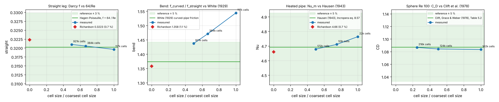
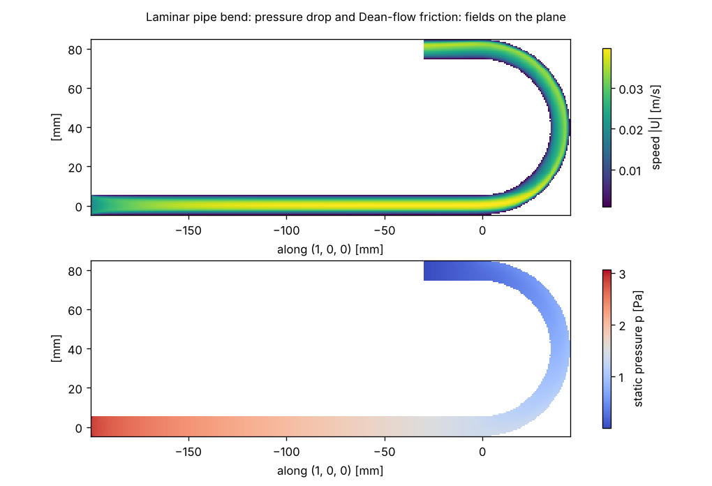
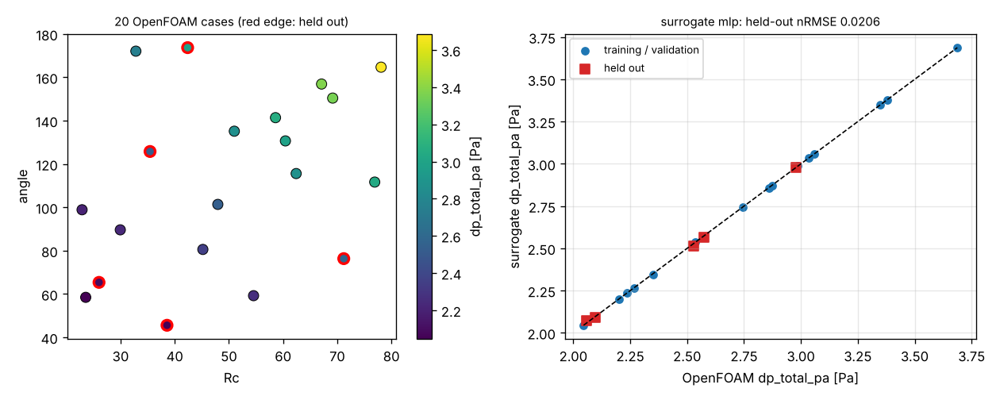

# FreeCAD -> OpenFOAM pipelines

`pinneapple_simulation.pipelines.freecad_openfoam` turns a parametric FreeCAD document into a checked OpenFOAM
result without a display and without clicking: set the spreadsheet parameters, recompute, export, name the patches,
mesh, solve, post-process, compare with a reference, and keep the evidence. A study is plain data
(`PipelineSpec`), so it can be reviewed, replayed, swept over its parameters and run from Flow Studio.

```python
from pinneapple_simulation.pipelines.freecad_openfoam import studies, run_pipeline

spec = studies.pipe_bend(cells_across=16)              # FreeCAD template + patch rules + mesh + physics + references
run = run_pipeline(spec, "runs/bend", inputs={"Rc": 40, "Re": 200})
print(run.state, run.message)                          # passed / rejected (a criterion failed) / failed / blocked
# runs/bend: study_result.json (StudyResult), report.html, run.json, every log, figure and file hash
```

## The steps

`PipelineSpec.to_workflow()` builds a workflow of `pinneapple_tools.automation`; `run_pipeline` runs it with the
automation `Runner`, so a run folder resumes after the last passed step and every step records its commands, logs,
checks and SHA-256 of its files.

| Step | Action | What it does and checks |
|---|---|---|
| `cad` | `freecadcmd.export` | `freecadcmd` (FreeCAD 1.0, headless) opens the document, sets the spreadsheet aliases, recomputes, saves the modified document, exports STEP and the faces of the solid. Patches are named by rule (below) and written as a multi-region STL in metres. Checks: no invalid object, valid and closed solid, watertight triangulation, triangulated volume = CAD volume, the snappy location point inside the fluid. |
| `case` | `openfoam.prepare` | blockMesh background + snappyHexMesh (cfMesh's `cartesianMesh` with `mesher="auto"` when installed), simpleFoam or pimpleFoam (laminar or k-omega SST), a passive scalar, `Allmesh` and `Allrun`; external flows use `ExternalFlow`'s dictionaries. The number of processes follows the cell count (`procs="auto"`). |
| `mesh` | `openfoam.mesh` | `Allmesh` (snappyHexMesh in parallel, `reconstructParMesh`), then `checkMesh` must say "Mesh OK". |
| `solve` | `openfoam.solve` | `Allrun` (decomposePar, MPI, reconstructPar); the solver must reach `End` and converge (residual control or the last residuals below the tolerance). Residual plot from the log. |
| `post` | `openfoam.post` | Area-averaged pressure, flux and bulk scalar on every inlet / outlet and on cross sections, mass imbalance, wall forces and y+ from the fields, largest Courant number (transient), the field and mesh figures, derived quantities and each reference with its error. |
| `verify` | `verify.criteria` | Acceptance: converged, mass balance, Courant (pimpleFoam), every reference within its tolerance. |

Patch rules are expressions over each face of the exported solid (document units, mm): `cx cy cz` (centre),
`nx ny nz` (mean outward normal), `area`, the type flags `plane cylinder torus sphere cone`, the bounding box
`xmin ... zmax` and every document parameter; the first rule a face satisfies takes it and `rest` takes the others.
They follow the geometry when a parameter moves a face:

```python
patches = {"inlet": "plane and abs(cx + L_in) < 1e-3 * D and abs(cy) < 1e-3 * D",
           "outlet": "plane", "walls": "rest"}
```

Physics values, sections, derived quantities and references are expressions too (over the inputs, the physics and
what was measured), with the reference correlations of `pinneapple_physics.closed_form`: `laminar_f(Re)`,
`dean(Re, D, Rc)`, `white_ratio(De)`, `hausen_nu(Re, Pr, D_over_L)`, `nu_from_T(...)`, `clift_cd(Re)`,
`schiller_cd(Re)`.

## Templates and worked studies

| Template | Document parameters (mm, deg) | Patches |
|---|---|---|
| `pipe_bend` | `D`, `Rc`, `angle`, `L_in`, `L_out` | inlet, outlet, walls |
| `heated_pipe` | `D`, `L_entry`, `L_heated` | inlet, outlet, wall_entry, wall_heated |
| `spheroid` | `D`, `L` (sphere when L = D) | body (external flow) |

`build_document(template, "model.FCStd")` writes the parametric document (a spreadsheet `Params`, primitives whose
dimensions and placements are expressions of it); `python -m pinneapple_simulation.pipelines.freecad_openfoam build
pipe_bend bend.FCStd` does the same from the shell. Any other document works the same way: give `document`,
`solid`, the patch rules and the parameters.

The three studies in `studies` are generic (no client data) and each is checked against a closed form or a
published correlation on three meshes, with Richardson extrapolation (Roache's GCI,
`pinneapple_analysis.verification.convergence`) in `report.mesh_study`:

* **Pipe bend** (laminar, Re = 200, D = 10 mm, Rc = 40 mm, 180°, De = 70.7): the friction factor of the developed
  straight inlet leg against Hagen-Poiseuille 64/Re, and the ratio of the developed pressure gradient in the bend
  (120°-165°) to the straight one against White (1929).
* **Heated pipe** (laminar thermal entry, Re = 100, Pr = 2, 6 D unheated then 10 D at constant wall temperature):
  the mean Nusselt number from the bulk outlet temperature against Hausen (1943).
* **Sphere** (Re = 100, laminar, half model): the drag coefficient against the standard drag curve of Clift, Grace &
  Weber (1978); also Re = 50 and 200.

## Measured validation

`examples/freecad_openfoam/freecad_openfoam.py` runs everything below (about an hour on 4 cores; `--quick` for
coarse meshes) and writes `validation.md`, `validation.json`, `sweep.csv` and the figures next to it. Measured on
FreeCAD 1.0.2 (AppImage, `freecadcmd`), OpenFOAM v1912 (Ubuntu 24.04 package), 4 CPU cores:

| study | quantity | mesh | cells | measured | reference | error | source |
|---|---|---|---|---|---|---|---|
| pipe_bend | straight | 16 | 117181 | 0.3196 | 0.3206 | 0.32 % | Hagen-Poiseuille, f = 64 / Re |
| pipe_bend | straight | 24 | 383891 | 0.3205 | 0.3204 | 0.05 % | Hagen-Poiseuille, f = 64 / Re |
| pipe_bend | straight | 32 | 921481 | 0.3210 | 0.3202 | 0.24 % | Hagen-Poiseuille, f = 64 / Re |
| pipe_bend | straight | Richardson (p = 1.03, GCI 0.5 %) | - | 0.3223 | 0.3202 | 0.65 % | Hagen-Poiseuille, f = 64 / Re |
| pipe_bend | bend | 16 | 117181 | 1.5441 | 1.3729 | 12.47 % | White (1929) curved-pipe friction |
| pipe_bend | bend | 24 | 383891 | 1.4712 | 1.3733 | 7.13 % | White (1929) curved-pipe friction |
| pipe_bend | bend | 32 | 921481 | 1.4375 | 1.3734 | 4.67 % | White (1929) curved-pipe friction |
| pipe_bend | bend | Richardson (p = 1.23, GCI 6.9 %) | - | 1.3580 | 1.3734 | 1.13 % | White (1929) curved-pipe friction |
| heated_pipe | Nu | 12 | 21504 | 4.7641 | 4.6919 | 1.54 % | Hausen (1943), Incropera eq. 8.57 |
| heated_pipe | Nu | 16 | 53248 | 4.7110 | 4.6919 | 0.41 % | Hausen (1943), Incropera eq. 8.57 |
| heated_pipe | Nu | 24 | 172032 | 4.6786 | 4.6919 | 0.28 % | Hausen (1943), Incropera eq. 8.57 |
| heated_pipe | Nu | Richardson (p = 2.47, GCI 0.5 %) | - | 4.6597 | 4.6919 | 0.69 % | Hausen (1943), Incropera eq. 8.57 |
| sphere_drag | CD | 3 | 102308 | 1.0833 | 1.0870 | 0.34 % | Clift, Grace & Weber (1978), Table 5.2 |
| sphere_drag | CD | 4 | 124291 | 1.0842 | 1.0870 | 0.26 % | Clift, Grace & Weber (1978), Table 5.2 |
| sphere_drag | CD | 5 | 216328 | 1.0866 | 1.0870 | 0.04 % | Clift, Grace & Weber (1978), Table 5.2 |
| sphere_drag | CD | Richardson: not applied | | | | | observed order -1.41 <= 0: the three meshes are not in the asymptotic range (changes below the discretisation noise) |
| sphere_drag Re 50 | CD | 4 | 124291 | 1.5689 | 1.5743 | 0.34 % | Clift, Grace & Weber (1978), Table 5.2 |
| sphere_drag Re 200 | CD | 4 | 124291 | 0.7775 | 0.7756 | 0.24 % | Clift, Grace & Weber (1978), Table 5.2 |

| surrogate (dp_total_pa from Rc, angle) | held-out nRMSE |
|---|---|
| Polynomial ridge | 0.0146 |
| Gaussian process | 0.0159 |
| MLP (chosen) | 0.0206 |
| Gradient-boosted trees | 0.8896 |

Times on 4 cores: the bend on 117k / 384k / 921k cells took 45 s / 2.2 min / about 25 min (snappyHexMesh is most
of it), the heated pipe 15-60 s, the sphere about 1 min per run, a sweep case 70-170 s on 2 processes. The surrogate
is chosen on 2 validation cases, so the chosen MLP is not the best on the 5 held-out cases (polynomial ridge is), and
the MLP's held-out error varies between runs (0.017-0.021 measured); the study's trust decision is REVIEW.





## Sweeps and surrogates

```python
from pinneapple_simulation.pipelines.freecad_openfoam import Sweep, doe, fit_surrogate, studies

design = doe({"Rc": (20, 80), "angle": (45, 180)}, 20, "lhs", fixed={"Re": 200.0})
rows = Sweep(studies.pipe_bend(16, procs=2), design, "runs/sweep").run(parallel=2)   # rerun: resumes
study = fit_surrogate(rows, ["Rc", "angle"], ["dp_total_pa"])
print(study.best, study.ranking("test"))               # held-out error of every method
```

Each case runs in its own process (`python -m pinneapple_simulation.pipelines.freecad_openfoam run ...`) in
`cases/<id>`; a rerun skips the cases that finished and resumes the others after their last passed step.
`fit_surrogate` is `pinneapple_analysis.surrogate.run_study`: every applicable method at equal budget, the best
chosen on validation data, errors measured on held-out cases that no method trained on.

## Flow Studio

Nodes `cfd.study` (a worked study, with overrides), `cfd.geometry` (FreeCAD only: parameters, patches, checks,
figure; runs everywhere with the NumPy stand-in), `cfd.run`, `cfd.sweep` and `cfd.surrogate`. Flows
`freecad_openfoam_bend` and `freecad_openfoam_sweep`.

## Without FreeCAD

`backend="fake"` (or `"auto"` when `freecadcmd` is not found) uses `FakeFreeCAD`, the same templates built in NumPy
(same faces, types, parameters and patch rules; no STEP file), so tests and machines without FreeCAD run every
step after the CAD one. `Toolchain` / `PINNEAPPLE_FREECADCMD` find FreeCAD: the AppImage extracted to `/opt/freecad`
(`FreeCAD_1.0.2-conda-Linux-x86_64-py311.AppImage --appimage-extract`) works headless.

## Limits

* OpenFOAM v1912 from the Ubuntu 24.04 package stops at start-up whenever `controlDict` has a function object
  ("error in IOstream sha1"), so the cases have none: pressures, fluxes, forces and y+ are computed from the written
  fields, residuals and Courant numbers from the log, and the passive scalar is solved after the flow by
  `scalarTransportFoam`. Wall shear is the first-cell gradient (laminar sublayer, log law above y+ = 11.25).
* The scalar is passive (constant properties, no buoyancy): conjugate heat transfer (chtMultiRegionFoam) and
  free-surface (interFoam) templates are not part of this pipeline; `pp.cfd.FreeSurfaceFlow` covers interFoam.
* cfMesh is used only when `cartesianMesh` is installed; it was not available on the validation machine, so its
  dictionary is written but not exercised there.
* pimpleFoam runs are checked for the solver end, mass balance and the largest Courant number (adjustable time step
  aiming at `max_courant`; it lags, 0.91 measured for a target of 0.8, so the check is Co <= 1, or 1.05 x
  `max_courant` when that is above 1); the three validated studies are steady (simpleFoam).
