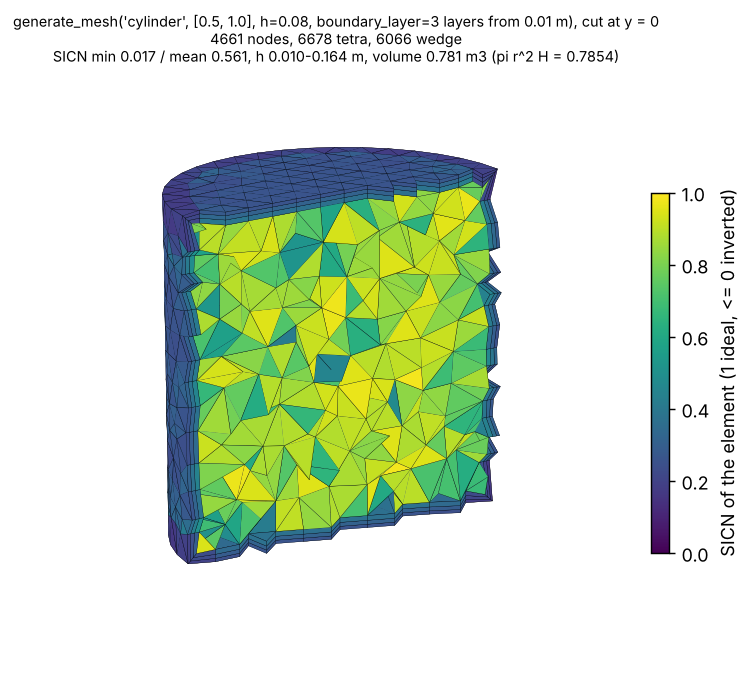

# Unstructured mesh generation

`pinneapple_design.geometry.mesh.generate.generate_mesh` makes a triangle mesh (2-D) or a tetrahedral mesh (3-D)
with gmsh. In 3-D it can add prism layers at the walls. It rates every element and can write the mesh and a 3-D view
of its quality. The Flow node `geometry.unstructured_mesh` calls it. The structured grid of `geometry.mesh` is
unchanged.

```python
from pinneapple_design.geometry.mesh.generate import generate_mesh

out = generate_mesh("cylinder", [0.5, 1.0], h=0.08,
                    boundary_layer={"first_layer": 0.01, "n_layers": 3, "growth": 1.2}, out_dir="mesh")
out["element_counts"], out["sicn_min"], out["volume"]     # {'tetra': 6678, 'wedge': 6066}, 0.017, 0.7810 m3
```



More pictures are in `docs/assets/mesh/`: a box, a sphere, local refinement, 2-D meshes with wall layers, an STL
part, and the SICN histograms with the measured numbers. `python scripts/mesh_generation_gallery.py` makes them all,
this figure included.

## Inputs

| input | meaning |
|---|---|
| `geometry` | One of five primitives or a file. Primitives: `box`, `cylinder`, `sphere`, `rectangle` (2-D), `disk` (2-D). Files: `.stl`, `.step` / `.stp`, `.iges` / `.igs`. |
| `dimensions` | Primitive sizes in m: box `[lx, ly, lz]`, cylinder `[radius, height]` (axis +z), sphere `[radius]`, rectangle `[lx, ly]`, disk `[radius]`. |
| `origin` | Where the primitive goes, in m: the corner of a box or rectangle, the centre of a sphere or disk, the base centre of a cylinder. |
| `h` | Target element size, in m. |
| `scale` | Converts a file's length unit to metres; `1e-3` for millimetres. |
| `refine` | Balls of smaller elements, `[{"center": [x, y, z], "radius": r, "h": h_local}]`. The size grows back to `h` over one radius. |
| `boundary_layer` | `{"first_layer": m, "n_layers": n, "growth": g}`. In 3-D, prisms are extruded inward from the surface. In 2-D, layers of triangles line the boundary. |
| `out_dir` | Where to write the files: `mesh.msh` (gmsh), `mesh.vtu` (ParaView), `quality.glb` and `quality.json`. Nothing is written anywhere else. |
| `max_input_mb` | Largest geometry file accepted, checked before the file is opened. Default: `PINNEAPPLE_MESH_MAX_INPUT_MB`, else 100 MB. |
| `max_elements` | Largest mesh, estimated before meshing. Default 2,000,000. Above it, the error names the smallest acceptable `h`. |

### File inputs

- **STEP / IGES:** read through OpenCASCADE, gmsh's OCC kernel.
- **STL without a boundary layer:** meshed by the existing `mesher_3d.mesh_from_surface`.
- **Open STL:** refused. An STL with open or non-manifold edges raises `ValueError` with the count of each edge kind; the check is `pinneapple_data.cae.quality.surface_checks`.

### Guards

These protect an app that runs the tool on untrusted input.

- **Local files only.** A URL is refused; nothing is downloaded.
- **File size.** A file above `max_input_mb` is refused before it is opened.
- **Mesh size.** The mesh size is estimated before meshing, from the volume or area over h^d with measured densities: 6 tetrahedra per V/h^3 and 2.5 triangles per A/h^2. The estimate also counts the refinement balls and one prism per wall triangle per layer. Files are estimated from their bounding box. The estimate is 1.0 to 1.35 times the count gmsh makes (tested).
- **Missing gmsh.** The error says `pip install gmsh`.

### Fixed settings

- Algorithms: Frontal-Delaunay in 2-D and Delaunay in 3-D.
- One thread, so the element order is deterministic.

## Outputs

The names, types and units are declared in the module's `X_OUTPUTS`, which the Studio reads.

| output | meaning |
|---|---|
| `dim` | 2 or 3. |
| `n_nodes` | Number of nodes. |
| `n_elements` | Number of elements of the mesh's dimension. |
| `element_counts` | Elements per type (for example tetra and wedge). |
| `sicn_min`, `sicn_mean` [-] | gmsh `minSICN`: the signed inverse condition number of the Jacobian. 1 is the ideal element; ≤ 0 is inverted. Below 0.1 the node logs a warning. |
| `gamma_min`, `gamma_mean` [-] | gmsh `gamma`: inscribed / circumscribed radius, normalised to 1 for the ideal element. |
| `aspect_ratio_max`, `aspect_ratio_mean` [-] | Longest / shortest edge of each element, from `pinneapple_data.cae.quality.element_metrics`. |
| `volume` [m3] | Volume of a 3-D mesh; null in 2-D. |
| `area` [m2] | The 2-D area, or the boundary area of a 3-D mesh (faces owned by one element). |
| `h_min`, `h_mean`, `h_max` [m] | Edge lengths. |
| `files` | Paths of the written files. |
| `backend` | How the mesh was made. |

## Quality view

The view is `pp.viz.field_view` on the mesh. It has three cell fields: `sicn`, `gamma` and `aspect_ratio`.

- `quality.glb` is the glTF. Fields are stored as vertex attributes `_F0`, `_F1`, `_F2`.
- `quality.json` is its meta, with schema `pinneapple-field-view/v1`.
- Apps open both with `/shared/fieldview3d.js`.

In the Flow, the node shows the view as `ctx.view("scene", {"glb", "meta"})`.

## Flow node `geometry.unstructured_mesh`

- **Input:** `geometry`, optional. With `shape = domain`, it meshes the rectangle or box of the connected `geometry.domain`.
- **Output:** `mesh`, of port type `unstructured_mesh`. It is its own type, so it cannot be wired by mistake into the finite-difference solvers that read the structured grid. The value is `{geometry, summary, files}`.
- **Report:**
  - metrics `n_nodes`, `n_elements`, `sicn_min`, `gamma_min`, `aspect_ratio_max`, `h_*` and the volume or area;
  - tables `quality` (min / mean / max and threshold) and `elements`;
  - the 3-D view;
  - the files as artifacts.
- **Files:** read only from the data folder (`PINNEAPPLE_FLOW_DATA`).

## Measured (gmsh 4.12.1 from Debian, one thread; `tests/test_mesh_generation.py`)

These numbers come from the Debian gmsh used for development. The tests also pass with the pip wheel, gmsh 4.15.2.

| case | h [m] | elements | result |
|---|---|---|---|
| unit box | 0.2 / 0.1 / 0.05 | 734 / 4943 / 37043 | n ~ h^-2.83; SICN min 0.304 / 0.295 / 0.289; volume 1 exactly |
| unit square | 0.2 / 0.1 / 0.05 | 66 / 248 / 944 | n ~ h^-1.92; SICN min 0.904 / 0.884 / 0.866 |
| cylinder r = 0.5, H = 2 | 0.2 / 0.1 / 0.05 | 1033 / 7626 / 58346 | volume error -1.98 % / -0.51 % / -0.12 % (facets inside the circle, ~h^2) |
| sphere r = 0.5 | 0.1 / 0.05 | 2571 / 19514 | volume error -1.44 % / -0.36 % |
| disk r = 0.5 | 0.05 | 755 | area error -0.17 % |
| unit box, 3 layers from 0.01 m | 0.2 | 730 tetra + 1224 prisms | volume 0.999995; shortest edge 0.0100 m; SICN min 0.051 |
| cylinder r = 0.5, H = 1, 3 layers from 0.01 m (figure) | 0.08 | 6678 tetra + 6066 prisms | volume -0.56 %; SICN min 0.017 |
| STL of the unit box | 0.2 | 1217 tetra | volume 1.0, area 6.0 |
| STEP box in mm, `scale = 1e-3` | 0.1 | | volume 0.125 m3, area 1.75 m2 |

## Limits

- **Thin prisms at sharp edges.** Prism layers are extruded along averaged normals. Where the wall turns sharply (the
  rim of a cylinder), the prisms flatten: SICN 0.017 in the figure. Where layers would overlap, gmsh stops, and
  `generate_mesh` raises a `ValueError` asking for a thinner layer or a larger `h`.
- **STL refinement.** `refine` on an STL works only with a boundary layer, because without one the existing
  `mesh_from_surface` meshes it and takes no size field. For local refinement, use STEP / IGES.
- **Linear elements only.** Elements are first order.
- **No named boundary groups.** The `.msh` has no physical groups for inlet, wall and so on.
