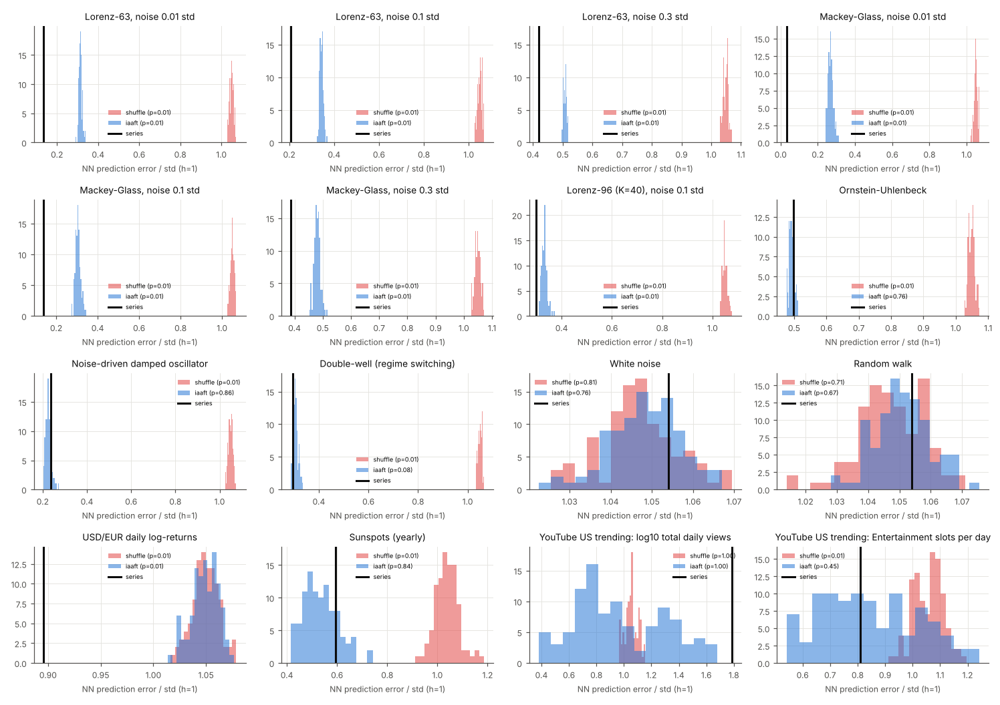
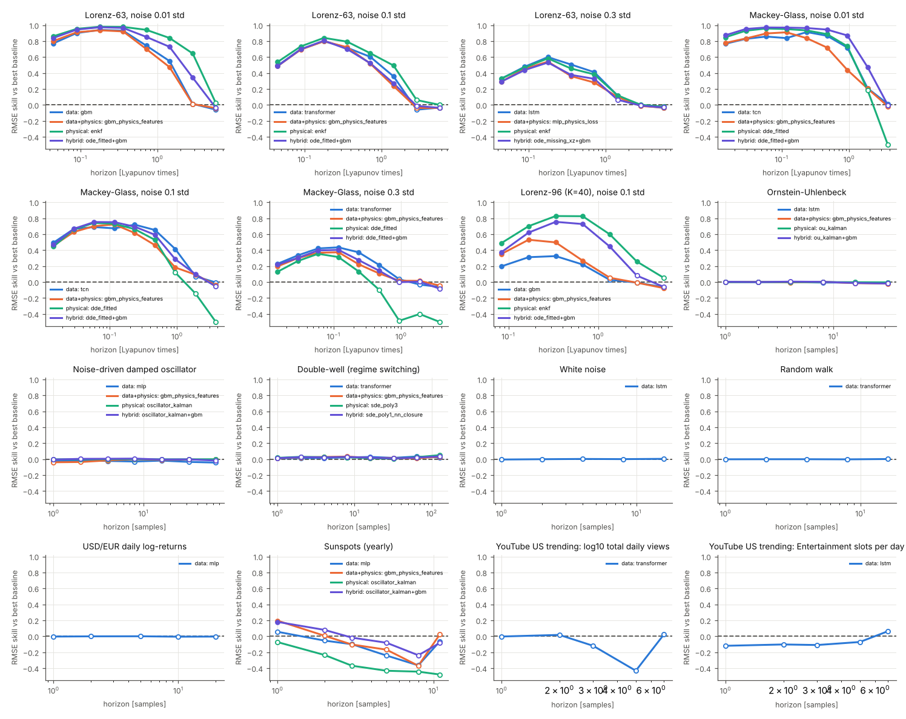
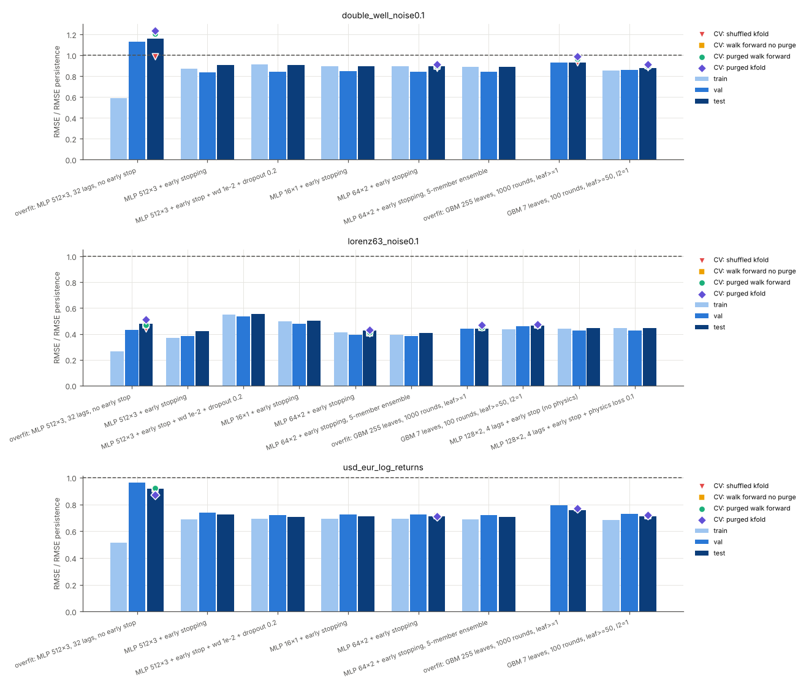
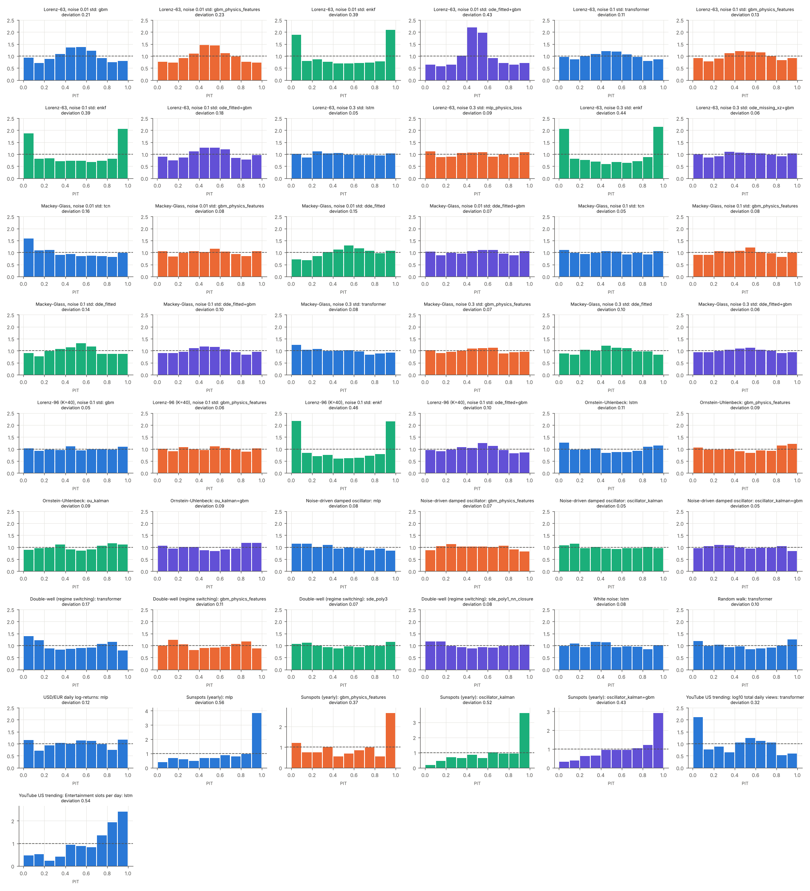
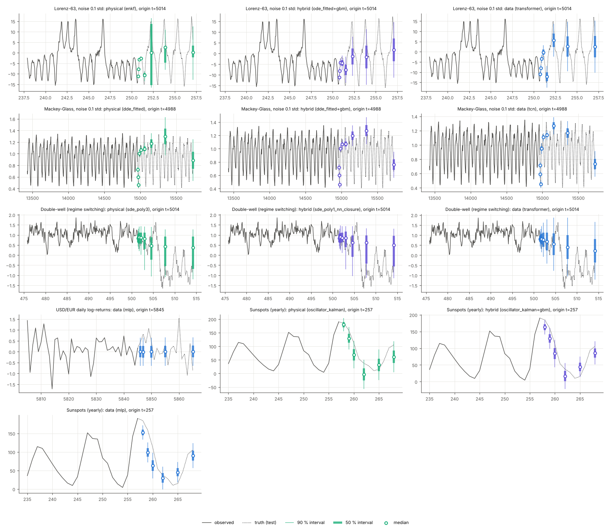
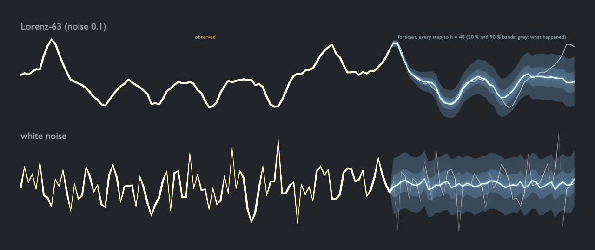
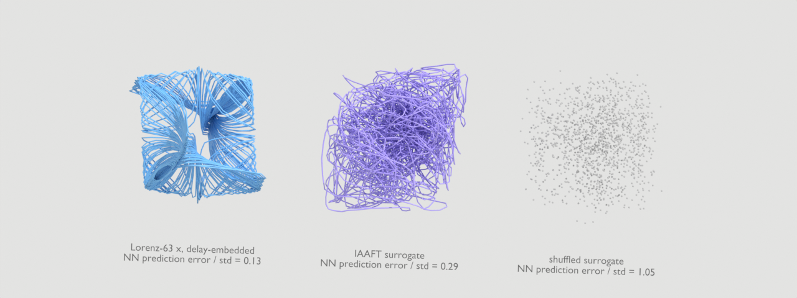
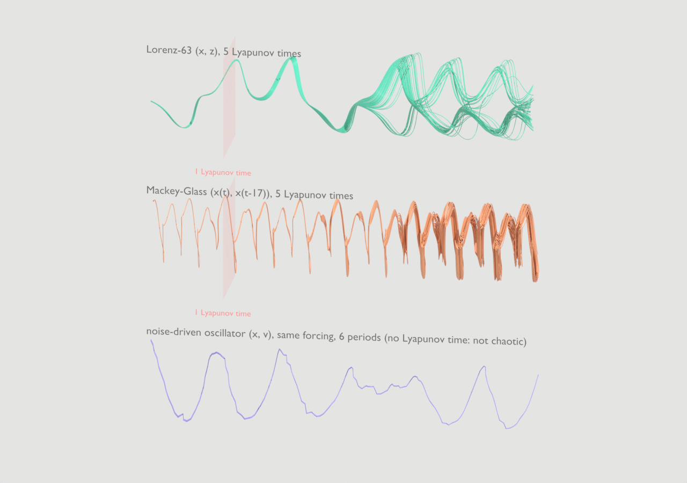
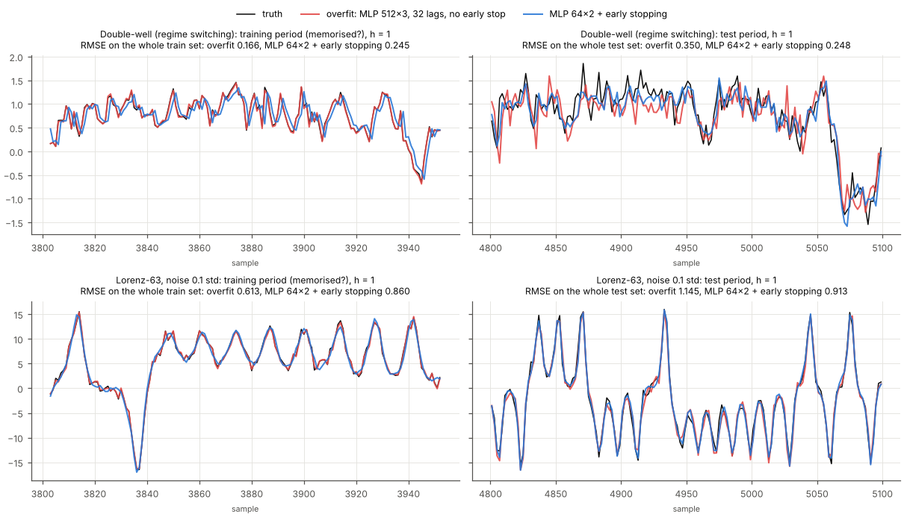
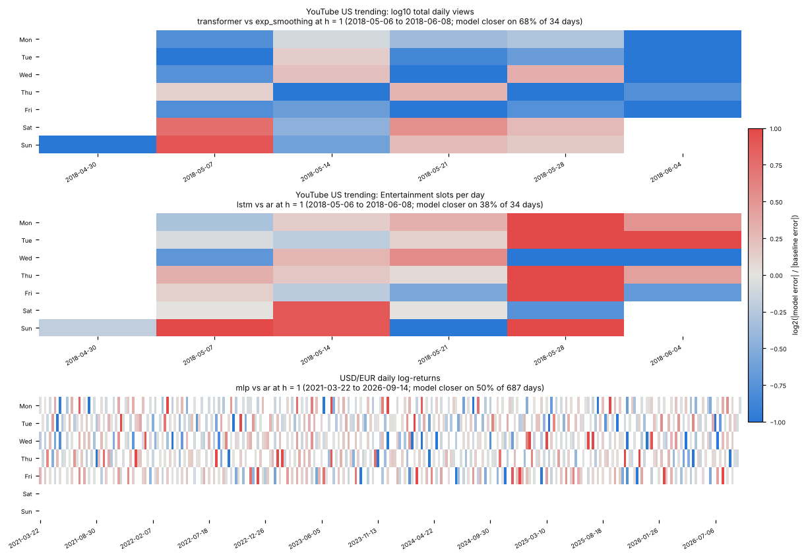

# Forecasting near-random series without overfitting

Some series are almost random: chaotic systems observed with noise, noise-driven physical systems, financial
returns. A flexible model always finds *something* in them on its training data. This guide gives measured answers
to four questions:

1. Is there anything predictable at all, and how do you know before fitting a model?
2. How far ahead can each model family forecast before its skill falls back to a baseline?
3. Which training choices actually prevent overfitting, and by how much?
4. How do the point and probabilistic scores compare once the differences are tested for significance?

Everything here comes from two scripts:
[`examples/near_random_forecasting/run_study.py`](../../examples/near_random_forecasting/run_study.py) runs the
study and [`render_visuals.py`](../../examples/near_random_forecasting/render_visuals.py) draws the
[visual pack](#visual-pack) from its results. Their results
are committed in `examples/near_random_forecasting/results/`: one JSON per series, the overfitting studies, and
`tables.md`, from which every table below is copied. The figures are in `examples/near_random_forecasting/figures/`.
The library pieces live in `pinneapple_systems.time_series` (`predictability`, `synthetic`, `forecast_lab`,
`metrics_ext`, `validation`, `datasets.public`) and are tested in `tests/test_near_random_forecasting.py` and
`tests/test_near_random_visuals.py`.

## Quick start

```python
from pinneapple_systems.time_series.predictability import predictability_report
from pinneapple_systems.time_series.forecast_lab import presets
from pinneapple_systems.time_series.forecast_lab.study import run_zoo

c = presets.case("double_well", n=1500)                       # series, protocol and model zoo
report = predictability_report(c.data.y, horizons=c.protocol.horizons, dt=c.data.dt, n_surrogates=19)
print(report["surrogate_tests"]["npe_iaaft"]["p_value"])      # more structure than a linear Gaussian process?
res = run_zoo(c.data, c.specs[:6], c.protocol, budget=2)      # baselines + gradient boosting, purged CV tuning
print(res["models"]["gbm"]["test"]["skill_rmse"], res["models"]["gbm"]["skill_horizon_vs_best_baseline"])
```

Your own series: wrap it in `SeriesData(obs, target=0, dt=...)`, pick horizons for a `Protocol`, and list
`ModelSpec(name, family, factory, grid)` entries. Every forecaster implements
`fit(data, train_origins, val_origins, horizons)` and `predict(data, origins) -> Forecast` (a mean plus a Gaussian
standard deviation or ensemble samples).

## The protocol

The same rules for every series and every model (`forecast_lab.study`):

* **Test period fixed first.** The last 20 % of each series is the test period. It is set before any tuning and
  touched once, by the final fitted model. Every forecast is made from an *origin* t using data up to t only, and
  targets t + h for each horizon h. Forecasts are direct (one output per horizon), not iterated.
* **Validation block, purged.** The last 15 % of the development part (everything before the test period) is the
  validation block. It is used for early stopping, for calibrating the predictive spread of point forecasters, and
  for choosing each family's representative. Training origins stop at least max(h) samples before it, so no
  training label falls inside it (purge = largest horizon). Validation labels never reach the test period.
* **Purged walk-forward tuning.** Each tuned model gets the same budget: 4 configurations drawn from its grid
  (`presets.BUDGET`). Each configuration is scored on 3 walk-forward folds of the development part (2 for
  sunspots). Each fold has a purged inner block for early stopping. The score is the mean over horizons of
  RMSE / RMSE(persistence), so all horizons weigh the same. The best configuration is refitted once on the final
  split.
* **Same origins for everyone.** All models of a series start at the same first origin (the longest input window
  in the zoo), and are scored on the same test origins (every second one, every one for the sunspots; 51 to 687 per series).
* **Scores** (`study.evaluate`), per horizon:
  * MAE and RMSE, and skill = 1 − RMSE / RMSE(reference).
  * CRPS: closed form for Gaussian forecasts, the fair ensemble estimator for ensembles; skill against
    climatology.
  * Coverage of the central 50, 80 and 95 % intervals, and the PIT histogram with its mean absolute deviation from
    flat (0 = flat).
  * A point forecaster gets a Gaussian predictive distribution whose standard deviation at each horizon is its RMSE
    on the validation block. Physical models with filters or SDEs produce their own distributions: Kalman, EnKF
    and Euler–Maruyama ensembles.
* **Tests.** One-sided Diebold–Mariano tests on squared errors (HLN small-sample correction, long-run variance up
  to the overlap of h-step errors) against persistence and against the *best baseline*: at each horizon, the
  baseline with the lowest validation RMSE, so the reference is not picked on the test period. The p-values are
  Holm-adjusted across all non-baseline models at each horizon (family-wise error 5 %), and Benjamini–Hochberg
  q-values over all model × horizon tests are stored too.
* **"Last horizon with skill"** is the largest h such that, at every horizon up to h, the skill is positive and the
  Holm-adjusted p-value is below 0.05.

The zoo per series, defined in `forecast_lab.presets`:

| family | models |
|---|---|
| baseline | persistence, climatology (training mean and std), AR(p) by AIC, ARIMA(p ≤ 2, d ≤ 1, q ≤ 1) by AIC, simple exponential smoothing, seasonal naive (the value whole periods before the target) and phase-aligned mean cycle (`PhaseClimatology`: the training cycle, re-aligned to the phase of each origin by least squares over the last 1 or 3 periods; tuned). The period is the highest peak of the training periodogram. |
| data | gradient boosting on lags (scikit-learn histogram GBM, one per horizon), MLP, LSTM (`time_series.models.LSTMForecaster`), TCN (`TCNForecaster`), transformer (`pinneapple_neural` `VanillaTransformer`) |
| data + physics | GBM with physics features (the fitted vector field or drift at the origin state, or the Kalman-filtered state and energy); MLP with a physics-residual loss on the predicted path (fully observed ODEs; λ ∈ {0, 0.01, 0.1, 1} tuned) |
| physical | the governing ODE / delay ODE with parameters fitted by multiple shooting on the training data, deliberately misspecified versions (Lorenz-63 without the −xz term, Mackey–Glass with delay 14 instead of 17, an OU model of the oscillator and of the double well), SINDy, EnKF (40 members) on the fitted ODE, Kalman-filtered linear SDEs (OU, damped oscillator), SDE drift regression with Euler–Maruyama ensembles |
| hybrid | physical forecast + GBM correction (correct and misspecified physics), UDE: misspecified Lorenz-63 + neural closure trained through the integrator, linear drift + neural drift closure for the double well |

Prior knowledge given to the physical models (assumptions): the structure of the equations, initial parameter
guesses 20–30 % off, the Mackey–Glass delay (17) and exponent (10), the Lorenz-96 dimension. Physical models
never see the true parameters.

## The series

| series | what it is | samples | step | noise |
|---|---|---|---|---|
| Lorenz-63 | chaotic ODE, x, y, z observed, x forecast | 6000 | 0.05 | 0.01, 0.1, 0.3 × std per variable |
| Mackey–Glass | chaotic delay ODE (τ = 17), scalar | 6000 | 3 | 0.01, 0.1, 0.3 × std |
| Lorenz-96 | 40 variables, F = 8, all observed, x₀ forecast | 6000 | 0.05 | 0.1 × std |
| Ornstein–Uhlenbeck | θ = 1, σ = 1, exact sampling | 6000 | 0.1 | 0.1 × std |
| damped oscillator | ω = 1, ζ = 0.05, white-noise forcing σ = 0.3, position observed | 6000 | 0.25 | 0.1 × std |
| double well | dx = (x − x³) dt + 0.7 dW: noise-driven switching between two regimes | 6000 | 0.1 | 0.1 × std |
| white noise, random walk | controls | 6000 | 1 | – |
| USD/EUR daily log-returns (%) | FRED DEXUSEU via the [datasets/exchange-rates](https://github.com/datasets/exchange-rates) package (ODC-PDDL), 1999-01-05 to 2026-10-09, pinned commit and SHA-256 | 6964 | 1 day | real |
| sunspots | yearly mean sunspot number 1700–2008, NOAA NGDC (public domain), as shipped by statsmodels | 309 | 1 year | real |
| YouTube US trending, daily | log10 of the total views of the ~200 trending entries, and the number of Entertainment (category 24) entries; see [section 5](#5-a-real-daily-series-youtube-trending) | 205 | 1 trending day | real |

The largest Lyapunov exponents come from the equations (Benettin two-trajectory method,
`synthetic.largest_lyapunov_benettin`, natural logarithm per unit time):
* 0.893 for Lorenz-63 (Sprott 2003, *Chaos and Time-Series Analysis*, gives 0.906);
* 0.0049 for Mackey–Glass (`synthetic.mackey_glass_lyapunov`, a perturbation of the whole delay history,
  50 000 time units at step 0.1);
* 1.677 for Lorenz-96.

One Lyapunov time (LT) is 22 samples for Lorenz-63, 68 for Mackey–Glass and 12 for Lorenz-96.

The Mackey–Glass value was checked for convergence (`pipeline.lyapunov_study`,
`results/lyapunov_mackey_glass.json`; three seeds each, which change the initial history and the perturbation
direction):

| step | 10 000 time units | 50 000 | 200 000 |
|---|---|---|---|
| 0.1 | 0.00481 ± 0.00056 | 0.00498 ± 0.00017 | 0.00501 ± 0.00015 |
| 0.05 | 0.00509 ± 0.00033 | 0.00504 ± 0.00003 | 0.00516 ± 0.00003 |

* At 10 000 time units (the first version of this study used one such run, 0.0046) the seed alone moves the
  estimate by about ±10 %.
* With longer runs the estimate settles at 0.0050 (step 0.1) to 0.0052 (step 0.05). The 3 % dependence on the
  step is presumably the integration error of the delayed term, which is interpolated linearly at the half step.
* The value used for the LT axes (0.0049) is within 5 % of the finest estimate.
* **Unverified comparison.** A reviewer quoted 0.006 to 0.007 for τ = 17 from Farmer (1982, Physica D 4:366) and
  Wolf et al. (1985, Physica D 16:285). Neither paper could be opened from this environment (publisher sites and
  arXiv were not reachable), so their values, units and settings are not checked here. Our converged value is 13
  to 29 % below that range.
* **Hypothesis, not a finding:** if those values are in bits per unit time, they would be 0.0042–0.0049 in natural
  log, consistent with ours. This was not verified.

## 1. Is there anything to predict?

`predictability_report(y)` runs before any model. It fits an AR model (order by AIC, in-sample one-step R²),
computes the permutation entropy (order 5, 1 = i.i.d.) and the sample entropy (m = 2, r = 0.2 std), and estimates
the Rosenstein exponent on a delay embedding. It then runs surrogate tests with 99 surrogates each:

* The statistic is the out-of-sample error of a nearest-neighbour predictor (NPE, one-sided) and the time-reversal
  asymmetry (TRA, two-sided).
* *Shuffled* surrogates test for any temporal structure.
* *IAAFT* surrogates test for structure beyond a linear Gaussian process seen through a monotone transform.
* A series with an AR(1) coefficient above 0.99 is tested on its differences.

The verdict column reads "nonlinear structure" if either IAAFT test rejects at 5 %, "linear structure only" if
only the shuffle test rejects.

| series | AR order (R² 1-step) | perm. entropy | sample entropy | Rosenstein λ (true λ) | NPE / std | p shuffle | p IAAFT | p TRA IAAFT | verdict |
|---|---|---|---|---|---|---|---|---|---|
| Lorenz-63, noise 0.01 std | 14 (0.99) | 0.43 | 0.44 | 0.89 (0.893) | 0.13 | 0.01 | 0.01 | 0.53 | nonlinear structure |
| Lorenz-63, noise 0.1 std | 13 (0.95) | 0.67 | 0.72 | 0.73 (0.893) | 0.21 | 0.01 | 0.01 | 0.75 | nonlinear structure |
| Lorenz-63, noise 0.3 std | 14 (0.80) | 0.91 | 1.38 | 0.64 (0.893) | 0.42 | 0.01 | 0.01 | 0.97 | nonlinear structure |
| Mackey-Glass, noise 0.01 std | 20 (0.99) | 0.59 | 0.62 | 0.01 (0.005) | 0.03 | 0.01 | 0.01 | 0.04 | nonlinear structure |
| Mackey-Glass, noise 0.1 std | 20 (0.94) | 0.64 | 0.86 | 0.01 (0.005) | 0.14 | 0.01 | 0.01 | 0.09 | nonlinear structure |
| Mackey-Glass, noise 0.3 std | 19 (0.81) | 0.83 | 1.50 | 0.01 (0.005) | 0.39 | 0.01 | 0.01 | 0.39 | nonlinear structure |
| Lorenz-96 (K=40), noise 0.1 std | 8 (0.95) | 0.74 | 0.82 | 0.76 (1.677) | 0.30 | 0.01 | 0.01 | 0.01 | nonlinear structure |
| Ornstein-Uhlenbeck | 2 (0.80) | 0.94 | 1.41 | 0.14 | 0.50 | 0.01 | 0.76 | 0.84 | linear structure only |
| Noise-driven damped oscillator | 14 (0.97) | 0.68 | 0.87 | 0.17 | 0.24 | 0.01 | 0.86 | 0.26 | linear structure only |
| Double-well (regime switching) | 6 (0.93) | 0.95 | 0.91 | 0.20 | 0.30 | 0.01 | 0.08 | 0.89 | linear structure only |
| White noise | 0 (0.00) | 1.00 | 2.20 | 0.00 | 1.05 | 0.81 | 0.76 | 0.88 | no structure found |
| Random walk | 0 (0.00) | 1.00 | 2.20 | -0.00 | 1.05 | 0.71 | 0.67 | 0.98 | no structure found (tested on differences) |
| USD/EUR daily log-returns | 0 (0.00) | 1.00 | 1.97 | 0.00 | 0.90 | 0.01 | 0.01 | 0.15 | nonlinear structure |
| Sunspots (yearly) | 9 (0.86) | 0.60 | 0.84 | 0.03 | 0.60 | 0.01 | 0.84 | 0.01 | nonlinear structure |



What this says:

* The tests call every control correctly. White noise and the random walk (tested on its increments) show no
  structure: permutation entropy 1.00, AR order 0, no rejection. OU and the oscillator show linear structure only.
  All chaotic series reject the IAAFT null.
* The double well (IAAFT p = 0.08) is called linear at 5 %. At this sampling step and noise level, its regime
  switching is not distinguishable from a linear Gaussian process by these two statistics.
* The USD/EUR returns reject both nulls, but the entropy is 1.00 and the AR order is 0. The structure is in a
  nonlinear statistic, not in the mean. Volatility clustering of returns is the usual explanation; that is an
  interpretation, which this study did not test. As section 2 shows, no model forecasts the mean return better than
  the baseline. **A rejected surrogate test says there is structure, not that the structure is forecastable.**
* The sunspots reject the time-reversal null (p = 0.01): cycles rise faster than they decay.
* The Rosenstein exponent is unreliable. It gives 0.20 for the (non-chaotic) double well and 0.14 and 0.17 for the
  linear OU and oscillator. For Lorenz-96 it gives 0.76, against the true 1.68: a scalar embedding of a
  40-dimensional system does not recover it. For Mackey–Glass it is 1.1 to 1.7 times the Benettin value (0.0052 to
  0.0085, against 0.0049). The estimate also depends on the fit window of the divergence curve; the default here is
  samples 5–30, and `tests/test_near_random_forecasting.py` only asks for 0.6–1.3 on noise-free Lorenz-63 (true
  0.906). Use it only next to a surrogate test, never alone.

The surrogate-trained twins check whether a model learned more than the linear correlations. The same GBM is
trained once on the real development data and once on an IAAFT surrogate of it (and on a shuffled one), then both
are scored on the real test period. The table gives the RMSE skill against persistence, averaged over horizons.

| series | GBM trained on real data | on IAAFT surrogate | on shuffled surrogate | real − IAAFT |
|---|---|---|---|---|
| Lorenz-63, noise 0.01 std | 0.67 | 0.24 | -0.34 | 0.42 |
| Lorenz-63, noise 0.1 std | 0.51 | 0.20 | -0.30 | 0.31 |
| Lorenz-63, noise 0.3 std | 0.33 | 0.15 | -0.09 | 0.17 |
| Mackey-Glass, noise 0.01 std | 0.85 | 0.51 | -0.07 | 0.34 |
| Mackey-Glass, noise 0.1 std | 0.73 | 0.49 | -0.06 | 0.25 |
| Mackey-Glass, noise 0.3 std | 0.56 | 0.43 | 0.03 | 0.12 |
| Lorenz-96 (K=40), noise 0.1 std | 0.27 | 0.24 | -0.33 | 0.03 |
| Ornstein-Uhlenbeck | 0.11 | 0.11 | -0.31 | 0.00 |
| Noise-driven damped oscillator | 0.51 | 0.50 | -0.29 | 0.01 |
| Double-well (regime switching) | 0.11 | 0.07 | -0.83 | 0.04 |
| White noise | 0.28 | 0.28 | 0.28 | -0.00 |
| Random walk | -0.03 | -0.04 | -14.95 | 0.01 |
| USD/EUR daily log-returns | 0.28 | 0.28 | 0.28 | 0.01 |
| Sunspots (yearly) | 0.39 | 0.34 | 0.02 | 0.05 |

The real-trained model beats its IAAFT twin only on the chaotic series (by 0.12 to 0.42 for Lorenz-63 and
Mackey–Glass) and, slightly, on the double well (0.04) and the sunspots (0.05). On OU, the oscillator, the noise controls and USD/EUR the
difference is 0.00 to 0.01: whatever the GBM learned there, a linear Gaussian process with the same spectrum
teaches it too. On white noise and USD/EUR, the 0.28 skill against persistence is just the gain of forecasting the
mean instead of the last value; the shuffled twin gets the same 0.28. Lorenz-96 seen through a single variable
(0.03) is nearly linear-looking: the univariate GBM cannot use the other 39 variables. The random walk's shuffled
twin (−14.95) is meaningless: shuffling the levels of a random walk destroys it. It is kept to show what a broken
surrogate looks like.

## 2. How far ahead?

The skill of each family's representative is plotted against the horizon, relative to the best baseline. The
representative is the family member with the best validation score, not the best on test. Horizons are in
Lyapunov times for the chaotic series. Filled markers are significant after Holm adjustment.



The table gives the last horizon with significant positive skill, against persistence and against the best
baseline. The horizons in samples (and LT) are listed per series.

| series | horizons | data: best (val) / last h with skill | data+physics: best (val) / last h with skill | physical: best (val) / last h with skill | hybrid: best (val) / last h with skill |
|---|---|---|---|---|---|
| Lorenz-63, noise 0.01 std | 1, 2, 4, 8, 16, 32, 64, 128 | gbm: 128 (5.72 LT) / 32 (1.43 LT) | gbm_physics_features: 128 (5.72 LT) / 32 (1.43 LT) | enkf: 128 (5.72 LT) / 64 (2.86 LT) | ode_fitted+gbm: 128 (5.72 LT) / 64 (2.86 LT) |
| Lorenz-63, noise 0.1 std | 1, 2, 4, 8, 16, 32, 64, 128 | transformer: 128 (5.72 LT) / 32 (1.43 LT) | gbm_physics_features: 128 (5.72 LT) / 32 (1.43 LT) | enkf: 128 (5.72 LT) / 32 (1.43 LT) | ode_fitted+gbm: 128 (5.72 LT) / 32 (1.43 LT) |
| Lorenz-63, noise 0.3 std | 1, 2, 4, 8, 16, 32, 64, 128 | lstm: 128 (5.72 LT) / 32 (1.43 LT) | mlp_physics_loss: 128 (5.72 LT) / 32 (1.43 LT) | enkf: 128 (5.72 LT) / 32 (1.43 LT) | ode_missing_xz+gbm: 128 (5.72 LT) / 16 (0.71 LT) |
| Mackey-Glass, noise 0.01 std | 1, 2, 4, 8, 16, 32, 64, 128, 256 | tcn: 256 (3.76 LT) / 128 (1.88 LT) | gbm_physics_features: 256 (3.76 LT) / 128 (1.88 LT) | dde_fitted: 256 (3.76 LT) / 64 (0.94 LT) | dde_fitted+gbm: 256 (3.76 LT) / 128 (1.88 LT) |
| Mackey-Glass, noise 0.1 std | 1, 2, 4, 8, 16, 32, 64, 128, 256 | tcn: 256 (3.76 LT) / 64 (0.94 LT) | gbm_physics_features: 256 (3.76 LT) / 128 (1.88 LT) | dde_fitted: 256 (3.76 LT) / 32 (0.47 LT) | dde_fitted+gbm: 256 (3.76 LT) / 128 (1.88 LT) |
| Mackey-Glass, noise 0.3 std | 1, 2, 4, 8, 16, 32, 64, 128, 256 | transformer: 256 (3.76 LT) / 32 (0.47 LT) | gbm_physics_features: 256 (3.76 LT) / 32 (0.47 LT) | dde_fitted: 256 (3.76 LT) / 16 (0.24 LT) | dde_fitted+gbm: 256 (3.76 LT) / 32 (0.47 LT) |
| Lorenz-96 (K=40), noise 0.1 std | 1, 2, 4, 8, 16, 32, 64 | gbm: 64 (5.37 LT) / 8 (0.67 LT) | gbm_physics_features: 64 (5.37 LT) / 8 (0.67 LT) | enkf: 64 (5.37 LT) / 32 (2.68 LT) | ode_fitted+gbm: 64 (5.37 LT) / 16 (1.34 LT) |
| Ornstein-Uhlenbeck | 1, 2, 4, 8, 16, 32 | lstm: 32 / none | gbm_physics_features: 32 / none | ou_kalman: 32 / none | ou_kalman+gbm: 32 / none |
| Noise-driven damped oscillator | 1, 2, 4, 8, 16, 32, 64 | mlp: 64 / none | gbm_physics_features: 64 / none | oscillator_kalman: 64 / none | oscillator_kalman+gbm: 64 / none |
| Double-well (regime switching) | 1, 2, 4, 8, 16, 32, 64, 128 | transformer: 16 / none | gbm_physics_features: 16 / none | sde_poly3: 8 / none | sde_poly1_nn_closure: 16 / none |
| White noise | 1, 2, 4, 8, 16 | lstm: 16 / none | – | – | – |
| Random walk | 1, 2, 4, 8, 16 | transformer: none / none | – | – | – |
| USD/EUR daily log-returns | 1, 2, 5, 10, 20 | mlp: 20 / none | – | – | – |
| Sunspots (yearly) | 1, 2, 3, 5, 8, 11 | mlp: 8 / none | gbm_physics_features: 8 / 1 | oscillator_kalman: 8 / none | oscillator_kalman+gbm: 8 / 1 |

* **Against persistence everything looks good**, up to the longest horizon on most series, because persistence is
  a poor forecast once the horizon passes the correlation time
  ([figure](../../examples/near_random_forecasting/figures/skill_vs_persistence.png)). Against the best baseline
  (chosen on validation at each horizon: AR or ARIMA, and on Mackey–Glass the phase-aligned mean cycle from
  h = 16 on) the picture is honest:
  * Lorenz-63: 1.4 LT for every family at noise 0.1, and at noise 0.3 except the hybrid (0.7 LT). At noise 0.01
    the EnKF and the hybrid reach 2.9 LT and the data models 1.4 LT.
  * Mackey–Glass: 1.9 LT for the data, data + physics and hybrid families at noise 0.01. At noise 0.1 it is
    1.9 LT for data + physics and hybrid and 0.9 LT for the data family. At noise 0.3 it is 0.5 LT for all three.
    The fitted delay equation alone stops earlier: 0.9, 0.5 and 0.2 LT.
  * Lorenz-96: 2.7 LT for the EnKF, 1.3 LT for the hybrid, 0.7 LT for the data and data + physics families.
* **Linear stochastic series: no family beats the linear baseline at any horizon.** That is the correct answer.
  The fitted Kalman models recover the true parameters:
  * OU: θ = 0.994, σ = 0.990 (true 1, 1).
  * oscillator: ω = 0.995, ζ = 0.059, σ = 0.308 (true 1, 0.05, 0.3).

  They are then *equal* to ARIMA, not better, because a linear SDE sampled at a fixed step is an ARMA process.
* **Double well: no significant skill over ARIMA** for any family. The mean gains are at most 0.05. The drift
  regression recovers the cubic drift shape, 0.80 x − 0.92 x³ against the true x − x³: the coefficients shrink
  towards zero because of the observation noise, as stated in the assumptions.
* **Noise controls and USD/EUR returns: nothing beats the baseline**, at any horizon, for any of the five
  data-driven models. That is the correct answer, and the protocol reports it as "none".
* **Sunspots** (51 test origins from 1947, targets up to 2008): only the data + physics and hybrid representatives
  beat the best baseline (AR(18)), and only one year ahead. The fitted oscillator alone has a period of
  2π/0.637 = 9.9 years and ζ = 0.32, and it is worse than the best baseline at every horizon.

**Misspecified physics, measured** (Lorenz-63, noise 0.1, skill against the best baseline at h = 1, 2, 4, 8, 16):

| model | skill |
|---|---|
| ODE without −xz | 0.36, 0.30, 0.10, 0.00, −0.01 |
| + GBM correction | 0.49, 0.69, 0.80, 0.70, 0.53 |
| UDE closure | 0.47, 0.68, 0.79, 0.66, 0.30 |
| correct ODE + EnKF | 0.54, 0.73, 0.84, 0.79, 0.65 |

Both repairs work at short horizons. The UDE falls below the baseline after about 1 LT (−0.09 at h = 32). With a
wrong delay (noise 0.01), the Mackey–Glass model's skill against persistence swings between −0.64 and +0.75 across
horizons. A GBM correction brings it to 0.60–0.99 at every horizon.

## 3. What prevents overfitting, measured

Ten training variants (eight on the series without physics) were run on three series. Each was trained on the
final split and scored by:

* its error on its training origins, on the validation block and on the untouched test period;
* the cross-validation estimate of four schemes (for the deliberately overfit models and two regularised
  references): shuffled k-fold, walk-forward without purge, purged walk-forward, and purged k-fold with an embargo
  of max(h).

The error is the mean over horizons of RMSE / RMSE(persistence) on the same origins (1 = no better than
persistence), so periods of different volatility compare. RMSE divided by the series std is stored too.

| series | variant | params | train | val | test | test − train | CV: shuffled k-fold | CV: walk-forward, no purge | CV: purged walk-forward | CV: purged k-fold + embargo |
|---|---|---|---|---|---|---|---|---|---|---|
| Double-well (regime switching) | overfit: MLP 512x3, 32 lags, no early stop | 546312 | 0.587 | 1.132 | 1.159 | 0.572 | 0.990 | 1.207 | 1.205 | 1.239 |
| Double-well (regime switching) | MLP 512x3 + early stopping | 546312 | 0.872 | 0.837 | 0.908 | 0.036 |  |  |  |  |
| Double-well (regime switching) | MLP 512x3 + early stop + wd 1e-2 + dropout 0.2 | 546312 | 0.912 | 0.843 | 0.909 | -0.003 |  |  |  |  |
| Double-well (regime switching) | MLP 16x1 + early stopping | 408 | 0.896 | 0.850 | 0.893 | -0.003 |  |  |  |  |
| Double-well (regime switching) | MLP 64x2 + early stopping | 5768 | 0.894 | 0.843 | 0.894 | 0.000 | 0.878 | 0.897 | 0.896 | 0.911 |
| Double-well (regime switching) | MLP 64x2 + early stopping, 5-member ensemble | 28840 | 0.889 | 0.842 | 0.889 | 0.000 |  |  |  |  |
| Double-well (regime switching) | overfit: GBM 255 leaves, 1000 rounds, leaf>=1 | 4072000 | 0.000 | 0.929 | 0.933 | 0.933 | 0.932 | 0.964 | 0.966 | 0.988 |
| Double-well (regime switching) | GBM 7 leaves, 100 rounds, leaf>=50, l2=1 | 10400 | 0.853 | 0.862 | 0.879 | 0.026 | 0.882 | 0.900 | 0.896 | 0.913 |
| Lorenz-63, noise 0.1 std | overfit: MLP 512x3, 32 lags, no early stop | 579080 | 0.265 | 0.429 | 0.476 | 0.212 | 0.438 | 0.467 | 0.468 | 0.511 |
| Lorenz-63, noise 0.1 std | MLP 512x3 + early stopping | 579080 | 0.369 | 0.383 | 0.423 | 0.054 |  |  |  |  |
| Lorenz-63, noise 0.1 std | MLP 512x3 + early stop + wd 1e-2 + dropout 0.2 | 579080 | 0.548 | 0.533 | 0.554 | 0.006 |  |  |  |  |
| Lorenz-63, noise 0.1 std | MLP 16x1 + early stopping | 920 | 0.498 | 0.478 | 0.504 | 0.005 |  |  |  |  |
| Lorenz-63, noise 0.1 std | MLP 64x2 + early stopping | 7816 | 0.410 | 0.395 | 0.426 | 0.017 | 0.401 | 0.409 | 0.414 | 0.432 |
| Lorenz-63, noise 0.1 std | MLP 64x2 + early stopping, 5-member ensemble | 39080 | 0.393 | 0.385 | 0.408 | 0.016 |  |  |  |  |
| Lorenz-63, noise 0.1 std | overfit: GBM 255 leaves, 1000 rounds, leaf>=1 | 4072000 | 0.000 | 0.439 | 0.438 | 0.438 | 0.457 | 0.450 | 0.450 | 0.469 |
| Lorenz-63, noise 0.1 std | GBM 7 leaves, 100 rounds, leaf>=50, l2=1 | 10400 | 0.434 | 0.461 | 0.465 | 0.031 | 0.465 | 0.467 | 0.469 | 0.472 |
| Lorenz-63, noise 0.1 std | MLP 128x2, 4 lags + early stop (no physics) | 67712 | 0.442 | 0.427 | 0.446 | 0.004 |  |  |  |  |
| Lorenz-63, noise 0.1 std | MLP 128x2, 4 lags + early stop + physics loss 0.1 | 67712 | 0.444 | 0.428 | 0.447 | 0.003 |  |  |  |  |
| USD/EUR daily log-returns | overfit: MLP 512x3, 32 lags, no early stop | 544773 | 0.516 | 0.965 | 0.919 | 0.403 | 0.862 | 0.919 | 0.921 | 0.870 |
| USD/EUR daily log-returns | MLP 512x3 + early stopping | 544773 | 0.689 | 0.737 | 0.723 | 0.034 |  |  |  |  |
| USD/EUR daily log-returns | MLP 512x3 + early stop + wd 1e-2 + dropout 0.2 | 544773 | 0.694 | 0.720 | 0.708 | 0.014 |  |  |  |  |
| USD/EUR daily log-returns | MLP 16x1 + early stopping | 357 | 0.694 | 0.725 | 0.711 | 0.017 |  |  |  |  |
| USD/EUR daily log-returns | MLP 64x2 + early stopping | 5573 | 0.695 | 0.724 | 0.710 | 0.015 | 0.714 | 0.714 | 0.715 | 0.713 |
| USD/EUR daily log-returns | MLP 64x2 + early stopping, 5-member ensemble | 27865 | 0.691 | 0.721 | 0.708 | 0.017 |  |  |  |  |
| USD/EUR daily log-returns | overfit: GBM 255 leaves, 1000 rounds, leaf>=1 | 2545000 | 0.000 | 0.796 | 0.756 | 0.756 | 0.779 | 0.776 | 0.776 | 0.773 |
| USD/EUR daily log-returns | GBM 7 leaves, 100 rounds, leaf>=50, l2=1 | 6500 | 0.684 | 0.728 | 0.713 | 0.028 | 0.720 | 0.717 | 0.718 | 0.721 |



* **The train–test gap is the detector.** The deliberately overfit models have gaps of 0.21 to 0.57 (wide MLP, no
  early stopping) and 0.44 to 0.93 (GBM with 255 leaves, which drives its training error to 0). Every early-stopped
  model has a gap of 0.054 or less.
* **Early stopping on a purged validation block is the single most effective choice.** The same 546k-parameter
  MLP goes from a test error of 1.159 to 0.908 (double well), 0.919 to 0.723 (USD/EUR) and 0.476 to 0.423
  (Lorenz-63) when it stops on the validation block.
* **Model size matters less than stopping.** A 16-unit MLP (357 to 920 parameters) and an early-stopped
  546k-parameter MLP score within 0.015 of each other on the double well and USD/EUR. On Lorenz-63 the large one is better (0.423 against
  0.504), so smaller is not automatically safer.
* **Weight decay 1e-2 plus dropout 0.2** on top of early stopping changes the test error by −0.015 (USD/EUR),
  +0.001 (double well) and +0.131 (Lorenz-63, where it under-fits).
* **A 5-member ensemble** improves on its single member by 0.002 to 0.018.
* **The physics-residual loss changes nothing measurable** here: 0.447 with λ = 0.1 against 0.446 without, on
  Lorenz-63. In the zoo, the tuner picked λ = 0 at noise 0.01, 0.1 at noise 0.1, 0.01 at noise 0.3 and 1 on
  Lorenz-96.
* **Which CV scheme to trust.** For the regularised models (MLP 64x2, GBM with 7 leaves), the four schemes agree
  within 0.04 of each other and of the test error. For the overfit MLP they differ: shuffled k-fold gave the lowest
  (most optimistic) estimate of the four in all three series. Double well: 0.990 shuffled against 1.159 on test. USD/EUR: 0.862 against
  0.919. Lorenz-63: 0.438 against 0.476. The purged walk-forward estimates were 1.205, 0.921 and 0.468, closer to
  test in each case. Walk-forward with and without purge gave nearly the same numbers here (largest difference
  0.005). With h ≤ 128 samples and several thousand training origins, the purge removes few samples; it matters
  more with long horizons and short series.

## 4. Point and probabilistic scores

For each series: persistence, climatology, AR, the phase-aligned mean cycle and the family representatives. Each cell is a list over the
horizons of that series.

| series | model | family | RMSE skill vs persistence per h | CRPS skill vs climatology per h | coverage of the central 80 % and 95 % intervals (mean over h) | PIT deviation (pooled) | params | final fit [s] |
|---|---|---|---|---|---|---|---|---|
| Lorenz-63, noise 0.01 std | persistence | baseline | 0.00 0.00 0.00 0.00 0.00 0.00 0.00 0.00 | 0.73 0.49 0.10 -0.25 -0.23 -0.26 -0.32 -0.38 | 0.78 (80 %), 0.94 (95 %) | 0.05 | 0 | 0.0 |
| Lorenz-63, noise 0.01 std | climatology | baseline | -2.74 -0.95 -0.12 0.19 0.25 0.24 0.26 0.28 | 0.00 0.00 0.00 0.00 0.00 0.00 0.00 0.00 | 0.74 (80 %), 0.97 (95 %) | 0.13 | 2 | 0.0 |
| Lorenz-63, noise 0.01 std | ar | baseline | 0.71 0.56 0.32 0.23 0.25 0.25 0.26 0.28 | 0.92 0.78 0.40 0.06 0.01 0.00 -0.00 -0.00 | 0.74 (80 %), 0.94 (95 %) | 0.12 | 16 | 0.4 |
| Lorenz-63, noise 0.01 std | phase_climatology | baseline | -2.98 -1.08 -0.21 0.13 0.20 0.20 0.21 0.23 | -0.06 -0.06 -0.07 -0.07 -0.06 -0.05 -0.06 -0.06 | 0.79 (80 %), 0.96 (95 %) | 0.11 | 668 | 0.6 |
| Lorenz-63, noise 0.01 std | gbm | data | 0.93 0.96 0.96 0.95 0.81 0.66 0.27 0.23 | 0.98 0.98 0.97 0.94 0.78 0.59 0.04 -0.06 | 0.83 (80 %), 0.95 (95 %) | 0.21 | 69600 | 3.5 |
| Lorenz-63, noise 0.01 std | gbm_physics_features | data+physics | 0.94 0.96 0.96 0.94 0.78 0.60 0.27 0.25 | 0.99 0.98 0.96 0.93 0.75 0.55 0.04 -0.04 | 0.85 (80 %), 0.95 (95 %) | 0.23 | 69600 | 3.1 |
| Lorenz-63, noise 0.01 std | enkf | physical | 0.96 0.98 0.99 0.98 0.96 0.88 0.74 0.29 | 0.99 0.99 0.99 0.98 0.97 0.95 0.82 0.16 | 0.57 (80 %), 0.70 (95 %) | 0.39 | 9 | 0.1 |
| Lorenz-63, noise 0.01 std | ode_fitted+gbm | hybrid | 0.95 0.98 0.98 0.97 0.89 0.80 0.51 0.25 | 0.99 0.99 0.98 0.97 0.85 0.76 0.42 -0.03 | 0.87 (80 %), 0.96 (95 %) | 0.43 | 10403 | 1.3 |
| Lorenz-63, noise 0.1 std | persistence | baseline | 0.00 0.00 0.00 0.00 0.00 0.00 0.00 0.00 | 0.70 0.47 0.10 -0.25 -0.24 -0.27 -0.33 -0.38 | 0.78 (80 %), 0.94 (95 %) | 0.05 | 0 | 0.0 |
| Lorenz-63, noise 0.1 std | climatology | baseline | -2.31 -0.90 -0.11 0.19 0.25 0.24 0.26 0.27 | 0.00 0.00 0.00 0.00 0.00 0.00 0.00 0.00 | 0.76 (80 %), 0.97 (95 %) | 0.14 | 2 | 0.0 |
| Lorenz-63, noise 0.1 std | ar | baseline | 0.24 0.26 0.19 0.22 0.25 0.25 0.26 0.27 | 0.77 0.61 0.28 0.04 0.01 0.00 -0.00 -0.00 | 0.75 (80 %), 0.95 (95 %) | 0.11 | 15 | 0.9 |
| Lorenz-63, noise 0.1 std | phase_climatology | baseline | -2.51 -1.01 -0.19 0.14 0.20 0.20 0.22 0.23 | -0.05 -0.05 -0.05 -0.06 -0.05 -0.05 -0.06 -0.05 | 0.79 (80 %), 0.96 (95 %) | 0.12 | 669 | 0.8 |
| Lorenz-63, noise 0.1 std | transformer | data | 0.62 0.78 0.84 0.78 0.70 0.52 0.22 0.25 | 0.89 0.88 0.86 0.76 0.66 0.40 -0.05 -0.03 | 0.82 (80 %), 0.95 (95 %) | 0.11 | 18056 | 22.8 |
| Lorenz-63, noise 0.1 std | gbm_physics_features | data+physics | 0.61 0.77 0.84 0.78 0.64 0.42 0.23 0.25 | 0.88 0.88 0.86 0.76 0.58 0.28 -0.03 -0.04 | 0.82 (80 %), 0.95 (95 %) | 0.13 | 69600 | 3.2 |
| Lorenz-63, noise 0.1 std | enkf | physical | 0.65 0.80 0.87 0.84 0.74 0.62 0.31 0.27 | 0.88 0.88 0.88 0.84 0.78 0.65 0.21 0.05 | 0.57 (80 %), 0.71 (95 %) | 0.39 | 9 | 0.1 |
| Lorenz-63, noise 0.1 std | ode_fitted+gbm | hybrid | 0.61 0.78 0.84 0.77 0.64 0.45 0.25 0.25 | 0.88 0.88 0.86 0.76 0.60 0.32 -0.00 -0.04 | 0.81 (80 %), 0.95 (95 %) | 0.18 | 31203 | 2.7 |
| Lorenz-63, noise 0.3 std | persistence | baseline | 0.00 0.00 0.00 0.00 0.00 0.00 0.00 0.00 | 0.53 0.37 0.05 -0.27 -0.26 -0.29 -0.35 -0.37 | 0.79 (80 %), 0.95 (95 %) | 0.05 | 0 | 0.0 |
| Lorenz-63, noise 0.3 std | climatology | baseline | -1.10 -0.59 -0.06 0.20 0.25 0.25 0.27 0.27 | 0.00 0.00 0.00 0.00 0.00 0.00 0.00 0.00 | 0.76 (80 %), 0.97 (95 %) | 0.15 | 2 | 0.0 |
| Lorenz-63, noise 0.3 std | ar | baseline | 0.05 0.09 0.14 0.22 0.26 0.25 0.27 0.27 | 0.55 0.43 0.19 0.03 0.01 0.00 0.00 -0.00 | 0.76 (80 %), 0.95 (95 %) | 0.12 | 15 | 0.1 |
| Lorenz-63, noise 0.3 std | phase_climatology | baseline | -1.22 -0.69 -0.13 0.15 0.20 0.20 0.22 0.23 | -0.05 -0.06 -0.06 -0.05 -0.06 -0.05 -0.06 -0.04 | 0.78 (80 %), 0.95 (95 %) | 0.17 | 670 | 1.6 |
| Lorenz-63, noise 0.3 std | lstm | data | 0.36 0.53 0.65 0.62 0.56 0.34 0.26 0.24 | 0.70 0.70 0.68 0.55 0.44 0.14 -0.01 -0.03 | 0.79 (80 %), 0.94 (95 %) | 0.05 | 18312 | 8.8 |
| Lorenz-63, noise 0.3 std | mlp_physics_loss | data+physics | 0.33 0.50 0.61 0.50 0.46 0.33 0.26 0.25 | 0.68 0.69 0.64 0.41 0.32 0.12 -0.01 -0.03 | 0.78 (80 %), 0.94 (95 %) | 0.09 | 67712 | 6.5 |
| Lorenz-63, noise 0.3 std | enkf | physical | 0.36 0.52 0.64 0.58 0.54 0.34 0.27 0.25 | 0.65 0.66 0.64 0.55 0.46 0.21 0.06 -0.00 | 0.55 (80 %), 0.70 (95 %) | 0.44 | 9 | 0.1 |
| Lorenz-63, noise 0.3 std | ode_missing_xz+gbm | hybrid | 0.33 0.49 0.60 0.51 0.50 0.30 0.26 0.25 | 0.68 0.68 0.63 0.44 0.36 0.09 -0.00 -0.03 | 0.80 (80 %), 0.95 (95 %) | 0.06 | 31203 | 2.9 |
| Mackey-Glass, noise 0.01 std | persistence | baseline | 0.00 0.00 0.00 0.00 0.00 0.00 0.00 0.00 0.00 | 0.57 0.18 -0.41 -0.92 0.22 0.27 -0.15 -0.67 -0.64 | 0.77 (80 %), 0.97 (95 %) | 0.10 | 0 | 0.0 |
| Mackey-Glass, noise 0.01 std | climatology | baseline | -1.32 -0.22 0.29 0.47 -0.25 -0.32 0.14 0.40 0.39 | 0.00 0.00 0.00 0.00 0.00 0.00 0.00 0.00 0.00 | 0.79 (80 %), 0.96 (95 %) | 0.30 | 2 | 0.0 |
| Mackey-Glass, noise 0.01 std | ar | baseline | 0.74 0.64 0.65 0.71 0.12 0.18 0.33 0.43 0.39 | 0.89 0.71 0.52 0.46 0.31 0.39 0.22 0.06 0.00 | 0.79 (80 %), 0.96 (95 %) | 0.17 | 21 | 0.7 |
| Mackey-Glass, noise 0.01 std | phase_climatology | baseline | -0.20 0.34 0.60 0.71 0.29 0.28 0.52 0.60 0.61 | 0.49 0.47 0.45 0.45 0.44 0.46 0.46 0.33 0.37 | 0.79 (80 %), 0.94 (95 %) | 0.17 | 18 | 0.0 |
| Mackey-Glass, noise 0.01 std | tcn | data | 0.94 0.94 0.95 0.95 0.94 0.90 0.87 0.68 0.61 | 0.97 0.95 0.93 0.91 0.95 0.93 0.85 0.49 0.39 | 0.74 (80 %), 0.90 (95 %) | 0.16 | 29065 | 57.6 |
| Mackey-Glass, noise 0.01 std | gbm_physics_features | data+physics | 0.94 0.94 0.96 0.97 0.88 0.80 0.73 0.68 0.60 | 0.98 0.95 0.95 0.95 0.91 0.85 0.70 0.51 0.38 | 0.79 (80 %), 0.92 (95 %) | 0.08 | 78300 | 4.3 |
| Mackey-Glass, noise 0.01 std | dde_fitted | physical | 0.96 0.98 0.99 0.99 0.95 0.92 0.87 0.67 0.37 | 0.98 0.98 0.98 0.97 0.96 0.94 0.86 0.51 -0.00 | 0.82 (80 %), 0.94 (95 %) | 0.15 | 2 | 0.9 |
| Mackey-Glass, noise 0.01 std | dde_fitted+gbm | hybrid | 0.97 0.98 0.99 0.99 0.97 0.96 0.94 0.79 0.61 | 0.99 0.99 0.99 0.98 0.98 0.97 0.93 0.68 0.39 | 0.79 (80 %), 0.91 (95 %) | 0.07 | 78302 | 10.4 |
| Mackey-Glass, noise 0.1 std | persistence | baseline | 0.00 0.00 0.00 0.00 0.00 0.00 0.00 0.00 0.00 | 0.54 0.18 -0.41 -0.92 0.22 0.26 -0.15 -0.67 -0.64 | 0.78 (80 %), 0.97 (95 %) | 0.09 | 0 | 0.0 |
| Mackey-Glass, noise 0.1 std | climatology | baseline | -1.18 -0.22 0.29 0.47 -0.25 -0.30 0.14 0.40 0.39 | 0.00 0.00 0.00 0.00 0.00 0.00 0.00 0.00 0.00 | 0.80 (80 %), 0.96 (95 %) | 0.29 | 2 | 0.0 |
| Mackey-Glass, noise 0.1 std | ar | baseline | 0.47 0.54 0.64 0.70 0.13 0.19 0.33 0.43 0.39 | 0.76 0.63 0.50 0.44 0.31 0.39 0.22 0.06 0.01 | 0.79 (80 %), 0.96 (95 %) | 0.15 | 22 | 0.0 |
| Mackey-Glass, noise 0.1 std | phase_climatology | baseline | -0.14 0.34 0.60 0.71 0.29 0.28 0.52 0.60 0.60 | 0.49 0.47 0.45 0.45 0.44 0.45 0.45 0.32 0.37 | 0.79 (80 %), 0.95 (95 %) | 0.12 | 18 | 0.0 |
| Mackey-Glass, noise 0.1 std | tcn | data | 0.73 0.85 0.89 0.90 0.80 0.75 0.72 0.63 0.60 | 0.88 0.88 0.85 0.82 0.85 0.81 0.68 0.41 0.38 | 0.79 (80 %), 0.92 (95 %) | 0.05 | 29065 | 44.3 |
| Mackey-Glass, noise 0.1 std | gbm_physics_features | data+physics | 0.71 0.83 0.89 0.92 0.73 0.61 0.60 0.63 0.59 | 0.87 0.86 0.85 0.85 0.79 0.71 0.55 0.42 0.36 | 0.81 (80 %), 0.95 (95 %) | 0.08 | 35100 | 4.0 |
| Mackey-Glass, noise 0.1 std | dde_fitted | physical | 0.71 0.84 0.91 0.92 0.76 0.66 0.57 0.54 0.33 | 0.87 0.87 0.87 0.85 0.82 0.76 0.54 0.27 -0.07 | 0.82 (80 %), 0.94 (95 %) | 0.14 | 2 | 1.1 |
| Mackey-Glass, noise 0.1 std | dde_fitted+gbm | hybrid | 0.72 0.85 0.91 0.93 0.78 0.71 0.65 0.64 0.58 | 0.87 0.88 0.88 0.86 0.83 0.79 0.62 0.43 0.35 | 0.81 (80 %), 0.94 (95 %) | 0.10 | 35102 | 9.9 |
| Mackey-Glass, noise 0.3 std | persistence | baseline | 0.00 0.00 0.00 0.00 0.00 0.00 0.00 0.00 0.00 | 0.41 0.13 -0.41 -0.89 0.17 0.19 -0.15 -0.65 -0.64 | 0.79 (80 %), 0.97 (95 %) | 0.07 | 0 | 0.0 |
| Mackey-Glass, noise 0.3 std | climatology | baseline | -0.69 -0.16 0.29 0.47 -0.18 -0.21 0.14 0.39 0.39 | 0.00 0.00 0.00 0.00 0.00 0.00 0.00 0.00 0.00 | 0.80 (80 %), 0.96 (95 %) | 0.26 | 2 | 0.0 |
| Mackey-Glass, noise 0.3 std | ar | baseline | 0.25 0.42 0.59 0.66 0.15 0.20 0.31 0.42 0.39 | 0.57 0.50 0.43 0.37 0.29 0.35 0.20 0.06 0.01 | 0.81 (80 %), 0.96 (95 %) | 0.12 | 21 | 0.4 |
| Mackey-Glass, noise 0.3 std | phase_climatology | baseline | 0.03 0.33 0.57 0.68 0.29 0.28 0.48 0.58 0.58 | 0.43 0.42 0.41 0.41 0.40 0.41 0.41 0.30 0.33 | 0.81 (80 %), 0.96 (95 %) | 0.06 | 18 | 0.0 |
| Mackey-Glass, noise 0.3 std | transformer | data | 0.42 0.61 0.76 0.81 0.55 0.44 0.50 0.56 0.55 | 0.67 0.67 0.67 0.65 0.63 0.54 0.43 0.29 0.30 | 0.78 (80 %), 0.93 (95 %) | 0.08 | 18537 | 43.7 |
| Mackey-Glass, noise 0.3 std | gbm_physics_features | data+physics | 0.40 0.59 0.74 0.79 0.44 0.36 0.49 0.58 0.56 | 0.65 0.65 0.64 0.62 0.55 0.48 0.42 0.33 0.31 | 0.80 (80 %), 0.95 (95 %) | 0.07 | 35100 | 4.0 |
| Mackey-Glass, noise 0.3 std | dde_fitted | physical | 0.35 0.57 0.73 0.77 0.38 0.21 0.23 0.41 0.31 | 0.62 0.64 0.63 0.58 0.50 0.38 0.14 0.05 -0.09 | 0.83 (80 %), 0.95 (95 %) | 0.10 | 2 | 1.0 |
| Mackey-Glass, noise 0.3 std | dde_fitted+gbm | hybrid | 0.42 0.59 0.75 0.80 0.48 0.38 0.48 0.58 0.55 | 0.66 0.66 0.65 0.63 0.58 0.50 0.41 0.33 0.29 | 0.81 (80 %), 0.95 (95 %) | 0.06 | 35102 | 9.5 |
| Lorenz-96 (K=40), noise 0.1 std | persistence | baseline | 0.00 0.00 0.00 0.00 0.00 0.00 0.00 | 0.72 0.49 0.11 -0.31 -0.48 -0.32 -0.43 | 0.82 (80 %), 0.95 (95 %) | 0.14 | 0 | 0.0 |
| Lorenz-96 (K=40), noise 0.1 std | climatology | baseline | -2.44 -0.89 -0.08 0.25 0.33 0.25 0.31 | 0.00 0.00 0.00 0.00 0.00 0.00 0.00 | 0.80 (80 %), 0.95 (95 %) | 0.14 | 2 | 0.0 |
| Lorenz-96 (K=40), noise 0.1 std | ar | baseline | 0.25 0.30 0.25 0.27 0.33 0.25 0.31 | 0.79 0.64 0.32 0.03 0.01 0.00 -0.00 | 0.80 (80 %), 0.95 (95 %) | 0.06 | 11 | 1.0 |
| Lorenz-96 (K=40), noise 0.1 std | phase_climatology | baseline | -2.19 -0.84 -0.12 0.18 0.25 0.14 0.23 | 0.09 0.04 -0.02 -0.08 -0.10 -0.12 -0.12 | 0.82 (80 %), 0.95 (95 %) | 0.10 | 33 | 0.0 |
| Lorenz-96 (K=40), noise 0.1 std | gbm | data | 0.40 0.52 0.49 0.43 0.35 0.24 0.26 | 0.83 0.76 0.55 0.26 0.05 -0.00 -0.06 | 0.79 (80 %), 0.93 (95 %) | 0.05 | 20300 | 16.2 |
| Lorenz-96 (K=40), noise 0.1 std | gbm_physics_features | data+physics | 0.52 0.67 0.62 0.47 0.37 0.24 0.26 | 0.86 0.83 0.66 0.31 0.08 -0.00 -0.07 | 0.80 (80 %), 0.94 (95 %) | 0.06 | 60900 | 14.2 |
| Lorenz-96 (K=40), noise 0.1 std | enkf | physical | 0.62 0.79 0.87 0.87 0.73 0.44 0.35 | 0.87 0.88 0.87 0.84 0.72 0.36 0.08 | 0.53 (80 %), 0.69 (95 %) | 0.46 | 81 | 0.6 |
| Lorenz-96 (K=40), noise 0.1 std | ode_fitted+gbm | hybrid | 0.53 0.74 0.81 0.80 0.63 0.31 0.27 | 0.86 0.86 0.83 0.75 0.51 0.12 -0.06 | 0.82 (80 %), 0.95 (95 %) | 0.10 | 9101 | 7.3 |
| Ornstein-Uhlenbeck | persistence | baseline | 0.00 0.00 0.00 0.00 0.00 0.00 | 0.56 0.44 0.24 0.03 -0.21 -0.45 | 0.76 (80 %), 0.92 (95 %) | 0.10 | 0 | 0.0 |
| Ornstein-Uhlenbeck | climatology | baseline | -1.25 -0.78 -0.31 -0.03 0.17 0.29 | 0.00 0.00 0.00 0.00 0.00 0.00 | 0.78 (80 %), 0.93 (95 %) | 0.13 | 2 | 0.0 |
| Ornstein-Uhlenbeck | ar | baseline | 0.03 0.04 0.07 0.12 0.20 0.29 | 0.57 0.46 0.29 0.14 0.03 -0.01 | 0.77 (80 %), 0.93 (95 %) | 0.11 | 4 | 0.2 |
| Ornstein-Uhlenbeck | phase_climatology | baseline | -1.22 -0.76 -0.32 -0.06 0.13 0.25 | 0.01 0.00 -0.01 -0.03 -0.06 -0.08 | 0.74 (80 %), 0.94 (95 %) | 0.16 | 820 | 0.6 |
| Ornstein-Uhlenbeck | lstm | data | 0.02 0.04 0.07 0.12 0.20 0.29 | 0.57 0.46 0.29 0.14 0.02 -0.02 | 0.76 (80 %), 0.93 (95 %) | 0.11 | 17670 | 3.6 |
| Ornstein-Uhlenbeck | gbm_physics_features | data+physics | 0.03 0.04 0.07 0.12 0.19 0.28 | 0.57 0.46 0.29 0.15 0.02 -0.03 | 0.77 (80 %), 0.93 (95 %) | 0.09 | 7800 | 1.2 |
| Ornstein-Uhlenbeck | ou_kalman | physical | 0.03 0.04 0.07 0.12 0.20 0.29 | 0.57 0.46 0.29 0.14 0.03 -0.00 | 0.80 (80 %), 0.95 (95 %) | 0.09 | 4 | 0.6 |
| Ornstein-Uhlenbeck | ou_kalman+gbm | hybrid | 0.03 0.04 0.08 0.12 0.19 0.28 | 0.57 0.46 0.30 0.14 0.02 -0.03 | 0.78 (80 %), 0.93 (95 %) | 0.09 | 7804 | 1.2 |
| Noise-driven damped oscillator | persistence | baseline | 0.00 0.00 0.00 0.00 0.00 0.00 0.00 | 0.70 0.48 0.03 -0.65 -0.76 -0.47 -0.60 | 0.84 (80 %), 0.97 (95 %) | 0.10 | 0 | 0.0 |
| Noise-driven damped oscillator | climatology | baseline | -2.35 -0.92 -0.03 0.39 0.43 0.32 0.37 | 0.00 0.00 0.00 0.00 0.00 0.00 0.00 | 0.81 (80 %), 0.96 (95 %) | 0.08 | 2 | 0.0 |
| Noise-driven damped oscillator | ar | baseline | 0.42 0.56 0.62 0.66 0.63 0.41 0.37 | 0.83 0.77 0.63 0.45 0.35 0.13 0.01 | 0.82 (80 %), 0.96 (95 %) | 0.06 | 12 | 0.1 |
| Noise-driven damped oscillator | phase_climatology | baseline | -1.71 -0.60 0.09 0.45 0.50 0.31 0.34 | 0.19 0.16 0.12 0.09 0.12 -0.02 -0.04 | 0.85 (80 %), 0.98 (95 %) | 0.12 | 27 | 0.0 |
| Noise-driven damped oscillator | mlp | data | 0.41 0.55 0.61 0.65 0.62 0.39 0.35 | 0.82 0.77 0.62 0.43 0.34 0.10 -0.04 | 0.80 (80 %), 0.96 (95 %) | 0.08 | 19591 | 1.5 |
| Noise-driven damped oscillator | gbm_physics_features | data+physics | 0.40 0.54 0.61 0.66 0.63 0.40 0.37 | 0.82 0.76 0.62 0.45 0.34 0.13 0.00 | 0.83 (80 %), 0.97 (95 %) | 0.07 | 9100 | 2.8 |
| Noise-driven damped oscillator | oscillator_kalman | physical | 0.42 0.56 0.62 0.66 0.63 0.41 0.37 | 0.83 0.77 0.63 0.45 0.35 0.13 0.01 | 0.80 (80 %), 0.95 (95 %) | 0.05 | 5 | 2.4 |
| Noise-driven damped oscillator | oscillator_kalman+gbm | hybrid | 0.42 0.56 0.62 0.67 0.63 0.41 0.36 | 0.83 0.77 0.63 0.45 0.35 0.13 -0.01 | 0.82 (80 %), 0.96 (95 %) | 0.05 | 9105 | 2.5 |
| Double-well (regime switching) | persistence | baseline | 0.00 0.00 0.00 0.00 0.00 0.00 0.00 0.00 | 0.73 0.67 0.55 0.43 0.28 0.06 -0.18 -0.47 | 0.80 (80 %), 0.95 (95 %) | 0.06 | 0 | 0.0 |
| Double-well (regime switching) | climatology | baseline | -2.57 -1.82 -1.09 -0.65 -0.28 0.00 0.18 0.34 | 0.00 0.00 0.00 0.00 0.00 0.00 0.00 0.00 | 0.73 (80 %), 1.00 (95 %) | 0.45 | 2 | 0.0 |
| Double-well (regime switching) | ar | baseline | 0.03 0.02 0.04 0.05 0.08 0.14 0.21 0.33 | 0.74 0.67 0.56 0.46 0.33 0.16 0.04 0.00 | 0.80 (80 %), 0.96 (95 %) | 0.13 | 6 | 0.2 |
| Double-well (regime switching) | phase_climatology | baseline | -2.60 -1.89 -1.17 -0.73 -0.36 -0.08 0.12 0.26 | 0.01 -0.01 -0.02 -0.03 -0.04 -0.06 -0.07 -0.10 | 0.79 (80 %), 0.99 (95 %) | 0.44 | 490 | 0.8 |
| Double-well (regime switching) | transformer | data | 0.04 0.03 0.05 0.07 0.10 0.14 0.21 0.31 | 0.74 0.68 0.57 0.47 0.34 0.17 0.05 -0.03 | 0.78 (80 %), 0.95 (95 %) | 0.17 | 2936 | 8.5 |
| Double-well (regime switching) | gbm_physics_features | data+physics | 0.04 0.04 0.06 0.08 0.09 0.13 0.19 0.32 | 0.74 0.68 0.58 0.48 0.34 0.17 0.02 -0.01 | 0.81 (80 %), 0.95 (95 %) | 0.11 | 10400 | 0.5 |
| Double-well (regime switching) | sde_poly3 | physical | 0.04 0.05 0.06 0.07 0.09 0.13 0.21 0.34 | 0.75 0.69 0.59 0.50 0.37 0.19 0.06 0.03 | 0.77 (80 %), 0.94 (95 %) | 0.07 | 5 | 0.0 |
| Double-well (regime switching) | sde_poly1_nn_closure | hybrid | 0.04 0.04 0.06 0.08 0.09 0.13 0.20 0.33 | 0.75 0.68 0.59 0.50 0.37 0.19 0.05 0.01 | 0.77 (80 %), 0.94 (95 %) | 0.08 | 324 | 2.9 |
| White noise | persistence | baseline | 0.00 0.00 0.00 0.00 0.00 | -0.50 -0.38 -0.46 -0.40 -0.36 | 0.79 (80 %), 0.95 (95 %) | 0.04 | 0 | 0.0 |
| White noise | climatology | baseline | 0.34 0.28 0.31 0.28 0.26 | 0.00 0.00 0.00 0.00 0.00 | 0.80 (80 %), 0.94 (95 %) | 0.07 | 2 | 0.0 |
| White noise | ar | baseline | 0.34 0.28 0.31 0.28 0.26 | 0.00 0.00 0.00 0.00 0.00 | 0.80 (80 %), 0.94 (95 %) | 0.07 | 2 | 0.7 |
| White noise | phase_climatology | baseline | 0.33 0.27 0.31 0.28 0.25 | -0.01 -0.01 -0.01 -0.01 -0.02 | 0.79 (80 %), 0.94 (95 %) | 0.05 | 46 | 0.0 |
| White noise | lstm | data | 0.33 0.28 0.31 0.28 0.26 | -0.00 -0.00 0.00 -0.00 0.00 | 0.80 (80 %), 0.94 (95 %) | 0.08 | 4709 | 3.3 |
| Random walk | persistence | baseline | 0.00 0.00 0.00 0.00 0.00 | 0.96 0.95 0.92 0.89 0.84 | 0.77 (80 %), 0.93 (95 %) | 0.09 | 0 | 0.0 |
| Random walk | climatology | baseline | -25.31 -17.02 -11.81 -8.09 -5.11 | 0.00 0.00 0.00 0.00 0.00 | 0.97 (80 %), 1.00 (95 %) | 1.31 | 2 | 0.0 |
| Random walk | ar | baseline | -0.00 -0.00 -0.00 -0.00 -0.01 | 0.96 0.95 0.92 0.89 0.84 | 0.76 (80 %), 0.93 (95 %) | 0.10 | 3 | 0.1 |
| Random walk | phase_climatology | baseline | -12.65 -8.47 -5.80 -3.95 -2.40 | 0.49 0.49 0.48 0.47 0.45 | 0.93 (80 %), 0.98 (95 %) | 0.39 | 846 | 0.6 |
| Random walk | transformer | data | -0.00 -0.00 -0.00 -0.00 0.00 | 0.96 0.95 0.92 0.89 0.84 | 0.76 (80 %), 0.93 (95 %) | 0.10 | 17893 | 5.4 |
| USD/EUR daily log-returns | persistence | baseline | 0.00 0.00 0.00 0.00 0.00 | -0.36 -0.36 -0.37 -0.40 -0.38 | 0.76 (80 %), 0.90 (95 %) | 0.10 | 0 | 0.0 |
| USD/EUR daily log-returns | climatology | baseline | 0.29 0.28 0.29 0.31 0.30 | 0.00 0.00 0.00 0.00 0.00 | 0.91 (80 %), 0.98 (95 %) | 0.42 | 2 | 0.0 |
| USD/EUR daily log-returns | ar | baseline | 0.29 0.28 0.29 0.31 0.30 | 0.04 0.04 0.04 0.04 0.04 | 0.77 (80 %), 0.90 (95 %) | 0.13 | 2 | 0.1 |
| USD/EUR daily log-returns | phase_climatology | baseline | 0.26 0.25 0.27 0.27 0.27 | 0.01 -0.00 0.01 -0.02 -0.01 | 0.77 (80 %), 0.90 (95 %) | 0.11 | 5 | 0.0 |
| USD/EUR daily log-returns | mlp | data | 0.29 0.28 0.29 0.30 0.29 | 0.04 0.04 0.05 0.04 0.04 | 0.77 (80 %), 0.90 (95 %) | 0.12 | 18309 | 2.0 |
| Sunspots (yearly) | persistence | baseline | 0.00 0.00 0.00 0.00 0.00 0.00 | 0.44 -0.05 -0.49 -0.86 -0.26 0.40 | 0.46 (80 %), 0.70 (95 %) | 0.68 | 0 | 0.0 |
| Sunspots (yearly) | climatology | baseline | -0.79 0.01 0.27 0.40 0.16 -0.65 | 0.00 0.00 0.00 0.00 0.00 0.00 | 0.58 (80 %), 0.77 (95 %) | 0.75 | 2 | 0.0 |
| Sunspots (yearly) | ar | baseline | 0.35 0.48 0.55 0.61 0.47 -0.07 | 0.65 0.52 0.43 0.38 0.41 0.40 | 0.64 (80 %), 0.81 (95 %) | 0.50 | 20 | 0.0 |
| Sunspots (yearly) | phase_climatology | baseline | -0.17 0.30 0.46 0.56 0.40 -0.20 | 0.27 0.23 0.22 0.22 0.24 0.24 | 0.40 (80 %), 0.63 (95 %) | 0.81 | 12 | 0.0 |
| Sunspots (yearly) | mlp | data | 0.39 0.45 0.50 0.51 0.28 -0.06 | 0.67 0.48 0.35 0.20 0.09 0.38 | 0.58 (80 %), 0.72 (95 %) | 0.56 | 18438 | 0.6 |
| Sunspots (yearly) | gbm_physics_features | data+physics | 0.48 0.48 0.50 0.54 0.28 0.02 | 0.72 0.53 0.35 0.22 0.11 0.44 | 0.61 (80 %), 0.77 (95 %) | 0.37 | 7386 | 0.8 |
| Sunspots (yearly) | oscillator_kalman | physical | 0.31 0.36 0.38 0.44 0.24 -0.48 | 0.62 0.41 0.18 0.07 0.12 0.12 | 0.62 (80 %), 0.81 (95 %) | 0.52 | 5 | 1.1 |
| Sunspots (yearly) | oscillator_kalman+gbm | hybrid | 0.47 0.52 0.54 0.57 0.35 -0.08 | 0.72 0.58 0.44 0.33 0.22 0.37 | 0.68 (80 %), 0.81 (95 %) | 0.43 | 7529 | 1.2 |



* **Validation-calibrated Gaussians are well calibrated on the synthetic series.** For the family
  representatives, their 95 % intervals cover 0.90 to 0.97 of the test targets on every synthetic series. The
  baselines range from 0.92 to 1.00: climatology over-covers on the random walk and the double well (1.00), and so
  does the phase-aligned cycle on the oscillator and the double well (0.98, 0.99).
* **The EnKF ensembles are under-dispersed.** Their 95 % intervals cover 0.69 to 0.71 averaged over horizons, and
  0.47 at h = 1 on Lorenz-63 noise 0.1. Their PIT deviation is 0.39 to 0.46. The other synthetic representatives
  are at 0.05 to 0.23, except the hybrid on Lorenz-63 noise 0.01 (0.43).
  * The EnKF's observation-noise estimate is close to the noise that was added: 0.070 for x at noise 0.01, where
    1 % of the climatological RMSE of x on the test period (7.94) is 0.079.
  * The untuned ensemble settings (40 members, inflation 1.02, process noise 0.1 R) are the likely cause. That is
    an assumption; it was not tested.
  * The EnKF still has the best CRPS at every horizon on Lorenz-63 (noise 0.01) and Lorenz-96, and from h = 4 on
    at noise 0.1.
* **Sunspots are not calibrated by anything** (95 % coverage 0.63 to 0.81, PIT deviation 0.37 to 0.81). A
  validation block from the past cannot calibrate a test period whose cycles differ in amplitude. The fan chart
  shows a test-period peak near 190; that the amplitude change is the cause is a reading of the figure, not a
  test.
* **USD/EUR:** climatology over-covers (0.98). The test period is calmer than the training period: in the
  overfitting study, the RMSE / std of the early-stopped MLP is 1.09 on training origins and 0.81 on test origins.

The full zoo (every model, its parameter count, tuning configurations, tuning and final-fit wall time, mean skill,
and the horizons where it beats the best baseline after Holm) is in
[`results/tables.md`](../../examples/near_random_forecasting/results/tables.md) under "zoo". The whole study took
13 190 s of wall time summed over the 14 series (worker time on 4 CPU cores, no GPU), plus the three overfitting
studies.

A few forecasts on the test period (one origin per family). The forecasts exist only at the evaluated horizons
(the models are direct), so they are drawn as a median marker with 50 % (thick) and 90 % (thin) intervals at those
horizons, with no line joining them.



## 5. A real daily series: YouTube trending

**Data.** "Trending YouTube Video Statistics" (Kaggle, user datasnaek; listed there as CC0 1.0 public domain). The
Kaggle page itself could not be opened from this environment; the licence is taken from the search-engine listing
of that page, so treat it as stated by the source, not checked here. The US file (`USvideos.csv`) is fetched from a
GitHub mirror at a pinned commit and checked against its SHA-256 (`datasets.public.PINNED["youtube_trending_us"]`);
two independent mirrors serve byte-identical files. No API key is needed.

`load_youtube_trending_us` aggregates it per trending day: 205 days from 2017-11-14 to 2018-06-14, 196 to 200
entries per day. Eight calendar days are missing from the source (2018-01-10, 01-11 and 04-08 to 04-13); they are
skipped, so one step is one trending day. Two series, horizons 1, 2, 3, 5 and 7 days, the baselines plus the
data-driven zoo (there is no physical model for this):

* **log10 total daily views**: trends upward over the period.
* **Entertainment slots per day**: 36 to 63 of the ~200 entries (mean 48.6).

Predictability (`results/tables.md`):

| series | AR order (R² 1-step) | NPE / std | p shuffle | p IAAFT | p TRA IAAFT | verdict |
|---|---|---|---|---|---|---|
| log10 total daily views | 10 (0.97) | 1.78 | 1.00 | 1.00 | 0.03 | nonlinear structure |
| Entertainment slots | 1 (0.80) | 0.81 | 0.01 | 0.45 | 0.37 | linear structure only |

* The surrogate tests assume a stationary series. On the trending views series the NPE is larger than the
  standard deviation and the shuffle and IAAFT tests give p = 1.00: the original is *less* predictable by nearest
  neighbours than its surrogates, presumably because test points late in the trend have no neighbours at that
  level. The "nonlinear structure" verdict rests on the time-reversal test alone and should not be read as
  evidence of exploitable nonlinearity.
* The Entertainment count has linear (AR(1)) structure and nothing beyond it.

Forecasts (test period 34 days, 2018-05-06 to 2018-06-08):

| series | best baseline (val) | best data model (val) | its RMSE skill vs persistence, h = 1 2 3 5 7 | significant vs best baseline (Holm) |
|---|---|---|---|---|
| log10 total daily views | exp_smoothing | transformer | -0.00 0.02 -0.12 -0.43 0.02 | none |
| Entertainment slots | ar | lstm | -0.13 -0.12 -0.17 -0.13 -0.08 | none |

No model of the zoo is significantly better than the best baseline on either series at any horizon. With 34 test
days the DM tests have little power, so this says the gain, if any, is too small to detect on this sample.

The surprise calendar below shows the same comparison day by day.

## Visual pack

`examples/near_random_forecasting/render_visuals.py` draws four 3-D scenes with Blender Cycles (`bpy` from PyPI, in
process, CPU; `pinneapple_blender.cycles`) and two 2-D figures from the committed case results. Every number on
them is in `results/visuals.json`. The scenes are built by `forecast_lab.renders`, which also returns the data
drawn.

**Predictability landscape.** One tile per series: x is the horizon (log10 Lyapunov times for the chaotic series,
log10 samples otherwise), y the four families, and height the RMSE skill of the family's best model (chosen on
validation) against the best baseline, floored at -0.5. The translucent plane is skill 0. The chaotic series peak
at 0.44 (Mackey–Glass, noise 0.3) to 0.98 (Lorenz-63, noise 0.01) and are back at 0.05 or less at their longest
horizon (3.8 to 5.7 LT). Sunspots peaks at 0.20; every other series stays at 0.06 or less. On white noise,
USD/EUR and the YouTube series only the data family was run.


**Forecast cone.** The same gradient-boosting forecaster refitted at every horizon 1 to 48 (so every step of the
cone is a real forecast, not an interpolation) on Lorenz-63 (noise 0.1) and white noise. On Lorenz-63 the cone
starts narrow and widens; on white noise it is as wide at h = 1 as at h = 48. Over all 576 test origins and
horizons the 90 % band covered 89.0 % (Lorenz-63) and 89.4 % (white noise) of the outcomes, and the 50 % band 62.3 %
and 50.4 %. A 3-second clip draws the cone step by step: `figures/visuals/forecast_cone.mp4`.



**Attractor vs surrogates.** Lorenz-63 x (noise 0.01), delay-embedded in three dimensions with delay 7 samples,
next to its IAAFT surrogate (same spectrum and value distribution) and a shuffled surrogate. The nearest-neighbour
prediction error relative to the standard deviation is 0.13, 0.29 and 1.05: the surrogate keeps the linear part
of the predictability, the shuffle keeps none.



**Ensemble divergence.** 50 members started from one state perturbed by 1 % of the attractor standard deviation,
integrated with the true equations. Mean spread (in units of the standard deviation) at the start, at 1 LT and
at the end:

| system | start | 1 LT | end |
|---|---|---|---|
| Lorenz-63, 5 LT | 0.011 | 0.018 | 0.747 |
| Mackey–Glass, 5 LT | 0.009 | 0.052 | 0.944 |
| noise-driven oscillator, 150 steps (all members share one forcing path) | 0.009 | – | 0.001 |

The chaotic spreads grow 67 times (Lorenz-63) and 110 times (Mackey–Glass) over 5 LT, to about one standard
deviation of the attractor; the damped linear oscillator forgets the initial difference and the members converge. Its unpredictability comes from the forcing, not from the initial state.



**Memorise vs learn.** The over-parametrised MLP of the overfitting study (512 × 3 units, 32 lags, no early
stopping) against the regularised one (64 × 2, early stopping), refitted. The figure shows the last 150 training
and the first 150 test origins; the one-step RMSE is over the whole training and test sets:

| series | variant | params | train | test |
|---|---|---|---|---|
| double well | overfit | 546 312 | 0.166 | 0.350 |
| double well | 64 × 2 + early stopping | 5 768 | 0.245 | 0.248 |
| Lorenz-63, noise 0.1 | overfit | 579 080 | 0.613 | 1.145 |
| Lorenz-63, noise 0.1 | 64 × 2 + early stopping | 7 816 | 0.861 | 0.913 |

The overfit network follows the training noise and is worse on the test period.



**Surprise calendar.** One cell per day of the test period, coloured by log2(|error of the best model| / |error of
the best baseline|) at h = 1, both chosen on validation (blue: model closer; red: baseline closer). The model was
closer on 68 % of the 34 days for YouTube views (transformer vs exponential smoothing), 38 % of 34 days for the
Entertainment count (LSTM vs AR) and 50 % of 687 days for USD/EUR returns (MLP vs AR). None of these differences
is significant in the DM tests above.



## What to use when

* **Always first:** run `predictability_report`.
  * If the shuffle test does not reject, forecast the mean (climatology) and stop.
  * If only the shuffle test rejects, an AR or ARIMA model is the forecast. In this study nothing beat it on the
    linear series, with or without physics.
  * If IAAFT rejects, nonlinear models may help, but check with the surrogate-trained twin. USD/EUR rejected both
    nulls and still nothing beat the mean.
* **Compare against the best baseline chosen on validation, not against persistence.** Persistence is beaten by
  the climatological mean on every mean-reverting series. Skill against persistence alone would have credited the
  noise controls with +0.3.
* **Near-periodic series need a periodic baseline.** On Mackey–Glass, the phase-aligned mean cycle keeps 0.58 to
  0.61 skill against persistence at h = 256 samples (3.8 LT), more than AR's 0.39. With it in the baseline set,
  every family's skill horizon dropped (see section 2). Without it, the first version of this study credited the
  learned models with skill to 3.5 LT at every noise level. On the sunspots, seasonal naive (period 11) matches
  AR at 5 years (0.61) but is not better on validation, and on the oscillator AR stays the best baseline.
* **Chaotic system, known equations, fully observed:** fit the parameters on the training data and assimilate with
  an EnKF. It had the longest or joint-longest skill horizon on Lorenz-63 and the longest on Lorenz-96. Calibrate its spread separately; here it
  was under-dispersed.
* **Known equations that may be wrong:** add a statistical correction (physics + GBM). Across all series and
  horizons it was at most 4.2 % worse in RMSE than its physics alone, and up to 43 % better. It repaired a
  misspecified Lorenz-63 and a wrong-delay Mackey–Glass. A UDE closure repaired the short horizons too, but was
  worse after 1 LT.
* **No equations, chaotic series:** a GBM on lags did as well as the neural forecasters at a fraction of the
  cost. On Lorenz-63 and Mackey–Glass, its skill against the best baseline (mean over horizons) was the best of the
  five data models or within 0.05 of it. On Lorenz-96 (40 inputs, 3000 training windows) it was the best data model
  (0.15), and the LSTM and TCN were worse than AR (−0.10 and −0.14).
* **Training:** early stopping on a purged validation block; the size of the network mattered less than that.
  Ensembles help a little. Use purged walk-forward (or purged k-fold) cross-validation, never shuffled k-fold, and
  report the train–test gap.
* **Report significance.** Many small skill differences in the tables (double well, OU, oscillator: ±0.03) are not
  significant after Holm adjustment across the zoo.

## Limits: what was not tested, and why

* **One realisation per synthetic series and one seed per model.** The spread across realisations and seeds is not
  measured. The DM tests account for the sampling error of the test period only.
* **Tuning budget:** 4 configurations per model, at most 60 epochs (neural forecasters), at most 3000 training
  windows per neural model. Larger budgets could change the ranking between neural architectures (not between
  families on the linear and noise series, where all are at the baseline).
* **Forecasts are direct, at fixed horizons.** Iterated one-step models, sequence-to-sequence decoders and
  probabilistic neural heads (quantile or distributional outputs) were not tested. Neural and GBM spreads are
  Gaussian, calibrated on the validation block.
* **No foundation models.** Chronos and TimesFM wrappers exist in `time_series.foundation_models` but need packages
  and weights this environment could not download.
* **Kuramoto–Sivashinsky** was not run. Lorenz-96 is the only high-dimensional case.
* **Data assimilation only where the state is observed.** The EnKF was run on Lorenz-63 and Lorenz-96 (all
  variables observed), not on Mackey–Glass, whose state is a delay history. Kalman filtering was used for the
  linear SDEs.
* **SINDy only on the fully observed ODEs.** It has no delay or stochastic library. The UDE was only tested on
  Lorenz-63; the double well has a neural *drift* closure instead.
* **Volatility models (GARCH)** were not part of the zoo. USD/EUR is tested for forecasting the mean return only.
* **Real data:** one financial series, one physical series and two series from one YouTube dataset. The sunspot
  test period has 51 origins and the YouTube one 34, so their DM tests have little power.
* **The Rosenstein exponent** was computed with one embedding (dimension 4, delay from the autocorrelation) and one
  fit window. As shown above, it is sensitive to both.
