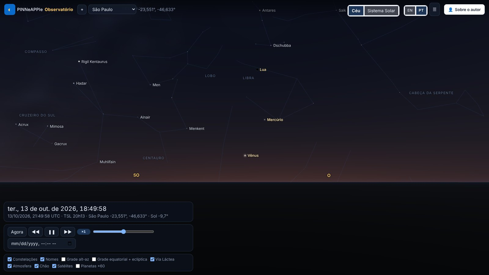
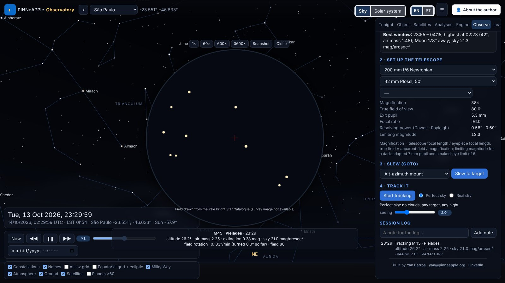
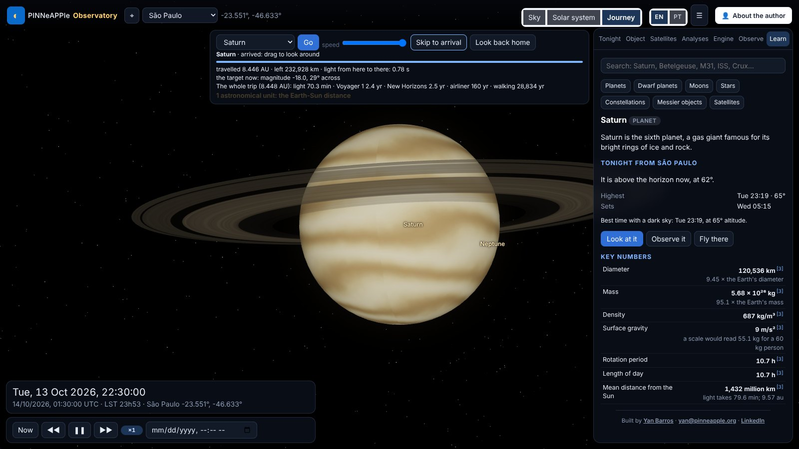
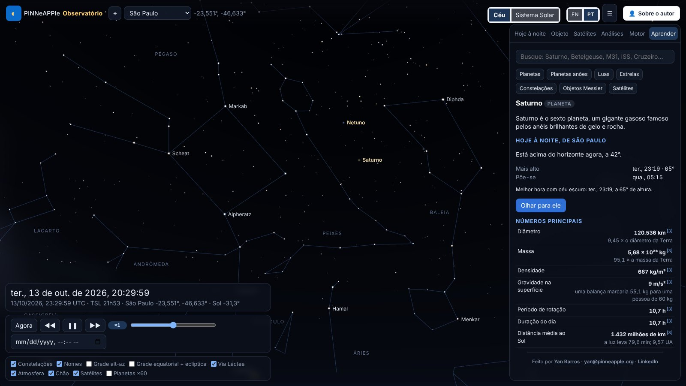

# The PINNeAPPle Observatory

A 3-D web app that shows the sky and the solar system as they are now from the visitor's location, with satellites,
astrophysics analyses and a physics-informed orbit surrogate shown with its trust checks.


## Run it

```bash
pip install -e ".[sky]" -r apps/observatory/requirements.txt
cd apps/observatory && uvicorn observatory.api:app --port 8094
```

Open `http://localhost:8094`, press ⌖ (or pick a city). Drag to look around, scroll or pinch to zoom, click an object.
*Solar system* flies out from your position to the planets; *Sky* flies back. URL parameters make views reproducible:
`?lat=-23.55&lon=-46.63&t=2026-10-13T22:05:00Z&az=250&alt=16&fov=72` (`view=system`, `tab=engine`, `panel=0`).

## Languages

The interface is in English and Brazilian Portuguese (**EN / PT** in the top bar). The default follows the browser
language; the choice is kept in the URL (`#lang=pt`) and in local storage. Every string the page shows comes from the
message catalogues `apps/observatory/observatory/static/i18n/en.json` and `pt.json` (menus, panels, tooltips, check
names, verdicts, units, API error messages); numbers and dates follow the locale (`Intl.NumberFormat`,
`Intl.DateTimeFormat`, decimal comma in Portuguese). Constellations use their Portuguese names
(`pinneapple_physics.astro.stars.constellation_names`, e.g. Cruzeiro do Sul, Escorpião); stars keep their IAU names;
the Sun, Moon and planets are translated. Server errors carry a message code (`X-Error-Code`) so the page shows them in
the visitor's language.



`tests/test_observatory_i18n.py` fails if a key is missing from one catalogue, if a placeholder differs, or if
interface text is hard-coded in `static/*.js` or `index.html` (a lint over the string literals); the browser test
`apps/observatory/tests/e2e/i18n.spec.js` switches to Portuguese, checks that the main panels have no English left and
switches back (`cd apps/observatory && npm ci && npx playwright test`).

## Observing session

The **Observe** tab reproduces an observing night. *Plan*: pick the Moon, a planet, a bright star or a Messier object
and get its altitude curve for the next 24 h with the dark hours shaded, rise / transit / set, astronomical night,
the Moon and the best window (air mass, Moon separation, sky brightness); a target that never rises from your place is
flagged. *Telescope*: an 80 mm refractor, a 200 mm Newtonian, an 8" SCT, binoculars or your own aperture and focal
length, with an eyepiece or a camera: magnification, true field, exit pupil, Dawes / Rayleigh resolution, limiting
magnitude and image scale. *Slew*: an alt-azimuth or German equatorial GoTo mount moves at a realistic rate
(trapezoidal profile per axis, horizon limit, meridian flip). *Track*: the eyepiece view stays on the target while time
runs at 1x to 3600x; the field turns on an alt-az mount (field rotation, shown), stars dim and redden with air mass,
the sky brightens with twilight and moonlight, seeing blurs the view. *Weather*: "Real sky" uses the Open-Meteo cloud
forecast and clouds hide the view; "Perfect sky" removes the weather, so any target can be observed on any night. The
session log keeps notes, snapshots and the conditions. Deep-sky fields use DSS2 colour cut-outs from CDS hips2fits
(cached on the server and credited in the view); without network the field is drawn from the star catalogue. The
physics is in `pinneapple_physics.astro.observing`, checked in `tests/test_astro_observing.py`: rise / transit / set
of the Sun, Moon and three bright stars within a minute of Skyfield at São Paulo and Tromsø, air mass from Kasten &
Young (1989), the optics formulas, and the field rotation against the parallactic angle.



## Space journey

**Journey** (top bar, or "Fly there" on a Learn card) flies from your place on Earth to the selected planet, moon, the
Sun or a star. You lift off from your latitude and longitude, leave the atmosphere and cross the Solar System with the
planets where they are on the chosen date; stars are reached through interstellar space at their parallax distance,
with the real neighbouring stars drawn in 3-D around the path. The speed control is logarithmic, and the scale markers
(Moon distance, 1 au, heliopause, 1 light-year, nearest star) are announced as you pass them. The counters show the
distance travelled and left, the light time, how long the trip would take walking, by airliner, at New Horizons' or
Voyager 1's speed and at light speed, and the target's apparent size and magnitude as it grows. On arrival you can
look around (drag) and the info card opens; at a star, "Look back home" turns you around and the Sun is a faint star
of the right magnitude (about +0.5 from Alpha Centauri, +1.9 from Sirius). The geometry is in
`pinneapple_physics.astro.journey` (`plan`, `scene`), checked in `tests/test_astro_journey.py`.



## Learn mode

The **Learn** tab (and the end of the Object tab) shows an info card for the Sun, planets, Moon, dwarf planets,
major moons, the brightest stars, the 88 constellations, the 110 Messier objects and the ISS, Hubble and Tiangong:
what it is in one sentence, key numbers with everyday comparisons (size against the Earth, light time, length of day
and year), how to see it tonight from your place, three to five curiosities, a short history and missions, and a
short quiz for classrooms. Search works with names in English or Portuguese. Every number carries its source
(numbered marks, with the list at the end of the card); the dataset is `pinneapple_physics/astro/data/facts/` and the
library `pinneapple_physics.astro.facts` (`card`, `search`, `quiz`, `tonight`, `validate`).



## What is computed where

The server (`apps/observatory/observatory/api.py`) calls `pinneapple_physics.astro` for every position, event and
analysis and returns samples a few minutes apart; the browser interpolates them, rotates the J2000 star catalogue with
the server's precession-nutation matrix and the sidereal time, and draws (three.js r169, vendored with the library).
Refraction and extinction of the stars are applied in the vertex shader with the same formulas as the library.

## Checking it

`pytest tests/test_astro_accuracy.py tests/test_observatory.py` runs the accuracy checks
([table](../core_concepts/astro.md#accuracy)) and every API endpoint offline (a local TLE file stands in for CelesTrak).


## PINNs, neural networks and ML in the app

Every model carries a trust card: its verdict, its checks against an independent reference, and a short "how this was
computed, how much to trust it". The numbers are in [the astronomy page](../core_concepts/astro.md#pinns-and-machine-learning-in-the-observatory).

- **Satellites → Orbit decay**: a PINN integrates the drag decay of the ISS-like orbit through the NRLMSIS 2.0
  thermosphere for the solar flux and geomagnetic activity you set, with a Monte-Carlo envelope of the inputs; it is
  compared with a Runge-Kutta integration and with SGP4's own drag model.
- **Analyses → Asteroids and close approaches**: Apophis, Phaethon, Ceres and 67P from JPL SBDB elements, propagated
  in the field of the Sun, planets and Moon; the Apophis flyby of 13 April 2029 is reproduced within JPL's 3σ range.
  A PINN can be trained for the selected body (Kepler orbit plus a network for the planetary perturbations, about a
  minute) and is checked against the integrator. A learned propagator (one network for many near-Earth asteroids)
  is shown with its errors on unseen bodies and is rejected by its own gate.
- **Analyses → Space weather and aurora**: Kp now and 3 h / 24 h ahead with calibrated 80 % intervals, and the chance
  of seeing the aurora overhead or low on the horizon at your geomagnetic latitude.
- **Analyses → Observing conditions**: P(clear sky), cloud quantiles, transparency and a seeing proxy from the
  Open-Meteo ensemble (marked not verified until it is calibrated against observations).
- **Analyses → Stellar ML**: the HR diagram clustered without labels, and the luminosity / spectral classes predicted
  from colour and absolute magnitude, cross-validated against the catalogue.
- **Analyses → Black hole**: a thin accretion disc around a Schwarzschild black hole, traced along exact null
  geodesics and lensed in front of the part of the sky you are looking at (Doppler beaming on or off). The far side
  of the disc appears above and below the shadow, with the photon ring inside.


