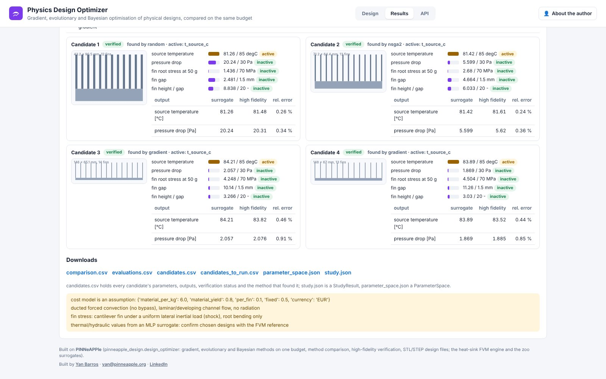

# Physics Design Optimizer (app, day 23)

Optimise parametric designs with explicit objectives, constraints and physics models, gradient-aware, and compare
gradient, evolutionary and Bayesian methods on the same problem and budget. Live at `https://design.pinneapple.org`;
source in [`apps/physics_design`](https://github.com/PINNeAPPle-Labs/PINNeAPPle/tree/main/apps/physics_design).


| | |
|---|---|
| **Designs** | plate-fin heat sink (six geometry parameters; neural surrogate of the FVM engine, differentiable; the FVM engine verifies), CST airfoil (six shape weights and the angle of attack; zoo ensemble trained on OpenFOAM runs) |
| **Methods** | gradient through autograd, SLSQP with finite differences, NSGA-II, differential evolution, Bayesian optimisation, Latin-hypercube baseline; same budget and seeds for each |
| **Output** | per method: evaluations, wall time, hypervolume, evaluations to 95 % of the best, converged or still improving; Pareto fronts and convergence curves; candidates from the best front over all methods with their verification status, margins and geometry; STL / STEP / CSV |

The same comparison in Python:

```python
from pinneapple_design.design_optimizer import compare_methods, presets

problem = presets.heatsink_problem("surrogate", objectives=("mass_g", "pressure_drop_pa"))
cmp = compare_methods(problem, ["gradient", "nsga2", "bayesian", "random"], budget=80, seeds=(0, 1))
print(cmp.table())
```



**Limits.** Gradients are those of the surrogate; every candidate is verified like any other. Airfoil candidates stay
"only surrogate" (no CFD in the app). One seed does not rank methods: use several.
