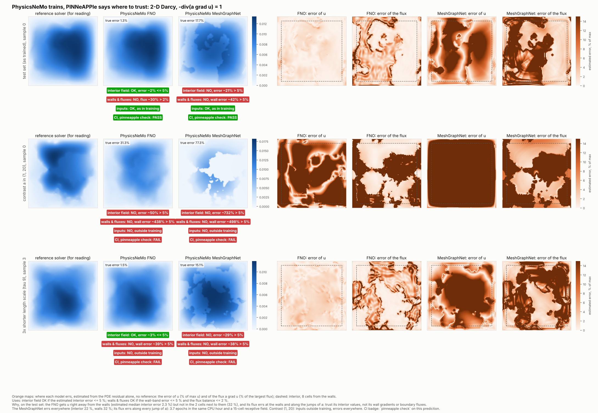

# PhysicsNeMo trains, PINNeAPPle says when to trust

PhysicsNeMo trains the models. PINNeAPPle checks whether their predictions can be trusted, without the reference
solution. The two complement each other: nothing below retrains or replaces a PhysicsNeMo model. The example is
[`examples/vs_physicsnemo/07_physicsnemo_trains_pinneapple_checks`](../../examples/vs_physicsnemo/07_physicsnemo_trains_pinneapple_checks/README.md).



The animated version alternates the two exported samples of each regime:
[physicsnemo_darcy_trust.gif](../assets/physicsnemo_trust/physicsnemo_darcy_trust.gif).

## Where each model works, and why

The orange maps show where each prediction errs, estimated from its PDE residual alone, with no reference:
- `estimated_error`: the error of `u`;
- `estimated_flux_error`: the error of the flux `a grad u`.

The badges under each prediction say which use it can serve (`use_verdicts`, limits fixed a priori):
- **interior field**: values of `u` at least 8 cells from the walls, OK if the estimated interior error is ≤ 5 %;
- **walls & fluxes**: values and gradients next to the walls and boundary flow rates, OK if the estimated error in
  the 2 cells next to the walls is ≤ 5 % and the flux balance is ≤ 2 %;
- **inputs**: the coefficient inside the training envelope;
- **CI**: what `pinneapple check` returns for that prediction.

| Regime | Model | interior error, estimated / true (median) | wall-band error, estimated / true | interior field OK | walls & fluxes OK | inputs as in training |
|---|---|---|---|---|---|---|
| test set | FNO | 2.3 % / 1.3 % | 32 % / 19 % | **99 %** of samples | 0 % | 95 % |
| test set | MeshGraphNet | 22 % / 15 % | 32 % / 23 % | 0 % | 0 % | 95 % |
| contrast {1, 20} | FNO | 85 % / 41 % | 392 % / 65 % | 0 % | 0 % | 0 % |
| contrast {1, 20} | MeshGraphNet | 688 % / 77 % | 529 % / 81 % | 0 % | 0 % | 0 % |
| length scale ÷3 | FNO | 3.1 % / 1.6 % | 34 % / 21 % | **94 %** | 0 % | 61 % |
| length scale ÷3 | MeshGraphNet | 21 % / 15 % | 37 % / 28 % | 0 % | 0 % | 61 % |

- **FNO: use it for the field away from the walls, not for wall gradients or boundary fluxes.** Its error is about
  1 % in the interior and about 20 % in the 2 cells next to the walls. Its flux also errs along the jumps of `a`.
  The net outflow it implies is off by 14 % (median) against the reference. This holds for the shorter length scale
  too: the interior is still about 2 %, although 39 % of those coefficients are outside the training envelope.
- **MeshGraphNet: not usable at this budget, for fields or for fluxes.** Its error is spread over the whole domain,
  and its flux errs along every jump of `a`. In the same CPU hour it did 3.7 epochs (the FNO did 41), and its 15
  message-passing steps reach 15 cells of a 128-cell grid, which is little for an elliptic problem.
- **Contrast {1, 20}: neither model.** The inputs are outside training, and the error is large everywhere.

**How much to trust the estimate.** It is not a certificate:
- It tracks the true error map; correlation 0.79 (FNO) and 0.85 (MeshGraphNet) on the test set.
- It over-estimates by 1.4 to 2.7× (the certified bounds below are the guarantee).
- Its use verdicts agree with the same verdicts computed from the true error on 94 to 100 % of the samples in every
  regime. Every disagreement is conservative: 6 % of the FNO's length-scale samples, and 1 % of its test samples,
  are called "not OK" in the interior although they are.

## Set-up

| | |
|---|---|
| Problem | `-div(a grad u) = 1` on the unit square, `u = 0` on the boundary, `a ∈ {3, 12}` (Li et al. 2021) |
| Data | zoo dataset `darcy_2d_li2021`: 1000 train / 200 test pairs on 128 × 128 cells, each solved on 512² and averaged |
| Models | PhysicsNeMo 2.2.2 `FNO` (4 layers, 12 modes, width 32, 2.37 M parameters) and `MeshGraphNet` on the 128 × 128 grid graph (15 message-passing steps, hidden 32, 0.15 M parameters; PyTorch Geometric) |
| Budget | `ComputeBudget(wall_s=3600)` each, 4 CPU threads (Xeon 2.8 GHz), Adam, cosine learning rate, relative L2 loss |
| Training reached | FNO 5144 steps = 41 epochs (train loss 0.012); MeshGraphNet 1828 steps = 3.7 epochs (train loss 0.15) |
| Regimes | test split (100 samples for calibration, 100 for evaluation); **contrast** `a ∈ {1, 20}`; **length scale** 3× shorter (`tau = 9`), 100 samples each, solved with the same reference solver (`operator_datasets.darcy_set`) |
| Time | data 4 min, training 2 × 60 min, evaluation 5 min, checks 2 ms per sample |

## The checks (no reference solution)

`pinneapple_physics.darcy_checks` uses the reference solver's own discretisation: cell-centred finite volumes,
harmonic-mean faces and half-cell Dirichlet faces. The solver's solution passes every check to round-off.

| Check | What it measures |
|---|---|
| energy bound | `residual_error_bound`: ‖r‖ in the dual norm of the constant-coefficient operator (one fast sine transform), over √min a and ‖u‖_A. A guaranteed upper bound on the relative energy-norm error, i.e. the error of the flux field `a grad u`, against the discrete solution. |
| L2 bound | `residual_l2_bound`: the same certificate through the discrete Poincaré inequality. A guaranteed upper bound on the relative L2 error of `u` itself. |
| boundary condition | RMS of `u` extrapolated to the boundary, over max \|u\| |
| flux balance | \|net outward flux − ∫f\| / ∫f |
| positivity | most negative `u` / max \|u\| (maximum principle) |
| inputs | `a` inside the training envelope: values, contrast, high fraction, interface density (`CoefficientEnvelope`) |

**Use profiles** (`PROFILES`). The limits are the library's fixed engineering tolerances, grouped by the quantity a
use depends on, each with its reason in the code. None was chosen from a model's values.

| Profile | For | Limits (reason) |
|---|---|---|
| `fields` | maps and point values of `u` | L2 bound ≤ 0.05 (the 5 % the library applies to a reference comparison); `u = 0` ≤ 0.02 (Dirichlet tolerance of `pp.trust_card`); positivity ≤ 0.01 (its max-principle tolerance) |
| `fluxes` | boundary flow rates, wall gradients, Darcy velocity | energy bound ≤ 0.10; flux balance ≤ 0.02 (the reference solver reaches 0.01) |

Each profile verdict is over the batch (90th percentile of each metric), with the graded ratio *value / limit* of
the worst metric: 1 is at the limit. **vs validation** (`calibrate_tolerances`) compares the same metrics with the
model's own 99th percentiles on the 100 held-out in-distribution calibration inputs. Only inputs are needed, never
labels. This layer is a drift monitor: it says whether the model is less physical here than where it was validated.
**inputs** is the envelope check.

## Certified checks: use profiles (strict)

| Regime | Model | rel. L2 (median) | fields: verdict, ratio (worst metric value / limit) | fluxes: verdict, ratio (worst metric value / limit) | vs validation | inputs |
|---|---|---|---|---|---|---|
| test set | FNO | 1.4 % | REJECT, 9.5× (L2 bound 0.48 / 0.05) | REJECT, 18× (flux 0.36 / 0.02) | APPROVED | APPROVED |
| test set | MeshGraphNet | 15.3 % | REJECT, 44× (L2 bound 2.2 / 0.05) | REJECT, 11× (energy bound 1.07 / 0.10) | APPROVED | APPROVED |
| contrast {1, 20} | FNO | 40.9 % | REJECT, 211× | REJECT, 148× (flux 2.95) | REJECT | REJECT |
| contrast {1, 20} | MeshGraphNet | 76.8 % | REJECT, 467× | REJECT, 27× (energy bound 2.69) | REJECT | REJECT |
| length scale ÷3 | FNO | 1.8 % | REJECT, 12× | REJECT, 20× (flux 0.40) | REJECT (marginal) | REJECT (39 % outside) |
| length scale ÷3 | MeshGraphNet | 15.0 % | REJECT, 53× | REJECT, 12× (flux 0.23) | REJECT (marginal) | REJECT (39 % outside) |
| test set | reference solver | — | APPROVED, 0.71× | APPROVED, 0.48× | — | — |
| contrast {1, 20} | reference solver | — | **REJECT, 4.0×** | APPROVED, 0.90× | — | — |

The profiles judge the whole field with guaranteed bounds, so they are strict. They answer "can this prediction be
certified for this use as a whole?"; the section above answers "where can it be used?". What this shows:

1. **Neither model meets the engineering limits of either profile at this 60-minute CPU budget.** The physics layer
   does not separate the two models by verdict; it grades them. On `fields` the FNO is 4.6× closer (9.5× against
   44× the limit). On `fluxes` the MeshGraphNet is 1.7× closer (11× against 18×): its flux balance (0.21) is better
   than the FNO's (0.36), although its L2 error is 10× larger.
2. **The FNO is the better model at equal budget by error.** On CPU it does 11× more epochs per hour (41 against
   3.7) and ends with a 10× smaller test error. The MeshGraphNet is undertrained. With 15 message-passing steps it
   also sees at most 15 cells in each direction on a 128-cell grid, which is little for an elliptic problem.
3. **A 1.4 % L2 error can still have a 22 % flux error.** The FNO's predicted net outflow differs from the reference
   solver's by 22 % (median over the first 40 test samples, 42 % at p90). Its relative error in the two cells next to
   the walls is 19 %, against 1.7 % inside. Its true energy-norm error is 18 %, and the bound gives 29 %. 58 % of its
   test predictions go below −1 % of their maximum near the walls. The `fluxes` profile rejects it for a reason the
   reference confirms.
4. **The `fields` certificate is conservative.** The certified L2 bound is about 30× the FNO's true L2 error
   (median 0.41 against 0.014) and 12× the MeshGraphNet's. For the contrast regime (min a = 1) even the reference
   solver's own solution fails it (4× the limit). A field-map use therefore cannot be approved by this certificate
   alone at these limits. The energy bound is much tighter (1.7× the true energy error for the FNO).
5. **Out of distribution, the label-free checks see the degradation.** For contrast {1, 20} the FNO's ratios grow
   from 9.5× / 18× to 211× / 148×, while its error goes from 1.4 % to 41 %. The drift and input layers reject, for
   both models.
6. **A shorter length scale degrades the models moderately, and the drift layer flags it only just.** The true
   energy-norm error rises by about 25 % for both models (FNO 0.167 → 0.208, MeshGraphNet 0.86 → 1.09). The FNO's
   L2 error rises from 1.4 % to 1.8 %; the MeshGraphNet's does not change. The drift monitor fails on the residual
   bound for 11 % (FNO) and 34 % (MeshGraphNet) of the samples, so the batch verdict is a marginal REJECT. The input
   envelope flags 39 % of these coefficients (interface density), a conservative alarm given how little the FNO
   degrades.
7. **Cost.** On this CPU the reference finite-volume solve at 128² takes 0.07 s. FNO inference takes 0.037 s per
   sample and MeshGraphNet 0.55 s. For a 2-D problem this size the surrogates' speed advantage is small; the case is
   here to show the trust layer, not to argue for surrogates.

## In CI: `pinneapple check` and the GitHub Action

`run.py evaluate` exports two predictions per model and regime (`check/predictions/`) and the configuration
(`check/pinneapple-check.toml`, written with `darcy_checks.check_config_entry`). Each target declares:
- `physics = "darcy"`;
- `bounds` and `envelope` of `a`: the training coefficients (`CoefficientEnvelope.to_check_config`);
- as tolerances, its model's validated limits.

`pinneapple check` runs `darcy_checks.sample_checks` on each prediction: PC301 (energy and L2 bounds), PC101 (flux),
PC201 (`u = 0`), PC402 (positivity), PC401 (envelope). The verdicts shown in the figure come from the same function,
on the same files. Exported samples:
- test and contrast sets: the first two;
- length-scale set: the first one *outside* the envelope (`_0`, sample 3) and the first one *inside* it (`_1`,
  sample 0).

```bash
pinneapple check --config check/pinneapple-check.toml check/predictions/in_distribution \
    check/predictions/length_scale/fno_1.npz check/predictions/length_scale/meshgraphnet_1.npz   # exit 0
pinneapple check --config check/pinneapple-check.toml check/predictions/contrast \
    check/predictions/length_scale/fno_0.npz check/predictions/length_scale/meshgraphnet_0.npz   # exit 1
#   contrast: PC301, PC201, PC401 on all four; PC402 on both FNO samples; PC101 on two
#   length scale _0: PC401 (interface density outside the envelope); MeshGraphNet also PC301 (L2 bound)
```

The `darcy-trust` job of `.github/workflows/physics-check.yml` runs the action on both sets:
- the in-range set must pass;
- the out-of-range set must break exactly the rules in `check/expected.json`. In this repository the job asserts
  them, so CI stays green; in a user's repository, with `fail-on: error`, that set turns the check red.

With the default tolerances (the fixed limits) every prediction of both models fails PC101 and PC301, as in the
table above.

## Checking data, not only models: PhysicsNeMo's `Darcy2D` datapipe

The same kind of checks can run on training data before anyone trains on them. Two open issues on that datapipe are
already acknowledged by NVIDIA, with a fix under review in
[NVIDIA/physicsnemo#2048](https://github.com/NVIDIA/physicsnemo/pull/2048):
[#2036](https://github.com/NVIDIA/physicsnemo/issues/2036) (the Jacobi kernel divides `grad k · grad u` by `2 dx`
instead of `4 dx²`) and [#2035](https://github.com/NVIDIA/physicsnemo/issues/2035) (the Fourier coefficients of a
permeability sample share one random value). The installed version, `nvidia-physicsnemo` 2.2.2, still has the
`2 dx` denominator, so it does not include that fix.

The datapipe stores `u` at the nodes of a finite-difference grid with zero ghost nodes and a one-node crop, not in
the cell-centred layout of `darcy_2d_li2021`. So the residual is computed by `check_nodal_darcy_batch` in the
datapipe's own layout, against a direct solve of the documented equation on the same nodes. Applied to node data,
the cell-centred physics check of [the dataset audit](dataset_audit.md) also fails a correct direct solve (solve
error 16 %), so it cannot separate the bug from the layout there. Its diversity measures (`near_duplicates`,
`effective_sample_count`) are used as they are.

`python run.py datapipe`: resolution 64, 4 batches of 32 on CPU (warp 1.18), 80 s.

| Check | Datapipe data | Direct solve of the documented equation, same nodes |
|---|---|---|
| residual of `-div(k grad u) = 1` (relative RMS, median) | **4.44** | 1.7e-13 |
| same data, stencil with `grad k · grad u` over `2 dx` | 0.0036 (the Jacobi tolerance) | — |
| distance to the direct solve (relative L2) | 24 % | — |
| flux balance (median; limit 2× the direct solve's floor, 0.061) | 0.42, fails for every sample | 0.020 |
| boundary condition, positivity | pass | pass |
| permeability samples | **4 distinct of 128**: every sample is an exact copy of others in its batch; effective sample count 1.8 | — |
| Fourier amplitudes per sample | **4 distinct of 100** (one per sin/cos family) | — |

Each run draws new seeds. Over three runs the residual was 4.4 to 5.0 and the flux imbalance 0.22 to 0.68; in one
run, half the samples stayed under the flux limit.

- **#2036:** the residual check catches it without ambiguity. The data solve the shipped stencil, not the documented
  equation.
- **#2035:** the diversity check catches it. The issue reports 8 distinct fields in 32 on its set-up; in these CPU
  runs every sample of a batch was identical.
- **Not caught:** the boundary and positivity checks, as expected, do not see either problem.

## In a Veriphysics Evidence Report: scope of use

An approve / reject verdict says whether to use a result, not *for what*. `python run.py report` writes a Decision
Record and an Evidence Report PDF per model with a scope of use (`pinneapple_veriphysics.scope`): each use with its
verdict over the test set, the share of samples that serve it, the median measured value against the limit, what
the use needs, and the kind of evidence. The input check is a precondition of every use. The shifted regimes are
notes, and the figure above is embedded in the PDF. For the FNO:

```text
Scope of use -- PhysicsNeMo FNO, test set
  use for: interior field; not for: walls and fluxes; preconditions met
  - [USABLE] interior field (99 % of samples): median interior 2.3 % (limit 5 %) [estimated]
  - [NOT USABLE] walls and fluxes (0 % of samples): median wall 31.9 % (limit 5 %), median flux 13.3 % (limit 2 %) [estimated]
  - [MET] inputs (95 % of samples): 95 % of samples OK [input check]
  note: PhysicsNeMo FNO, contrast a in {1, 20}: not for: interior field, walls and fluxes; precondition not met: inputs
  note: PhysicsNeMo FNO, 3x shorter length scale (tau 9): use for: interior field; not for: walls and fluxes; precondition not met: inputs
```

The MeshGraphNet record reads "not for: interior field, walls and fluxes; preconditions met". The use verdicts are
estimated (no guarantee); the record says how the estimate was validated on this case. The certified profiles stay
in the reasoning line (both models REJECT `fields` and `fluxes` on the test set).

## Limits

- One problem (2-D Darcy, constant source) and one seed per model. The MeshGraphNet configuration was reduced to
  fit a CPU budget; at PhysicsNeMo's default width (128) one hour on this CPU gives under one epoch.
- The bounds are about the discrete 128² problem; the dataset's own averaging leaves a floor (energy bound 0.02 to
  0.09). The certified L2 bound is loose (about 30× the true error for the FNO), so the `fields` profile is strict.
- The drift limits come from 100 calibration inputs; the length-scale result sits at their edge.
- Fixed limits are engineering choices, set before training and not tuned afterwards.
