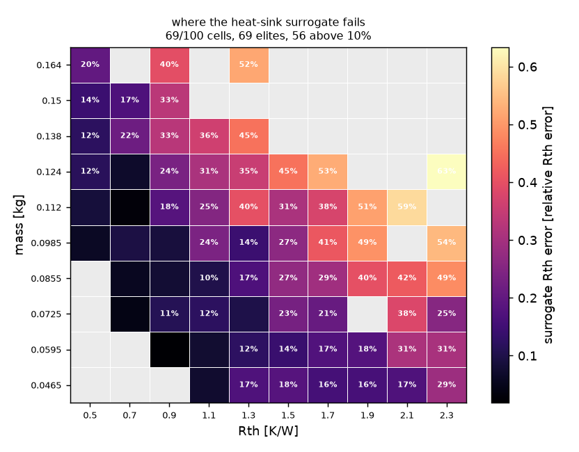
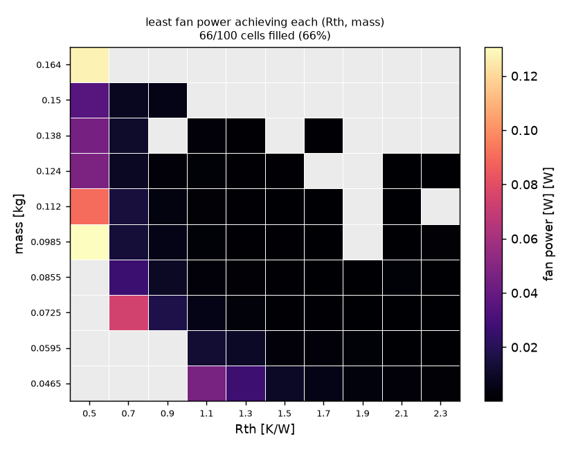

# Quality-diversity: a map of designs, and the map of where a model fails

An optimiser answers one question: which design is best. A Pareto front answers a second one: which designs are not
worse than another in everything. Neither says *what kinds of design exist*, and neither covers the space on purpose --
the search walks towards the optimum and abandons the rest.

`pinneapple_design.design_optimizer.quality_diversity` keeps the loop and changes the bookkeeping. It maintains a grid
over a **behaviour space** -- how the design behaves, not what its parameters are -- with one cell per behaviour and
the best design found for that behaviour in each cell (MAP-Elites, Mouret & Clune 2015). The result is a map an
engineer reads at a glance: the cheapest heat sink at each fin density, the airfoil with the least drag at each lift.

The same archive, pointed at a model instead of at a design, is a **failure map**. Set the fitness to the model's own
error and every cell holds the worst error the search could find for that behaviour, together with the design that
produced it. The cells above a tolerance are the region where the model is wrong, handed back with the number, the
design and the condition -- the out-of-domain region of the trust layer, found by search instead of declared by hand.

## The behaviour space

A behaviour axis is what the design *does*. The ranges are part of the definition: a descriptor outside them cannot be
placed and is counted as unplaceable, rather than clipped into an edge cell that would then lie about its behaviour.

```python
from pinneapple_design.design_optimizer.quality_diversity import (BehaviourAxis, BehaviourSpace, EliteArchive,
                                                                  Evaluation, QDConfig, QualityDiversitySearch)

behaviour = BehaviourSpace(
    axes=(BehaviourAxis("Rth", 0.4, 2.4, unit="K/W", why="the cooling the customer buys; the top is the junction limit"),
          BehaviourAxis("mass", 0.04, 0.17, unit="kg", why="the aluminium is the other half of the cost")),
    bins=(10, 10), labels="plate-fin heat sink, 50 x 50 mm base, 25 W")
```

* `why=` is printed by the map and the report. An axis without a physical reason is a design parameter in disguise.
* `scale="log"` for quantities that span decades (thermal resistances, pressure drops, pumping powers): a linear grid
  there spends most of its cells on values nobody builds.
* `space.condition(cell)` is the behaviour **interval** of each axis, which is what makes a failing cell a condition
  and not a point.

The axes come from the reference physics, or from the qualitative descriptors of the geometry --
`pinneapple_design.qualitative.describe` returns volume, wetted area,
slenderness, sphericity, the flat areas and the sharp-edge length, all of which say what a body *is* to the flow
without being the parameters that produced it. `descriptor_vector` reads them, and `descriptor_axes` builds a grid
whose ranges are what the design box actually reaches:

```python
from pinneapple_design.design_optimizer.quality_diversity import descriptor_axes, descriptor_vector
from pinneapple_design.qualitative import describe

meshes = [describe(mesh) for mesh in campaign_meshes]          # any closed, outward-oriented body
space = descriptor_axes(meshes, ("slenderness", "sphericity"), bins=(8, 6),
                        why={"slenderness": "how much body the flow has to go around"})
descriptors = descriptor_vector(describe(new_mesh), ("slenderness", "sphericity"))
```

Never from the model under test: if the axis were the surrogate's own output, a cell could not say what the *part* is.

## The archive

`EliteArchive(space, sense="min"|"max")` holds the elites and counts what it refused. `sense="min"` ranks a cost to
minimise (a **design map**); `sense="max"` ranks an error or a residual to maximise (a **failure map**).

One evaluation is one `Evaluation`:

| Field | Meaning |
|---|---|
| `value` | the number the archive ranks by inside a cell |
| `descriptors` | one value per behaviour axis; `None` or non-finite means "could not be placed" |
| `error` | optional per-channel breakdown (`{"rth": 0.31, "mass": 0.02}`), carried into the report |
| `valid` | `False` for a case that is not physically legitimate -- it is **never** archived |
| `note` | free text kept with the elite (the reference value, a solver warning) |

`valid=False` is the field that keeps a failure map honest: a "failure" found where the physics does not apply is not a
failure of the model. In the heat-sink study below, 161 of 600 cases are refused because the part would not survive
them at all.

An archive can be full of cells and still be a point, so the module measures it:

```python
report = archive.diversity()        # cells, fill, design spread in the normalised box, largest cluster
archive.assert_diverse()            # raises CollapsedArchiveError instead of reporting a map that is a point
print(archive.summary(), report.text())
```

## The search

```python
result = QualityDiversitySearch(archive, bounds, evaluate, QDConfig(budget=600, seed=0)).run()
```

The loop is the canonical one: evaluate a Latin-hypercube first batch, then repeatedly pick a parent from a uniformly
chosen occupied cell, mutate it, evaluate the child, and let it replace the elite of its own cell when it beats it.
Selection happens *inside* the cell, so the optimum of one behaviour never starves another -- which is exactly why the
`ask`/`tell` GA of `EvolutionaryDesignOptimizer` is not reused here: selecting by objective value over one population
is the pressure that empties the archive back into a single corner. What is shared with the GA is the parameter space
(`ParamSpace`, its bounds and clipping) and the mutation conventions of `DesignOptimizerConfig`, so a QD run and a GA
run are configured with the same knobs and sampled in the same box.

| `QDConfig` | Default | What it costs you |
|---|---|---|
| `budget` | 600 | evaluations the run may spend, initial batch included -- the number the comparison quotes |
| `population` | 50 | candidates per generation, and the parallel unit |
| `mutation_std` | 0.08 | Gaussian step, in **normalised** design units, so one number means the same in every parameter |
| `line_share` | 0.35 | share of children that move along a line, half of them towards another elite (a variation along the map, the ISO-line idea of CMA-ME) |
| `immigrant_share` | 0.1 | share drawn uniformly in the box, so an unlucky archive can still be escaped |
| `init_fraction` | 0.5 | share of the budget spent on the space-filling batch: a map has to exist before it can be improved |
| `workers` | 1 | threads for a batch; only helps when `evaluate` releases the GIL, and the batch is collected in order, so the result does not depend on it |

`uniform_search(bounds, evaluate, behaviour, budget=..., kind="random"|"latin")` is the honest opponent: the same box,
the same evaluator, the same number of evaluations, and the samples placed in the same grid, so the coverage and the
failure set come out comparable.

## The failure map

```python
region, result = find_failure_region(search_box, evaluate_model_error, behaviour,
                                     budget=600, seed=0, tolerance=0.10, name="surrogate Rth error")
print(region.text(8))
```

`evaluate` returns the error as `Evaluation.value` (larger is worse), the **reference** behaviour as `descriptors`, and
`valid=False` where the case is not physically legitimate -- the case set is decided by the physics, never by the model
under test, or the search would only find its own refusals.

`region.cells()` gives the failing cells worst first, each with the error, the per-channel breakdown, the design and the
behaviour interval; `region.map_max` is the worst error on the map, `region.failing_fraction()` how much of the mapped
behaviour the model gets wrong, and `region.to_json()` the whole thing for a report.

## Measured: where the heat-sink surrogate fails

`examples/quality_diversity` is the demo, and the numbers below are what it produced (seed, budget and tolerance are in
each figure and in `examples/quality_diversity/heat_sink_qd.json`).

A plate-fin heat sink is described by three design numbers -- fin count, fin height and approach air speed -- and the
house closed-form model (`pinneapple_physics.closed_form.plate_fin_heatsink`) says what each one does. An MLP surrogate
is trained on a **campaign**: ducted forced convection, 4-20 fins, 8-50 mm fins, 0.8-3.0 m/s, which is what a
fan-cooled extrusion project would sample. The search is then pointed at a wider envelope that goes down to 0 m/s --
a fan failure, or the half of the catalogue that is passive -- and asked, at 600 evaluations:

| Search | Worst verified error | Failing cells (> 10 %) | Cells filled | Median cell error |
|---|---|---|---|---|
| quality-diversity | **66.4 %** (62.4-72.3 %) | **57.8** | **70.2** / 100 | **21.6 %** |
| random | 57.7 % (54.0-62.0 %) | 43.0 | 57.8 / 100 | 14.2 % |
| Latin hypercube | 62.6 % (55.7-71.4 %) | 40.8 | 55.8 / 100 | 14.0 % |

Mean over five seeds, every method at the same 600 evaluations and over the same grid. Read it honestly: the failure
search beats random sampling **on all five seeds** (+4.3 to +13.7 points), and beats Latin hypercube on the mean
(+3.8 points) but only on three of five seeds (-8.0, +11.0, +16.5, -0.4, +0.1). After 600 evaluations the archive's
advantage is in the *shape* of what it finds -- twice the cells above tolerance, a third more of the map covered, and a
median cell error half again as large -- not in a per-seed guarantee over a space-filling design. `examples/quality_diversity/experiment.json`
records the Latin-hypercube check as failed, because on a per-seed basis it is.



The gradient is the story a single number cannot tell: the error is small where the surrogate was trained (low Rth, low
mass) and grows towards the thick, high-resistance parts, reaching 63 % at Rth in [2.2, 2.4] K/W and mass in
[0.118, 0.131] kg. That is the region a trust report should carry.

Two cases check the map against what is already known, without telling the archive about them:

* **near pass** (14 fins, 30 mm, 0.6 m/s): *not* a strange operating point -- it is below the campaign's 0.8 m/s floor,
  so the surrogate has never seen it. The archive reports 10.5 % and puts it in the failing set.
* **fan off** (12 fins, 25 mm, 0 m/s): the physics can answer it (natural convection), but the junction lands above its
  limit, so the case is not buildable. The archive **refuses** it instead of reporting a large error that would mean
  nothing.

## The design map

The same machinery with `sense="min"` and fitness = the fan power the design costs answers the other question: the
least fan power that achieves each (Rth, mass) cell. 66 of 100 cells are filled, and the cheapest cell found is
0.12 mW at Rth in [2.0, 2.2] K/W, mass in [0.092, 0.105] kg (11 fins, 50 mm, 0.19 m/s).



Blank cells say what was *not* explored and are left blank on purpose: a map that fills them with a colour would be
claiming a design nobody found.

## What it does not do

* **Grid archives only.** The issue asked for a grid *or* a CVT archive; the grid is what exists. A CVT archive
  (Vassiliades et al. 2018) would place the centroids where the data are instead of on a uniform lattice, which matters
  when the behaviour space is high-dimensional -- on a 10 x 10 map of a thermal plane it does not.
* **No gradient-aware emitter.** CMA-ME's improvement emitter needs a differentiable archive; this is the black-box
  version, and `line_share` with the towards-another-elite direction is the part of it that survives without gradients.
* **Threads, not processes.** `workers` helps only when the evaluator releases the GIL (numpy, torch).
* **A deterministic evaluator.** The archive compares values across generations; a noisy evaluator makes those
  comparisons meaningless. Average the noise inside `evaluate` if you have to.
* **Not a validation.** Regressing where a model is wrong says nothing about whether it is right where it was fitted;
  use `pinneapple_analysis.trust` and `pinneapple_check` for that.

## Where it plugs in

The failure map is the input the rest of the stack asks for: the trust benchmark and the out-of-domain region of a trust
report, active learning (`pinneapple_data.active_learning`) which wants the cases the model is worst at, adaptive
fidelity, and `examples/use_cases/physics_data_factory`, which wants a design map instead of a random campaign.

## Running the demo

```bash
python examples/quality_diversity/heat_sink_failure_map.py     # ~27 s; writes the figures, a small elites CSV and the numbers
```

It writes `heat_sink_elites.csv` (one row per elite of both maps: cell, condition, value, design), `heat_sink_qd.json`
(the comparison, the known-failure check, and the budget, seed and tolerance behind every number here) and the two
figures above.

## References

* Mouret & Clune, *Illuminating search spaces by mapping elites*, arXiv:1504.04909 (2015).
* Cully, Clune, Tarapore & Mouret, *Robots that can adapt like animals*, Nature 521 (2015).
* Vassiliades, Chatzilygeroudis & Mouret, *Using centroidal Voronoi tessellations to scale up the multi-dimensional
  archive of phenotypic elites*, IEEE TEC 22 (2018).
* McKay, Beckman & Conover, *A comparison of three methods for selecting values of input variables*, Technometrics 21
  (1979).
