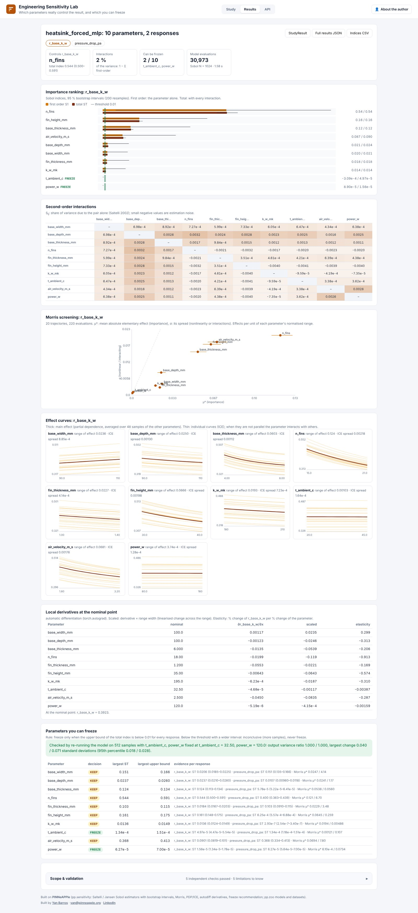
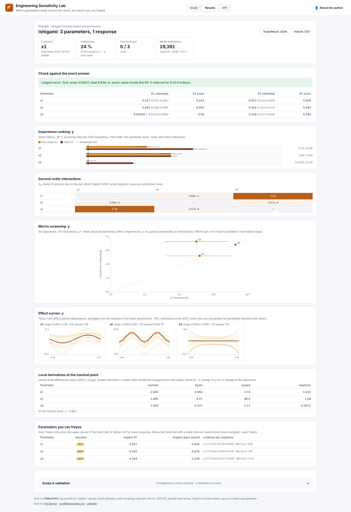

# Engineering Sensitivity Lab

**Which parameters really control the result, and which can you freeze?**
Day 16 of the apps series: <https://sensitivity.pinneapple.org> (source: [`apps/sensitivity_lab`](https://github.com/PINNeAPPle-Labs/PINNeAPPle/tree/main/apps/sensitivity_lab)).

Give a model (built-in benchmark, `pp.zoo` model or ONNX graph), runs done in your solver (OpenFOAM, CalculiX: download
the Saltelli design, upload the results) or a dataset, the parameters with their ranges or distributions and the
responses. The lab returns Sobol first-order, total and second-order indices with bootstrap intervals, Morris
screening, main-effect and ICE curves, local derivatives (automatic differentiation for torch models) and the
parameters you can freeze, each recommendation checked by re-running the model with them fixed.

On the Ishigami benchmark every estimated index is within 0.003 of the exact value and inside its 95 % interval. On the
heat-sink design, fin count controls the thermal resistance (total index 0.54); ambient temperature and power can be
frozen (total index < 2e-4) and fixing them changes the output variance by less than 0.1 %. From data alone (3,900
simulations) the app flags that the inputs are correlated (r = 0.66), so the first-order indices add up to more than 1.

Everything shown comes from `pp.sensitivity` (see [Uncertainty and sensitivity studies on any
model](uncertainty_and_sensitivity.md)). Limits, methods and the API are in the
[app README](https://github.com/PINNeAPPle-Labs/PINNeAPPle/blob/main/apps/sensitivity_lab/README.md).
