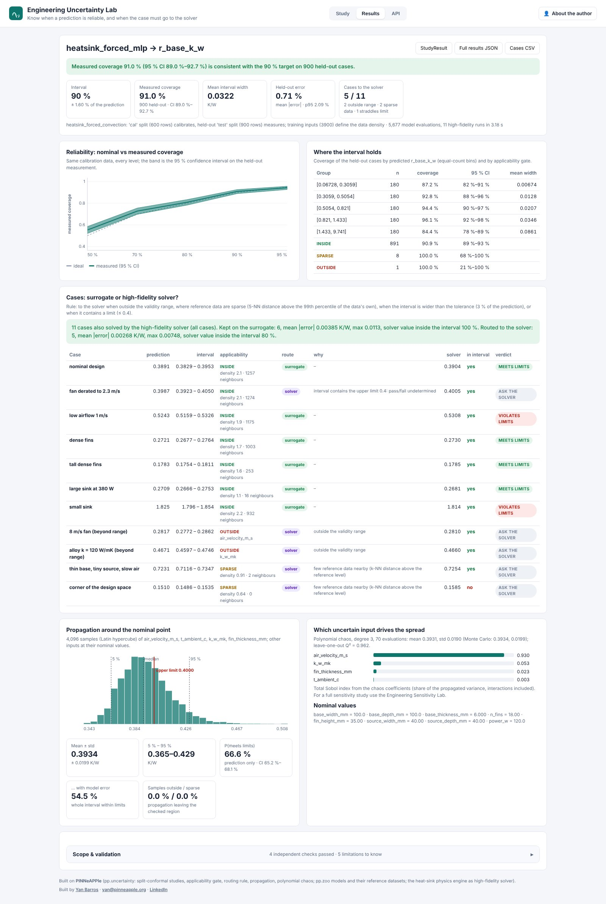
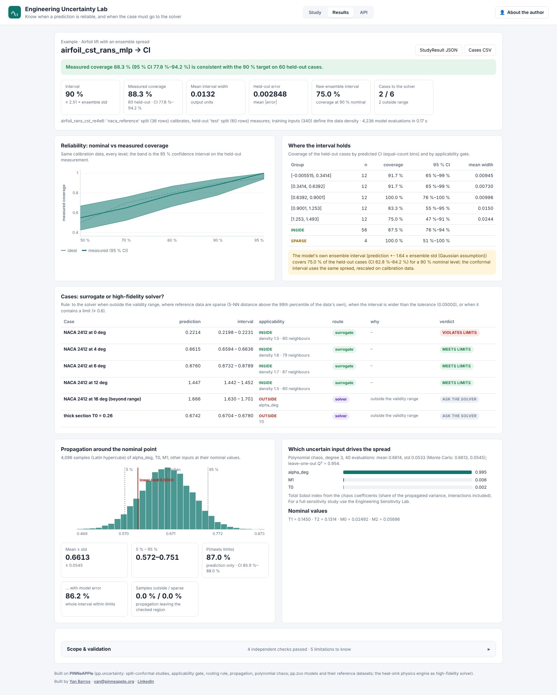

# Engineering Uncertainty Lab

**Know when a prediction is reliable, and when the case must go to the high-fidelity solver.**
Day 15 of the apps series: <https://uncertainty.pinneapple.org> (source: [`apps/uncertainty_lab`](https://github.com/PINNeAPPle-Labs/PINNeAPPle/tree/main/apps/uncertainty_lab)).

Pick a model (a `pp.zoo` model or an uploaded ONNX graph), its reference data, the cases you want to decide on, the
uncertain inputs and the decision limits. The lab returns:

- **split-conformal intervals with their coverage measured on held-out data** (Wilson interval, reliability across
  levels, coverage per region and per applicability gate; the raw ensemble interval for comparison when the model has
  one);
- **applicability alerts**: outside the validity range, or inside it where the reference data are sparse;
- **a routing rule** per case (surrogate or high-fidelity solver, with the reasons), checked against the heat-sink
  physics engine where the library has it;
- **propagation** of uncertain inputs (Monte Carlo, Latin hypercube, Sobol; polynomial chaos when cheap), with the
  probability of meeting the limits with and without the model's own error.

On the heat-sink example the 90 % intervals cover 91.0 % (95 % CI 89.0–92.7 %) of the 900 held-out designs. Of
eleven screened designs, the only one whose engine value falls outside its interval is the corner of the design space,
which the gate flags as sparse and routes to the solver. On the airfoil example the model's own ensemble interval
covers 75 % of held-out OpenFOAM runs at a 90 % nominal level; the conformal interval on the same spread covers 88 %.

Everything shown comes from one library call, `pp.uncertainty.uncertainty_study` (see
[Uncertainty and sensitivity studies on any model](uncertainty_and_sensitivity.md)). Limits, methods and the API are in
the [app README](https://github.com/PINNeAPPle-Labs/PINNeAPPle/blob/main/apps/uncertainty_lab/README.md).
