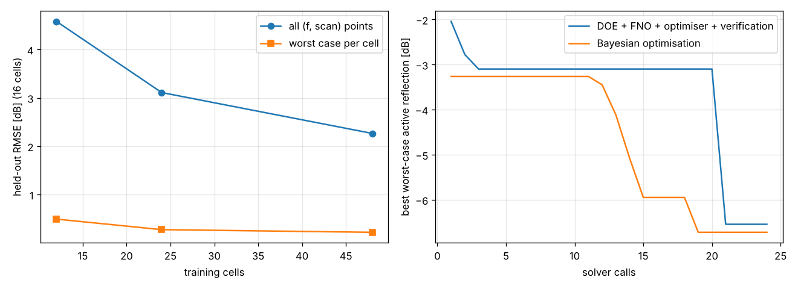

# Periodic unit cell: an FNO over frequency × scan, and an equal-budget benchmark against Bayesian optimisation

An infinite phased array (a tightly coupled dipole array, TCDA) or a frequency-selective surface is simulated as
one **unit cell** with periodic boundaries carrying the phase of the scan angle and a Floquet port. The quantity a
wideband array designer watches is the **active reflection coefficient** at the element port over frequency and scan
angle. This guide runs a campaign of cells in EMerge, trains a Fourier neural operator (FNO) from the cell
parameters to the whole (frequency × scan) map, measures its error on cells it never saw, and compares, at the same
number of solver calls, two ways of minimising the worst-case active reflection: an FNO plus an optimiser (verified
by the solver), and Bayesian optimisation calling the solver directly.

Everything lives in `pinneapple_simulation.electromagnetics.periodic`; the example
`examples/use_cases/antennas/unit_cell_benchmark.py` only calls it.

```bash
pip install emerge
python examples/use_cases/antennas/unit_cell_benchmark.py --quick                 # 3 cells, budget 6 (~6 min)
python examples/use_cases/antennas/unit_cell_benchmark.py --cells 64 --budget 24  # the pilot below
```

## The cell (`tcda.TCDACell`, generic)

A square cell of side `a` (22 mm by default); the ground plane at z = 0 (the bottom face of the cell); a dipole
strip of width `w` at height `h`, fed across a gap `s` by a lumped port (100 Ω); its arms stop `g/2` from the cell
edge, so neighbouring dipoles couple capacitively across `g`; an optional dielectric superstrate (`er_s`, `t_s`) at
`d_s` above the dipole; air up to 0.35 λ above the stack and a Floquet port. `check()` refuses a cell that lets a
grating lobe in at the highest frequency and scan (`a ≥ λ/(1 + sin θ)`). The default ranges of the campaign
(`benchmark.CELL_RANGES`) vary `h`, `w`, `g`, `t_s` and `er_s`.

EMerge details that matter: the periodic boundary conditions exist only after `mw._initialize_bc_data()`, so the scan
angle is set after it; one mesh then serves every scan angle of a cell (the angle changes only the boundary phases
and the port), and solving the angles in sequence on one model gives the same S11 as solving each alone (test).
SuperLU is used.

## Measured

Pilot on 4 CPU cores (EMerge 2.8.9, SuperLU, `res` 0.1 λ), generic cell ranges, 3.0–6.0 GHz in 7 steps × scan
θ = 0, 15, 30, 45° in the E-plane, LHS of 64 cells (`results/unit_cell/campaign.csv`):

* **Cost per cell** (one process: one mesh, 4 scan solves of 7 frequencies): median 93 s, 35–327 s, peak memory
  2.04 GB; 64 cells in 7 490 s of process time, all solved. About half of the cells ran while another study shared
  the cores.
* **Mesh error at this resolution** (default cell, broadside): |Γ| at 3/4/5/6 GHz is −3.53/−6.65/−10.69/−18.35 dB at
  `res` 0.1 λ, −3.13/−6.19/−10.29/−21.94 dB at 0.07 λ and −2.77/−5.73/−9.80/−26.83 dB at 0.05 λ (52 s and 462 s for
  that run): about 0.5 dB per step away from deep nulls, more in them. The pilot compares methods on the same solver
  settings; its absolute |Γ| carries this mesh error.
* **FNO** (from the 5 parameters to the 7 × 4 map of |Γ| in dB, 60 s of training on one thread, the last 16 cells
  never seen):

  | training cells | held-out RMSE, every (f, θ) | max abs error | RMSE of the worst case per cell |
  |---|---|---|---|
  | 12 | 4.58 dB | 26.0 dB | 0.49 dB |
  | 24 | 3.11 dB | 18.3 dB | 0.27 dB |
  | 48 | 2.26 dB | 14.6 dB | 0.22 dB |

  The pointwise error is dominated by the deep resonant nulls (their depth moves with the parameters); the worst-case
  active reflection over the band and scans, the quantity optimised below, is predicted to 0.2–0.5 dB.
* **Equal budget, 24 solver calls each, minimising the worst-case |Γ| over the band and scans:**


  | strategy (24 solver calls each) | best worst-case \|Γ\| (solver value) | reached at call |
  |---|---|---|
  | LHS of 20 cells alone (random search) | −3.10 dB | 3 |
  | LHS of 20 + FNO + optimiser over 4 000 candidates + 4 verifications | −6.54 dB | 21 (first verification) |
  | Bayesian optimisation on the solver | −6.72 dB | 19 |

  On this 5-parameter problem the two strategies end within 0.2 dB of each other; Bayesian optimisation got there
  two calls earlier. The FNO ranked well but was pessimistic: its predictions for the 4 verified candidates were
  −4.31 to −4.38 dB, the solver gave −4.56 to −6.54 dB. What the FNO buys is the rest of the map: one trained model
  predicts the whole (frequency × scan) response of any cell in milliseconds, for other objectives too, while the
  Bayesian run answers only the question it was run for. A single seed and a 24-call budget: the ranking between
  the two is not established by this pilot. The run was interrupted once by a machine restart and resumed from the
  saved results (`CLISimulator(resume=True)`), with the same designs and the same values.



A one-thread FNO matters: with four threads competing with each other (or with a solver) the same FNO took 26 steps
in 20 s instead of 2 421; `fit_fno` trains on one thread by default.

## What it would take to run 1,000 cells

Measured here: a median of 93 s per cell for 7 frequencies × 4 scans at `res` 0.1 λ on 4 cores, one cell per process
(peak 2.04 GB). At that rate 1,000 cells are about 26 hours of one 4-core machine, and the cells are independent:
the runner's one-process-per-cell layout spreads over as many machines (or preemptible instances) as are available, a
cell lost to a preemption costing one rerun. A finer mesh (0.05 λ, 462 s for one broadside run of 4 frequencies)
multiplies the cost several times. No cloud price is quoted here.

## API

```python
from pinneapple_simulation.electromagnetics.periodic import benchmark as bm
from pinneapple_simulation.electromagnetics.periodic.tcda import TCDACell, simulate

simulate(TCDACell(h=9), [3, 4.5, 6], [(0, 0), (30, 0)])           # rows of active reflection
table, sim = bm.campaign(64, freqs, scans, "runs/")               # DOE of cells, one process per cell
X, Y, tags = bm.to_arrays(table, list(bm.CELL_RANGES), freqs, scans)
predict, info = bm.fit_fno(X[:48], Y[:48], wall_s=60)            # FNO over the (f, scan) map
bm.heldout(predict, X[48:], Y[48:])                               # error on unseen cells
bm.equal_budget(bm.solver_from(sim, names, freqs, scans), bm.CELL_RANGES, budget=24)
```
