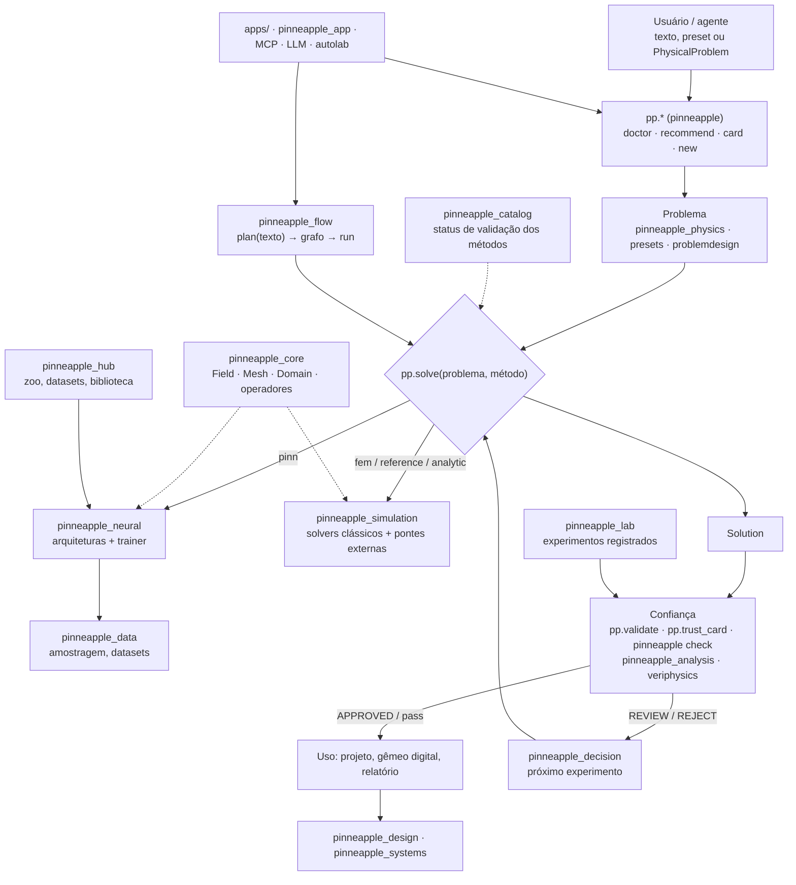

## Visão geral

### O que é o PINNeAPPle

O PINNeAPPle é uma biblioteca Python de IA para física. A ideia central tem duas partes:

1. **Uma descrição, muitos métodos.** O problema físico é descrito uma vez (`pp.PhysicalProblem`, ou o nome de um
   preset). Depois ele é resolvido por redes informadas pela física (PINN), operadores neurais, redes de grafos ou
   solvers clássicos (diferenças finitas, elementos finitos, pontes para OpenFOAM e CalculiX), sempre pela mesma
   chamada: `pp.solve(problema, método)`.
2. **Uma camada de confiança.** Antes de alguém usar um resultado, ele é conferido contra a física: resíduo da
   equação, conservação, condições de contorno, comparação com referências e domínio de validade. A saída é uma
   decisão explícita (`APPROVED` / `REVIEW` / `REJECT` no `pp.trust_card`; `pass` / `warn` / `fail` no
   `pp.validate`).

Em volta desse núcleo há camadas de projeto (geometria, otimização, projeto a partir de um texto), sistemas
(séries temporais, co-simulação, gêmeos digitais), orquestração (Flow, Lab, laboratório autônomo, LLMs, servidor
MCP) e produtos (Hub, apps web). O pacote de topo `pinneapple` (importado como `pp`) é uma camada fina: cada nome
dele delega para um dos pacotes `pinneapple_*`.

### Arquitetura em camadas

A tabela resume as camadas na ordem em que um problema passa por elas. Cada camada depende só da interface da
anterior (um `ProblemSpec`, coordenadas amostradas, a função de perda, um modelo treinado), e não de herança ou de
um objeto compartilhado. Por isso dá para trocar uma peça sem mexer nas outras.

| camada | pacotes principais | papel |
|---|---|---|
| Porta de entrada | `pinneapple` (`pp.*`), `pinneapple_core.onboarding` | `pp.doctor`, `pp.recommend`, `pp.card`, `pp.new`, `pp.solve`, `pp.compare`, `pp.validate` |
| Primitivos | `pinneapple_core` | `Field`, `Mesh`, `Domain`, `Geometry`, operadores diferenciais, motor de workflows |
| Problema | `pinneapple_physics` (`physical_problem`, `pde_environment`, `symbolic_pde`), `pinneapple_presets`, `pinneapple_problemdesign` | descrever o problema: equações, contornos, presets, desenho guiado |
| Solução clássica | `pinneapple_simulation`, `pinneapple_condense` | FDM, FEM, FVM, SPH, LBM, pontes externas, eletromagnetismo, voo, veículos, condensação |
| Aprendizado | `pinneapple_neural`, `pinneapple_data`, `pinneapple_adaptation`, `pinneapple_worldmodel`, `pinneapple_quantum` | arquiteturas, treino, dados, transferência, modelos de mundo |
| Confiança | `pinneapple_analysis`, `pinneapple_check`, `pinneapple_veriphysics`, `pinneapple_security` | validação, incerteza, inversão, linter de física em CI, registros de evidência, assinaturas |
| Decisão e raciocínio | `pinneapple_decision`, `pinneapple_reason`, `pinneapple_query` | qual experimento rodar a seguir, cadeia de porquês, consultas físicas com planejador |
| Projeto e sistemas | `pinneapple_design`, `pinneapple_systems`, `pinneapple_twin3d` | geometria, otimização, projeto por intenção, séries temporais, gêmeos digitais |
| Catálogo e registro | `pinneapple_catalog`, `pinneapple_registry`, `pinneapple_hub` | métodos com status de validação, recursos com licença, artefatos, zoo de modelos |
| Orquestração | `pinneapple_flow`, `pinneapple_lab`, `pinneapple_autolab`, `pinneapple_llm`, `pinneapple_mcp`, `pinneapple_orchestration` | grafos de nós, experimentos registrados, missões autônomas, agentes |
| Ferramentas e produtos | `pinneapple_tools`, `pinneapple_arena`, `pinneapple_blender`, `pinneapple_app`, `apps/` | benchmarks, exportação, visualização, automação de GUIs, apps web |

Os pacotes `pinneapple_models`, `pinneapple_train` e `pinneapple_solvers` são shims de compatibilidade: só
reexportam `pinneapple_neural.architectures`, `pinneapple_neural.trainer` e
`pinneapple_simulation.numerical_solvers`, para que caminhos de import antigos continuem funcionando.

### Como as peças se conectam

Em palavras:

- **`pp.*`** é a porta de entrada. `pp.doctor` diz o que falta instalar, `pp.recommend` sugere preset, método e
  modelo a partir de uma frase, `pp.card` mostra o que um preset recebe e devolve, e `pp.new` cria um projeto do
  usuário fora do repositório.
- **`pp.solve` / `pp.compare`** (em `pinneapple_physics.solving`) recebem um `PhysicalProblem`, um `ProblemSpec`
  ou o nome de um preset e despacham para o método pedido (`"pinn"`, `"fem"`, `"analytic"`, `"reference"`,
  `"exact"`, `"external"`; `pp.list_methods()` lista os registrados). O resultado é um `Solution`.
- **Confiança**: `pp.validate` (em `pinneapple_analysis.validation.validate`) e `pp.trust_card` (em
  `pinneapple_analysis.trust.field_card`) conferem resultados e modelos; `pinneapple check` roda as mesmas
  verificações em CI.
- **`pinneapple_flow`** transforma um texto num grafo de nós tipados (`plan`), e o executa sem interface ou no
  Flow Studio (`run`).
- **`pinneapple_hub`** guarda e entrega modelos treinados e verificados (`pp.zoo`), datasets (`pp.datasets`) e uma
  biblioteca pesquisável de ferramentas, geometrias, fluxos e exemplos.
- **`pinneapple_catalog`** lista cada solver, método de treino, equação e problema com o código, as referências e
  o status de validação calculado a partir dos testes (`validated` / `tested` / `untested`).
- **Apps** (`apps/` e `pinneapple_app`) são interfaces web e ferramentas de demonstração montadas sobre a
  biblioteca; o servidor MCP (`pinneapple_mcp`) expõe as mesmas funções para agentes de código.

{{PP_TABLE}}
