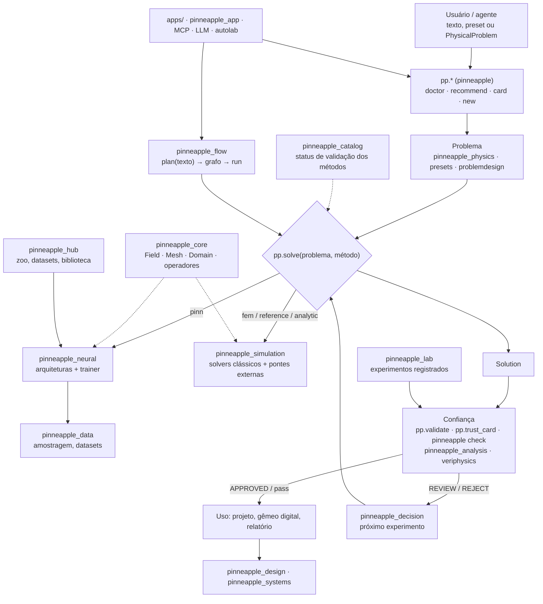

# Mapa completo do PINNeAPPle

Documento de referência, em português, de todo o repositório: 41 pacotes, 2.142 módulos, 2.757 classes e 6.130 funções públicas. Gerado a partir do inventário automático do commit `e53cdcfb04`.

Como o texto passa de 150 páginas, ele está dividido em volumes por camada. Este arquivo é o volume 0: visão geral, arquitetura e sumário.

## Volumes

| volume | conteúdo | pacotes |
|---|---|---|
| [Volume 1 — Núcleo, porta de entrada e catálogo](mapa_completo/v01_nucleo.md) | A porta de entrada `pp.*`, os primitivos do núcleo, o catálogo de métodos, o registro de artefatos e os shims de compatibilidade. | `pinneapple`, `pinneapple_core`, `pinneapple_catalog`, `pinneapple_registry`, `pinneapple_orchestration`, `pinneapple_models`, `pinneapple_train`, `pinneapple_solvers` |
| [Volume 2 — Física: problemas, equações e ciência](mapa_completo/v02_fisica.md) | Como um problema físico é descrito e resolvido (`PhysicalProblem`, `pp.solve`), as equações, os presets industriais, o desenho de problemas, os experimentos por área, a condensação e as consultas físicas. | `pinneapple_physics`, `pinneapple_presets`, `pinneapple_problemdesign`, `pinneapple_science`, `pinneapple_condense`, `pinneapple_query` |
| [Volume 3 — Simulação numérica](mapa_completo/v03_simulacao.md) | Solvers clássicos (FDM, FEM, FVM, espectral, SPH, LBM), pontes para solvers externos, eletromagnetismo, voo, multicorpos, veículos e rovers. | `pinneapple_simulation` |
| [Volume 4 — Aprendizado de máquina e dados](mapa_completo/v04_aprendizado.md) | Arquiteturas e treino de redes (PINN, operadores neurais, grafos), dados e amostragem, adaptação, modelos de mundo, percepção, computação quântica e a arena de benchmarks. | `pinneapple_neural`, `pinneapple_data`, `pinneapple_pdb`, `pinneapple_adaptation`, `pinneapple_arena`, `pinneapple_worldmodel`, `pinneapple_perception`, `pinneapple_quantum` |
| [Volume 5 — Confiança, validação e decisão](mapa_completo/v05_confianca.md) | A camada que confere cada resultado contra a física: validação, incerteza, inversão, o linter `pinneapple check`, registros de evidência, segurança, decisão e a cadeia de porquês. | `pinneapple_analysis`, `pinneapple_check`, `pinneapple_veriphysics`, `pinneapple_security`, `pinneapple_decision`, `pinneapple_reason` |
| [Volume 6 — Projeto e sistemas](mapa_completo/v06_projeto_sistemas.md) | Geometria, otimização de projeto, projeto a partir de intenção, sistemas dinâmicos, séries temporais, co-simulação e gêmeos digitais. | `pinneapple_design`, `pinneapple_systems`, `pinneapple_twin3d` |
| [Volume 7 — Ferramentas, orquestração e produtos](mapa_completo/v07_ferramentas_produtos.md) | Ferramentas (benchmarks, exportação, visualização, automação de GUIs de engenharia, NVIDIA), o Flow, o Hub, o Lab, os LLMs, o servidor MCP, o laboratório autônomo e o app web. | `pinneapple_tools`, `pinneapple_blender`, `pinneapple_flow`, `pinneapple_hub`, `pinneapple_lab`, `pinneapple_llm`, `pinneapple_mcp`, `pinneapple_autolab`, `pinneapple_app` |
| [Volume 8 — Apps, exemplos, reproduções, scripts e CI](mapa_completo/v08_apps_exemplos_ci.md) | 64 apps, 88 entradas de exemplos, reproduções de papers, scripts, benchmarks e 12 workflows de CI. | — |
| [Volume 9 — Índice alfabético, glossário e apêndice numérico](mapa_completo/v09_indice_glossario_apendice.md) | Índice de todas as classes e funções públicas, glossário e números. | — |

## Visão geral

### O que é o PINNeAPPle

O PINNeAPPle é uma biblioteca Python de IA para física. A ideia central tem duas partes:

1. **Uma descrição, muitos métodos.** O problema físico é descrito uma vez (`pp.PhysicalProblem`, ou o nome de um
   preset). Depois ele é resolvido por redes informadas pela física (PINN), operadores neurais, redes de grafos ou
   solvers clássicos (diferenças finitas, elementos finitos, pontes para OpenFOAM e CalculiX), sempre pela mesma
   chamada: `pp.solve(problema, método)`.
2. **Uma camada de confiança.** Antes de alguém usar um resultado, ele é conferido contra a física: resíduo da
   equação, conservação, condições de contorno, comparação com referências e domínio de validade. A saída é uma
   decisão explícita (`APPROVED` / `REVIEW` / `REJECT` no `pp.trust_card`; `pass` / `warn` / `fail` no
   `pp.validate`).

Em volta desse núcleo há camadas de projeto (geometria, otimização, projeto a partir de um texto), sistemas
(séries temporais, co-simulação, gêmeos digitais), orquestração (Flow, Lab, laboratório autônomo, LLMs, servidor
MCP) e produtos (Hub, apps web). O pacote de topo `pinneapple` (importado como `pp`) é uma camada fina: cada nome
dele delega para um dos pacotes `pinneapple_*`.

### Arquitetura em camadas

A tabela resume as camadas na ordem em que um problema passa por elas. Cada camada depende só da interface da
anterior (um `ProblemSpec`, coordenadas amostradas, a função de perda, um modelo treinado), e não de herança ou de
um objeto compartilhado. Por isso dá para trocar uma peça sem mexer nas outras.

| camada | pacotes principais | papel |
|---|---|---|
| Porta de entrada | `pinneapple` (`pp.*`), `pinneapple_core.onboarding` | `pp.doctor`, `pp.recommend`, `pp.card`, `pp.new`, `pp.solve`, `pp.compare`, `pp.validate` |
| Primitivos | `pinneapple_core` | `Field`, `Mesh`, `Domain`, `Geometry`, operadores diferenciais, motor de workflows |
| Problema | `pinneapple_physics` (`physical_problem`, `pde_environment`, `symbolic_pde`), `pinneapple_presets`, `pinneapple_problemdesign` | descrever o problema: equações, contornos, presets, desenho guiado |
| Solução clássica | `pinneapple_simulation`, `pinneapple_condense` | FDM, FEM, FVM, SPH, LBM, pontes externas, eletromagnetismo, voo, veículos, condensação |
| Aprendizado | `pinneapple_neural`, `pinneapple_data`, `pinneapple_adaptation`, `pinneapple_worldmodel`, `pinneapple_quantum` | arquiteturas, treino, dados, transferência, modelos de mundo |
| Confiança | `pinneapple_analysis`, `pinneapple_check`, `pinneapple_veriphysics`, `pinneapple_security` | validação, incerteza, inversão, linter de física em CI, registros de evidência, assinaturas |
| Decisão e raciocínio | `pinneapple_decision`, `pinneapple_reason`, `pinneapple_query` | qual experimento rodar a seguir, cadeia de porquês, consultas físicas com planejador |
| Projeto e sistemas | `pinneapple_design`, `pinneapple_systems`, `pinneapple_twin3d` | geometria, otimização, projeto por intenção, séries temporais, gêmeos digitais |
| Catálogo e registro | `pinneapple_catalog`, `pinneapple_registry`, `pinneapple_hub` | métodos com status de validação, recursos com licença, artefatos, zoo de modelos |
| Orquestração | `pinneapple_flow`, `pinneapple_lab`, `pinneapple_autolab`, `pinneapple_llm`, `pinneapple_mcp`, `pinneapple_orchestration` | grafos de nós, experimentos registrados, missões autônomas, agentes |
| Ferramentas e produtos | `pinneapple_tools`, `pinneapple_arena`, `pinneapple_blender`, `pinneapple_app`, `apps/` | benchmarks, exportação, visualização, automação de GUIs, apps web |

Os pacotes `pinneapple_models`, `pinneapple_train` e `pinneapple_solvers` são shims de compatibilidade: só
reexportam `pinneapple_neural.architectures`, `pinneapple_neural.trainer` e
`pinneapple_simulation.numerical_solvers`, para que caminhos de import antigos continuem funcionando.

### Como as peças se conectam

Em palavras:

- **`pp.*`** é a porta de entrada. `pp.doctor` diz o que falta instalar, `pp.recommend` sugere preset, método e
  modelo a partir de uma frase, `pp.card` mostra o que um preset recebe e devolve, e `pp.new` cria um projeto do
  usuário fora do repositório.
- **`pp.solve` / `pp.compare`** (em `pinneapple_physics.solving`) recebem um `PhysicalProblem`, um `ProblemSpec`
  ou o nome de um preset e despacham para o método pedido (`"pinn"`, `"fem"`, `"analytic"`, `"reference"`,
  `"exact"`, `"external"`; `pp.list_methods()` lista os registrados). O resultado é um `Solution`.
- **Confiança**: `pp.validate` (em `pinneapple_analysis.validation.validate`) e `pp.trust_card` (em
  `pinneapple_analysis.trust.field_card`) conferem resultados e modelos; `pinneapple check` roda as mesmas
  verificações em CI.
- **`pinneapple_flow`** transforma um texto num grafo de nós tipados (`plan`), e o executa sem interface ou no
  Flow Studio (`run`).
- **`pinneapple_hub`** guarda e entrega modelos treinados e verificados (`pp.zoo`), datasets (`pp.datasets`) e uma
  biblioteca pesquisável de ferramentas, geometrias, fluxos e exemplos.
- **`pinneapple_catalog`** lista cada solver, método de treino, equação e problema com o código, as referências e
  o status de validação calculado a partir dos testes (`validated` / `tested` / `untested`).
- **Apps** (`apps/` e `pinneapple_app`) são interfaces web e ferramentas de demonstração montadas sobre a
  biblioteca; o servidor MCP (`pinneapple_mcp`) expõe as mesmas funções para agentes de código.

### A porta de entrada `pp.*`

`import pinneapple as pp` expõe 297 nomes (versão `0.7.0`). A tabela diz de onde cada um vem e o que faz.

| nome | como é carregado | origem | o que faz |
|---|---|---|---|
| `pp.ActiveLearningConfig` | import direto | `pinneapple_data.ActiveLearningConfig` |  |
| `pp.AdaptiveCollocationTrainer` | import direto | `pinneapple_data.AdaptiveCollocationTrainer` |  |
| `pp.AFNO` | import direto | `pinneapple_neural.architectures.AFNO` |  |
| `pp.annulus` | import direto | `pinneapple_design.geometry.annulus` |  |
| `pp.arena` | submódulo preguiçoso (`_SUBMODULES`) | `pinneapple_arena` | Pacote raiz: reexporta configuração, `Arena`, rankings, problemas, fábrica de modelos, treino, visualização, `define_problem`, `DatasetProblem`, presets de dataset, modo de decisão e NAS. |
| `pp.as_tensor` | preguiçoso (`_LAZY_ATTRS`) | `pinneapple_neural.utils.as_tensor` | Extrai o tensor de previsão de um Tensor, dicionário de campos, tupla ou objeto de saída (`PINNOutput`, `ModelOutput` etc.). |
| `pp.assess_drift` | preguiçoso (`_LAZY_ATTRS`) | `pinneapple_analysis.uncertainty.drift.assess_drift` | Checa um lote de predições quanto a perda de acurácia, má calibração, mudança de entrada e tendência do resíduo. |
| `pp.assimilation` | submódulo preguiçoso (`_SUBMODULES`) | `pinneapple_analysis.data_assimilation` | Assimilação de dados: 4D-Var por autograd sobre os métodos de ensemble (EKI) e filtros de Kalman, mais reconstrução GP e posicionamento de sensores. |
| `pp.astro` | submódulo preguiçoso (`_SUBMODULES`) | `pinneapple_physics.astro` | Pacote de astronomia posicional e astrofísica do observatório PINNeAPPle, em NumPy próprio e validado contra USNO NOVAS, JPL Horizons e skyfield; reexporta `Observer`, `Time`, `apparent` e afins. |
| `pp.auto_residual` | import direto | `pinneapple_physics.symbolic_pde.auto_residual` |  |
| `pp.Backend` | import direto | `pinneapple_tools.compute_backends.Backend` |  |
| `pp.backend` | submódulo preguiçoso (`_SUBMODULES`) | `pinneapple_tools.compute_backends` | Suporte multi-backend: reexporta o seletor PyTorch/JAX e os utilitários JAX. |
| `pp.batched_inference` | import direto | `pinneapple_neural.trainer.batched_inference` |  |
| `pp.benchmark` | submódulo preguiçoso (`_SUBMODULES`) | `pinneapple_analysis.benchmark` | Entrada do benchmark com orçamento igual (preparar -> validar -> rodar -> relatório); reexporta `run`, `prepare`, `load`, o registro e `ArrayProblem`. |
| `pp.BenchmarkConfig` | import direto | `pinneapple_tools.benchmark_suite.BenchmarkConfig` |  |
| `pp.BenchmarkResult` | import direto | `pinneapple_tools.benchmark_suite.BenchmarkResult` |  |
| `pp.BenchmarkTaskBase` | import direto | `pinneapple_tools.benchmark_suite.BenchmarkTaskBase` |  |
| `pp.best_device` | import direto | `pinneapple_neural.trainer.best_device` |  |
| `pp.best_method` | import direto | `pinneapple_core.onboarding.catalog.best_method` | O método mais barato que roda hoje para o preset: analítico, senão solver de referência, senão rede treinada. |
| `pp.bodies` | submódulo preguiçoso (`_SUBMODULES`) | `pinneapple_design.geometry.bodies` | Corpos fechados triangulados para escoamento externo: corpo de Ahmed, esfera, cilindro, caixa e anel. |
| `pp.BoxConstraint` | import direto | `pinneapple_design.design_optimizer.BoxConstraint` |  |
| `pp.build_digital_twin` | import direto | `pinneapple_systems.digital_twin.build_digital_twin` |  |
| `pp.build_model` | definido em `pinneapple/__init__.py` | `pinneapple.build_model` |  |
| `pp.CADToCFDPipeline` | import direto | `pinneapple_simulation.numerical_solvers.CADToCFDPipeline` |  |
| `pp.cae` | submódulo preguiçoso (`_SUBMODULES`) | `pinneapple_data.cae` |  |
| `pp.card` | import direto | `pinneapple_core.onboarding.card` |  |
| `pp.CauchyMisfit` | import direto | `pinneapple_analysis.inverse_problems.CauchyMisfit` |  |
| `pp.CausalPINNTrainer` | import direto | `pinneapple_neural.trainer.CausalPINNTrainer` |  |
| `pp.CausalWeightScheduler` | import direto | `pinneapple_neural.trainer.CausalWeightScheduler` |  |
| `pp.cfd` | submódulo preguiçoso (`_SUBMODULES`) | `pinneapple_simulation.numerical_solvers.external_flow` | Escoamento externo em torno de qualquer corpo no OpenFOAM numa chamada: STL → snappyHexMesh → simpleFoam (k-omega SST) → forças, coeficientes de pele, linhas de corrente, cortes e cena 3D. Requer OpenFOAM instalado. |
| `pp.CFDMesh` | import direto | `pinneapple_simulation.numerical_solvers.CFDMesh` |  |
| `pp.channel_with_hole` | import direto | `pinneapple_design.geometry.channel_with_hole` |  |
| `pp.ChannelDomain2D` | import direto | `pinneapple_design.geometry.ChannelDomain2D` |  |
| `pp.ChannelWithObstacleDomain2D` | import direto | `pinneapple_design.geometry.ChannelWithObstacleDomain2D` |  |
| `pp.circle` | import direto | `pinneapple_design.geometry.circle` |  |
| `pp.closed_form` | submódulo preguiçoso (`_SUBMODULES`) | `pinneapple_physics.closed_form` | Subpacote de modelos físicos em forma fechada (sem EDP), portados de ferramentas de produtos para serem compartilhados e testados; o `__init__` importa só parte dos módulos (não importa `eddy_coil`, `electromagnetics`, `heat_exchanger`, `pipe_insulation`, `pump_npsh`, `thin_airfoil`). |
| `pp.CollocationConfig` | import direto | `pinneapple_data.CollocationConfig` |  |
| `pp.CollocationSampler` | import direto | `pinneapple_data.CollocationSampler` |  |
| `pp.compare` | import direto | `pinneapple_physics.solving.compare` | Resolve ou reaproveita cada método e pontua contra a referência nos mesmos pontos. |
| `pp.Comparison` | import direto | `pinneapple_physics.solving.Comparison` | Tabela de `compare`: métricas de cada método contra a referência nos mesmos pontos, com `best`. |
| `pp.compile` | preguiçoso (`_LAZY_ATTRS`) | `pinneapple_physics.compile_api.compile` | Prepara um `PhysicalProblem`, `ProblemSpec` ou nome de preset para resolver mais rápido. |
| `pp.ComposedObsOperator` | import direto | `pinneapple_analysis.inverse_problems.ComposedObsOperator` |  |
| `pp.CompositeObjective` | import direto | `pinneapple_design.design_optimizer.CompositeObjective` |  |
| `pp.CompositeRegularizer` | import direto | `pinneapple_analysis.inverse_problems.CompositeRegularizer` |  |
| `pp.compute_isosurface` | import direto | `pinneapple_neural.predictor.compute_isosurface` |  |
| `pp.compute_pareto_front` | import direto | `pinneapple_design.design_optimizer.compute_pareto_front` |  |
| `pp.compute_streamlines` | import direto | `pinneapple_neural.predictor.compute_streamlines` |  |
| `pp.ComputeBudget` | preguiçoso (`_LAZY_ATTRS`) | `pinneapple_analysis.cost.equal_budget.ComputeBudget` | Orçamento de treino em segundos, FLOPs e/ou passos (None = sem limite). |
| `pp.conformal_study` | preguiçoso (`_LAZY_ATTRS`) | `pinneapple_analysis.uncertainty.conformal_study.conformal_study` | Calibra em `(y_cal, pred_cal)` e mede a cobertura em `(y_test, pred_test)`. |
| `pp.ConformalPredictor` | import direto | `pinneapple_analysis.uncertainty.ConformalPredictor` |  |
| `pp.ConstraintSet` | import direto | `pinneapple_design.design_optimizer.ConstraintSet` |  |
| `pp.ContinuousAdjointSolver` | import direto | `pinneapple_design.design_optimizer.ContinuousAdjointSolver` |  |
| `pp.core` | submódulo preguiçoso (`_SUBMODULES`) | `pinneapple_core` | Ponto de entrada do pacote: exporta `Domain`, `Geometry`, `Mesh`, `Field`, `FunctionField`, `Grid`, `PointCloud` e os operadores, e carrega `func`, `fem`, `loss`, `optim`, `data`, `transforms` etc. preguiçosamente no primeiro acesso. |
| `pp.count_gpus` | import direto | `pinneapple_neural.trainer.count_gpus` |  |
| `pp.csg_annulus` | import direto | `pinneapple_design.geometry.csg_annulus` |  |
| `pp.CSGCircle` | import direto | `pinneapple_design.geometry.CSGCircle` |  |
| `pp.CSGDifference` | import direto | `pinneapple_design.geometry.CSGDifference` |  |
| `pp.CSGEllipse` | import direto | `pinneapple_design.geometry.CSGEllipse` |  |
| `pp.CSGIntersection` | import direto | `pinneapple_design.geometry.CSGIntersection` |  |
| `pp.CSGPolygon` | import direto | `pinneapple_design.geometry.CSGPolygon` |  |
| `pp.CSGRectangle` | import direto | `pinneapple_design.geometry.CSGRectangle` |  |
| `pp.CSGUnion` | import direto | `pinneapple_design.geometry.CSGUnion` |  |
| `pp.curl` | preguiçoso (`_LAZY_ATTRS`) | `pinneapple_core.operators.curl` | Rotacional: vetor em 3D, escalar (componente z) em 2D. |
| `pp.dashboard` | submódulo preguiçoso (`_SUBMODULES`) | `pinneapple_tools.visualization.dashboard` | Painéis centrados numa animação para qualquer simulação: animação no meio, gráficos sincronizados ao cursor de tempo, KPIs, parâmetros e barra de cor; exporta HTML interativo, PNG e GIF/MP4. |
| `pp.data` | submódulo preguiçoso (`_SUBMODULES`) | `pinneapple_data` |  |
| `pp.datasets` | submódulo preguiçoso (`_SUBMODULES`) | `pinneapple_hub.zoo.datasets` | `pp.datasets`: datasets verificados em uma linha, guardados como npz sem pickle; os pequenos vêm no pacote, os outros são baixados do Hub, conferidos por SHA-256 e cacheados. |
| `pp.DDPPINNTrainer` | import direto | `pinneapple_neural.trainer.DDPPINNTrainer` |  |
| `pp.DDPTrainerConfig` | import direto | `pinneapple_neural.trainer.DDPTrainerConfig` |  |
| `pp.decide` | preguiçoso (`_LAZY_ATTRS`) | `pinneapple_decision.api.decide` | Decide which experiment to run next. ``problem`` may be a ``ProblemSpec`` or a free-form dict (see ``adapter.py``). Facts that could not be determined are listed in ``decision.diagnostics["problem_facts"]["unknown"]``. |
| `pp.decision` | submódulo preguiçoso (`_SUBMODULES`) | `pinneapple_decision` | pinneapple_decision -- probabilistic decision layer over the Physics AI pipeline. |
| `pp.decision_engine` | preguiçoso (`_LAZY_ATTRS`) | `pinneapple_decision.api.decision_engine` | Return the default engine. Passing any argument (or ``reset=True``) replaces it with a new engine built from those arguments (evidence is not carried over). |
| `pp.DEFAULT_MODELS` | import direto | `pinneapple_tools.benchmark_suite.DEFAULT_MODELS` |  |
| `pp.design` | preguiçoso (`_LAZY_ATTRS`) | `pinneapple_design.intent.design` |  |
| `pp.design_opt` | submódulo preguiçoso (`_SUBMODULES`) | `pinneapple_design.design_optimizer` | Ponto de entrada do otimizador de projeto: reexporta o laço fechado (espaço de parâmetros, surrogate, otimizador, refinamento por PINN, Pareto) e a camada de estudos de projeto. |
| `pp.DesignOptConfig` | import direto | `pinneapple_design.design_optimizer.DesignOptConfig` |  |
| `pp.DesignOptimizerConfig` | import direto | `pinneapple_design.design_optimizer.DesignOptimizerConfig` |  |
| `pp.DesignOptLoop` | import direto | `pinneapple_design.design_optimizer.DesignOptLoop` |  |
| `pp.DesignOptResult` | import direto | `pinneapple_design.design_optimizer.DesignOptResult` |  |
| `pp.DigitalTwin` | import direto | `pinneapple_systems.digital_twin.DigitalTwin` |  |
| `pp.DigitalTwinConfig` | import direto | `pinneapple_systems.digital_twin.DigitalTwinConfig` |  |
| `pp.DirichletBC` | import direto | `pinneapple_physics.symbolic_pde.DirichletBC` |  |
| `pp.div` | preguiçoso (`_LAZY_ATTRS`) | `pinneapple_core.operators.div` | Divergência de um campo vetorial. |
| `pp.doctor` | import direto | `pinneapple_core.onboarding.doctor` | `pp.doctor`: verifica a instalação contra um perfil (`start`, `cfd`, `research`, `enterprise`, `all`) e imprime um comando de correção por falha. |
| `pp.dominant_frequency` | preguiçoso (`_LAZY_ATTRS`) | `pinneapple_physics.physics_audit.regime.dominant_frequency` | Frequência do pico espectral mais forte de um sinal amostrado (por exemplo desprendimento de vórtices). |
| `pp.DoMINO` | import direto | `pinneapple_physics.pinn_solver.DoMINO` |  |
| `pp.DragAdjointObjective` | import direto | `pinneapple_design.design_optimizer.DragAdjointObjective` |  |
| `pp.DragObjective` | import direto | `pinneapple_design.design_optimizer.DragObjective` |  |
| `pp.dt` | submódulo preguiçoso (`_SUBMODULES`) | `pinneapple_systems.digital_twin` | Runtime de gêmeo digital sobre modelos substitutos: reexporta `DigitalTwin`, estados, fluxos de sensores, filtros de Kalman, detectores de anomalia, pipeline de tempo real, reconstrução de sinais, condicionamento de telemetria e prognóstico (RUL). |
| `pp.dynamics` | submódulo preguiçoso (`_SUBMODULES`) | `pinneapple_simulation.particle_dynamics` | Simulação dinâmica diferenciável em PyTorch puro: corpos rígidos, MPM (MLS-MPM) e SPH; reexporta também os parâmetros de solo/roda de Bekker-Wong. |
| `pp.EKIConfig` | import direto | `pinneapple_analysis.inverse_problems.EKIConfig` |  |
| `pp.ellipse` | import direto | `pinneapple_design.geometry.ellipse` |  |
| `pp.em` | submódulo preguiçoso (`_SUBMODULES`) | `pinneapple_simulation.electromagnetics` | Pacote de eletromagnetismo em SI: referências em forma fechada, materiais, solvers FEM 2-D em A_z, FDTD, ondas e máquinas elétricas; reexporta as classes e funções principais dos submódulos. |
| `pp.ensemble` | submódulo preguiçoso (`_SUBMODULES`) | `pinneapple_physics.ensemble` | Ensemble adaptativo de especialistas físicos: pesos atualizados online por erro contra referência, resíduo físico e custo, nos modos `select` ou `combine`, com intervalos conformais e detecção de suspeitos. |
| `pp.EnsembleKalmanInversion` | import direto | `pinneapple_analysis.inverse_problems.EnsembleKalmanInversion` |  |
| `pp.EnsembleUQ` | import direto | `pinneapple_analysis.uncertainty.EnsembleUQ` |  |
| `pp.env` | submódulo preguiçoso (`_SUBMODULES`) | `pinneapple_physics.pde_environment` | Ponto de entrada do ambiente de problemas: reexporta `ProblemSpec`, `PDETermSpec`, as condições de contorno, `ProblemBuilder`, o registro de presets, presets acadêmicos/CFD/industriais, os resíduos de turbulência e a base de famílias de EDP. O bloco de presets estruturais é importado dentro de `try/except ImportError`. [sem teste direto] |
| `pp.excitation` | submódulo preguiçoso (`_SUBMODULES`) | `pinneapple_systems.excitation` | Sinais de excitação de atuador em NumPy (degrau, rampa, senoide, escada aleatória, PRBS, chirp, dente de serra, passeio aleatório suavizado, pulsos gaussianos, AM de dois tons) para identificação de sistemas e treino de surrogates; separa famílias de treino e famílias reservadas (`TRAIN_FAMILIES`, `HELDOUT_FAMILIES`). |
| `pp.execute` | preguiçoso (`_LAZY_ATTRS`) | `pinneapple_decision.api.execute` | Execute a decision issued by the same engine (constraints are re-checked first). |
| `pp.Experiment` | import direto | `pinneapple_physics.experiment.Experiment` | Método aplicado a um problema com semente, opções e referência opcional; `run` executa de forma reprodutível. |
| `pp.ExperimentResult` | import direto | `pinneapple_physics.experiment.ExperimentResult` | Registro de uma execução: config, fingerprint, solução, métricas, tempo, ambiente; salva e carrega em JSON. |
| `pp.export` | submódulo preguiçoso (`_SUBMODULES`) | `pinneapple_tools.model_export` | Exportação de modelos `nn.Module` para TorchScript e ONNX e de arrays de coordenadas/campos para CSV e NPZ. [sem teste] |
| `pp.export_csv` | import direto | `pinneapple_tools.model_export.export_csv` | Grava coordenadas e campos num arquivo CSV com cabeçalho. |
| `pp.export_npz` | import direto | `pinneapple_tools.model_export.export_npz` | Grava coordenadas e campos num `.npz` comprimido do NumPy. |
| `pp.export_onnx` | import direto | `pinneapple_tools.model_export.export_onnx` | Exporta qualquer `nn.Module` para ONNX com nomes de entrada/saída, opset e eixos dinâmicos. |
| `pp.export_torchscript` | import direto | `pinneapple_tools.model_export.export_torchscript` | Exporta qualquer `nn.Module` para TorchScript (trace com `example_input`, ou script se não houver exemplo ou o trace falhar). |
| `pp.fea` | submódulo preguiçoso (`_SUBMODULES`) | `pinneapple_simulation.external_solvers.calculix.study` | Estudos CalculiX em poucas linhas: malha (hexaedros, tetraedros gmsh ou deck existente), conjuntos por geometria, um passo de análise (estático, frequência, flambagem, calor), execução e resultados em arrays. |
| `pp.FlowVisualizer` | import direto | `pinneapple_neural.predictor.FlowVisualizer` |  |
| `pp.flux` | preguiçoso (`_LAZY_ATTRS`) | `pinneapple_core.operators.flux` | Fluxo de um campo vetorial pela fronteira, `integral f . n dS`. |
| `pp.FourierFeatureEmbedding` | import direto | `pinneapple_neural.architectures.FourierFeatureEmbedding` |  |
| `pp.func` | submódulo preguiçoso (`_SUBMODULES`) | `pinneapple_core.func` | Transformações de função (`grad`, `jacrev`, `jacfwd`, `jacobian`, `hessian`, `vmap`) sobre `torch.func` com `wrt` por nome ou posição, e `implicit_solve`, que diferencia através de um solver por uma solução adjunta. |
| `pp.GaussianMisfit` | import direto | `pinneapple_analysis.inverse_problems.GaussianMisfit` |  |
| `pp.geom` | submódulo preguiçoso (`_SUBMODULES`) | `pinneapple_design.geometry` | Subpacote de geometria (antigo `pinneapple_geom`): reexporta `GeometrySpec`, `GeometryAsset`, `MeshData`, SDFs, CSG, domínios físicos 2D/3D, malhadores, RBF e `MeshCollocator`; o construtor STL é importado de forma tolerante (vira `None` se faltar dependência). |
| `pp.geometries` | submódulo preguiçoso (`_SUBMODULES`) | `pinneapple_design.geometry_library` | Fachada da biblioteca de geometrias (exposta como `pp.geometries`): listar, construir, exportar, renderizar miniaturas, carregar arquivos pré-gerados e exportar a galeria web. |
| `pp.geophysics` | submódulo preguiçoso (`_SUBMODULES`) | `pinneapple_simulation.geophysics` | Blocos do sistema terrestre verificados contra soluções exatas ou testes padrão: águas rasas na esfera, equação de Richards e modelo de balanço de energia de duas camadas. |
| `pp.get_backend` | import direto | `pinneapple_tools.compute_backends.get_backend` |  |
| `pp.get_pde_family` | import direto | `pinneapple_physics.pde_environment.get_pde_family` |  |
| `pp.get_physics_backend` | preguiçoso (`_LAZY_ATTRS`) | `pinneapple_core.backend.get_physics_backend` | Devolve o objeto backend pelo nome ou o backend ativo. |
| `pp.get_preset` | import direto | `pinneapple_physics.pde_environment.get_preset` |  |
| `pp.get_rank` | import direto | `pinneapple_neural.trainer.get_rank` |  |
| `pp.get_rans_preset` | import direto | `pinneapple_physics.pde_environment.get_rans_preset` |  |
| `pp.get_world_size` | import direto | `pinneapple_neural.trainer.get_world_size` |  |
| `pp.GlobalSensitivity` | import direto | `pinneapple_analysis.inverse_problems.GlobalSensitivity` |  |
| `pp.gpu_info` | import direto | `pinneapple_neural.trainer.gpu_info` |  |
| `pp.grad` | preguiçoso (`_LAZY_ATTRS`) | `pinneapple_core.operators.grad` | Gradiente: `(N, d)` para escalar, `(N, c, d)` para `c` componentes. |
| `pp.GradNormBalancer` | import direto | `pinneapple_neural.trainer.GradNormBalancer` |  |
| `pp.HardBC` | import direto | `pinneapple_physics.symbolic_pde.HardBC` |  |
| `pp.HashGridEncoding` | import direto | `pinneapple_neural.architectures.HashGridEncoding` |  |
| `pp.HashGridMLP` | import direto | `pinneapple_neural.architectures.HashGridMLP` |  |
| `pp.hessian` | preguiçoso (`_LAZY_ATTRS`) | `pinneapple_core.operators.hessian` | Hessiana `(N, d, d)` de um campo escalar. |
| `pp.HeteroscedasticMisfit` | import direto | `pinneapple_analysis.inverse_problems.HeteroscedasticMisfit` |  |
| `pp.HuberMisfit` | import direto | `pinneapple_analysis.inverse_problems.HuberMisfit` |  |
| `pp.Hybrid` | preguiçoso (`_LAZY_ATTRS`) | `pinneapple_core.module.Hybrid` | Solver mais correção neural (por exemplo modo `residual`), treinável através do solver. |
| `pp.IdentifiabilityAnalyzer` | import direto | `pinneapple_analysis.inverse_problems.IdentifiabilityAnalyzer` |  |
| `pp.identify_pde` | import direto | `pinneapple_physics.pde_environment.identify_pde` |  |
| `pp.infer_on_grid_1d` | import direto | `pinneapple_neural.predictor.infer_on_grid_1d` |  |
| `pp.infer_on_grid_2d` | import direto | `pinneapple_neural.predictor.infer_on_grid_2d` |  |
| `pp.inference` | submódulo preguiçoso (`_SUBMODULES`) | `pinneapple_neural.predictor` | Inferência pós-treino (antigo `pinneapple_inference`): reexporta inferência em lote e em grade, gráficos de campos, erro, perda, comparação, fluxo 3D e otimização de projeto. [sem teste direto] |
| `pp.info` | definido em `pinneapple/__init__.py` | `pinneapple.info` | Imprime versão, dispositivos, número de presets e modelos, pacotes importáveis e dependências opcionais com o extra de pip. |
| `pp.IntegralObsOperator` | import direto | `pinneapple_analysis.inverse_problems.IntegralObsOperator` |  |
| `pp.integrate` | preguiçoso (`_LAZY_ATTRS`) | `pinneapple_core.operators.integrate` | Integral sobre o suporte (trapézio na grade, P1 exato na malha, quadratura ou Monte Carlo na nuvem). |
| `pp.inverse` | submódulo preguiçoso (`_SUBMODULES`) | `pinneapple_analysis.inverse_problems` | Reexporta o kit de problemas inversos (modelos de ruído, regularizadores, operadores de observação, EKI, sensibilidade, termos faltantes, `InverseProblemSolver`, e o núcleo de identificabilidade/calibração/studio). O docstring ainda usa o nome antigo `pinneapple_inverse`. |
| `pp.InverseProblemSolver` | import direto | `pinneapple_analysis.inverse_problems.InverseProblemSolver` |  |
| `pp.InverseSolverConfig` | import direto | `pinneapple_analysis.inverse_problems.InverseSolverConfig` |  |
| `pp.is_distributed` | import direto | `pinneapple_neural.trainer.is_distributed` |  |
| `pp.IteratedEKI` | import direto | `pinneapple_analysis.inverse_problems.IteratedEKI` |  |
| `pp.jacobian` | preguiçoso (`_LAZY_ATTRS`) | `pinneapple_core.operators.jacobian` | Jacobiana `(N, c, d)` de um campo. |
| `pp.JAXBackend` | import direto | `pinneapple_tools.compute_backends.JAXBackend` |  |
| `pp.jit_pinn` | import direto | `pinneapple_tools.compute_backends.jit_pinn` |  |
| `pp.KOmegaSSTResiduals` | import direto | `pinneapple_physics.pde_environment.KOmegaSSTResiduals` |  |
| `pp.laplacian` | preguiçoso (`_LAZY_ATTRS`) | `pinneapple_core.operators.laplacian` | Soma das segundas derivadas, por componente em campos vetoriais. |
| `pp.LCurveSelector` | import direto | `pinneapple_analysis.inverse_problems.LCurveSelector` |  |
| `pp.LidDrivenCavityDomain2D` | import direto | `pinneapple_design.geometry.LidDrivenCavityDomain2D` |  |
| `pp.LinearObsOperator` | import direto | `pinneapple_analysis.inverse_problems.LinearObsOperator` |  |
| `pp.list_methods` | import direto | `pinneapple_physics.solving.list_methods` | Nomes dos métodos registrados, opcionalmente filtrados por tipo. |
| `pp.list_models` | definido em `pinneapple/__init__.py` | `pinneapple.list_models` |  |
| `pp.list_pde_families` | import direto | `pinneapple_physics.pde_environment.list_pde_families` |  |
| `pp.list_presets` | import direto | `pinneapple_physics.pde_environment.list_presets` |  |
| `pp.LocalSensitivity` | import direto | `pinneapple_analysis.inverse_problems.LocalSensitivity` |  |
| `pp.loss` | submódulo preguiçoso (`_SUBMODULES`) | `pinneapple_core.loss` | Termos de perda como funções simples (`pde`, `boundary`, `supervised`, `conservation`, `energy`, `symmetry`, `inverse`), soma ponderada (`combine`) e o `Balancer` de pesos dinâmicos escolhido por nome. |
| `pp.LossRatioBalancer` | import direto | `pinneapple_neural.trainer.LossRatioBalancer` |  |
| `pp.lshape` | import direto | `pinneapple_design.geometry.lshape` |  |
| `pp.MassConservationConstraint` | import direto | `pinneapple_design.design_optimizer.MassConservationConstraint` |  |
| `pp.maxwell` | submódulo preguiçoso (`_SUBMODULES`) | `pinneapple_physics.maxwell_checks` | Verificações das equações de Maxwell sobre campos numa grade (de PINN, FNO, solver ou medição), sem referência: resíduos relativos com teste em `2h`, balanço de Poynting, contorno PEC, reciprocidade e passividade; alimenta `pinneapple check` (`physics = "maxwell"`). |
| `pp.maybe_compile` | import direto | `pinneapple_neural.trainer.maybe_compile` |  |
| `pp.MCDropoutWrapper` | import direto | `pinneapple_analysis.uncertainty.MCDropoutWrapper` |  |
| `pp.MeshGraphNet` | import direto | `pinneapple_neural.architectures.MeshGraphNet` |  |
| `pp.meta` | submódulo preguiçoso (`_SUBMODULES`) | `pinneapple_adaptation.meta_learning` | Reexporta configurações, amostrador e treinadores de meta-learning e oferece `meta_train` (constrói e treina) e `meta_adapt` (adapta a uma tarefa nova). |
| `pp.MetaBenchmarkConfig` | import direto | `pinneapple_tools.benchmark_suite.MetaBenchmarkConfig` |  |
| `pp.MetaBenchmarkFamily` | import direto | `pinneapple_tools.benchmark_suite.MetaBenchmarkFamily` |  |
| `pp.MetaBenchmarkPipeline` | import direto | `pinneapple_tools.benchmark_suite.MetaBenchmarkPipeline` |  |
| `pp.MetaBenchmarkResult` | import direto | `pinneapple_tools.benchmark_suite.MetaBenchmarkResult` |  |
| `pp.MethodNotAvailable` | import direto | `pinneapple_physics.solving.MethodNotAvailable` | Exceção: o método pedido não pode resolver este problema. |
| `pp.metrics` | submódulo preguiçoso (`_SUBMODULES`) | `pinneapple_physics.metrics` | `pp.metrics`: L2, L2 relativo, RMSE, MAE, erro máximo, L∞ relativo e R² por campo, mais resumo, métrica agregada para rankings e erro de rollout temporal. |
| `pp.ModelRegistry` | import direto | `pinneapple_neural.architectures.ModelRegistry` |  |
| `pp.models` | submódulo preguiçoso (`_SUBMODULES`) | `pinneapple_models` | [shim] Reexporta registro, catálogo e arquiteturas de `pinneapple_neural.architectures` para código legado; marcado como obsoleto (use `pinneapple_neural.architectures`). [sem teste direto] |
| `pp.ModelSpec` | import direto | `pinneapple_tools.benchmark_suite.ModelSpec` |  |
| `pp.ModifiedMLP` | import direto | `pinneapple_neural.architectures.ModifiedMLP` |  |
| `pp.molecular` | submódulo preguiçoso (`_SUBMODULES`) | `pinneapple_tools.visualization.molecular` | Visualização molecular: proteínas e moléculas, sozinhas ou adsorvidas em superfícies metálicas, como imagens, trajetórias MP4, cenas glTF e painéis de dinâmica molecular. |
| `pp.MPMSimulator` | import direto | `pinneapple_simulation.particle_dynamics.MPMSimulator` |  |
| `pp.MPMState` | import direto | `pinneapple_simulation.particle_dynamics.MPMState` |  |
| `pp.multibody` | submódulo preguiçoso (`_SUBMODULES`) | `pinneapple_simulation.multibody` | Dinâmica de corpos rígidos em coordenadas reduzidas: uma base flutuante com árvores de juntas de revolução; reexporta a árvore e os utilitários de braço. |
| `pp.naca_parametric` | import direto | `pinneapple_design.design_optimizer.naca_parametric` |  |
| `pp.NeumannBC` | import direto | `pinneapple_physics.symbolic_pde.NeumannBC` |  |
| `pp.new` | definido em `pinneapple/__init__.py` | `pinneapple.new` |  |
| `pp.new_project` | import direto | `pinneapple_core.onboarding.new_project` |  |
| `pp.non_hermitian` | submódulo preguiçoso (`_SUBMODULES`) | `pinneapple_physics.non_hermitian` | Física não hermitiana: dímeros e cadeias PT-simétricos, pontos excepcionais (EPs) e se eles podem ser sintonizados; numpy, sympy para a parte simbólica e matplotlib para as figuras. |
| `pp.NSFlowSolver` | import direto | `pinneapple_simulation.numerical_solvers.NSFlowSolver` |  |
| `pp.NTKWeightBalancer` | import direto | `pinneapple_neural.trainer.NTKWeightBalancer` |  |
| `pp.Parameter` | import direto | `pinneapple_physics.physical_problem.Parameter` | Parâmetro físico nomeado com valor, unidade, papel (fixo, projeto, incerto, desconhecido), limites e distribuição. |
| `pp.ParetoFront` | import direto | `pinneapple_design.design_optimizer.ParetoFront` |  |
| `pp.ParticleSystem` | import direto | `pinneapple_simulation.particle_dynamics.ParticleSystem` |  |
| `pp.pde_from_sympy` | import direto | `pinneapple_physics.symbolic_pde.pde_from_sympy` |  |
| `pp.PeriodicBC` | import direto | `pinneapple_physics.symbolic_pde.PeriodicBC` |  |
| `pp.PhysicalProblem` | import direto | `pinneapple_physics.physical_problem.PhysicalProblem` | Problema físico completo (geometria, EDP, condições, parâmetros, solver, intenção) com validação, serialização, fingerprint e adaptadores. |
| `pp.physics_audit` | submódulo preguiçoso (`_SUBMODULES`) | `pinneapple_physics.physics_audit` | Auditoria física: qual modelo usar, quando confiar nele e quando sua formulação física deve ser revista; `diagnose` junta avaliação e diagnóstico num caso. Numpy puro, sem torch. |
| `pp.PhysicsDomain2D` | import direto | `pinneapple_design.geometry.PhysicsDomain2D` |  |
| `pp.PhysicsModule` | preguiçoso (`_LAZY_ATTRS`) | `pinneapple_core.module.PhysicsModule` | Classe base de modelos e solvers com `kind`, `describe()`, `num_parameters()` e um `fit` simples. |
| `pp.PhysicsOptimizer` | preguiçoso (`_LAZY_ATTRS`) | `pinneapple_core.optim.PhysicsOptimizer` | Parâmetros com limites, objetivo e restrições, minimizados pelo método escolhido em `minimize`. |
| `pp.PhysicsScenario` | import direto | `pinneapple_worldmodel.PhysicsScenario` |  |
| `pp.PhysicsSurrogate` | import direto | `pinneapple_design.design_optimizer.PhysicsSurrogate` |  |
| `pp.PhysicsValidator` | import direto | `pinneapple_analysis.validation.PhysicsValidator` |  |
| `pp.PhysicsWorldModel` | import direto | `pinneapple_worldmodel.PhysicsWorldModel` |  |
| `pp.pinn` | submódulo preguiçoso (`_SUBMODULES`) | `pinneapple_physics.pinn_solver` | Subpacote do compilador de PINN; reexporta `compile_problem`, pesos de perda, DoMINO e utilidades de PINN estocástico. |
| `pp.PINNArenaBenchmark` | import direto | `pinneapple_tools.benchmark_suite.PINNArenaBenchmark` |  |
| `pp.PINNRefinement` | import direto | `pinneapple_design.design_optimizer.PINNRefinement` |  |
| `pp.plot_isosurface_3d` | import direto | `pinneapple_neural.predictor.plot_isosurface_3d` |  |
| `pp.plot_streamlines_2d_from_model` | import direto | `pinneapple_neural.predictor.plot_streamlines_2d_from_model` |  |
| `pp.plot_volume_slice` | import direto | `pinneapple_neural.predictor.plot_volume_slice` |  |
| `pp.PointObsOperator` | import direto | `pinneapple_analysis.inverse_problems.PointObsOperator` |  |
| `pp.presets` | submódulo preguiçoso (`_SUBMODULES`) | `pinneapple_presets` | Presets industriais: problemas de engenharia já montados, resolvidos e validados com o PINNeAPPle, acessíveis por `pp.presets.names()`/`load()`; reexporta o registro e as classes base. |
| `pp.profiles` | import direto | `pinneapple_core.onboarding.profiles` |  |
| `pp.propagate_tolerances` | preguiçoso (`_LAZY_ATTRS`) | `pinneapple_analysis.uncertainty.tolerance.propagate` | Propaga tolerâncias independentes por `fn` via Monte Carlo. |
| `pp.propagate_uncertainty` | preguiçoso (`_LAZY_ATTRS`) | `pinneapple_analysis.uncertainty.tolerance.propagate_space` | Propaga entradas com qualquer distribuição por `fn`. |
| `pp.qualitative` | submódulo preguiçoso (`_SUBMODULES`) | `pinneapple_design.qualitative` |  |
| `pp.Quantity` | import direto | `pinneapple_physics.physical_problem.Quantity` | Quantidade de interesse que o usuário quer da solução, com unidade e campo de origem. |
| `pp.quantum` | submódulo preguiçoso (`_SUBMODULES`) | `pinneapple_quantum` | pinneapple_quantum — PINNeAPPle Quantum Module (PQM). |
| `pp.quickstart` | definido em `pinneapple/__init__.py` | `pinneapple.quickstart` | Imprime o resumo de um preset (EDP, campos, coordenadas, domínio, condições) e os próximos passos sugeridos; devolve o spec. |
| `pp.recommend` | import direto | `pinneapple_core.onboarding.recommend` | `pp.recommend`: transforma uma frase em preset, método e modelo, com o motivo e os termos que casaram; é pontuação por palavras-chave e pode errar. [sem teste direto] |
| `pp.rectangle` | import direto | `pinneapple_design.geometry.rectangle` |  |
| `pp.register_method` | import direto | `pinneapple_physics.solving.register_method` | Decorador que registra um método de solução sob um nome e um tipo. |
| `pp.register_preset` | import direto | `pinneapple_physics.pde_environment.register_preset` |  |
| `pp.reporting` | submódulo preguiçoso (`_SUBMODULES`) | `pinneapple_tools.reporting` | Relatórios: estilo de figuras e construtor de PDF (`paperkit`) e datasheet técnico (`datasheet`); não é importado automaticamente pelo pacote. |
| `pp.ResidualBasedAL` | import direto | `pinneapple_data.ResidualBasedAL` |  |
| `pp.RigidBody` | import direto | `pinneapple_simulation.particle_dynamics.RigidBody` |  |
| `pp.RigidBodyState` | import direto | `pinneapple_simulation.particle_dynamics.RigidBodyState` |  |
| `pp.RigidBodySystem` | import direto | `pinneapple_simulation.particle_dynamics.RigidBodySystem` |  |
| `pp.run_parallel_sweep` | import direto | `pinneapple_neural.trainer.run_parallel_sweep` |  |
| `pp.run_tree` | preguiçoso (`_LAZY_ATTRS`) | `pinneapple_decision.api.run_tree` | Walk the physics-AI decision tree (``tree.physics_ai_tree()`` by default). |
| `pp.science` | submódulo preguiçoso (`_SUBMODULES`) | `pinneapple_science` | Ponto de entrada (`pp.science`): reexporta `atlas`, `experiments`, `run` e os tipos centrais. |
| `pp.score_against_reference` | preguiçoso (`_LAZY_ATTRS`) | `pinneapple_analysis.verification.physics_confidence_score.score_against_reference` | Pontua as predições de vários modelos contra um conjunto de referência separado. |
| `pp.security` | submódulo preguiçoso (`_SUBMODULES`) | `pinneapple_security` | pinneapple_security — data and process security for scientific and industrial Physics AI. |
| `pp.SelfAdaptiveWeights` | import direto | `pinneapple_neural.trainer.SelfAdaptiveWeights` |  |
| `pp.sensitivity` | submódulo preguiçoso (`_SUBMODULES`) | `pinneapple_analysis.sensitivity` | Análise de sensibilidade global e local; reexporta Sobol, Morris, curvas de efeito, o estudo completo e as funções de teste. |
| `pp.Sequential` | preguiçoso (`_LAZY_ATTRS`) | `pinneapple_core.module.Sequential` | Encadeia componentes (módulos, solvers ou funções), a saída de um é a entrada do próximo. |
| `pp.set_backend` | import direto | `pinneapple_tools.compute_backends.set_backend` |  |
| `pp.ShapeParametrization` | import direto | `pinneapple_design.design_optimizer.ShapeParametrization` |  |
| `pp.SineLayer` | import direto | `pinneapple_neural.architectures.SineLayer` |  |
| `pp.SIREN` | import direto | `pinneapple_neural.architectures.SIREN` |  |
| `pp.sobol_indices` | preguiçoso (`_LAZY_ATTRS`) | `pinneapple_analysis.sensitivity.sobol.sobol_indices` | Índices de Sobol de primeira ordem e totais (e de segunda ordem, opcional) de `fn`. |
| `pp.Solution` | import direto | `pinneapple_physics.solving.Solution` | Resultado de `solve`: função `predict`, tempo, histórico, modelo, grade e tipo do método, com `metadata` uniforme. |
| `pp.solve` | import direto | `pinneapple_physics.solving.solve` | Resolve o problema com o método pedido (nome registrado ou callable). |
| `pp.SolverModule` | preguiçoso (`_LAZY_ATTRS`) | `pinneapple_core.module.SolverModule` | Um solver como componente, com parâmetros treináveis opcionais; `from_method` usa um backend de `pp.solve` (não diferenciável). |
| `pp.solvers` | submódulo preguiçoso (`_SUBMODULES`) | `pinneapple_solvers` | [shim] Pacote de compatibilidade (obsoleto) que reexporta os solvers de `pinneapple_simulation.numerical_solvers`; os solvers opcionais viram `None` se o import falhar. [sem teste direto do `__init__`] |
| `pp.SpalartAllmarasResiduals` | import direto | `pinneapple_physics.pde_environment.SpalartAllmarasResiduals` |  |
| `pp.SparsityRegularizer` | import direto | `pinneapple_analysis.inverse_problems.SparsityRegularizer` |  |
| `pp.SPHParticles` | import direto | `pinneapple_simulation.particle_dynamics.SPHParticles` |  |
| `pp.StructuralObjective` | import direto | `pinneapple_design.design_optimizer.StructuralObjective` |  |
| `pp.StudentTMisfit` | import direto | `pinneapple_analysis.inverse_problems.StudentTMisfit` |  |
| `pp.StudyModel` | preguiçoso (`_LAZY_ATTRS`) | `pinneapple_analysis.study_models.StudyModel` | Envelope de modelo para estudos: predição, nomes, unidades, limites, desvio opcional e construtores de função, zoo e ONNX. |
| `pp.Subdomain` | import direto | `pinneapple_physics.pinn_solver.Subdomain` |  |
| `pp.SubdomainPINN` | import direto | `pinneapple_physics.pinn_solver.SubdomainPINN` |  |
| `pp.suggest_problem_spec` | import direto | `pinneapple_physics.pde_environment.suggest_problem_spec` |  |
| `pp.SurrogateConfig` | import direto | `pinneapple_design.design_optimizer.SurrogateConfig` |  |
| `pp.SweepConfig` | import direto | `pinneapple_neural.trainer.SweepConfig` |  |
| `pp.symbolic` | submódulo preguiçoso (`_SUBMODULES`) | `pinneapple_physics.symbolic_pde` | Compilador simbólico de EDP: transforma resíduos SymPy em funções PyTorch com autograd e oferece condições de contorno rígidas e suaves; reexporta `SymbolicPDE`, `HardBC` etc. [sem teste direto do __init__] |
| `pp.SymbolicPDE` | import direto | `pinneapple_physics.symbolic_pde.SymbolicPDE` |  |
| `pp.t_junction` | import direto | `pinneapple_design.geometry.t_junction` |  |
| `pp.terramechanics` | submódulo preguiçoso (`_SUBMODULES`) | `pinneapple_simulation.terramechanics` | Terramecânica de rodas de rovers planetários: solos com proveniência, modelo de roda de Wong-Reece e extensões, terreno deformável com sulcos, bancada de roda única com dados publicados e substitutos PINN do contato. |
| `pp.ThermalEfficiencyObjective` | import direto | `pinneapple_design.design_optimizer.ThermalEfficiencyObjective` |  |
| `pp.ThroughputMonitor` | import direto | `pinneapple_neural.trainer.ThroughputMonitor` |  |
| `pp.TikhonovRegularizer` | import direto | `pinneapple_analysis.inverse_problems.TikhonovRegularizer` |  |
| `pp.TimeMarchingTrainer` | import direto | `pinneapple_neural.trainer.TimeMarchingTrainer` |  |
| `pp.to_jsonable` | preguiçoso (`_LAZY_ATTRS`) | `pinneapple_core.jsonable.to_jsonable` | Devolve uma cópia de um objeto que `json.dumps` aceita, com opção de arredondar e tratar não-finitos. |
| `pp.TotalVariationRegularizer` | import direto | `pinneapple_analysis.inverse_problems.TotalVariationRegularizer` |  |
| `pp.train` | submódulo preguiçoso (`_SUBMODULES`) | `pinneapple_train` | [shim] Pacote de compatibilidade (marcado como obsoleto) que reexporta o treinador, callbacks e métricas de `pinneapple_neural.trainer`; nomes opcionais viram `None` se o import falhar. [sem teste direto do `__init__`] |
| `pp.TrainConfig` | import direto | `pinneapple_neural.trainer.TrainConfig` |  |
| `pp.Trainer` | import direto | `pinneapple_neural.trainer.Trainer` |  |
| `pp.transfer` | submódulo preguiçoso (`_SUBMODULES`) | `pinneapple_adaptation.transfer_learning` | Reexporta `TransferConfig`, `TransferTrainer`, utilitários de congelamento, `ParametricFamilyTransfer` e `PhysicsTransferAdapter`. [sem teste direto do `__init__`] |
| `pp.TransferBenchmarkConfig` | import direto | `pinneapple_tools.benchmark_suite.TransferBenchmarkConfig` |  |
| `pp.TransferBenchmarkPipeline` | import direto | `pinneapple_tools.benchmark_suite.TransferBenchmarkPipeline` |  |
| `pp.TransferBenchmarkResult` | import direto | `pinneapple_tools.benchmark_suite.TransferBenchmarkResult` |  |
| `pp.TransferScenario` | import direto | `pinneapple_tools.benchmark_suite.TransferScenario` |  |
| `pp.transforms` | submódulo preguiçoso (`_SUBMODULES`) | `pinneapple_core.transforms` | Transformações invertíveis e componíveis (`>>`) sobre tabelas, `PhysicsDataset` e, para as de escala, `PhysicalProblem`, registrando proveniência a cada `apply`; as não-escalares levantam `NotImplementedError` em nível de problema. |
| `pp.trust_card` | preguiçoso (`_LAZY_ATTRS`) | `pinneapple_analysis.trust.field_card.trust_card` | Roda `field_checks` e produz a decisão de deploy e as seis perguntas do cartão de confiança. |
| `pp.TwoPhaseConfig` | import direto | `pinneapple_neural.trainer.TwoPhaseConfig` |  |
| `pp.TwoPhaseHistory` | import direto | `pinneapple_neural.trainer.TwoPhaseHistory` |  |
| `pp.TwoPhaseTrainer` | import direto | `pinneapple_neural.trainer.TwoPhaseTrainer` |  |
| `pp.uncertainty` | submódulo preguiçoso (`_SUBMODULES`) | `pinneapple_analysis.uncertainty` | Quantificação de incerteza (antigo `pinneapple_uq`); reexporta aleatória, epistêmica, conformal, calibração, quantis, reamostragem, drift, tolerâncias e `uq_predict`. |
| `pp.UnnormModel` | import direto | `pinneapple_neural.trainer.UnnormModel` |  |
| `pp.uq` | submódulo preguiçoso (`_SUBMODULES`) | `pinneapple_analysis.uncertainty` | Quantificação de incerteza (antigo `pinneapple_uq`); reexporta aleatória, epistêmica, conformal, calibração, quantis, reamostragem, drift, tolerâncias e `uq_predict`. |
| `pp.uq_predict` | import direto | `pinneapple_analysis.uncertainty.uq_predict` |  |
| `pp.use_backend` | preguiçoso (`_LAZY_ATTRS`) | `pinneapple_core.backend.use_backend` | Gerenciador de contexto que roda um bloco num backend e restaura o anterior. |
| `pp.validate` | preguiçoso (`_LAZY_ATTRS`) | `pinneapple_analysis.validation.validate.pp_validate` |  |
| `pp.validate_model` | import direto | `pinneapple_analysis.validation.validate_model` |  |
| `pp.vehicle` | submódulo preguiçoso (`_SUBMODULES`) | `pinneapple_simulation.vehicle` | Veículos planetários com rodas: descrição (chassi + módulos de canto) com CAD, modelo multicorpo construído a partir dela e simulador em terreno deformável com rodas de Wong-Reece. |
| `pp.verify` | preguiçoso (`_LAZY_ATTRS`) | `pinneapple_decision.api.verify` | Verify a result; only verified results become evidence for the next decision. |
| `pp.veriphysics` | submódulo preguiçoso (`_SUBMODULES`) | `pinneapple_veriphysics` | Camada de verificação e evidência do Veriphysics dentro do PINNeAPPle; o `__init__` só documenta os submódulos (decisão, relatório, aplicabilidade, escopo, robustez, recomendação, ledger, Validation Lab). |
| `pp.viz` | submódulo preguiçoso (`_SUBMODULES`) | `pinneapple_tools.visualization.studio` | Studio do PINNeAPPle: visualização 3D realista de qualquer geometria e sua física (cena, visualizador web, Blender, PyVista); exporta `Scene` e atalhos de render. |
| `pp.vmap_residual` | import direto | `pinneapple_tools.compute_backends.vmap_residual` |  |
| `pp.WeightMinimizationObjective` | import direto | `pinneapple_design.design_optimizer.WeightMinimizationObjective` |  |
| `pp.WeightScheduler` | import direto | `pinneapple_neural.trainer.WeightScheduler` |  |
| `pp.WeightSchedulerConfig` | import direto | `pinneapple_neural.trainer.WeightSchedulerConfig` |  |
| `pp.worldmodel` | submódulo preguiçoso (`_SUBMODULES`) | `pinneapple_worldmodel` | Ponto de entrada do pacote: reexporta o pipeline, o orquestrador, cenários, modelos e fábricas; o docstring descreve o pipeline de cinco estágios do modelo de fundação física. |
| `pp.WorldModelConfig` | import direto | `pinneapple_worldmodel.WorldModelConfig` |  |
| `pp.WorldModelDataset` | import direto | `pinneapple_worldmodel.WorldModelDataset` |  |
| `pp.WorldModelTrainer` | import direto | `pinneapple_worldmodel.WorldModelTrainer` |  |
| `pp.zoo` | submódulo preguiçoso (`_SUBMODULES`) | `pinneapple_hub.zoo` | `pp.zoo`: modelos pré-treinados e verificados em uma linha (listar, carregar, prever, avaliar, validar, consultar checagens, exportar, fazer benchmark e fine-tune com guarda). |

## Como este documento foi feito

1. `docs/pt/_mapa/inventario.py` percorre o repositório por AST e grava `inventario.json`.
2. O texto em português de cada pacote, módulo e símbolo foi escrito lendo o código e está em `docs/pt/_mapa/prosa/*.json`; `docs/pt/_mapa/checar_prosa.py` confere que nada ficou sem texto.
3. `docs/pt/_mapa/gerar.py` monta os volumes. Quando falta texto em português para um símbolo, a tabela mostra a primeira linha da docstring original (em inglês).
4. `docs/pt/_mapa/pdf.js` gera o PDF.
