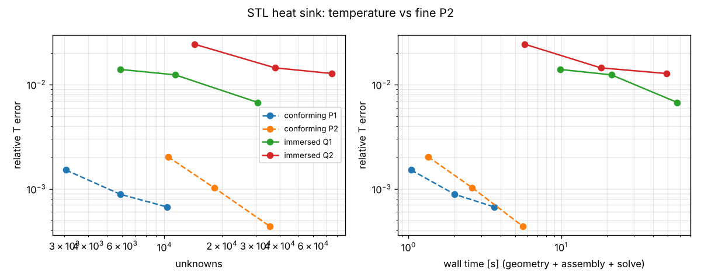
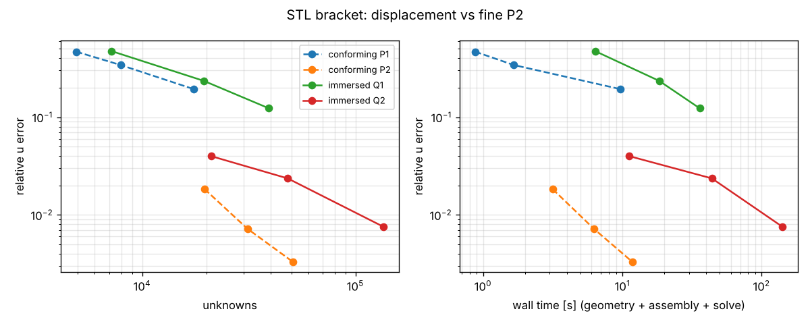

# Immersed analysis on raw geometry (issue #966)

The question: can PINNeAPPle analyse a part straight from its geometry (a signed distance, a voxel mask, an STL)
without generating a conforming mesh, accurately enough and fast enough to matter? The earlier meshless attempt
(RBF-FD and GFDM in [condensation_falsification.md](condensation_falsification.md), M1–M4) lost to finite volumes at
equal unknowns. This part tests the other well-established family: immersed / finite cell methods.

Every number below was measured in this container (4 cores, one thread per run, Python 3.13, NumPy / SciPy,
pyamg 5.3, gmsh 4.15, CalculiX 2.21) by the commands given with each table.

## Method (`pinneapple_simulation.immersed`)

- **Geometry**: any level set `phi(X)` (negative inside). Sources: analytic SDFs and their CSG (`ball`, `box`,
  `cylinder`, `torus`, `annulus`, `|`, `&`, `-`), any vectorised SDF (e.g. `pinneapple_design.geometry.gen.sdf_shapes`),
  a voxel mask (`VoxelGeometry`: Euclidean distance transforms of material and void, interpolated), or an STL
  (`STLGeometry`). For the STL, the inside test is the generalised winding number (Jacobson et al. 2013) with a
  dipole tree (Barill et al. 2018), and the distance is the exact point-triangle distance to candidates from a
  KD-tree of surface samples. In the near band of a watertight, consistently oriented surface, the sign comes from
  angle-weighted pseudonormals (Bærentzen & Aanæs 2005); there it is identical to the winding number (0 mismatches on
  200 000 points) and about 4× cheaper. A surface with holes uses the winding number everywhere.
- **Discretisation**: uniform background grid, Q1 or Q2 Lagrange elements; unknowns only on the active cells.
- **Cut cells**: adaptive octree, `depth` levels (default 2 for Q1, 3 for Q2). Leaves still cut are split into Kuhn
  simplices and clipped by the level set. The surface points are put on the true surface by regula falsi. The fine
  rule of each cut cell is compressed by moment fitting onto (2p+1)^d Gauss points, which is exact for the stiffness
  and mass integrands (Q_2p). The cut-cell matrices are then one matrix product.
- **Small cuts**: ghost penalty on the faces of cut cells (Burman 2010; coefficient 0.1 for Q1, 0.01 for Q2), or the
  finite cell method's fictitious material α = 1e-6 (Parvizian, Düster & Rank 2007), or none. The condition number is
  computed on request (Lanczos plus shift-invert, raw and Jacobi-scaled).
- **Boundary conditions**: Nitsche for temperatures. The penalty is β k / h with ghost penalty, or comes from a
  per-cell eigenvalue problem without it (Embar, Dolbow & Harari 2010). Heat flux and convection use surface
  quadrature on the clipped facets. Conditions are selected by `where(X, n)`.
- **Checks returned with every solve**: an energy balance (heat generated against heat leaving through each
  condition, using Nitsche's consistent flux) and, on request, the condition number.

## Verification

### Manufactured solutions on curved domains

`u = sin 2x cos 3y (sin z) + x²` with the matching source. Relative L2 and H1 errors are measured on the fine octree
rule. The rate is the slope between successive grids. Command: `verification.convergence(verification.manufactured(...), order, ns)`.

| Case | Order | n (cells across) | Rates L2 | Rates H1 |
|---|---|---|---|---|
| 2-D ring, Robin | Q1 | 10, 20, 40, 80 | 2.33, 2.12, 2.11 | 0.99, 1.00, 1.00 |
| 2-D ring, Robin | Q2 | 10, 20, 40, 80 | 3.18, 3.13, 3.09 | 2.09, 2.06, 2.03 |
| 2-D ring, Dirichlet | Q1 | 10, 20, 40, 80 | 2.26, 2.06, 2.08 | 1.00, 1.00, 1.00 |
| 2-D ring, Dirichlet | Q2 | 10, 20, 40, 80 | 3.21, 3.15, 3.09 | 2.10, 2.07, 2.03 |
| 3-D sphere, Dirichlet | Q1 | 6, 12, 24, 48 | 2.09, 2.25, 2.20 | 1.02, 1.03, 1.01 |
| 3-D sphere, Dirichlet | Q2 | 4, 8, 16, 24 | 2.97, 3.18, 3.16 | 2.04, 2.10, 2.08 |
| 3-D sphere, Robin | Q1 | 6, 12, 24, 48 | 2.18, 2.28, 2.20 | 0.99, 1.00, 1.00 |
| 3-D sphere, Robin | Q2 | 4, 8, 16, 24 | 2.84, 3.11, 3.09 | 1.96, 2.09, 2.08 |
| 3-D torus, Dirichlet | Q1 | 6, 12, 24, 48 | 1.80, 2.00, 2.21 | 0.93, 1.00, 1.01 |
| 3-D torus, Dirichlet | Q2 | 4, 8, 16, 24 | 2.14, 2.94, 3.06 | 1.82, 2.10, 2.08 |

The rates are optimal (p + 1 in L2, p in H1). The energy balance closes to between 1e-16 and 1e-10 in every run.

### Sphere and cylinder in closed form

Uniform generation q, convection h on the surface. Sphere: `T = T∞ + qR/3h + q(R² − r²)/6k`. Finite cylinder with
convection on the mantle and adiabatic caps: `T = T∞ + qR/2h + q(R² − r²)/4k` (Incropera et al., §3.5).

| Case | Order | n | Unknowns | L2 rel | H1 rel |
|---|---|---|---|---|---|
| sphere | Q1 | 6, 12, 24, 48 | 350 … 69 092 | 3.45e-3, 7.40e-4, 1.58e-4, 3.56e-5 | 2.12e-1 … 2.68e-2 (rate 1.0) |
| sphere | Q2 | 4, 8, 16, 24 | 879 … 74 231 | 7.32e-5, 1.92e-5, 4.74e-6, 2.10e-6 | 4.21e-4 … 2.15e-5 |
| cylinder | Q1 | 6, 12, 24, 48 | | L2 rates 2.31, 2.38, 1.59 | H1 rates 0.97, 0.98, 0.99 |
| cylinder | Q2 | 4, 8, 16, 24 | 847 … 70 839 | 4.48e-4, 2.37e-4, 1.17e-4, 8.35e-5 | 1.63e-2 … 6.12e-3 |

Two measured limitations:

- **Geometry-limited Q2.** The exact sphere field is quadratic, so Q2 can represent it exactly. What remains is the
  O((h/2^depth)²) error of the clipped surface, and the L2 rate is 2.0, not 3.
- **Sharp edges.** On the cylinder, Q2 drops to an L2 rate of about 1. A manufactured Dirichlet field on the same
  cylinder also loses its rate at the finest grid (L2 rates 2.93, 0.76). The level set has a kink at the rim, the
  linear clipping inside a leaf chamfers it, and the facets of the chamfer take the mantle or the cap condition by
  their normal. Edge-preserving clipping (one level set per smooth face) is the known remedy; it is not implemented
  here.

### Small cuts and conditioning

2-D manufactured case on a disk (n = 10). The grid is placed so that the disk pokes `offset × h` past a grid line,
which leaves slivers in the cells it enters. Command: `verification.conditioning(order)`.

| offset | order | smallest cut fraction | κ, none | κ, FCM (Jacobi-scaled) | κ, ghost (Jacobi-scaled) | L2 rel, none / FCM / ghost |
|---|---|---|---|---|---|---|
| 0.1 | Q1 | 3.3e-04 | 1.1e+09 | 1.2e+08 (3.9e+01) | 3.3e+02 (2.5e+01) | 9.8e-03 / 9.8e-03 / 1.2e-02 |
| 0.01 | Q1 | 4.1e-06 | 3.8e+13 | 8.5e+08 (6.1e+01) | 3.1e+02 (2.4e+01) | 9.5e-03 / 9.5e-03 / 1.2e-02 |
| 0.001 | Q1 | 4.2e-08 | 2.3e+18 | 2.2e+09 (2.8e+01) | 2.8e+02 (2.4e+01) | 9.6e-03 / 9.6e-03 / 1.2e-02 |
| 0.0001 | Q1 | 4.2e-10 | singular | 4.4e+09 (2.8e+01) | 2.6e+02 (2.4e+01) | 9.6e-03 / 9.6e-03 / 1.2e-02 |
| 0.1 | Q2 | 3.3e-04 | singular | 2.7e+08 (1.7e+05) | 3.7e+04 (2.6e+02) | 3.1e-04 / 3.1e-04 / 4.3e-04 |
| 0.01 | Q2 | 4.1e-06 | singular | 1.2e+09 (3.5e+05) | 6.3e+04 (2.8e+02) | 3.1e-04 / 3.1e-04 / 4.4e-04 |
| 0.001 | Q2 | 4.2e-08 | 1.8e+23 | 5.7e+09 (8.6e+03) | 6.4e+04 (2.9e+02) | 3.1e-04 / 3.1e-04 / 4.5e-04 |
| 0.0001 | Q2 | 4.2e-10 | singular | 1.5e+10 (5.2e+02) | 6.2e+04 (2.9e+02) | 3.1e-04 / 3.1e-04 / 4.5e-04 |

Without stabilisation, Q2 is numerically singular. The finite cell method keeps the solution accurate, but the raw
condition number grows to 1e8–1e10. The ghost penalty keeps it bounded and independent of the cut: about 3e2 for Q1
and 6e4 for Q2 (2.4e1 and 2.9e2 after Jacobi scaling). Its cost is the error: 25 % above FCM for Q1, 40–45 % for Q2.

The two coefficients were chosen together. For Q2 a ghost coefficient of 0.1 gives about 4× the FCM error. With 0.01
and the Nitsche penalty β = 40, the matrix was **indefinite** at offset 0.01 (two negative eigenvalues), because the
weak ghost penalty no longer controls the gradient on the sliver. β = 100 is positive definite at every offset from
0.3 to 1e-4 (`tests/test_immersed.py::test_ghost_nitsche_matrix_stays_positive_definite_on_slivers`). The Q2 defaults
are ghost 0.01 and β = 100. Every Q2 table in this report was measured with them; the convection cases have no
Nitsche term and do not depend on β.

### Other geometry inputs

Sphere with convection, Q1 and Q2 at h = R/8 (`tests/test_immersed.py`, measured once here):

| Input | Volume error | L2 rel (Q1 / Q2) | Quadrature time (Q1 / Q2) |
|---|---|---|---|
| SDF | −2.3e-4 | 3.8e-4 / 4.7e-6 | 1.2 / 5.3 s |
| STL (icosphere, 20 480 triangles) | −7.7e-4 (faceting) | 4.2e-4 / 4.4e-5 | 8.3 / 32.4 s |
| Voxels (R/40) | −5.7e-4 | 1.1e-3 / 9.7e-4 | 0.7 / 4.2 s |

The STL and voxel errors are dominated by the input itself: the facets of the icosphere, and the staircase of the
voxels smoothed over one voxel. STL quadrature is 6× slower than the SDF because every level-set value is a
nearest-triangle query. In the near band the pseudonormal sign brought it down from 116 s to 32 s for Q2; the winding
number alone was 27 of 36 s in a Q1 profile.

## Equal accuracy against conforming FEM

Command: `python -m pinneapple_simulation.immersed.compare --parts sphere_mms sphere --out DIR`. Raw rows are in
[`immersed/compare_results.json`](immersed/compare_results.json). Same part, same exact field, one thread.

- **Conforming:** P1 / P2 tetrahedra from gmsh (P2 nodes on the CAD sphere), solved by the same Python assembly and
  the same linear solver: SuperLU up to 3e5 non-zeros, otherwise CG with smoothed-aggregation AMG. CalculiX 2.21
  (C3D10) runs on the identical P2 mesh. It agrees with the internal P2: L2 3.0e-5 against 2.8e-5 at h = 0.2. Its
  error stops falling near 1e-6 at the two finest meshes, which looks like the output precision of the .frd file.
- **Times:** each method's geometry phase (cut-cell quadrature for immersed, gmsh meshing and optimisation for
  conforming) plus assembly and solve. The energy-balance check is left out for both methods.
- **Equal accuracy:** log-log interpolation between measured runs only; targets outside the measured range are not
  reported.

| Part | Target L2 | Method | Unknowns | Compute [s] | of which geometry [s] |
|---|---|---|---|---|---|
| sphere, manufactured (non-polynomial) | 1e-3 | immersed Q2 | 2.7e3 | 1.38 | 0.78 (quadrature) |
| | | conforming P2 | 3.0e3 | 0.77 | 0.32 (meshing) |
| | | immersed Q1 | 2.4e4 | 6.58 | 4.44 |
| | 1e-4 | immersed Q2 | 1.73e4 | 6.45 | 3.29 |
| | | conforming P2 | 3.27e4 | 5.50 | 2.56 |
| sphere, convection (quadratic field) | 1e-3 | immersed Q1 | 1.26e3 | 0.50 | 0.32 |
| | | conforming P1 | 1.12e3 | 0.66 | 0.54 |
| | 1e-4 | immersed Q1 | 1.81e4 | 3.90 | 2.92 |
| | 1e-5 | immersed Q2 | 9.6e3 | 3.37 | 2.08 |
| | | conforming P2 | 2.75e3 | 0.46 | 0.15 |
| | | CalculiX C3D10 | 2.9e3 | 0.53 | 0.17 |

Run-to-run variation in this container is about ±30 % on these timings: the same sweep measured 10.7 s and 8.2 s for
the 1e-4 manufactured row in an earlier run. The ratios are stable.

## Verdict (part 1, steady heat)

Measured on two parts, a sphere with a smooth field and a sphere with generation and convection.

**Immersed wins where:**
- **Unknowns, smooth non-polynomial fields:** Q2 reaches 1e-4 with 1.73e4 unknowns against 3.27e4 for conforming P2.
  The Cartesian grid spends fewer nodes on the same volume.
- **Raw geometry:** an STL (winding number), a voxel mask or an SDF is solved directly, with no meshing step and no
  meshing failure mode. A surface with 10 missing triangles still gets the right inside test.
- **Conditioning:** with the ghost penalty, κ stays at 3e2 (Q1) / 6e4 (Q2) for cut fractions down to 4e-10.
- **Matching low order:** Q1 vs P1 at 1e-3 on the convection sphere is a draw (0.50 s vs 0.66 s, similar unknowns).

**Immersed loses where:**
- **Wall time at equal accuracy on clean CAD:** 1.2–1.8× slower than conforming P2 on the smooth field (6.45 vs
  5.50 s at 1e-4, 1.38 vs 0.77 s at 1e-3). No meshing time is saved there: the Python cut-cell quadrature took as long
  as gmsh's compiled meshing (3.3 s vs 2.6 s).
- **Fields conforming P2 represents exactly:** on the quadratic sphere field, immersed Q2 is geometry-limited (L2 rate
  2.0). It needs 3.5× the unknowns and 7× the time of P2 or CalculiX to reach 1e-5.
- **Sharp edges with a change of boundary condition:** on the cylinder rim, Q2 falls to L2 rate ≈ 1 (8.4e-5 at
  7e4 unknowns). Meshing is not the bottleneck there; edge-preserving clipping would be needed.
- **STL input cost:** 6× the SDF quadrature time (32 s for Q2 at h = R/8 on a 20 480-triangle sphere).

Parts whose meshing is not trivial (an STL heat sink and an STL bracket), elasticity and transient heat: below.

## Part 2: linear elasticity and two STL parts

### Elasticity verification

`immersed.solve_elasticity` reuses the discretisation, the stabilisation and the Nitsche machinery. Displacements can
be imposed on all components or a subset; loads are tractions, pressures, or a total force spread over the area the
selector finds (`Force`). Every solve returns an equilibrium check: applied loads against the reactions computed
from Nitsche's consistent flux. Commands: `verification.elastic_convergence(verification.elastic_manufactured(dim), order, ns)`
and `verification.solve_elastic_case(verification.lame_sphere(), n, order)`.

| Case | Order | n | L2 rel | Rates L2 | Rates H1 |
|---|---|---|---|---|---|
| 2-D disk, plane waves, ν = 0.3 | Q1 | 10, 20, 40, 80 | 1.36e-2 … 1.59e-4 | 2.21, 2.11, 2.10 | 1.03, 1.02, 1.01 |
| 2-D disk, plane waves | Q2 | 10, 20, 40, 80 | 5.08e-4 … 5.56e-7 | 3.44, 3.23, 3.16 | 2.18, 2.08, 2.05 |
| 3-D sphere, plane waves | Q1 | 6, 12, 24 | 3.04e-2 … 1.47e-3 | 2.11, 2.26 | 1.06, 1.06 |
| 3-D sphere, plane waves | Q2 | 4, 8, 12, 16 | 5.84e-3 … 5.94e-5 | 3.23, 3.26, 3.57 | 2.16, 2.16, 2.23 |
| Lamé thick sphere (a = 0.3, b = 0.6), inner pressure | Q1 | 6, 12, 24 | 1.80e-1 … 8.14e-3 | 1.97, 2.50 | 1.21, 1.17 |
| Lamé thick sphere | Q2 | 4, 8, 12, 16 | 1.18e-1 … 1.91e-3 | 2.83, 3.15, 3.11 | 1.87, 2.31, 2.43 |

Equilibrium closes to between 1e-16 and 1e-9. FCM sits at 2e-8 because of its ~1e10 condition number. On the Lamé
sphere the pressure has no net force, so the imbalance is relative to the sum of the load magnitudes.

### Two parts given only as STL: a heat sink and a bracket

`immersed.parts` builds both parts in gmsh's OpenCASCADE kernel and writes them as STL. The STL is the only geometry
either method sees:
- the immersed solver reads it with `STLGeometry` (winding number);
- the conforming solver turns it into a volume mesh with gmsh (`tet_fem.occ_stl`: classify the facets, rebuild the
  surfaces, mesh).

Each run is compared with a fine conforming P2 run on the same STL, at 3000 interior points (≥ 0.3 mm inside) and at
one probe point. Command: `parts.study(name, plan, reference, out_dir)`. The study is checkpointed: each run is
appended to `<name>.jsonl`, and an interrupted study resumes. Raw rows:
[`immersed/heat_sink.jsonl`](immersed/heat_sink.jsonl) and [`immersed/bracket.jsonl`](immersed/bracket.jsonl).
Times are one thread; compute = geometry phase (quadrature, or gmsh meshing from the STL) + assembly + solve.

- **Heat sink.** Aluminium (k = 205 W/m K): a 40 × 40 × 4 mm base with 7 fins, each 1.5 mm thick and 20 mm high.
  A 15 × 15 mm chip under the centre puts in 20 W (`HeatInput`, spread over the area each method finds there).
  Every other surface has h = 25 W/m² K to air at 25 °C. Reference: P2 at 1 mm (139 630 unknowns).
- **Bracket.** Steel L-bracket, two 60 × 40 × 6 mm flanges with a 4 mm inner fillet. Two 6 mm bolt holes are
  clamped, and 500 N pulls down on the arm's end face (`Force`). Reference: P2 at 1.5 mm (217 131 unknowns).

Both selectors had to apply exact totals. With per-point selection, the rounded edges of the end face lost 8 % of
the bracket load (461 N instead of 500 N). With per-face selection, the conforming meshes changed the chip power from
mesh to mesh, and their errors did not converge.

| Heat sink | Size | Unknowns | T L2 rel | Chip T error | Geometry [s] | Compute [s] |
|---|---|---|---|---|---|---|
| conforming P1 | 3 / 2 / 1.5 mm | 3 056 / 5 876 / 10 298 | 1.5e-3 / 8.9e-4 / 6.7e-4 | −4.8e-3 / −2.5e-3 / −2.0e-3 | 0.9 / 1.7 / 2.9 | 1.0 / 2.0 / 3.6 |
| conforming P2 | 4 / 3 / 2 mm | 10 444 / 18 179 / 35 473 | 2.0e-3 / 1.0e-3 / 4.4e-4 | −1.6e-3 / −6.7e-4 / −7.1e-4 | 0.8 / 1.3 / 2.5 | 1.3 / 2.6 / 5.6 |
| immersed Q1 | 2 / 1.5 / 1 mm | 5 896 / 11 368 / 30 744 | 1.4e-2 / 1.2e-2 / 6.7e-3 | +1.0e-2 / +9.5e-3 / +5.4e-3 | 8.9 / 19.7 / 51.9 | 9.9 / 21.3 / 57.6 |
| immersed Q2 | 3 / 2 / 1.5 mm | 14 355 / 37 883 / 75 075 | 2.4e-2 / 1.4e-2 / 1.3e-2 | +1.9e-2 / +1.3e-2 / +1.1e-2 | 3.4 / 8.7 / 20.9 | 5.8 / 18.2 / 48.9 |

The coarsest conforming run (P1, 3 mm: 1.5e-3 in 1.0 s) is more accurate than the finest immersed run (Q1, 1 mm:
6.7e-3 in 57.6 s). The immersed error plateaus near 1 %, and the cause was measured:
- At h = 1.5 mm, depth 2, the immersed surface area is **1.28 % short**. The level-set clipping chamfers each fin
  edge at the leaf scale h/2^depth, which removes convective area.
- The chip runs 1.1 % too hot, which matches.
- The area deficit halves per octree level (−1.44e-2 / −7.01e-3 at h = 2 mm, depths 2 / 3; −1.28e-2 / −5.96e-3 at
  1.5 mm), so it converges only like h/2^depth, and each level costs 5–6× more quadrature.

On a part made of thin plates and sharp edges, convection-dominated heat is the immersed method's worst case.

| Bracket | Size | Unknowns | u L2 rel | Tip error | Peak VM error | VM L2 rel | Compute [s] |
|---|---|---|---|---|---|---|---|
| conforming P1 | 4 / 3 / 2 mm | 4 908 / 7 917 / 17 460 | 0.47 / 0.34 / 0.19 | −0.49 / −0.35 / −0.20 | −2.1e-2 / −0.19 / −6.7e-2 | 0.50 / 0.43 / 0.32 | 0.9 / 1.7 / 9.7 |
| conforming P2 | 6 / 4 / 3 mm | 19 587 / 31 191 / 50 778 | 1.8e-2 / 7.2e-3 / 3.3e-3 | −1.9e-2 / −7.5e-3 / −3.3e-3 | −9.4e-3 / −1.6e-2 / −5.7e-3 | 8.8e-2 / 5.1e-2 / 4.1e-2 | 3.2 / 6.2 / 11.7 |
| immersed Q1 | 3 / 2 / 1.5 mm | 7 200 / 19 440 / 39 258 | 0.47 / 0.24 / 0.12 | −0.48 / −0.24 / −0.12 | −0.50 / −0.32 / −0.25 | 0.49 / 0.25 / 0.14 | 6.4 / 18.4 / 35.9 |
| immersed Q2 | 4 / 3 / 2 mm | 21 045 / 48 090 / 135 351 | 4.0e-2 / 2.4e-2 / 7.5e-3 | −3.7e-2 / −2.3e-2 / −6.3e-3 | −0.19 / −7.5e-2 / −3.9e-2 | 9.2e-2 / 5.7e-2 / 2.6e-2 | 11.2 / 43.9 / 140.9 |

Equal accuracy on the displacement:

| Target u L2 | Method | Unknowns | Compute [s] |
|---|---|---|---|
| 2e-2 | conforming P2 | < 1.96e4 (6 mm: 1.8e-2) | < 3.2 |
| | immersed Q2 | 5.6e4 | 51.9 |
| 1e-2 | conforming P2 | 2.65e4 | 4.9 |
| | immersed Q2 | 1.05e5 | 106 |

- **Locking.** Linear elements lock in bending on a 6 mm plate, conforming P1 and immersed Q1 alike (12–49 %
  error).
- **Q2 vs P2.** Q2 removes the locking but needs 4× the unknowns and 20× the time of P2. A uniform grid spends cells
  on the bracket's bounding box, and its 3-D Q2 couplings (125 nodes) make the matrix much denser than P2's.
- **Peak stress.** The peak von Mises stress (at interior points, near the fillet and holes) converges more slowly
  for immersed (3.9 % at 2 mm) than for P2 (0.6–1.6 %).
- **Meshing was not the bottleneck.** gmsh meshed both STLs in 0.6–2.9 s (6.3 s for the 1.5 mm reference), less
  than the immersed quadrature of the same STL at any useful resolution.

## Part 3: transient heat

`immersed.transient.solve_transient_heat`: ρc ∂T/∂t − div(k ∇T) = f with the θ scheme (θ = 1 backward Euler,
θ = 1/2 Crank–Nicolson). The steady operator and loads are reused; the mass matrix comes from the same cut-cell
rule. With the ghost penalty, a mass ghost term γ_M ρc h² (γ_M = 0.01) controls small cuts. Time-dependent sources
`f(X, t)` and conditions `bcs(t)` are supported. The matrix is factorised once.

- **Initial field.** The first version projected T0 in L2. That left round-off-sized noise on small-cut unknowns,
  which Crank–Nicolson never damps: the error stayed at 1.4e-3 for every Δt without the mass ghost term, and at
  1e-5 with it. Nodal interpolation removed the floor.
- **Manufactured solution in time.** 2-D disk, Q2, n = 80, t ∈ [0, 0.5], `u = e^{−t} sin 2x cos 3y + x²`, Dirichlet:

| Scheme | Steps 2, 4, 8, 16, 32: L2 rel | Rates |
|---|---|---|
| backward Euler | 3.09e-3, 1.51e-3, 7.39e-4, 3.66e-4, 1.82e-4 | 1.04, 1.03, 1.02, 1.01 |
| Crank–Nicolson | 5.39e-5, 2.94e-5, 7.56e-6, 1.98e-6, 7.43e-7 | 0.87, 1.96, 1.94, 1.41 (spatial floor) |

- **Space rates** (Crank–Nicolson, small Δt, n = 10, 20, 40): Q1 L2 2.22, 2.10 and H1 1.01, 1.00; Q2 L2 2.92, 2.65
  and H1 1.79, 1.86.
- **Sphere cooling** (Bi = 2, series solution of Incropera §5.6.2, to Fo = 0.3, 80 Crank–Nicolson steps):
  - Q1, n = 8 / 16 / 32: L2 rel 7.9e-3 / 1.7e-3 / 3.9e-4;
  - Q2, n = 4 / 8 / 16: 1.9e-3 / 2.1e-4 / 5.1e-5.

## Verdict (all parts)

Measured on a sphere, a cylinder, a torus, a Lamé shell, an STL heat sink and an STL bracket.

**Immersed wins:**
- **Raw geometry in, no meshing failure mode.** An SDF, a voxel mask or an STL is solved directly. An STL with
  holes still gets a robust inside test. No geometry here failed for either method, but gmsh's high-order optimiser
  did abort the whole process on one coarse STL mesh, which the immersed path cannot do.
- **Smooth parts and smooth fields:** fewer unknowns than conforming P2 at equal accuracy (sphere, manufactured
  field: 1.73e4 vs 3.27e4 at 1e-4), with optimal rates in L2 and H1 for heat, elasticity and time stepping.
- **Small cuts:** with the ghost penalty, the conditioning stays bounded whatever the cut (κ ≈ 3e2 / 6e4 for
  Q1 / Q2 down to cut fractions of 4e-10).

**Immersed loses:**
- **Wall time, everywhere measured:** 1.2–1.8× on the smooth sphere, about 7× when P2 represents the field exactly,
  20× on the bracket and more than 50× on the heat sink at equal accuracy.
- **Meshing time saved is negative here.** The Python cut-cell quadrature took as long as or longer than gmsh's
  meshing of the same geometry in every case: 3.3 s vs 2.6 s on the sphere; 9–52 s vs 1–3 s on the STL heat sink.
- **Sharp edges:**
  - with a change of condition across them (cylinder rim), Q2 drops to L2 rate ≈ 1;
  - with convection on all of them (heat sink), the chamfered edges remove 1.3 % of the area and the temperature
    plateaus near 1 %; the error converges only like h/2^depth.
- **Thin-walled parts in bending:** Q1 locks (as P1 does). Q2 works but needs 4× the unknowns of P2, because a
  uniform grid cannot grade towards thin walls.

**What would change the verdict**, and was not built here:
- edge-preserving clipping (one level set per smooth face, or exact clipping by the STL triangles);
- local or adaptive grid refinement (hanging nodes, an octree background);
- compiled quadrature, since the Python octree is the time sink.

On the measurements here, conforming P2 is faster and at least as accurate on every part that gmsh can mesh. The
immersed path's remaining case is input that cannot be meshed well or at all: voxel data, defective STL, geometry
sweeps that change topology. None of these was measured here; the evidence for them is the method's design (no mesh
to fail), not a benchmark.