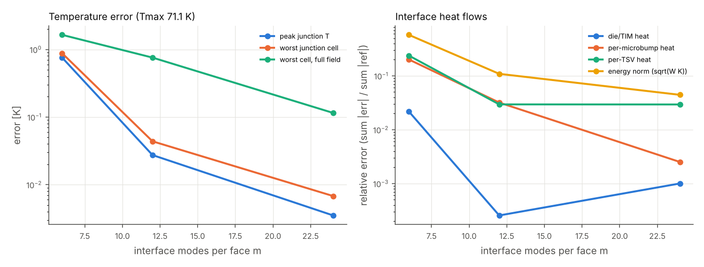
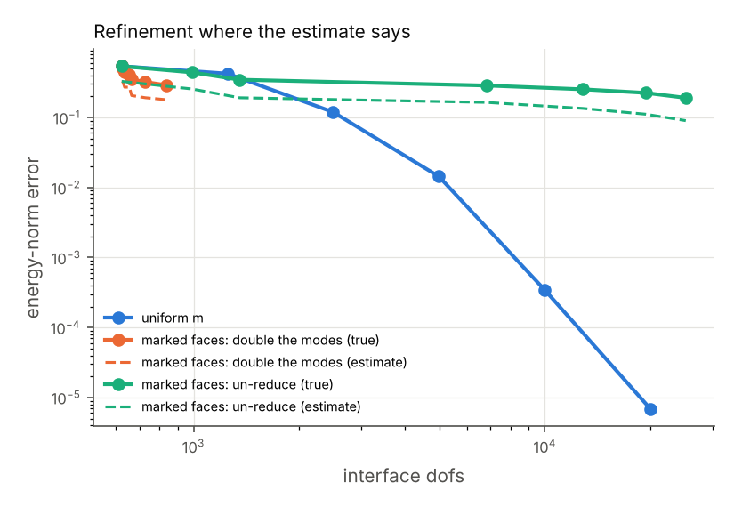
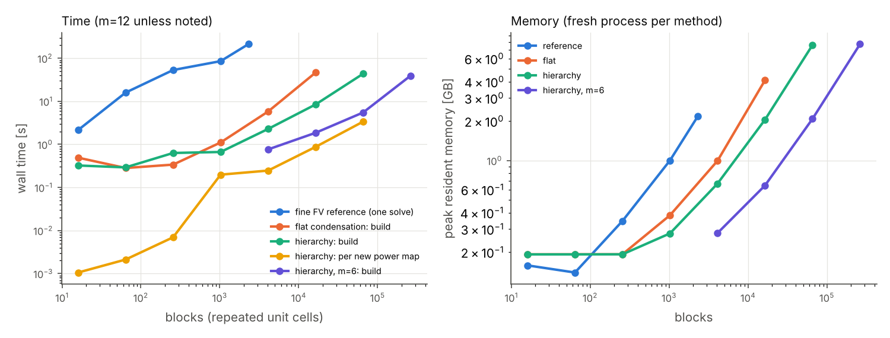
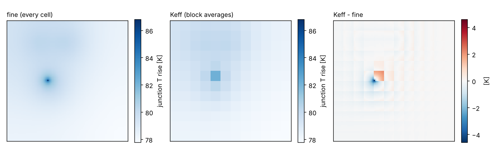
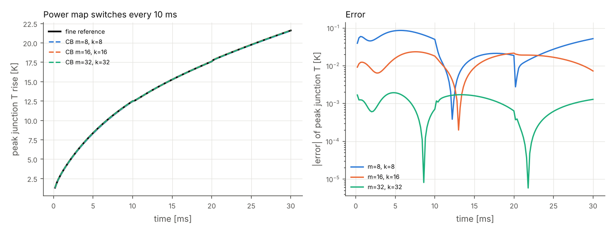
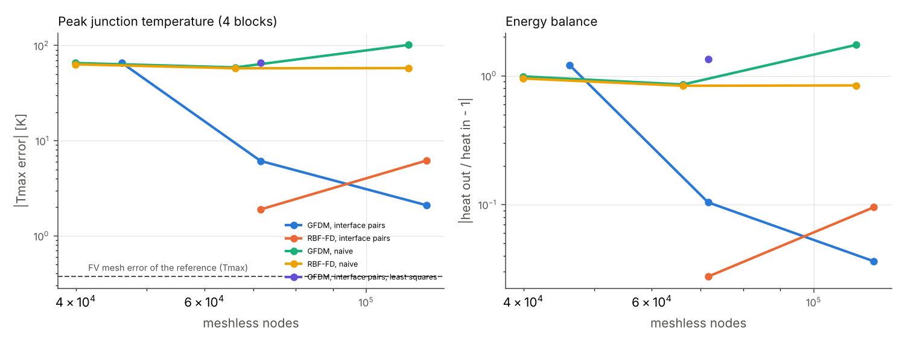
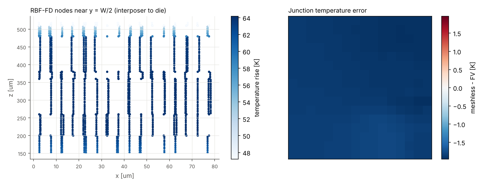
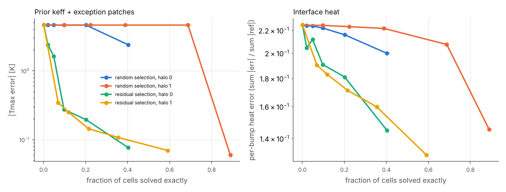
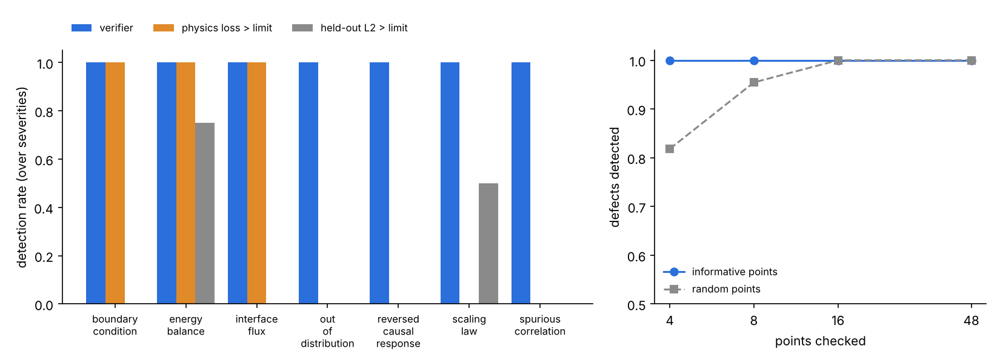
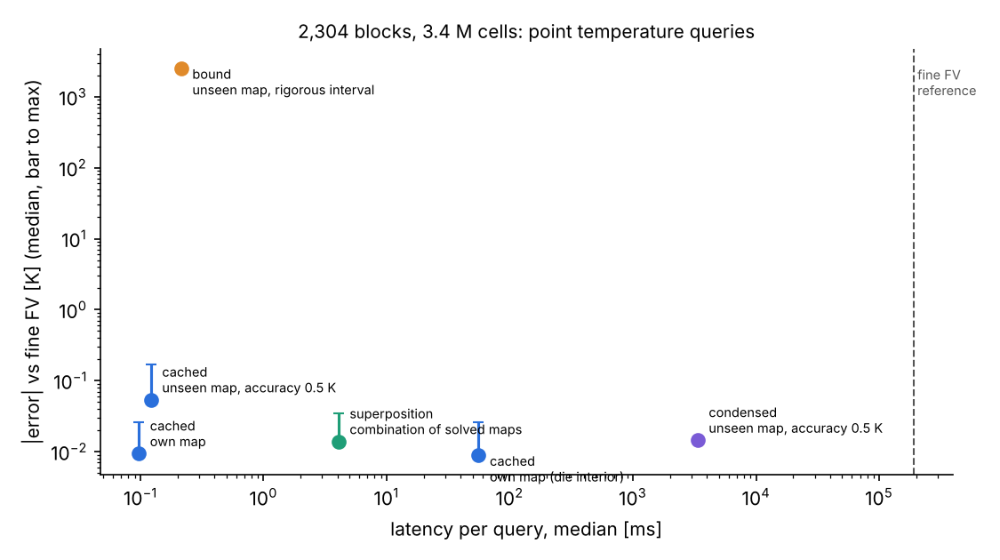

# Adaptive Physics Condensation: geometry-independent thermal models of chip packages

Research line, track 1 of 3 (condensation). Tracks 2 (a physics query engine) and 3 (verification of what a PINN
has actually learned) build on this one and are reported separately.

Code: [`pinneapple_condense`](../../pinneapple_condense). Benchmark: [`examples/physics_condensation`](../../examples/physics_condensation/run_benchmark.py).
Every number below was measured in this repository's CI container (4 cores, 15 GB RAM, no GPU). Each comes from
`results/*.json` of that example. Each study ran in a fresh Python process, and *peak memory* is that process's
peak resident set size. Nothing below is quoted from another source unless it carries a citation.

## 1. The question

A 2.5D/3D package has 10^4 to 10^6 microbumps, TSVs and C4 bumps, and a fab-resolution CAD model has up to 10^9
polygons. An engineer asks only a few questions of it:

- the peak junction temperature;
- the temperature of each junction;
- how the heat divides between the lid and the board, and through each bump;
- the thermal resistance.

Can the cost of answering them track the *physical* complexity of the package rather than its element count:

- how many distinct kinds of structure it has;
- how far heat spreads;
- how many independent power patterns it sees?

Three objects get confused here:

| | what it is | what drives its size |
|---|---|---|
| **geometry** | the solids and their materials | number of features (bumps, vias, layers) |
| **discretisation** | the unknowns a solver needs to resolve the geometry and the fields | features x cells per feature |
| **fields / observables** | temperatures and fluxes, and the few numbers asked of them | the physics: diffusion length, sources, contrasts |

A fine mesh couples all three. The cost of a direct solve grows with the discretisation even when 10^5 bumps are
identical and the answer is a handful of numbers. Homogenisation (Keff) cuts the discretisation by replacing the
geometry with averages. It also erases whatever happens below the averaging scale, and Section 4.6 measures what it
erases. This work keeps the exact fine operator and *condenses* it:

1. every repeated block is reduced once to its interface operator;
2. identical blocks, and identical arrangements of blocks, share that work;
3. interior fields are rebuilt only where they are asked for;
4. an error estimate decides where the reduction has to be undone.

## 2. Related work

*How the references were checked.* The network in this container blocked direct access to publisher pages, DOI
resolvers, arXiv, patent offices and the vendor's site; only a web-search tool worked. Each reference below was
checked against search-result records of publisher, repository or index pages. Where a field could not be confirmed
it is marked.

**Homogenisation and multiscale methods.** Periodic homogenisation gives effective coefficients from cell problems
(Bensoussan, Lions and Papanicolaou 1978). For two-phase composites, the Hashin–Shtrikman bounds bracket the
effective conductivity (Hashin and Shtrikman, *J. Appl. Phys.* 33 (1962) 3125, doi:10.1063/1.1728579). Our Keff
baseline uses the lower bound in plane and the parallel rule through the layer. Multiscale finite elements (Hou and
Wu, *J. Comput. Phys.* 134 (1997) 169, doi:10.1006/jcph.1997.5682) and the heterogeneous multiscale method (E and
Engquist, *Commun. Math. Sci.* 1 (2003) 87) keep fine-scale information in coarse basis functions or local solves.

**Substructuring and component mode synthesis.**
- Static condensation onto interfaces and component mode synthesis go back to Hurty (*AIAA J.* 3 (1965) 678; DOI
  from citing lists only) and Craig and Bampton (*AIAA J.* 6 (1968) 1313, doi:10.2514/3.4741).
- Characteristic constraint modes reduce the interface itself (Castanier, Tan and Pierre, *AIAA J.* 39 (2001) 1182;
  DOI not confirmed).
- The closest prior work to ours is the static-condensation reduced basis element method. Huynh, Knezevic and Patera
  (*ESAIM: M2AN* 47 (2013) 213, doi:10.1051/m2an/2012022) and Eftang and Patera (*Int. J. Numer. Methods Eng.* 96
  (2013) 269, doi:10.1002/nme.4543) introduce port reduction with a posteriori error estimation.
- Our reduced interfaces with a residual-based estimate follow the same idea. The differences are the port basis
  (load-informed POD, Section 3.3), the nested memoised hierarchy, and the learned-operator fallback.
- Load-dependent Ritz vectors (Wilson, Yuan and Dickens, *Earthquake Eng. Struct. Dyn.* 10 (1982) 813; details from
  a citing list) motivate building interface modes from loads rather than from an eigenproblem.

**Fast direct solvers.**
- Nested dissection orders a mesh so that elimination proceeds through separators (George, *SIAM J. Numer. Anal.* 10
  (1973) 345, doi:10.1137/0710032).
- Hierarchical matrices (Hackbusch, *Computing* 62 (1999) 89, doi:10.1007/s006070050015) and HSS multifrontal
  solvers (Xia, Chandrasekaran, Gu and Li, *SIAM J. Matrix Anal. Appl.* 31 (2009) 1382, doi:10.1137/09074543X)
  compress the dense separator Schur complements, whose off-diagonal blocks have low numerical rank.
- The fast multipole method exploits the same far-field smoothness for particle interactions (Greengard and Rokhlin,
  *J. Comput. Phys.* 73 (1987) 325, doi:10.1016/0021-9991(87)90140-9).
- Our hierarchy is nested dissection on reduced interfaces, with memoisation of identical subtrees. Section 4.4
  measures the off-diagonal ranks of its top operator, but the H-matrix arithmetic is not implemented.

**Model reduction.** Projection-based parametric model reduction is surveyed by Benner, Gugercin and Willcox (*SIAM
Rev.* 57 (2015) 483, doi:10.1137/130932715). Hyper-reduction of nonlinear terms uses the empirical interpolation
method (Barrault, Maday, Nguyen and Patera, *C. R. Math.* 339 (2004) 667, doi:10.1016/j.crma.2004.08.006) and DEIM
(Chaturantabut and Sorensen, *SIAM J. Sci. Comput.* 32 (2010) 2737, doi:10.1137/090766498). The learned block
operator of Section 3.5 is a parametric POD of the operator entries with a Gaussian-process regression, the existing
`pinneapple_neural.architectures.rom.parametric.ParametricPOD`.

**Chip thermal models and neural operators.**
- Compact thermal models such as HotSpot (Skadron et al., ISCA 2003, pp. 2–13, doi:10.1109/ISCA.2003.1206984) and
  3D-ICE (Sridhar et al., ICCAD 2010, pp. 463–470, doi:10.1109/ICCAD.2010.5653749) use coarse grids or
  layer-homogenised resistances.
- Neural operators learn the map from power maps to fields:
  - FNO (Li et al., ICLR 2021, arXiv:2010.08895);
  - DeepONet (Lu et al., *Nat. Mach. Intell.* 3 (2021) 218, doi:10.1038/s42256-021-00302-5);
  - for 3D ICs, DeepOHeat (Liu, Li, Hu, Yu, Shiau, Ai, Zeng and Zhang, DAC 2023, arXiv:2302.12949);
  - physics-enforced networks for full-chip thermal analysis (Chen, Lu, Jin and Tan, ICCAD 2023; DOI not confirmed).
- These learn the whole field map, so their error is not bounded by a solver. Here learning is confined to block
  operators, inside an exact algebraic assembly with a check against the exact operator.

**PINN failure modes** (they motivate track 3): spectral bias and stiffness of the loss landscape (Wang, Teng and
Perdikaris, *SIAM J. Sci. Comput.* 43 (2021) A3055, doi:10.1137/20M1318043; Wang, Yu and Perdikaris, *J. Comput.
Phys.* 449 (2022) 110768, doi:10.1016/j.jcp.2021.110768), and failures at higher coefficients (Krishnapriyan et al.,
NeurIPS 2021, arXiv:2109.01050). PINNs: Raissi, Perdikaris and Karniadakis, *J. Comput. Phys.* 378 (2019) 686,
doi:10.1016/j.jcp.2018.10.045.

**Reference company (ideas only).** Vinci (getvinci.ai; formerly Vinci4D) sells physics AI for semiconductor
packaging, thermal and thermo-elastic. What search-result text of their pages and press releases says (the pages
themselves could not be loaded from this container):

- "up to 1000x faster than conventional simulation tools" (Business Wire, 2 Dec 2025);
- a homepage table of 20 s against 2 h for a commercial FEA solver at 117,440,512 DOF;
- no manual meshing;
- research notes that report results both without homogenisation and with per-layer Keff tensors.

These are the company's own claims; they are not verified here and are not compared with our numbers. The brief for
this work names a patent application, WO2026064513A1, as theirs, describing:

- a latent encoding of geometry and a separate topology representation;
- boundary conditions, materials and sources as inputs;
- a field-prediction model;
- verification or correction by the governing equations or a solver.

We could not retrieve the document: patent offices were unreachable and searches returned no record. Title,
applicant and claims are therefore **not verified**. The design here was not taken from it: there is no geometry
latent and no learned field predictor. Learning is confined to block operators inside an exact assembly. Whether
this work is free to operate against that application, or anything else, needs an IP specialist; nothing here is a
freedom-to-operate opinion.

## 3. Method

### 3.1 Benchmark and reference solver

`pinneapple_condense.package` builds a synthetic multilayer package from bottom to top:

| layer | thickness | contents |
|---|---|---|
| organic substrate | 200 µm | — |
| C4 bumps in underfill | 60 µm | — |
| silicon interposer with copper TSVs | 100 µm | — |
| microbumps in underfill | 20 µm | — |
| die | 100 µm | power on its bottom cell row (flip chip) |
| TIM | 30 µm | contact resistance 5e-6 m²K/W on both faces |
| copper lid | 500 µm | Robin cooling h = 2e4 W/m²K on top |

- The board side has h = 1e3 W/m²K. Laterally the package is a square array of 40 µm unit cells (*blocks*), each
  with one microbump, one TSV and one C4 bump, all square in plan.
- Materials are representative: Si k = 148, Cu k = 401, solder 58, underfill 0.5, TIM 4, substrate 0.8 W/m/K. The
  copper values match Incropera et al.'s Table A.1 (as transcribed); the silicon value is a handbook value (Wikipedia
  gives ~149). The package is synthetic and is not a product.
- One block is 8 x 8 x 23 = 1,472 cells.
- Power maps are a uniform background (40 %) plus Gaussian hotspots, at a mean of 1e6 W/m² (100 W/cm²).
- The reference (`fv`) is a cell-centred finite-volume scheme: harmonic face conductances and contact resistances
  in series. It is solved by sparse LU up to 6e4 unknowns and by AMG-preconditioned CG (pyamg) to a relative
  residual of 1e-11 above that.
- With all heat generated on the active row and non-negative power, the discrete maximum principle for this M-matrix
  scheme puts Tmax on that row (Varga, *Matrix Iterative Analysis*, 2nd ed., Springer 2000; Ciarlet and Raviart,
  *Comput. Methods Appl. Mech. Eng.* 2 (1973) 17, doi:10.1016/0045-7825(73)90019-4). Every reference run checks it.

### 3.2 Block condensation (exact)

Each block is a voxel box with one *port* node per lateral boundary face. Each port is joined to its cell by the
half-cell conductance; eliminating a shared port gives exactly the fine scheme's harmonic face conductance. The fine
problem is therefore the assembly of blocks through their ports, and nothing is approximated. Eliminating the cells
gives

```
S = K_pp − K_pc K_cc⁻¹ K_cp,     g = W p,  W = −K_pc K_cc⁻¹ E,     T_c = Z p − Y t
```

Blocks with the same variant (materials, a voided bump, a missing bump, a degraded contact) share `S`, `W`, `Y` and
`Z`, which are cached. A test checks this path against the reference to 1e-7 relative.

### 3.3 Reduced interfaces, error estimate, refinement

A face has 8 x 23 = 184 port nodes, and its trace is restricted to `m` modes: the constant, then the leading POD
modes of two equally weighted sets of exactly solved traces.

- **Local:** the interior faces of a 4 x 4 patch under every unit active-cell load. These are the near-field traces
  any power map can produce.
- **Global:** the interior faces of an exactly condensed 16 x 16 package under 24 random hotspot maps. These are the
  far-field traces, where the lid, die, interposer and substrate spread heat laterally at different rates.

The POD comes from the eigenvectors of the 184 x 184 Gram matrix. The snapshot set is built once per stack (about
2.5 min) and cached on disk.

The global problem is then a Galerkin restriction, with two consequences:

- the error is the energy-norm best approximation over the chosen interface space;
- with the constant in every basis, the global heat balance holds to round-off.

The global set is what lets reduced interfaces work at scale (Section 4.2): with local snapshots only, the error grew
with the package size. The textbook choice, characteristic constraint modes (the softest eigenvectors of the face
Schur complement), fails outright here: its soft modes localise in the low-k underfill and substrate and miss the
vertical temperature profile.

Interiors are exact, so the fine residual lives only on port nodes. The per-face estimate is `η_F² = r_Fᵀ S_FF⁻¹
r_F`. Refinement marks the faces holding half of `Σ η²` (Dörfler marking) and either doubles their modes (`p`) or
restores their full port field (`full`).

**Exact correction.** `Condensed.correct` makes the reduced model exact. It solves the *unreduced* interface problem
by conjugate gradients, preconditioned by the reduced model (two-level additive Schwarz: a coarse solve on the
interface modes, plus face-block Jacobi) and started from the reduced solution. The iterations needed, not the final
accuracy, depend on `m`.

### 3.4 Hierarchical condensation with memoised subtrees

`hierarchy.Hierarchy` splits the array in halves recursively. Each merge eliminates the shared faces of two
children: dense Schur complements on reduced ports, that is, nested dissection. A node's operator depends only on
its shape and its children's operators, so nodes are memoised by that key:

- a uniform 2^L x 2^L array needs 2L merges;
- a few variants add a few per level;
- the build cost follows the number of *distinct subtrees*, plus the dense algebra of the top separators, which
  grows with the array side.

A power map goes up the tree as condensed loads; ports come down. The downward pass can be restricted to the path
to one block, which is what a point query needs (track 2).

### 3.5 Learned block operators with verification

When blocks differ continuously (a void fraction, TIM degradation, TSV quality), each block would need its own
factorisation. `learned.LearnedBlocks` learns the reduced operator `(S_r, W_r, O_t, O_p)` as a function of the
block parameters `θ` from 48 exact condensations (Latin hypercube). It uses POD of the entries, taken as a correction
to the operator of the centre block, plus a GP regression. `solve_adaptive` then runs four steps:

1. Blocks outside the training box, or with a large predictive deviation, are condensed exactly.
2. The global problem is solved.
3. The hottest blocks and a random audit sample are compared with their exact operator *at the solved state*. The
   check uses the local junction discrepancy and the global effect of the heat-flow residual they inject,
   `A⁻¹ r_b`, computed with the already factorised global matrix.
4. Failing blocks are replaced by their exact operator and the problem is solved again. The audit gives an additive
   estimate for the blocks never checked.

### 3.6 Transient

`transient.CBTransient` applies Craig–Bampton to the heat equation:

- per block, static constraint modes, the exact static response to the block's own power, and `k` slowest
  fixed-interface modes;
- interface modes from steady *and* Laplace-shifted (`K + sC`) traces, because steady traces miss early-time
  profiles (Section 4.7);
- implicit Euler at a fixed step, against the fine reference at the same step.

### 3.7 Meshless (track 1b)

`meshless.point_cloud` places nodes from the implicit description only: layers are z intervals and inclusions are
square prisms. There is no volume mesh.

- **Interior nodes:** a jittered lattice per material region. The spacing is `min(cap, thickness / 3)` per layer,
  and at least 4 nodes span each inclusion within a band around its walls. Rows are aligned with the heated layer's
  step.
- **Surface nodes:** lattices on each surface. Interfaces carry node *pairs*, one per side. Plane spacing follows the
  layers on both sides.

`meshless.assemble` collocates the equations with RBF-FD (PHS `r^3` plus degree-2 polynomials, Flyer, Fornberg,
Bayona and Barnett, *J. Comput. Phys.* 321 (2016) 21) or GFDM (weighted least squares, Benito, Ureña and Gavete,
*Appl. Math. Model.* 25 (2001) 1039, doi:10.1016/S0307-904X(01)00029-4). The generic n-D weights live in
`pinneapple_simulation.meshless.stencils`.

- Inside a region, `k ∇²T + q = 0`, using same-region stencils only.
- At the top and bottom, Robin conditions.
- Each interface pair gets flux continuity and the contact law from one-sided stencils.
- `interface="naive"` keeps one node per interface point, lets stencils cross materials, and imposes no interface
  condition.

Instabilities found and fixed on the way, each measured on an exact solution (`tests/test_condense.py`):

1. Neumann side walls collocated at nodes: the error grew under refinement. The fix treats the adiabatic sides as
   mirror planes, so stencils near a side use reflected images of the nodes.
2. Interface-plane stencils whose nodes were all coplanar made the local systems singular. The fix allows at most
   `n/3` nodes in a surface node's own plane.
3. Row scales spanned 12 orders of magnitude (`k/h²` against 1), and the factorisation lost the small rows. The fix
   equilibrates the rows.

Oversampled least-squares collocation (Tominec, Larsson and Heryudono, *SIAM J. Sci. Comput.* 43 (2021) A1441,
doi:10.1137/20M1320079) is implemented as an option.

### 3.8 Prior + exception patches (track 1c)

`exceptions.run` takes four steps:

1. **Prior.** It builds a cheap field (the Keff solution copied to the fine cells, or the 1-D column of each block).
2. **Residual.** It computes the prior's finite-volume residual `K T_prior - f` on the fine grid (one sparse
   product) and ranks blocks by its norm, or picks them at random for the baseline.
3. **Patches.** It solves the fine problem on each selected block plus a halo, with the prior as Dirichlet data
   around the patch.
4. **Correction.** It blends the patch solutions into the prior and adds `alpha * phi` (`phi`: the response to a
   uniform map) so that heat out equals heat in.

## 4. Results

All figures are in `examples/physics_condensation/figures/`. Tables are rounded from `results/*.json`.

### 4.1 Reference solver and mesh convergence

Joint refinement on 8 x 8 blocks, at 4 / 8 / 16 cells per block side with 1 / 2 / 4 times the vertical rows (from
23.5 k to 1.5 M cells):

| quantity | observed order | error of the default mesh (8 cells, 1 x rows) |
|---|---|---|
| Tmax | 0.49 | 0.37 K of 66.5 K |
| mean junction T | 0.89 | 0.048 K |
| die/TIM heat | 1.13 | 5e-5 W (0.05 %) |

- **Error measure:** errors are against the Richardson extrapolation.
- **Energy balance:** every reference run balances to better than 1e-9.
- **Maximum principle:** Tmax always sits on the heated row, as the discrete maximum principle requires; checked on
  every run.
- **Why Tmax converges slowly:** it is a pointwise maximum of a field heated in a thin row.
- **The yardstick:** 0.37 K is the discretisation error every reduction below must be compared with.

### 4.2 Reduced interfaces: accuracy against the number of modes



| package | m | interface dofs | Tmax err | worst junction err | die/TIM heat | per-bump heat | effectivity |
|---|---|---|---|---|---|---|---|
| 12 x 12 | 6 | 1,872 | 0.10 K | 0.13 K | 0.42 % | 8.7 % | 1.03 |
| 12 x 12 | 12 | 3,744 | 2.4 mK | 2.5 mK | 0.012 % | 0.87 % | 1.38 |
| 12 x 12 | 24 | 7,488 | 1e-5 K | 2e-5 K | 1e-3 % | 0.019 % | 1.23 |
| 32 x 32 | 6 | 12,672 | 0.76 K | 0.88 K | 2.2 % | 20 % | 0.98 |
| 32 x 32 | 12 | 25,344 | 27 mK | 44 mK | 0.03 % | 3.2 % | 1.12 |
| 32 x 32 | 24 | 50,688 | 3.5 mK | 6.8 mK | 0.1 % | 0.25 % | 0.89 |
| 64 x 64 | 12 | — | 0.37 K | 0.50 K | 0.46 % | 5.1 % | — |

How to read the table:
- **Effectivity** is the error estimate divided by the true energy-norm error. It stays between 0.9 and 1.6 for m ≥ 4.
- **Energy balance** holds to 2e-10 for every m, as the constant mode guarantees.
- **The 64 x 64 row** is the hierarchy on a single-hotspot map, against two 6.1 M-cell reference solves (Section 4.5).

What failed along the way:
1. **Characteristic constraint modes** stay at 19 K error for m = 2, 8 and 24. Their estimate effectivity is 0.07,
   so the estimator does not see the failure either.
2. **POD of local traces only** (the first version) gave 0.23 K at 12 x 12 but **8.8 K at 64 x 64** with m = 6, and
   0.25 K still at m = 48.
   - Projecting the exact 32 x 32 traces showed the cause: six local modes miss the substrate and lid "plane"
     temperatures that spread independently in the far field.
   - Two alternatives made things worse, because they short-circuit the low-k layers vertically or laterally:
     one constant per layer (77 K at 64 x 64) and one per z row (83 K).
   - Adding the global snapshot set fixed it: 0.37 K at m = 12 and 0.25 K at m = 16 on that case, about the mesh
     error of Section 4.1.

### 4.3 Error-driven refinement and the exact correction



**Refinement (a negative result).** On 12 x 12 blocks with a sub-pitch hotspot, refining the faces flagged by the
estimate does not beat adding modes everywhere:
- doubling the modes of the marked faces reaches an energy error of 0.29 at 836 dofs;
- un-reducing the marked faces reaches 0.19 at 25 k dofs;
- uniform m = 16 reaches 0.014 at 5 k dofs.

The estimator is not the problem: it tracks the error at effectivity 0.6–0.7. The reduction error is *global*,
spread over all faces, so any local marking pays a lot for each face it touches. Face refinement only pays when the
error is local.

**Exact correction.** On 32 x 32 blocks, 1.5 M cells, a single hotspot at 4x power (Tmax 307 K), CG on the
unreduced interfaces, preconditioned by the reduced model:

| start | after 10 its | after 40 its | to 1e-9 residual | fine AMG solve |
|---|---|---|---|---|
| m = 6 (5.1 K error) | 27 mK, 1.3 s | 1.8 mK, 5.4 s | 234 its, 26 s, 3e-8 K | 71 s |
| m = 12 (0.13 K error) | 1.9 mK, 1.3 s | 0.29 mK, 4.9 s | 184 its, 25 s, 3e-8 K | 71 s |

The reduced model is therefore never the last word. When a query needs the fine answer, ten iterations bring it to
the millikelvin level for about the cost of one more solve.

### 4.4 Cost against package size

`examples/physics_condensation/results/scaling.json`. Each point ran in a fresh process; the peak memory is that
process's. All points use the same package family: uniform 40 µm unit cells, hotspot power, 1,472 fine cells per
block.

| blocks | fine cells | fine FV reference (AMG) | flat condensation, m=12: build / solve / RAM | hierarchy, m=12: build / solve / RAM | hierarchy, m=6: build / solve / RAM |
|---|---|---|---|---|---|
| 16 | 2.4e4 | 2.2 s | 0.49 s / 0.4 ms / 0.19 GB | 0.32 s / 1 ms / 0.19 GB | |
| 256 | 3.8e5 | 53 s, 0.35 GB | 0.34 s / 3 ms / 0.19 GB | 0.63 s / 7 ms / 0.19 GB | |
| 1,024 | 1.5e6 | 86 s, 1.0 GB | 1.1 s / 15 ms / 0.38 GB | 0.67 s / 0.20 s / 0.28 GB | |
| 2,304 | 3.4e6 | 213 s, 2.2 GB | | | |
| 4,096 | 6.0e6 | | 5.8 s / 76 ms / 1.0 GB | 2.3 s / 0.25 s / 0.67 GB | 0.76 s / 0.10 s / 0.28 GB |
| 16,384 | 2.4e7 | | 47 s / 0.42 s / 4.1 GB | 8.5 s / 0.88 s / 2.0 GB | 1.9 s / 0.27 s / 0.65 GB |
| 65,536 | 9.6e7 | | | **44 s / 3.4 s / 7.6 GB** | 5.5 s / 1.2 s / 2.1 GB |
| 262,144 | 3.9e8 | | | | 40 s / 4.0 s / 7.7 GB |



**Accuracy along the curve.**
- Where the fine reference fits (up to 1,024 blocks), the m=12 hierarchy's Tmax is within 16 mK of it. The flat and
  hierarchical condensations give the same Tmax to 1 mK at every size: they solve the same reduced problem.
- **m=6 is not accurate at scale, and its error grows with the package.** Its Tmax departs from m=12 by −0.97 K
  (4,096 blocks), −2.96 K (16,384) and −6.03 K (65,536). The 262,144-block point shows that the method *runs* at
  that size in 7.7 GB. It does not show an accurate answer there: from that trend the error is likely 10 K or more,
  and nothing here measures it.
- **The m=12 error grows with size too, more slowly.** Against the fine reference it is 2.4 mK at 144 blocks,
  27 mK at 1,024 (Section 4.2) and 0.37 K at 4,096 (Section 4.5, two maps).
- So the 65,536-block m=12 point (44 s build, 3.4 s per map) has an error that is not measured, likely above 1 K
  given that trend. The cost table is a cost result, not an accuracy result beyond 4,096 blocks.
- The far-field snapshots cover 16 x 16 blocks (Section 3.3). Larger packages have longer-range interface modes
  that 12 modes do not hold. More modes for larger packages, or the exact correction (Section 4.3: 0.13 K to 1.9 mK
  in 10 iterations at 1,024 blocks), are the measured ways to control it.

**Cost.**
- The hierarchy's build grows about 4–5× per 4× blocks (2.3 → 8.5 → 44 s), dominated by the dense merges at the top
  separators. Thanks to memoisation there are only 15–17 distinct merges.
- The flat condensation grows faster, about 8× per 4× (5.8 → 47 s), dominated by the sparse factorisation of the
  interface system. It was not run beyond 16,384 blocks.
- The fine AMG reference grows about linearly in cells, but with a large constant: 213 s at 3.4e6 cells.
- A new power map costs one up-and-down pass: 3.4 s at 65,536 blocks, against a build of 44 s.

**Compressibility of the top operator** (`results/root_ranks.json`, 64 x 64 blocks, m=12, 3,072 root ports, 768 per
side, singular values above 1e-8 of the largest):
- coupling between adjacent sides: rank 74 of 768 (10%);
- coupling between opposite sides: rank 16;
- a quarter of a side against the far half: rank 10 of 192.

The top blocks are therefore strongly data-sparse, which is the case for H-matrix or HSS arithmetic (Section 2). It
would remove the cubic growth of the top merges, but it is not implemented here.

### 4.5 Cost to build against cost per configuration

On 64 x 64 blocks (6.1 M fine cells, m = 12):

| step | time |
|---|---|
| build: block condensation, modes from the cached snapshots, memoised merges | 6.5 s |
| each of 20 new power maps (1 to 5 hotspots) | 0.29–0.98 s (median 0.48 s) |
| one fine reference solve (AMG-CG) | 386 s |

On the two checked maps, the errors against the reference were:
- Tmax 0.37 K and 0.32 K;
- junction field relative L2 0.4 %;
- die/TIM heat 0.46 %;
- per-bump heat 5 %;
- energy balance 2e-10.

The one-time snapshot build (about 2.5 min per stack) is not in the 6.5 s. It is cached on disk and shared by every
package built on that stack.

### 4.6 What Keff homogenisation erases



All three cases are on 12 x 12 blocks. The condensed (m = 12) column is the same metric as the Keff Tmax error.

| case | Keff Tmax err | Keff worst block-peak err | lost intra-block spread | Keff per-bump heat err | condensed (m=12) Tmax err |
|---|---|---|---|---|---|
| smooth power | −0.14 K | 0.41 K | 0.65 K | 14.5 % | 2.4 mK |
| sub-pitch hotspot (+20 % of P in one cell) | −4.59 K | 4.59 K | 6.7 K | 22.5 % | 96 mK |
| voided microbumps at the hotspot | −0.12 K | 0.43 K | 0.70 K | 15.1 % | 8 mK |

- **Speed:** Keff takes 0.02 s against 9–11 s for the fine reference.
- **Bulk quantities survive:** it keeps the die/TIM heat (0.1 %) and the energy balance.
- **What it erases:** the junction structure under each bump (0.65 K of spread even with smooth power) and the share
  of heat each bump carries (14–22 % error).
- **Sub-pitch sources:** a hotspot smaller than the pitch costs 4.6 K. Voided bumps are a variant of the block, so
  Keff averages them in too.

### 4.7 Transient (Craig–Bampton)



6 x 6 blocks (53 k cells), 150 implicit-Euler steps of 0.2 ms, with the power map switching every 10 ms:

| m, k | dofs | max Tmax err | max junction err | die/TIM heat err | run | fine run |
|---|---|---|---|---|---|---|
| 8, 8 | 960 | 86 mK | 0.11 K | 1.3 % | 0.13 s | 10.3 s |
| 16, 16 | 1,920 | 23 mK | 34 mK | 1.6 % | 0.17 s | |
| 32, 32 | 3,840 | 1.9 mK | 5.3 mK | 0.21 % | 0.37 s | |

- **Interface modes for transients:** they need the Laplace-shifted snapshots. With steady modes the m = 6 error was
  1.3 K and did not fall with k.
- **Exactness:** with every mode the model matches the fine run to 1e-8 (a test).
- **Build cost:** the first build (216 s) includes the shifted snapshots, which are then cached.

### 4.8 Learned block operators with verification

All blocks differ (smooth fields of microbump voiding, TIM contact degradation and TSV quality), with four defect
blocks outside the training box (two nearly open bumps, two delaminated TIM contacts):

| blocks | training | learned + verified | all exact | Tmax err (verified) | Tmax err (learned only) | exact blocks |
|---|---|---|---|---|---|---|
| 256 | 48 samples, 36 s | 24.6 s | 113 s | 2.2 mK | 2.2 mK | 4 (OOD) |
| 1,024 | 48 samples, 14 s | 9.4 s | 417 s | 4.4 mK | 4.4 mK | 4 (OOD) |
| 1,024 | 6 samples, 4 s | 97 s | 1,198 s | 0.13 K | 0.70 K | 250 |
| 4,096 | 48 samples, 14 s | 51 s | 1,991 s | 0.06 mK | 0.06 mK | 4 (OOD) |

At 4,096 blocks the learned and verified solve is 39 times faster than condensing every block exactly. Of its 51 s,
37 s are verification: the 24 audited blocks and the `A⁻¹ r` effect estimate, which bounds the unchecked blocks
additively at 64 mK. The 64 x 64 run shared the 4 cores with a PINN training run (Section 6), so both of its times
are pessimistic by the same load.

The 6-sample case shows the fallback doing its job:
- the predictive deviation flagged 227 blocks and the out-of-box rule 4;
- the verification rounds replaced 4–5 more blocks each round, until the 5-round limit;
- the error went from 0.70 K (learned only) to 0.13 K;
- the additive estimate for the unchecked blocks was 4.4 K, which is conservative.

The defects themselves change the junction temperature by up to 0.17 K (16 x 16, exact with against without them).

### 4.9 Meshless (track 1b)




The package is 2 x 2 blocks. The reference is FV with 5,888 cells, solved in 0.09 s, with Tmax 65.87 K. Point
generation takes 0.02–0.09 s for every cloud.

| method | interface | nodes | Tmax err | die/TIM heat | energy balance | solve |
|---|---|---|---|---|---|---|
| GFDM | pairs | 46 k | −65.6 K | −36 % | −121 % | 5.8 s |
| RBF-FD | pairs | 46 k | singular | | | |
| GFDM | pairs | 72 k | +6.1 K | +3.4 % | +10.4 % | 10.8 s |
| RBF-FD | pairs | 72 k | −1.9 K | −2.8 % | −2.8 % | 10.7 s |
| GFDM | pairs | 121 k | +2.1 K | +2.3 % | +3.6 % | 36 s |
| RBF-FD | pairs | 121 k | +6.2 K | +9.4 % | +9.5 % | 39 s |
| both | naive | 40–114 k | −58 to −102 K | −100 % | −84 to −174 % | |
| both | pairs + least squares | 72 k | −65.6 K | | −134 % | 456–554 s, 9.4 GB |

What the table shows:
- **Naive collocation** across materials loses most of the heat, at every resolution.
- **Interface pairs** turn that into an erratic 3–10 % error. Nothing converged in the range the container allows,
  and every run is worse than the 5,888-cell FV model.
- **The error map** of the best run (RBF-FD, 72 k) is a near-uniform −1.5 to −2 K offset: a conservation error, not
  a local one.
- **Least-squares collocation** is exact and stable on a smooth interface (the test: below 1e-3 relative across
  refinement). Its residual concentrates at the re-entrant corners of the bump/underfill frame, where it fails.
- **Where meshless wins here:** there is no meshing step (the geometry is evaluated, not meshed), and a geometry
  change is a new point cloud in milliseconds.
- **Where it loses here:** multi-material interfaces (k ratios up to 800), conservation (no discrete balance),
  conditioning (row-scaled 1-norm condition estimates of 1e8–3e9 at 40–46 k nodes) and cost.

Meshless block + Schur reuse was not built. A meshless block would need about 18 k nodes, against 1,472 FV cells
for a more accurate block, so condensing it cannot be cheaper at equal accuracy. The hybrid (meshless bulk,
conservative FV at the interfaces) is a next step.

### 4.10 Prior + exception patches (track 1c)



On 12 x 12 blocks (1.7 M cells; fine solve 22–24 s), with a 1-block halo:

| case | prior alone | residual-selected patches | random patches, same budget |
|---|---|---|---|
| sub-pitch hotspot | 4.59 K | 0.35 K at 6.9 % of the cells solved; 0.14 K at 21.5 %; 0.07 K at 59 % | 4.59 K up to 69 % of the cells; 0.06 K at 89 % |
| smooth power | 0.14 K | 0.12 K at 24 %; 0.075 K at 61 % | 0.14 K at 39 % |

- **Energy:** the correction closes the balance to 2e-16 in every run.
- **Per-bump heat** improves little (22.5 % to 13–19 %). The prior's error is everywhere, and patches with prior
  boundary data cannot fix a far-field error.
- **The 1-D column prior** is off by 266 K and 1,985 K on the same cases: it ignores lateral spreading, which carries
  most of a hotspot's heat away.

The method is a one-shot defect correction (a two-level Schwarz step) on a homogenised coarse level, like the local
corrections of multiscale FEM. What this work adds is selecting the patches by the prior's residual, which beats
random selection by more than 10x at equal budget when the error is local. It does not help when the error is
spread out. Hotspots on an interface are the default here, since the heated row sits on the microbump interface.

## 5. Limitations and next steps

**The benchmark**
- It is synthetic: square bumps, one microbump, TSV and C4 per pitch, layers the size of the die, isotropic
  representative materials, linear conduction, Robin cooling.
- It has no lid overhang, warpage, or temperature-dependent k.

**Track 1 (condensation)**
- Dense algebra on the top separator grows as the array side cubed. H-matrix or HSS compression of those blocks is
  measured (Section 4.4) but not implemented.
- Interface modes are built per stack from snapshots. A stack with very different layers needs new snapshots; the
  "global" set covers 16 x 16 blocks of far field.
- Local refinement did not pay. The exact correction is the robust way to reach the fine answer.

**Track 1b (meshless)**
- It did not converge reliably on this multi-material benchmark.
- Next: interface-enriched stencils or the hybrid with FV at the interfaces, and RBF-FD-LS with corner-weighted rows.

**Track 1c (exception patches)**
- It works for local defects only. A prior with the right far field, and a fine correction only near features, is
  what condensation does exactly.

**Falsification campaign.** [condensation_falsification.md](condensation_falsification.md) pre-registered 23
hypotheses, each with a kill criterion, and tested them. Each verdict is computed from the measured results.

What holds:
- Exactness held on every operator tried: contrast 1e5, anisotropy, thin layers, advection to Pe 1000, Stokes,
  Picard Navier–Stokes and CHT to Re 100, and meshless matrices.
- Reduced interfaces needed only 2–3 modes per face for 1 % on the CFD cases.

What was refuted:
- The far-field error grows about 3× per 4× blocks at fixed m.
- The speed gain vanishes without repetition: random variants, non-linear k(T) and R_c(T), computed velocity
  fields, and 2-D Stokes against a sparse direct solve.
- A single-cell power spike gives 1.7 K with 12 modes.
- The meshless and hybrid discretisations stay several times less accurate than FV.
- The residual of a coarse prior does not find the regions that need solving in transport problems.

**Freedom to operate.** This work did not examine any patent, including WO2026064513A1, beyond the brief's
description. An IP specialist must review freedom to operate.


## 6. Physics learning verification (track 3)

**Question.** A low training loss and a low held-out error do not show that a learned thermal model has learned the
physics. Can a check independent of the training loss tell which relations a model has learned, under the changes an
engineer will make (power, source position, conductivity, contact resistance, cooling), and at which points?

**Case.** A 2-D die / TIM / lid cross-section (silicon 100 µm, TIM 30 µm, copper lid 500 µm, 2 mm wide), heated by a
Gaussian line source at the bottom of the die. It has Robin cooling on top and adiabatic sides and bottom
(`pinneapple_analysis/validation/physics_learning_cases.py`). The reference is the finite-volume scheme of
`pinneapple_condense.fv` on 200 × 36 cells. One solve takes milliseconds, so every expected response comes from
solving the physics, not from a rule.

**Verifier** (`pinneapple_analysis/validation/physics_learning.py`, `verify(model, case)`). It uses only model
evaluations and reference solves, never the model's loss.

- *Structural checks at the solved state:*
  - the discrete FV residual of the model's field at selected cells (heat created or destroyed, relative to the heat
    through the cell);
  - interface flux continuity;
  - boundary conditions: source flux, Robin top, adiabatic sides (as a cell balance), and the side gradient itself;
  - global energy balance;
  - consistency between neighbouring points;
  - mirror symmetry;
  - linear scaling with power.
- *Interventions:* power ×2, source moved, source outside the training box, TIM conductivity ×2 and /2, cooling ×2,
  and a contact resistance added. Each model response is compared with the reference response to the same change.
- *Scope:* an intervention on a parameter the model does not take is **out of scope**. It is reported, but it is not
  a defect.
- *Sufficiency:* whether the model's inputs cover every parameter that moves the answer by more than 2% over its
  plausible variation.
- *Informative points:* chosen near interfaces, the source and the boundaries (`select_points`).
- *Provenance:* a check that still passes with untrained weights is credited to the **architecture**. A check that
  only the trained model passes is credited as **learned**.
- *Trust report:* the result is a `TrustReport` with the decision APPROVED / REVIEW / REJECT.

**Defective models.** Seven deliberately defective models, each accurate on the training distribution by the usual
metrics and wrong in one physical respect:

1. interfaces smoothed over 25 µm × severity;
2. frozen outside the training box;
3. reversed TIM response;
4. cooling learned from power, because the training data had h = 100 P;
5. 3% × severity heat created in the lid;
6. heat leaking through the adiabatic sides;
7. saturating power response.

They run at severities 0.25, 0.5, 1 and 2. There are also seven controls: the reference, and the reference times
`1 + a cos(2πjx/L)` for a = 0.1% and 0.3%, j = 1, 2, 3.

The baselines are held-out relative L2 on 6 cases × 200 points of the training distribution, and the mean squared
discrete residual. Both are flagged above 1%.

### 6.1 Detection against the usual metrics

`examples/physics_learning_verification/results/detection.json`, 7 s for the whole study on one core:

| | verifier | physics loss > 1 % | held-out L2 > 1 % |
|---|---|---|---|
| defective models detected (22) | **22 (100 %)** | 12 (55 %) | 5 (23 %) |
| controls flagged (7) | 3 | 1 | 0 |

- The physics loss misses all causal defects (out of distribution, reversed response, spurious correlation) and the
  scaling defect.
- Held-out L2 misses every defect except large energy and scaling errors.
- Each defect is flagged by the check that names it (`tests/test_physics_learning.py::test_the_right_check_fails`).



**The three flagged controls are not false alarms in the physical sense.** They are the higher-wavenumber errors:
mode 3 at 0.1%, and modes 2 and 3 at 0.3%.

- The residual these controls leave grows with the square of the wavenumber: the worst cell creates or destroys
  9% (0.1%, mode 3), 12% (0.3%, mode 2) and 27% (0.3%, mode 3) of the heat through it. The passing controls stay at
  1–4%. Most of this sits in the copper lid, where a small temperature error carries a large flux.
- The mean squared residual shows the same ranking: 3.3e-3, 5.9e-3 and 3.0e-2, against at most 6.5e-4 for the
  passing controls.
- The verifier's residual tolerance (5% of the heat through a cell) is therefore a statement about heat, not about
  temperature. A model can be 0.1% accurate in temperature and still fail it. Whether that is a defect depends on
  whether the user needs fluxes.
- The CI test uses the controls that are small in heat-flow terms.

**Informative against random points.** At equal budgets the informative points detect every defect from 4 points.
Random points detect 82% at 4 points, 95% at 8, and 100% from 16 (right panel). The verifier itself takes a median
of 25 ms per model with 48 points.

### 6.2 Real learned models

`results/models.json`:

| model | train | held-out rel. L2 | physics loss | decision | what failed |
|---|---|---|---|---|---|
| POD-GPR, correlated training data (h = 100 P) | 48 solves | **9.5e-5** | 2.2e-4 | REJECT | 5 interventions (cooling ×2: response off by 121 %, power ×2: 91 %), scaling 45 % |
| POD-GPR, independent samples | 48 solves | 6.0e-3 | 1.6e-3 | REJECT | residual 13 %, source flux 18 %, TIM ×2 16 %, source outside the box 61 % |
| PINN, soft side conditions | 97 s, loss 2.8e-4 | 0.29 | 0.076 | REJECT | residual 51 %, interface flux 56 %, energy balance 29 % |
| PINN, hard adiabatic sides | 105 s, loss 2.0e-4 | 0.084 | 0.075 | REJECT | residual 76 %, interface flux 75 %, energy balance 8.4 % |

- The first row is the case the brief describes. Its held-out error is 0.01%, yet the verifier rejects it because it
  learned the correlation between cooling and power in its data, not the physics.
- Both PINNs are rejected; their low training losses do not mean the solution is right.
  - The PINNs take only the nominal case, so every intervention is out of scope and reported as such.
  - Their losses are small because the loss is non-dimensional and dominated by the die, while the copper lid and
    the TIM jump carry the heat.
  - Interface flux is learned worst, consistent with the reported PINN failure modes at material jumps (Section 2).
- **Architecture against learned** for the hard-constraint PINN:
  - the side gradient passes with untrained weights, so it is credited to the architecture;
  - neighbour consistency is credited to the architecture for both PINNs (a smooth network);
  - symmetry is learned.
  - The adiabatic-sides *cell balance* still fails (0.14): it involves the interior flux next to the wall, which the
    architecture does not constrain.
- The PINNs ran 3,000 Adam steps on one core alongside the condensation benchmark. A longer schedule would lower the
  errors; the point measured here is that the verifier separates loss from physics, not how far a PINN can be
  trained.

### 6.3 Limitations (track 3)

- The case is 2-D and steady. Transient checks (heat capacity, time causality) are not implemented.
- The expected responses need a reference solver. Here it is cheap; for a full package it is the condensed solver of
  track 1, which the verifier does not call yet.
- Thresholds are fixed and relative: 5% for residual and boundary, 1% for energy, 10% for interventions. A
  calibrated threshold per quantity of interest would turn REVIEW/REJECT into an error bar.
- The defects are synthetic and each has one cause. Real models mix them; the per-check report still names each
  failure, but the defect-type attribution has not been tested on mixtures.

## 7. Physics query engine (track 2)

**Question.** An engineer asks about a quantity at a place, under conditions, to an accuracy. Can a system answer
with the cheapest method that is valid, and say:
- the value and units;
- the uncertainty;
- under which conditions the answer holds;
- where it came from;
- whether it *read* a solved state or *predicted* an unsolved one?

**Interface.** `pinneapple_query`: `Engine.query(quantity, where, time=None, conditions={}, accuracy=None,
rigorous=False)` returns an `Answer`:
- `value`, `unit`, `uncertainty`;
- `kind`: `read`, `predicted` or `solved`;
- `method`, `validity`, `provenance`, `seconds`;
- `rigorous`, and `interval` when the bound is guaranteed.

Locations are stable physical references, not mesh nodes: `die@u,v` (junction under a point), `die@u,v,w` (height
fraction through the die), `region:die[i0:i1,j0:j1]`, `ubump[I,J]`, `tsv[I,J]`, `interface:die/tim`, `lid:top`.
They survive a change of mesh or of the number of interface modes.

**Planner.** Every method makes an `Offer`: expected cost, error bound, rigorous or not, valid or not. The planner
takes the cheapest valid offer whose bound meets the target. With no target, it takes the default target (0.1 K for
temperatures) or, for heat, the most accurate offer. With `rigorous=True` it takes only guaranteed intervals.

**Methods on the chip package** (`pinneapple_condense.query`), from cheapest to most expensive:
- *Read* a stored state. Its uncertainty is that of the solve that made it: |T_m − T_2m| for a condensed solve,
  per observable.
- *Superposition* of solved states. Conduction is linear in the power, so the coefficients come from least squares
  on the power maps. The uncertainty is the residual map's effect plus the states' own uncertainties weighted by
  |c|.
- *Monotone bound.* The FV matrix is a nonsingular M-matrix, so its inverse is entrywise non-negative (Berman and
  Plemmons, *Nonnegative Matrices in the Mathematical Sciences*, SIAM, 1994, ch. 6). Any map with
  p_min ≤ p ≤ p_max is therefore bracketed by the uniform-map solutions, which for identical blocks are one block
  with adiabatic sides. This gives a *rigorous* interval for one block solve, ever.
- *Condensed* solve with the memoised hierarchy at m and 2m. It returns the 2m value with |T_m − T_2m| as its
  uncertainty and stores the state for later reads.
- *Fine FV reference*, only where it fits.

### 7.1 Measured demo

`examples/physics_query/run_demo.py`, `results/query_demo.json`.

The package has 48 x 48 blocks (3.4 M fine cells). Building the engine takes 11.9 s: the hierarchies at m = 12 and
24, plus a calibration solve of the package's own map.

There are 5,115 queries. Every answer is compared with a fine FV solve of the same conditions, which takes 190–218 s
each (AMG-CG), and the process peaks at 2.9 GB.

| phase | queries | method picked | kind | latency (median) | error vs fine FV (max) | error ≤ stated uncertainty |
|---|---|---|---|---|---|---|
| own map, junction points | 2,000 | cached | read | 0.10 ms | 26 mK | 2,000 / 2,000 |
| own map, die-interior points | 100 | cached (block rebuilt on its root-to-leaf path) | read | 56 ms | 26 mK | 100 / 100 |
| own map, Tj_max, die/TIM heat, lid heat, one bump | 4 | cached | read | 0.9 ms | 20 mK; heat within its stated uncertainty | 4 / 4 |
| 0.5 P0 + 0.3 P1 + 0.2 P2, junction points | 500 | superposition | predicted | 4.1 ms | 35 mK | 500 / 500 |
| same map, regions and interfaces | 4 | superposition | predicted | 5.0 ms | 16 mK | 4 / 4 |
| unseen single-hotspot map, rigorous interval asked | 501 | bound | predicted | 0.2 ms | interval half-width ≈ 2,550 K | 501 / 501 inside |
| same unseen map, target 0.5 K | 2,004 | condensed once (3.4 s), then cached | solved, then read | 0.12 ms (reads) | 15 mK (solved point), 0.17 K (reads) | 2,004 / 2,004 |



**What this shows.**
- **Reading against predicting is explicit.** A read costs 0.1 ms. A prediction from superposition costs 4 ms and is
  labelled `predicted`, with its uncertainty and the states and coefficients it used. A new map with a tight target
  costs one condensed solve (3.4 s, against 190–218 s for the fine solve), after which the same map is read.
- **Stated uncertainties held:** 5,113 of 5,113 non-rigorous answers were within them, and 501 of 501 rigorous
  intervals contained the fine value.
- **This needed a fix found by the demo.** In the first run, superposition answered heat queries with an uncertainty
  of 1e-15 W. It treated linear combination as exact and ignored the error of the condensed states it combined; 3 of
  4 heat answers were outside their uncertainty.
  - States now carry per-observable uncertainties.
  - Superposition and reads propagate them.
  - `tests/test_query.py::test_heat_from_condensed_states_carries_their_uncertainty` fails without the fix.

### 7.2 Limitations (track 2)

- **The monotone bound is rigorous and useless for hotspot maps.** Its width is set by p_max / p_min over the map:
  2,550 K for a single hotspot at 1.3 times the nominal power. It is informative only for near-uniform maps. A
  tighter rigorous bound needs a decay estimate of the Green's function, which is not implemented.
- **Uncertainties are estimates, not bounds.** |T_m − T_2m| is an estimate. It held on every query here, but
  Section 4.4 shows the reduction error growing with package size, and the estimate has not been tested beyond
  2,304 blocks.
- **Conditions are only the power map.** Changes of material, contact resistance or cooling invalidate every stored
  state (they are different keys) and need a new condensed solve. A parametric learned operator (Section 3.5) would
  be the cheaper method to offer there, and it is not wired in.
- **Steady state only.** The `time` argument is accepted but no transient method is registered (Craig–Bampton,
  Section 3.6, would be the one).
