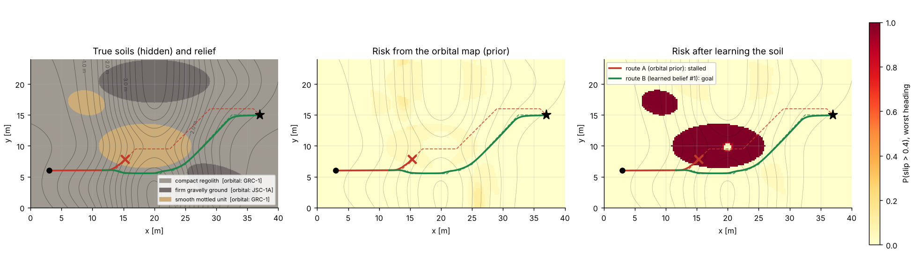
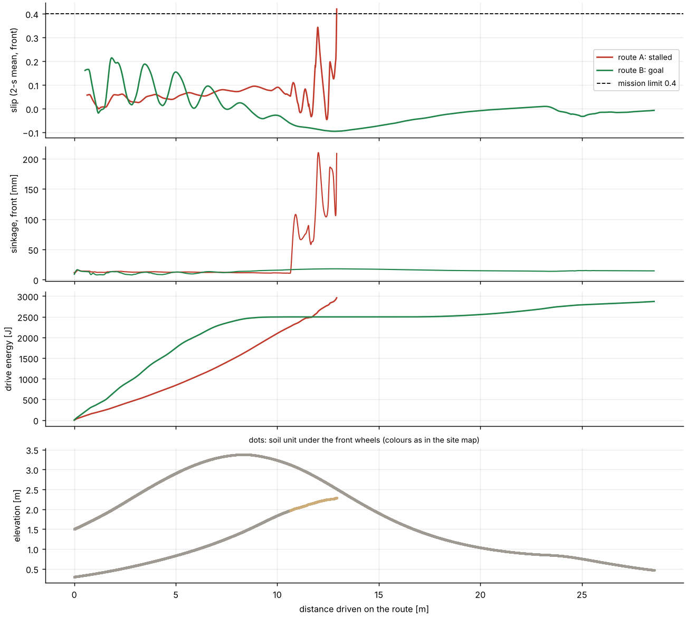
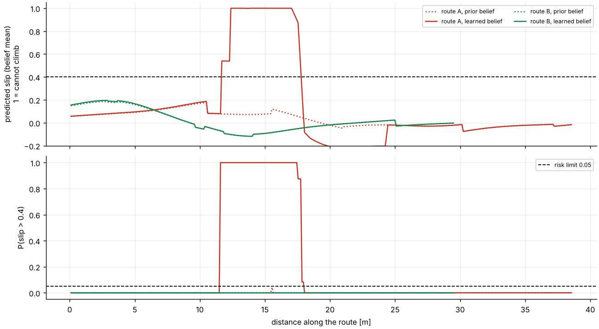
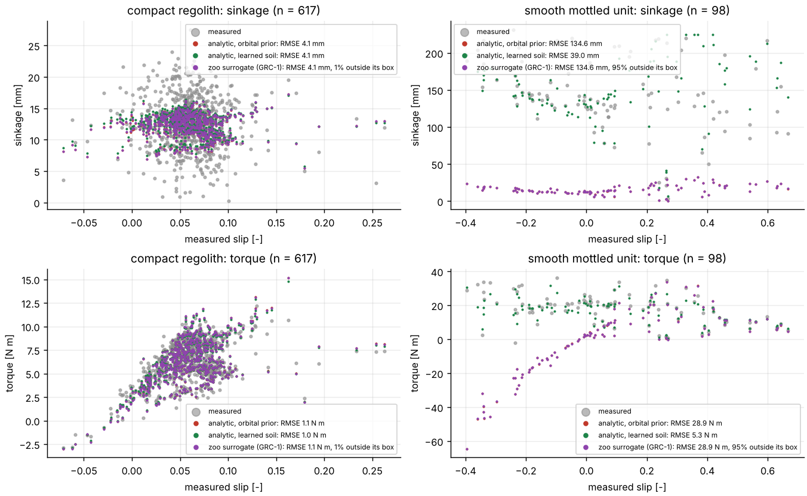
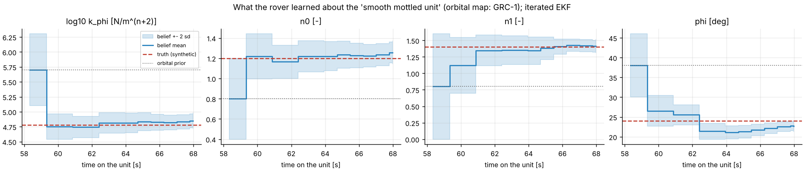

# The rover that learns the planet

Mission: *Leve o rover até (37, 15) sem atolar, escorregamento máximo de 40%, minimizando a energia.*

Parsed by `rules`: goal (37.0, 15.0), start (3.0, 6.0), slip limit 0.4, risk limit 0.05, objective energy, speed 0.2 m/s (defaults: start = site start, risk_max = 0.05 (default), speed = 0.2 (default)).

Rover: NASA VIPER (parametric, public figures), 450 kg, 4 wheels R = 0.25 m. Site: synthetic, truth known (soils listed in `summary.json`).

All numbers below were measured in this run (multibody simulation on the true terrain, or the planner's prediction where marked).

## Routes

| Route | Planned with | Predicted max risk (then) | Predicted max risk (learned) | Measured outcome | Distance [m] | Drive energy [J] | Max 2-s slip | Max sinkage [mm] |
|---|---|---|---|---|---|---|---|---|
| A | orbital prior | 0.042 | 1.000 | stalled: mean slip 0.42 over 2 s > limit 0.4 | 12.9 | 2958 | 0.42 | 319 |
| B | learned belief #1 | 0.000 | 0.000 | goal | 28.6 | 2869 | 0.21 | 31 |

After the stall the rover backs out on its own ruts to (11.63, 6.06) (the reversal is not simulated) and drives route B from there.

## Why the new route reduces the risk of getting stuck

* Under the learned belief, route A has a largest risk of 1.00 over 6.5 m above the risk limit; route B 0.000 (0.0 m above it).
* Predicted largest slip (learned belief mean, 1 = cannot climb): A 1.00, B 0.20; measured: A 0.42 (stalled), B 0.21.
* The stall unit was 'smooth mottled unit': the orbital map called it compact regolith; the rover's measurements say otherwise (table below), so every slope of that unit steeper than it can climb is now avoided.

## What the rover learned (known truth of the synthetic site)

| Parameter | Truth | Orbital prior | Learned | Posterior sd | Error / sd |
|---|---|---|---|---|---|
| log10_k_phi | 4.778 | 5.703 | 4.850 | 0.064 | +1.14 |
| n0 | 1.200 | 0.800 | 1.257 | 0.056 | +1.02 |
| n1 | 1.400 | 0.800 | 1.415 | 0.050 | +0.29 |
| phi_deg | 24.000 | 38.000 | 22.686 | 0.663 | -1.98 |

Held-out check (25 measurements not used by the filter): sinkage RMSE 5.4 mm, torque RMSE 1.86 N m.

## Wheel-soil models against the measurements

| Unit | Model | Sinkage RMSE [mm] | Torque RMSE [N m] | Outside validity box |
|---|---|---|---|---|
| compact regolith (n=617) | analytic_prior | 4.1 | 1.07 | - |
| compact regolith (n=617) | analytic_learned | 4.1 | 1.04 | - |
| compact regolith (n=617) | surrogate_zoo | 4.1 | 1.07 | 1% |
| smooth mottled unit (n=98) | analytic_prior | 134.6 | 28.92 | - |
| smooth mottled unit (n=98) | analytic_learned | 39.0 | 5.35 | - |
| smooth mottled unit (n=98) | surrogate_zoo | 134.6 | 28.91 | 95% |

Surrogate: rover_contact_grc1_viper v1.1.0.

## Trust report

**Decision: REVIEW** (score 0.92, coverage 100%)

| Check | Status | Value | Limit | Source |
|---|---|---|---|---|
| goal_reached | supports | 1 | 1 | multibody run of the final route |
| slip_within_limit | supports | 0.215 | 0.4 | 2-s mean front-wheel slip after the 2-s start-up, final run |
| energy_covers_climb | supports | 2.87e+03 | 1.36e+03 | drive energy (sum of max(tau omega, 0)) vs m g x total climb of the final run (no regeneration; kinetic energy at 0.2 m/s is negligible) |
| time_step_converged | supports | 0.00617 | 0.05 | first seconds of the final route at dt = 0.004 s and dt/2 |
| planner_vs_multibody_energy | supports | 0.131 | 0.25 | quasi-static planner (learned belief) vs multibody, final route |
| planner_vs_multibody_slip | contradicts | 0.0541 | 0.05 | RMS of predicted slip - 2-s mean front-wheel slip along the final route |
| replanned_route_risk | supports | 0 | 0.05 | share of belief samples that exceed the slip limit |
| failed_route_risk_learned | supports | 1 | 0.05 | first route re-evaluated with the learned belief |
| learned_soil_predictive | supports | 0.0355 | 0.2 | held-out last quarter of the stall unit's measurements |
| learned_soil_calibrated | supports | 1.98 | 3 | known truth of the synthetic site: max |error| / posterior sd |
| learned_soil_closer_to_truth | supports | - | - | known truth: |error| vs prior's |
| models_used_in_validity | supports | - | - | planner uses the analytic Wong-Reece law; zoo surrogate only compared |

## Agent log

| Stage | Tool | Seconds |
|---|---|---|
| mission | parse | 0.0 |
| plan | agent | 0.0 |
| build | survey_site | 0.0 |
| plan | plan_route | 22.5 |
| simulate | drive | 99.5 |
| learn | estimate_soil | 20.7 |
| learn | compare_models | 4.2 |
| optimize | plan_route | 22.3 |
| simulate | drive | 192.1 |
| verify | verify | 27.5 |

## Run

date_utc: 2026-10-24 10:02:04, python: 3.13.17, numpy: 2.5.3, scipy: 1.18.1, platform: Linux-6.18.44-fc-v153-x86_64-with-glibc2.39, processor: x86_64, cpu_count: 4, torch: 2.14.1+cu130, blender: 5.1.2, cpu: Intel(R) Xeon(R) Processor @ 2.10GHz

## Figures

