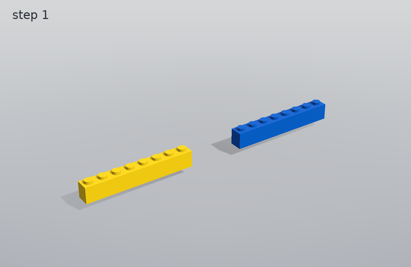
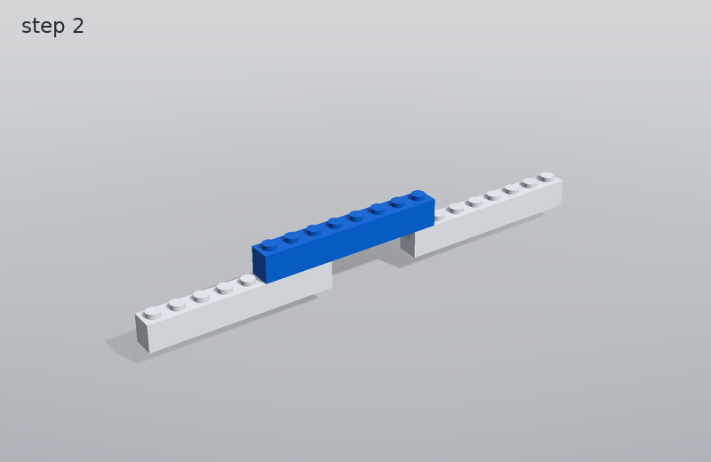

# Best bridge: building instructions

3 parts, 2 steps, 19.2 mm tall, 9.1 g.

## Part list

| part | colour | count |
|---|---|---|
| brick_1x8 | blue | 2 |
| brick_1x8 | yellow | 1 |

## Steps

### Step 1

Add: 1 x brick_1x8 (yellow), 1 x brick_1x8 (blue)

### Step 2

Add: 1 x brick_1x8 (blue)

The same steps as an LDraw file: [build.ldr](build.ldr) (opens in LDraw-compatible editors).
