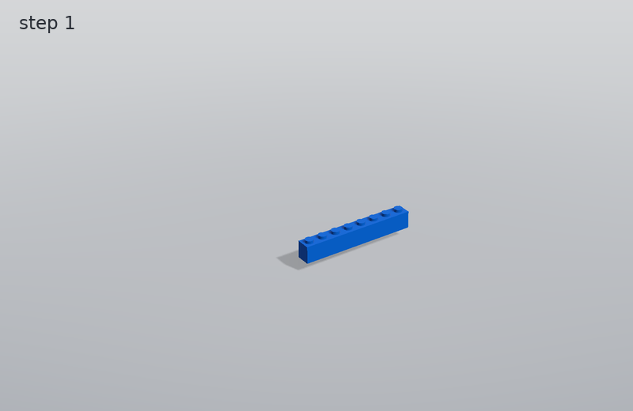
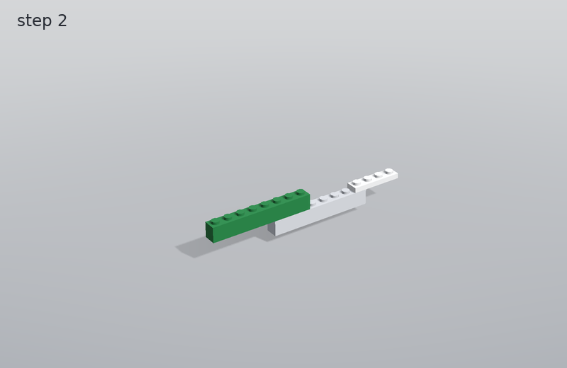
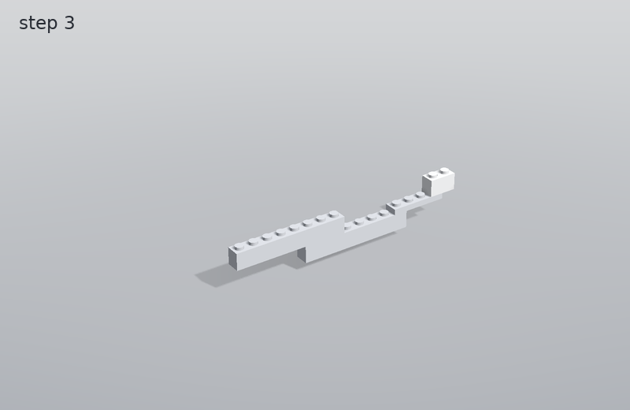
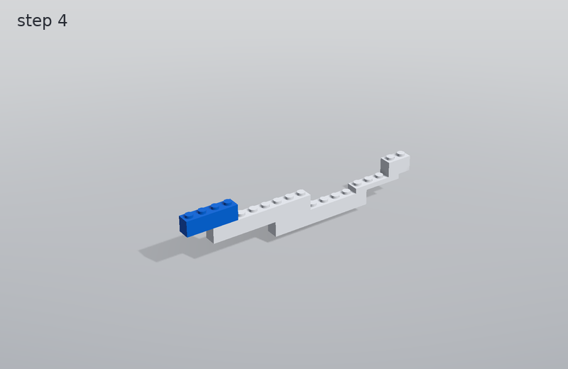
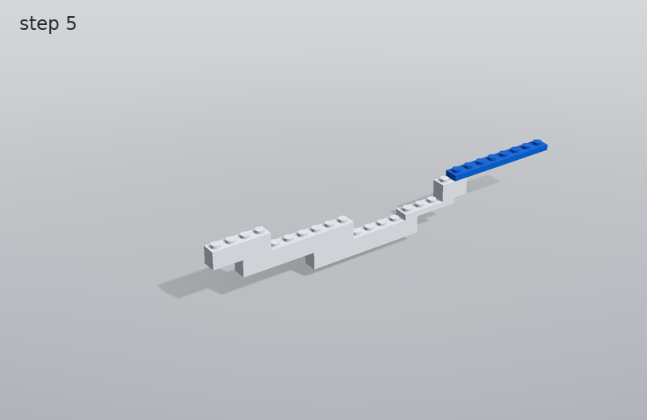
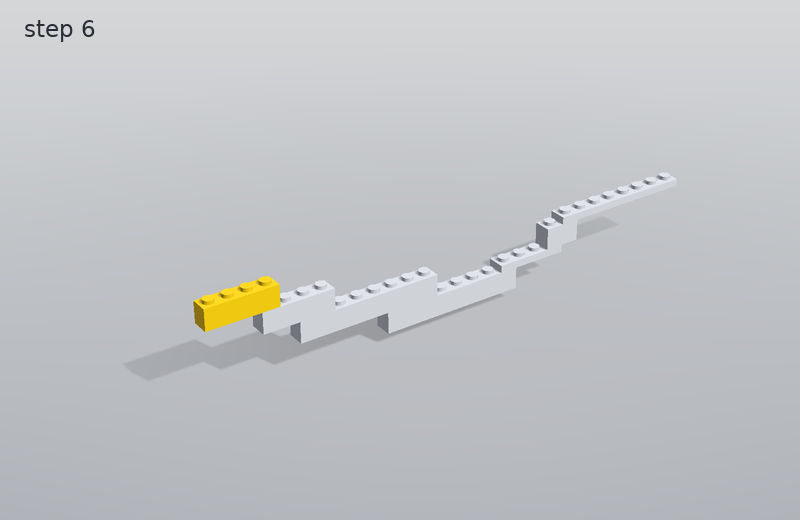
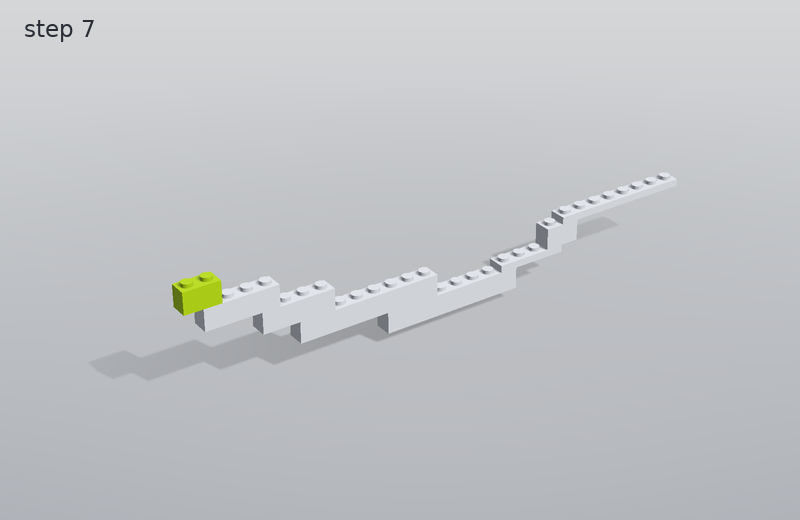

# Best cantilever: building instructions

8 parts, 7 steps, 48.0 mm tall, 13.3 g.

## Part list

| part | colour | count |
|---|---|---|
| brick_1x2 | lime | 1 |
| brick_1x2 | white | 1 |
| brick_1x4 | blue | 1 |
| brick_1x4 | yellow | 1 |
| brick_1x8 | blue | 1 |
| brick_1x8 | green | 1 |
| plate_1x4 | white | 1 |
| plate_1x8 | blue | 1 |

## Steps

### Step 1

Add: 1 x brick_1x8 (blue)

### Step 2

Add: 1 x brick_1x8 (green), 1 x plate_1x4 (white)

### Step 3

Add: 1 x brick_1x2 (white)

### Step 4

Add: 1 x brick_1x4 (blue)

### Step 5

Add: 1 x plate_1x8 (blue)

### Step 6

Add: 1 x brick_1x4 (yellow)

### Step 7

Add: 1 x brick_1x2 (lime)

The same steps as an LDraw file: [build.ldr](build.ldr) (opens in LDraw-compatible editors).
