# Best tower: building instructions

16 parts, 16 steps, 153.6 mm tall, 16.1 g.

## Part list

| part | colour | count |
|---|---|---|
| brick_1x1 | blue | 1 |
| brick_1x1 | green | 1 |
| brick_1x1 | orange | 2 |
| brick_1x1 | white | 1 |
| brick_1x2 | blue | 2 |
| brick_1x2 | lime | 1 |
| brick_1x2 | orange | 1 |
| brick_1x2 | yellow | 1 |
| brick_2x2 | green | 1 |
| brick_2x2 | lime | 1 |
| brick_2x2 | orange | 1 |
| brick_2x4 | blue | 1 |
| brick_2x4 | white | 1 |
| brick_2x4 | yellow | 1 |

## Steps

### Step 1

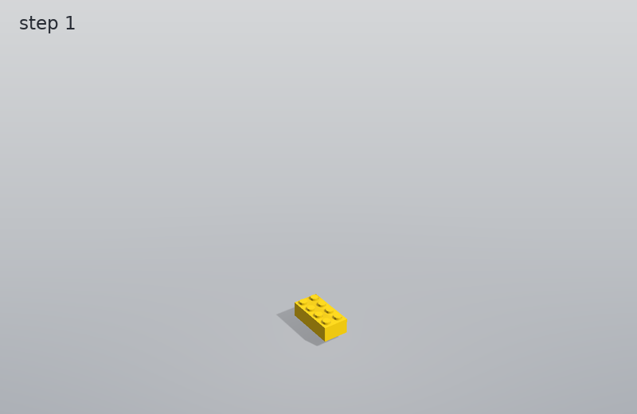

Add: 1 x brick_2x4 (yellow)

### Step 2

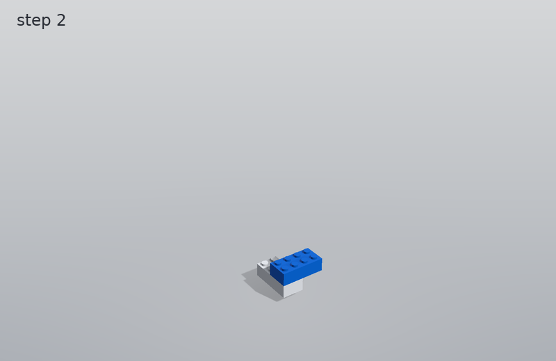

Add: 1 x brick_2x4 (blue)

### Step 3

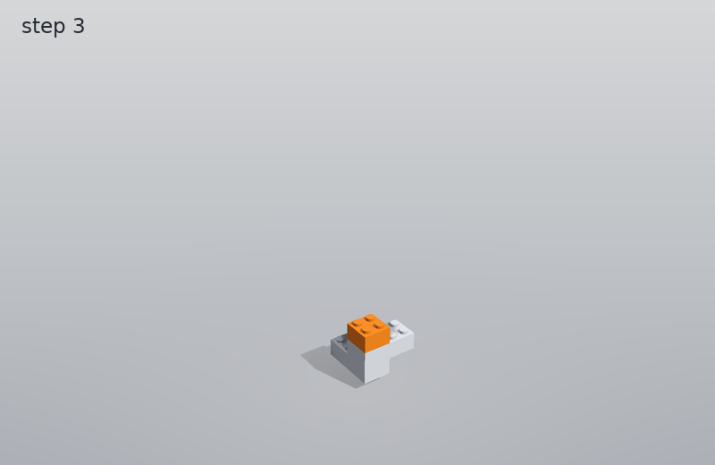

Add: 1 x brick_2x2 (orange)

### Step 4

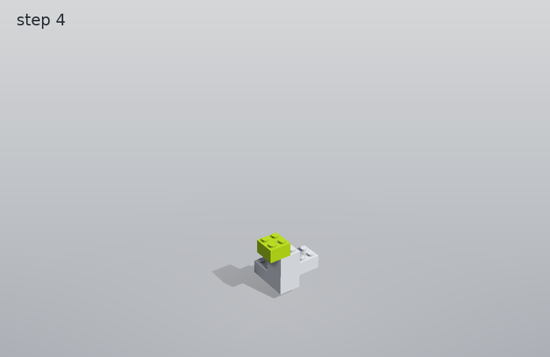

Add: 1 x brick_2x2 (lime)

### Step 5

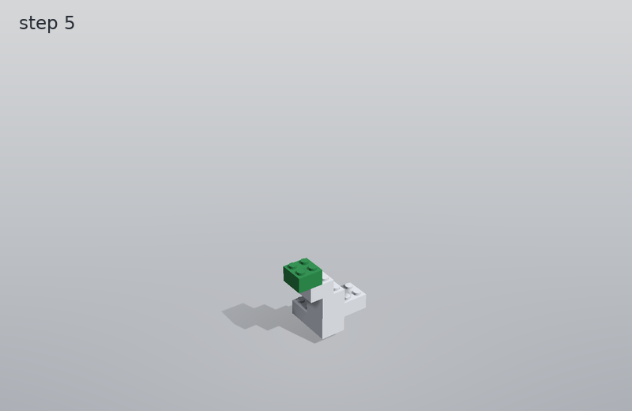

Add: 1 x brick_2x2 (green)

### Step 6

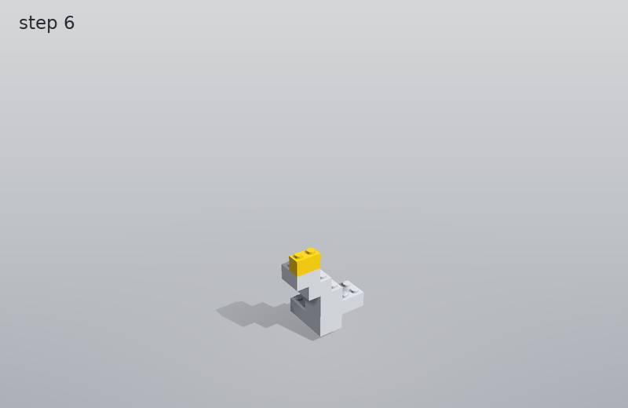

Add: 1 x brick_1x2 (yellow)

### Step 7

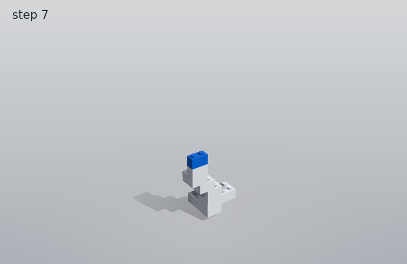

Add: 1 x brick_1x2 (blue)

### Step 8

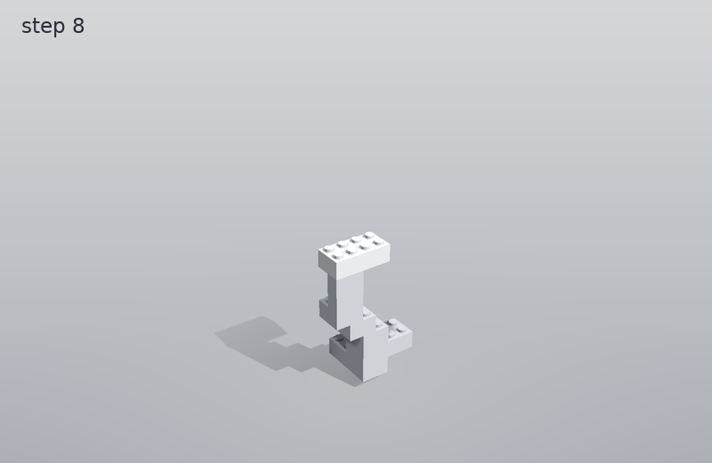

Add: 1 x brick_2x4 (white)

### Step 9

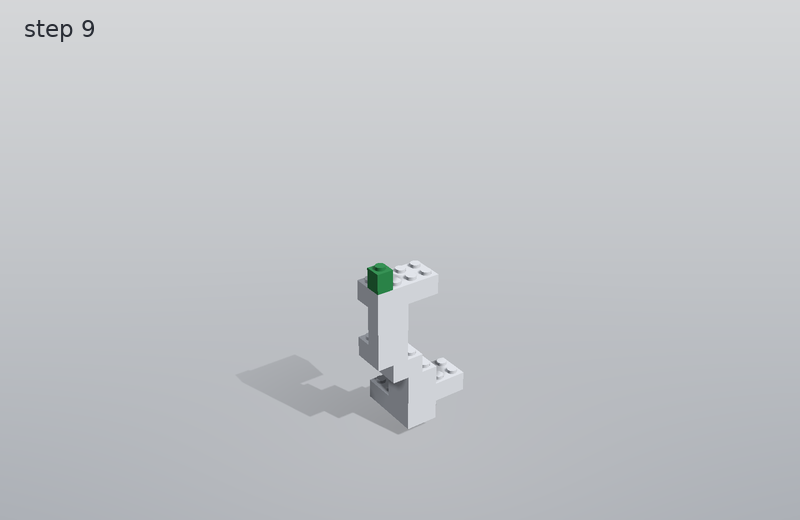

Add: 1 x brick_1x1 (green)

### Step 10

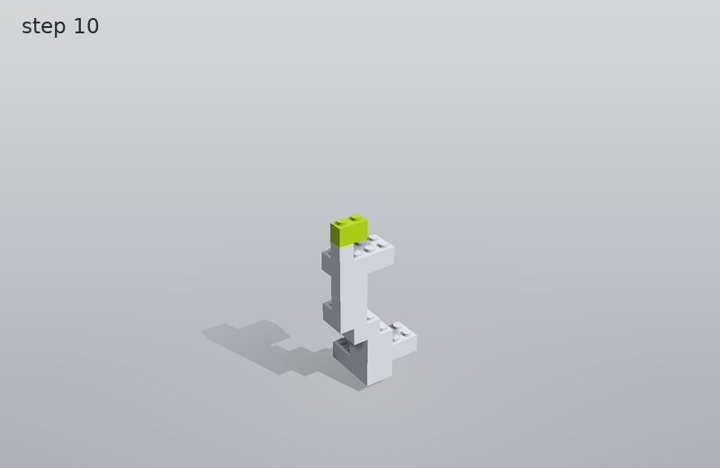

Add: 1 x brick_1x2 (lime)

### Step 11

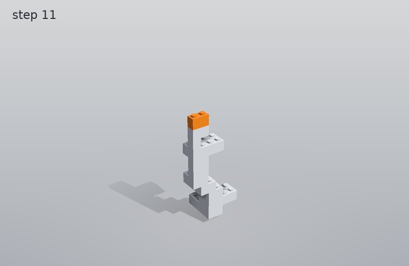

Add: 1 x brick_1x2 (orange)

### Step 12

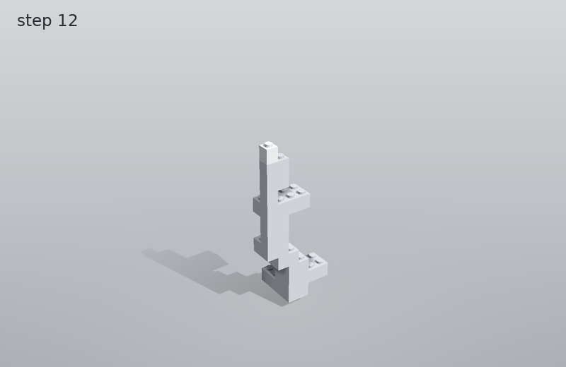

Add: 1 x brick_1x1 (white)

### Step 13

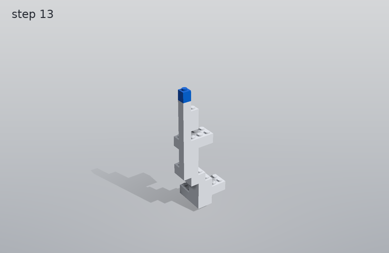

Add: 1 x brick_1x1 (blue)

### Step 14

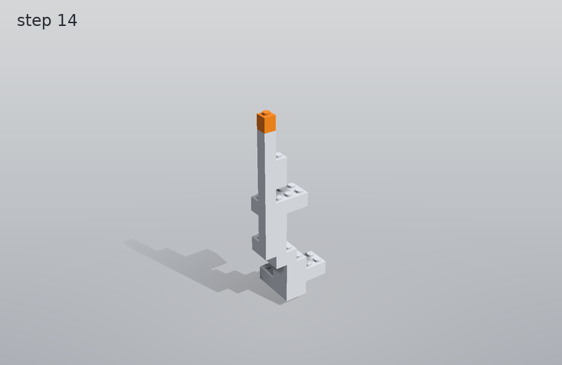

Add: 1 x brick_1x1 (orange)

### Step 15

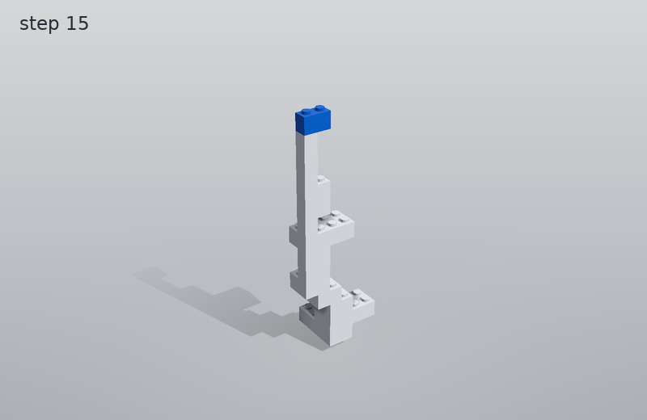

Add: 1 x brick_1x2 (blue)

### Step 16

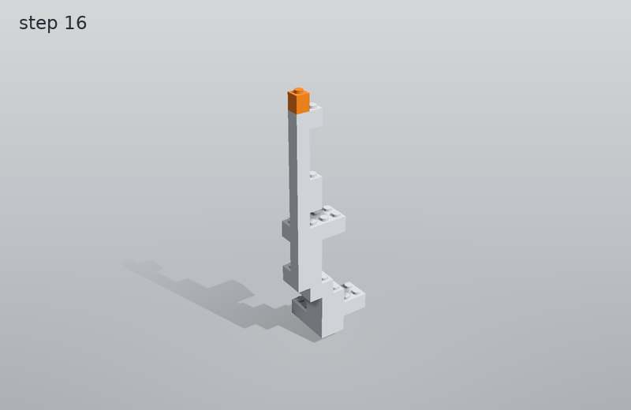

Add: 1 x brick_1x1 (orange)

The same steps as an LDraw file: [build.ldr](build.ldr) (opens in LDraw-compatible editors).
