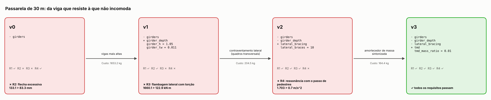
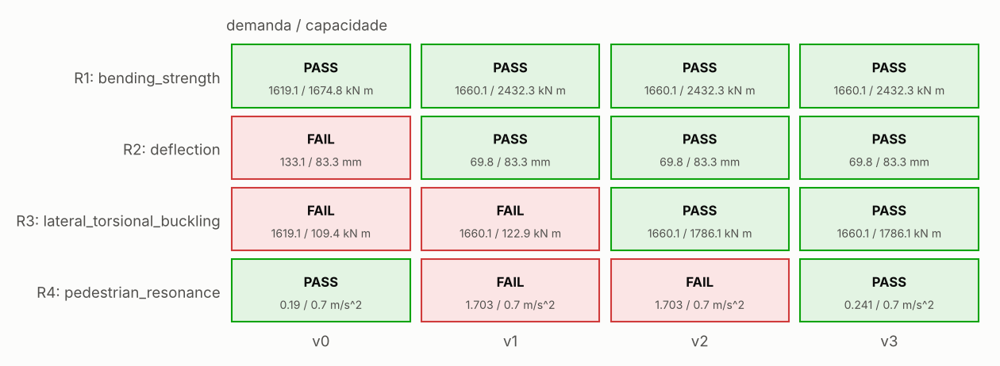
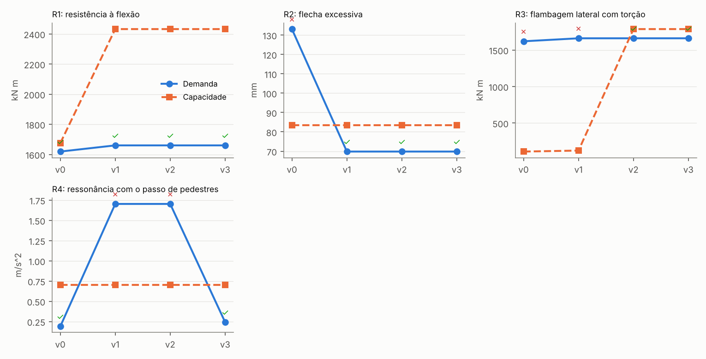
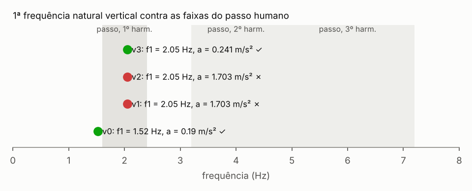

# Passarela de 30 m: da viga que resiste à que não incomoda

**Status:** resolvido · **Decisão:** APPROVED · 3 passos · 24 avaliações físicas

## Requisitos

- **R1** — resistir à multidão com segurança (ELU) (`bending_strength`)
- **R2** — não flechar a ponto de assustar (ELS) (`deflection`)
- **R3** — não flambar de lado (`lateral_torsional_buckling`)
- **R4** — não vibrar de forma desconfortável (`pedestrian_resonance`)

## Linha do tempo: versão 0 → versão N, e por quê

### Versão 0 — girders

**✗ R2 falha: flecha excessiva.** Sob a multidão (4 kN/m²) cada viga flecha 133 mm, mais que L/360 = 83.3 mm: a passarela resiste, mas balança e assusta quem passa — a rigidez (E·I), não a resistência, governa.

*Prova:* flecha sob carga de pedestres = 133.1 mm > limite L/360 = 83.3 mm — Euler-Bernoulli 5 q L^4 / (384 E I), checked by a finite-difference solve of E I w'''' = q.

Opções testadas:

| | Resolve | Margem | Custo | Mudanças |
|---|---|---|---|---|
| **→** deepen_girders | sim | -0.597 → 0.162 | 1653.2 kg × 1 = 1653.2 | girder_h = 1.05, girder_tw = 0.011 |

**Escolhida: vigas mais altas.** I cresce com o cubo da altura: menos flecha e frequência natural mais alta (f ∝ √(EI/m)). *Por quê:* resolve a falha (mas quebra R4/pedestrian_resonance, tratado no passo seguinte).

### Versão 1 — girders, girder_depth

**✗ R3 falha: flambagem lateral com torção.** A mesa comprimida, travada só a cada 30 m, tende a sair do plano e torcer: momento crítico elástico 146 kN·m, esbeltez λ_LT = 4.08, fator χ_LT = 0.0505 (curva d); resistência à flambagem lateral 123 kN·m contra 1.66e+03 kN·m de cálculo — a viga alta e estreita que resolveu a flecha flamba de lado antes de escoar.

*Prova:* momento de cálculo = 1660.1 kN m > resistência à flambagem lateral = 122.9 kN m — EN 1993-1-1 6.3.2.2 general case with the elastic critical moment of Timoshenko & Gere (C1 given, load at the shear centre).

Opções testadas:

| | Resolve | Margem | Custo | Mudanças |
|---|---|---|---|---|
| **→** lateral_bracing | sim | -12.5 → 0.071 | 204.5 kg × 1.5 = 306.7 | lateral_braces = 10 |
|  wider_flanges | sim | -12.5 → 0.077 | 1.56e+04 kg × 1 = 1.56e+04 | girder_b = 0.7, girder_tf = 0.031 |

**Escolhida: contraventamento lateral (quadros transversais).** trava a mesa comprimida: o comprimento destravado cai e o momento crítico sobe com 1/L². *Por quê:* resolve a falha sem quebrar nenhum requisito que passava; entre 2 opções que resolvem, é a de menor custo (307, 3 verificações passando; contra wider_flanges: 4 passando, custo 1.56e+04).

### Versão 2 — girders, girder_depth, lateral_bracing

**✗ R4 falha: ressonância com o passo de pedestres.** Frequência natural vertical 2.05 Hz dentro da faixa do 1º harmônico do passo (1.6-2.4 Hz): um pedestre a 2.05 Hz entra em ressonância; com amortecimento de 0.5 % e massa modal 16.4 t a aceleração chega a 1.7 m/s², acima de 0.7 m/s² de conforto.

*Prova:* aceleração vertical de pico = 1.703 m/s^2 > limite de conforto = 0.7 m/s^2 — first vertical mode of a simply supported beam, steady resonant response to one walking pedestrian (harmonics 1-3); tuned mass damper as Den Hartog's optimum amplification.

Opções testadas:

| | Resolve | Margem | Custo | Mudanças |
|---|---|---|---|---|
| **→** tuned_mass_damper | sim | -1.433 → 0.655 | 164.4 kg × 3 = 493.3 | tmd_mass_ratio = 0.01 |
|  deepen_girders | sim | -1.433 → 0.685 | 1606.1 kg × 1 = 1606.1 | girder_h = 1.25, girder_tw = 0.012 |

**Escolhida: amortecedor de massa sintonizada.** uma massa pequena sintonizada no 1º modo absorve a energia na ressonância: amplificação limitada a √(1 + 2/μ) (Den Hartog). *Por quê:* resolve a falha sem quebrar nenhum requisito que passava; entre 2 opções que resolvem, é a de menor custo (493, 4 verificações passando; contra deepen_girders: 4 passando, custo 1.61e+03).

### Versão 3 — girders, girder_depth, lateral_bracing, tmd

✓ todos os requisitos passam.

## Verificações da versão final

| Verificação | Demanda | Capacidade | Margem | Método |
|---|---|---|---|---|
| ✓ R1/bending_strength | 1660.1 kN m | 2432.3 kN m | 0.317 | simply supported girder, M = w L^2/8, M_Rd = W_el f_y / gamma_M0 |
| ✓ R2/deflection | 69.8 mm | 83.3 mm | 0.162 | Euler-Bernoulli 5 q L^4 / (384 E I), checked by a finite-difference solve of E I w'''' = q |
| ✓ R3/lateral_torsional_buckling | 1660.1 kN m | 1786.1 kN m | 0.071 | EN 1993-1-1 6.3.2.2 general case with the elastic critical moment of Timoshenko & Gere (C1 given, load at the shear centre) |
| ✓ R4/pedestrian_resonance | 0.241 m/s^2 | 0.7 m/s^2 | 0.655 | first vertical mode of a simply supported beam, steady resonant response to one walking pedestrian (harmonics 1-3); tuned mass damper as Den Hartog's optimum amplification |

### Números medidos

- **bending_strength**: design moment per girder = 1.66e+06 N m; elastic moment resistance = 2.43e+06 N m; footbridge crowd load (EN 1991-2) = 4000.0 Pa; elastic section modulus = 0.00685 m^3
- **deflection**: mid-span deflection (live load) = 0.07 m; second moment of area per girder = 0.0036 m^4; live load per girder = 5000.0 N/m
- **lateral_torsional_buckling**: elastic critical moment = 7.63e+06 N m; non-dimensional slenderness = 0.565 1; reduction factor = 0.734 1; unbraced length = 2.727 m; buckling resistance moment = 1.79e+06 N m
- **pedestrian_resonance**: first vertical natural frequency = 2.049 Hz; modal mass m L/2 = 1.64e+04 kg; peak vertical acceleration = 0.241 m/s^2; governing pacing frequency = 1.981 Hz

## Figuras

## Premissas e parâmetros da versão final

| Parâmetro | Valor | Fonte |
|---|---|---|
| `brace_mass_per_m` | 3.77 | premise: L50x50x5 angle |
| `damping_ratio` | 0.005 | premise: welded steel footbridge |
| `deck_dead_load` | 3000.0 | premise: 100 mm precast concrete planks (25 kN/m3, EN 1991-1-1 Table A.1) + 0.5 kN/m2 finishes, on cross-beams |
| `deck_width` | 2.5 | premise |
| `design_margin` | 0.05 | premise |
| `fy` | 3.55e+08 | EN 10025-2 S355, t <= 16 mm (premise grade) |
| `girder_b` | 0.25 | premise |
| `girder_h` | 1.05 | countermeasure:deepen_girders |
| `girder_tf` | 0.02 | premise |
| `girder_tw` | 0.011 | countermeasure:deepen_girders |
| `lateral_braces` | 10 | countermeasure:lateral_bracing |
| `n_girders` | 2 | premise |
| `pedestrian_weight` | 700.0 | Bachmann & Ammann (1987) |
| `section_type` | welded | premise |
| `span` | 30.0 | premise |
| `tmd_mass_ratio` | 0.01 | countermeasure:tuned_mass_damper |

## Confiança

**Decisão:** APPROVED · score 1 · 16 checks

| Verificação | status | Valor | limit | Fonte |
|---|---|---|---|---|
| inputs recorded and finite | supports | 16.0 | — | concept parameters with their sources |
| R1/bending_strength | supports | 1660.1 | 2432.3 | simply supported girder, M = w L^2/8, M_Rd = W_el f_y / gamma_M0 |
| R2/deflection | supports | 69.8 | 83.3 | Euler-Bernoulli 5 q L^4 / (384 E I), checked by a finite-difference solve of E I w'''' = q |
| solver vs closed form: FD beam deflection | supports | 5.07e-06 | 0.01 | pinneapple_simulation.numerical_solvers.beam_bvp_fdm.solve_euler_bernoulli_beam_1d (4th-or |
| equilibrium: FD support reactions = applied load | supports | 0.0075 | 0.01 | pinneapple_simulation.numerical_solvers.beam_bvp_fdm.solve_euler_bernoulli_beam_1d (4th-or |
| R3/lateral_torsional_buckling | supports | 1660.1 | 1786.1 | EN 1993-1-1 6.3.2.2 general case with the elastic critical moment of Timoshenko & Gere (C1 |
| R4/pedestrian_resonance | supports | 0.241 | 0.7 | first vertical mode of a simply supported beam, steady resonant response to one walking pe |
| solver vs closed form: Rayleigh frequency from FD deflection | supports | 0.00071 | 0.005 | pinneapple_simulation.numerical_solvers.beam_bvp_fdm.solve_euler_bernoulli_beam_1d (4th-or |
| applicability: pedestrian_resonance: first mode below 5 Hz (EN 1990 A2.4.3.2 asks for the check) | supports | 2.049 | 1e+09 |  |
| known answer: deflection.deflection | supports | 0 | 1e-12 | 5 q L^4/(384 E I) (Timoshenko, Strength of Materials) |
| known answer: lateral_torsional_buckling.M_cr | supports | 0 | 1e-12 | M_cr formula, Timoshenko & Gere (1961), ch. 6, with C1 = 1 |
| known answer: pedestrian_resonance.f1 | supports | 0 | 1e-12 | f1 = pi/(2 L^2) sqrt(EI/m) (simply supported beam) |
| uncertainty: R1/bending_strength worst margin (fy -5 %) | supports | 0.282 | 0 | one-at-a-time spread of the mode's uncertain premises |
| uncertainty: R2/deflection worst margin (nominal) | supports | 0.162 | 0 | one-at-a-time spread of the mode's uncertain premises |
| uncertainty: R3/lateral_torsional_buckling worst margin (fy -5 %) | supports | 0.035 | 0 | one-at-a-time spread of the mode's uncertain premises |
| uncertainty: R4/pedestrian_resonance worst margin (deck_dead_load -10 %) | supports | 0.629 | 0 | one-at-a-time spread of the mode's uncertain premises |

### Cartão de confiança (6 etapas)

| Etapa | status | Evidência | Próximo passo |
|---|---|---|---|
| Data and geometry | answered | inputs recorded: v0, v1, v2, v3 PASS inputs recorded and finite (concept parameters with their sources) |  |
| Model | answered | PASS known answer: deflection.deflection (5 q L^4/(384 E I) (Timoshenko, Strength of Materials)) PASS known answer: lateral_torsional_buckling.M_cr (M_cr formula, Timoshenko & Gere (1961), ch. 6, with C1 = 1) PASS known answer: pedestrian_resonance.f1 (f1 = pi/(2 L^2) sqrt(EI/m) (simply supported beam)) |  |
| Physical constraints | answered | PASS equilibrium: FD support reactions = applied load (pinneapple_simulation.numerical_solvers.beam_bvp_fdm.solve_euler_bernoulli_beam_1d (4th-or) |  |
| Benchmark | answered | PASS solver vs closed form: FD beam deflection (pinneapple_simulation.numerical_solvers.beam_bvp_fdm.solve_euler_bernoulli_beam_1d (4th-or) PASS solver vs closed form: Rayleigh frequency from FD deflection (pinneapple_simulation.numerical_solvers.beam_bvp_fdm.solve_euler_bernoulli_beam_1d (4th-or) |  |
| Uncertainty | answered | PASS applicability: pedestrian_resonance: first mode below 5 Hz (EN 1990 A2.4.3.2 asks for the check) PASS uncertainty: R1/bending_strength worst margin (fy -5 %) (one-at-a-time spread of the mode's uncertain premises) PASS uncertainty: R2/deflection worst margin (nominal) (one-at-a-time spread of the mode's uncertain premises) |  |
| Engineering decision | answered | tier B (solid), ready for design screening 5 limitations bound the use |  |

## Hipóteses

- C1 = 1 (momento uniforme: conservador para carga distribuída)
- amortecimento estrutural 0.5 % (premissa)
- o tabuleiro não trava a mesa comprimida
- seção classe 3 ou melhor (resistência elástica)
- um pedestre em regime permanente no meio do vão (limite superior)

## Fontes

- AASHTO LRFD Guide Specifications for the Design of Pedestrian Bridges (2009), sec. 5: deflection under pedestrian live load <= span/360
- Bachmann & Ammann (1987), Vibrations in Structures Induced by Man and Machines, IABSE: walking pace 1.6-2.4 Hz, body weight 700 N, dynamic load factors 0.4 / 0.1 / 0.1 for harmonics 1-3
- Den Hartog, Mechanical Vibrations, 4th ed., 1956, sec. 3.3 (optimum vibration absorber)
- EN 1990:2002, Table A1.2(B): gamma_G = 1.35, gamma_Q = 1.5; Annex A2, A2.4.3.2: vertical acceleration of footbridge decks <= 0.7 m/s^2 (recommended)
- EN 1991-2:2003, 5.3.2.1: footbridge crowd load q_fk = 2.0 + 120/(L + 30) kN/m^2, 2.5 <= q_fk <= 5.0
- EN 1993-1-1:2005, Eurocode 3 - Design of steel structures, 3.2.6 (E, G, nu) and 6.3.2 (lateral-torsional buckling, Tables 6.3 and 6.4)
- Timoshenko & Gere, Theory of Elastic Stability, 2nd ed., 1961, ch. 6 (lateral buckling of beams)
- pinneapple_simulation.numerical_solvers.beam_bvp_fdm.solve_euler_bernoulli_beam_1d (4th-order FD)
